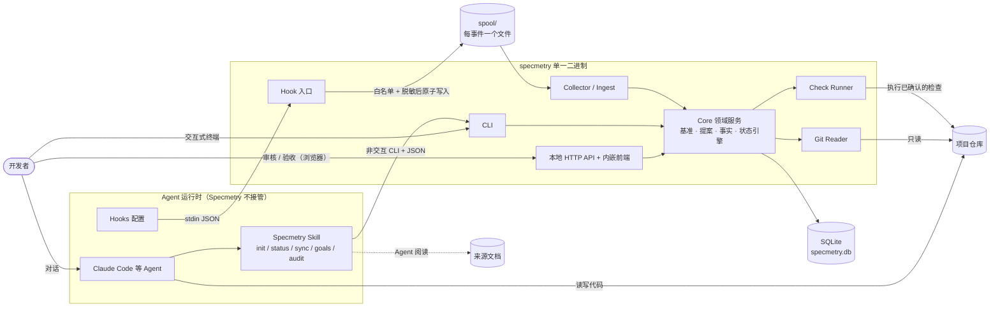
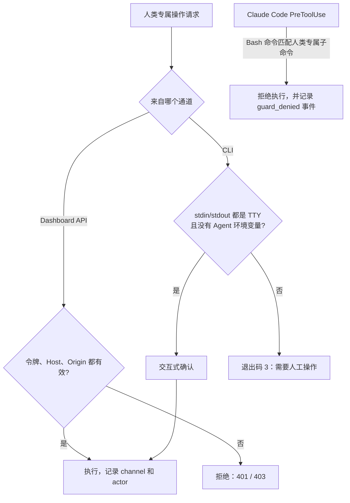
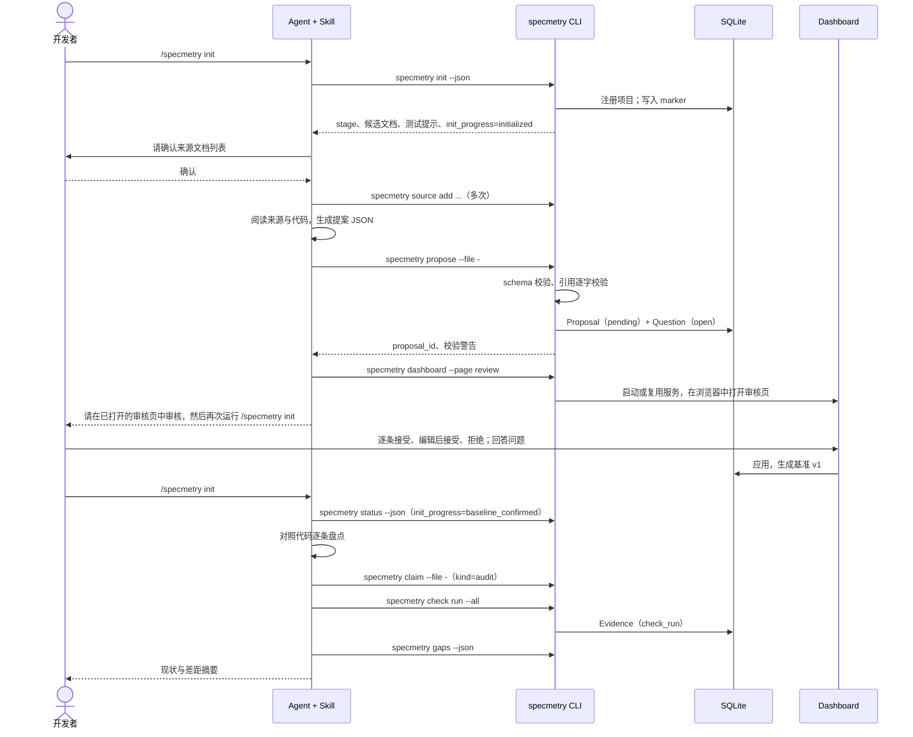
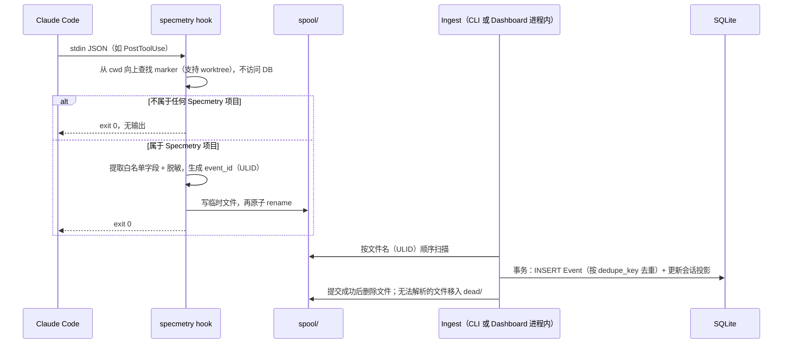

# Specmetry 架构设计

> 状态：Draft v0.1 · 2026-10-13
> 实体与状态规则见 [data-model.md](data-model.md)，范围见 [mvp.md](mvp.md)。本文中的决策状态均为"提议"，需确认后才视为采纳。

## 1. 架构目标与约束

| 目标 / 约束 | 来源 |
|---|---|
| 不接管 Agent：只通过 Skill（Agent 主动调用）和 Hook（被动观察）接入 | 原则 1 |
| 三层事实严格区分，并由不同通道产生 | 原则 2 |
| 数据默认留在本地；无账号、无出站网络 | 原则 5、6 |
| Hook 必须快速、可靠，且永远不影响 Agent | 原则 4 |
| 单人本地使用，但为未来的 Hosted 同步留出余地（不实现） | 原则 5 |
| 安装简单、跨平台 | NFR-05、NFR-06 |

## 2. 系统上下文



## 3. 关键设计决策（提议）

| ID | 决策 | 理由 | 代价 |
|---|---|---|---|
| AD-01 | **核心不内置 LLM。** 语义工作（提取、盘点、映射）由用户自己的 Agent 通过 Skill 完成，再以结构化 JSON 写入 Specmetry。 | 无需 API Key、账号和网络；不接管 Agent；代码不离开本机；Specmetry 本体完全确定、可测试 | 提取质量取决于用户的 Agent；Specmetry 无法在没有 Agent 的情况下自动更新语义 |
| AD-02 | **单一 Go 二进制**，同时提供 CLI、Hook 入口、Collector、HTTP 服务和内嵌前端 | 安装和升级简单；Hook 冷启动快；跨平台 | 前端需要 Node 工具链来构建 |
| AD-03 | **没有必需的常驻守护进程。** Hook 只负责写 spool 文件；任何 `specmetry` 进程启动时，以及 Dashboard 运行期间，负责把 spool 入库。 | Hook 不依赖守护进程是否存活；至少投递一次，入库幂等；没有进程管理负担 | Dashboard 未运行时，事件要等到下一次 CLI 调用才入库（不影响正确性） |
| AD-04 | **在 Hook 进程内、落盘之前完成字段白名单和脱敏** | 敏感原文永远不落盘 | 白名单要跟随 Agent 的 Hook 格式维护 |
| AD-05 | **事实只追加，状态由纯函数推导，不作为真相存储** | 可复现、可测试；与写入顺序无关；利于未来同步 | 每次读取都要计算（规模内开销可忽略） |
| AD-06 | **所有基准变更（包括人工编辑）统一走"提案 → 审核 → 基准版本"** | 单一代码路径；历史完整 | 人工小改动多一层封装（在 UI 中透明处理） |
| AD-07 | **只有 Specmetry 自己执行的、经人确认的检查命令，才能产生 `verifies` 证据** | 把"自述"和"证据"区分开 | 没有检查的自动化 AC 无法被验证（显示为 `UNVERIFIABLE` 差距） |
| AD-08 | **人类专属操作有双重防护**：通道识别（TTY 与 Agent 环境变量、Dashboard 令牌）加 PreToolUse 拦截。威胁模型是"防误操作，不防恶意"。 | 同一个 OS 用户下，本地无法做到强隔离 | 恶意 Agent 仍可能绕过（例如直接写数据库），但会留下痕迹 |
| AD-09 | **全局单一 SQLite 数据库**，仓库内只放最小的 marker 文件 | 支持多项目看板；数据不进入客户仓库；只有一个 Collector | 迁移项目需要导出和导入（见 TD-01、TD-02） |
| AD-10 | **Dashboard 只监听回环地址**，使用会话令牌，校验 Host 与 Origin，设置 CSP，不加载外部资源 | 防御本地 Web 服务的常见攻击：DNS rebinding、CSRF | 不能从局域网的其他设备访问（MVP 不需要） |
| AD-11 | **Agent 适配器隔离。** Claude Code 是第一个适配器；没有 Hook 的 Agent 以"CLI + git + 检查"降级工作。 | 不绑定单一 Agent | 降级模式下没有会话活动记录 |

## 4. 组件

| 组件 | 职责 | 不负责 |
|---|---|---|
| **CLI** | 解析命令；识别通道；输出人类可读格式或 `--json`；在每次命令开始时机会性地把 spool 入库 | 业务规则（交给 Core） |
| **Hook 入口**（`specmetry hook <agent> <event>`） | 读取 stdin；不访问数据库、不启动子进程，就能把 cwd 解析为项目；提取白名单字段；脱敏；原子写入 spool；PreToolUse 拦截人类专属命令；总是快速退出 | 入库、推导 |
| **Collector / Ingest** | 按顺序读取 spool；在事务中写入 Event（去重）；更新会话投影；按节流扫描 git 并生成提交证据；处理死信；执行保留期清理 | 解析 Agent 的原始格式（交给适配器） |
| **Agent 适配器**（Claude Code：Go 包 `claudecode`，CLI 参数 `claude-code`，数据中的 agent 标识 `claude_code`） | Hook payload 的字段映射与白名单；拦截规则；`setup` 时生成 Hook 配置并安装 Skill | 通用逻辑 |
| **Core：基准** | 来源登记、引用校验、提案校验、审核、版本、编号分配、冲突检测、Question | — |
| **Core：事实** | 写入 Claim 批次、Evidence（含链接）、Acceptance；校验通道权限 | 状态计算 |
| **Core：状态引擎** | 纯函数：事实 → AC 状态与标记 → 需求状态 → 差距 → 就绪判定 → 指标 | 任何 I/O |
| **Check Runner** | 解析 AC 的检查配置；限制工作目录不越出项目根；选择 shell；超时控制与进程树终止；截取输出尾部；脱敏；计算哈希；记录 HEAD 与工作区状态 | 决定执行哪些命令（由基准决定） |
| **Git Reader** | 封装 `git` CLI：HEAD、工作区状态、增量日志、trailer、worktree 公共目录、提交是否存在 | 写操作（Specmetry 从不写 git） |
| **HTTP API + 前端** | REST JSON、内嵌 SPA、令牌、Host / Origin 校验、CSP、变更通知 | 执行检查（MVP 不提供） |
| **Skill 包** | `SKILL.md` + 参考文档（粒度指南、交换格式说明）。由 `setup` 安装。 | 直接访问数据 |

## 5. 信任边界与操作通道

| 通道 | 识别方式 | 可执行的操作 |
|---|---|---|
| `agent_cli` | 默认值：stdin 或 stdout 不是 TTY，**或**存在已知的 Agent 环境变量（如 Claude Code 在其 shell 中设置的变量，以实现时核实为准） | 见 [prd.md §3.3](prd.md#33-权限矩阵) 中的"Agent"列 |
| `human_cli` | stdin 和 stdout 都是 TTY，没有 Agent 环境变量，并通过交互式确认（逐条确认或输入 AC 编号） | 人类专属操作 |
| `dashboard` | 请求带有有效的会话令牌，Host 在白名单内，写操作的 Origin 是同源 | 审核提案、人工编辑基准、回答问题、验收决定（`setup` 和 `purge` 只能在终端执行） |
| `hook` | 由 `specmetry hook` 进入 | 只写 spool；PreToolUse 拦截 |
| `system` | Specmetry 内部（ingest、check runner、git 扫描） | 产生 Evidence、Event、快照 |

人类专属操作的判定流程：



被拦截的命令包括：`accept`、`reject`、`waive`、`review`、`question answer` / `dismiss`、`purge`、`setup`（含 `--uninstall`），以及 `propose --apply`（人工编辑立即应用）。匹配规则以子命令和参数为准，避免误伤 `status`、`propose`（不带 `--apply`）等命令。

`specmetry dashboard` 不在拦截之列：Agent 可以用它为用户打开审核页。令牌只通过浏览器 URL 的 fragment 传递，不打印到输出（见 §10.4）。

## 6. 关键流程

### 6.1 项目初始化（`in_development` 起始阶段）



`docs_only` 起始阶段跳过"对照代码"一步；`incomplete_docs` 在生成提案时同时阅读代码，产生 `inferred_from_code` 条目。

### 6.2 Hook 采集与入库



### 6.3 `sync`

1. Skill 调用 `specmetry status --json --session current`，获取基准、当前状态和本会话的起始 HEAD（来自 SessionStart 事件；没有 Hook 时退化为上一次 sync 记录的 HEAD）。
2. Agent 根据 `git diff <起始 HEAD>` 和本会话的提交，判断受影响的 AC。
3. `specmetry claim --file -` 提交 `sync` 批次，内容包括 Claim 和未映射工作。
4. `specmetry check run <受影响的 AC>` 产生证据。
5. `specmetry status --json --diff-since <批次开始时间>` 输出状态变化。

### 6.4 检查执行

1. 从基准读取 AC 的检查配置（命令、工作目录、超时、shell）。AC 未确认、已退役或没有检查时报错。
2. 工作目录相对项目根解析，规范化后不得越出项目根。
3. 记录 `git rev-parse HEAD` 和 `git status --porcelain` 是否为空。
4. 启动进程：Unix 上设置独立进程组；Windows 上放入 Job Object。继承用户环境，并额外注入 `SPECMETRY_CHECK=1` 和 `SPECMETRY_AC=<key>`。环境变量的值不记录。
5. 合并 stdout 和 stderr，流式写入 `logs/checks/<evidence-id>.log`，同时计算 sha256 并保留最后 4 KB。
6. 结果判定：退出码 0 为 `pass`；非 0 为 `fail`；超时、找不到命令或无法启动为 `error`（超时会终止整个进程树）。
7. 在一个事务中写入 Evidence（`check_run`）和 EvidenceLink（`verifies`，绑定 AC 当时的 revision）。
8. 多个检查默认串行执行。

### 6.5 验收

1. 人在 Dashboard 的需求详情页（或交互式 `specmetry accept AC-003-1`）作出决定；`rejected` 和 `waived` 必须填写说明。
2. Core 校验通道，读取当前 AC 的 revision、最新的 `verifies` 证据 ID 和 HEAD，写入 Acceptance（只追加，`supersedes` 指向前一个决定）。
3. 状态引擎重新推导，并写入状态快照。

### 6.6 基准变更

提案条目中的 `update` 和 `retire` 都带有 `base_version`。审核时，如果目标条目在 `base_version` 之后已被修改，该条目标记为 `conflict`，UI 展示"提案值、提案时的值、当前值"三方对比。应用时：

- `material` 变更：revision 加 1；
- `editorial` 变更：revision 不变；
- 修改检查命令或工作目录：一律按 `material` 处理。

## 7. 状态推导引擎

- 实现为不依赖 I/O 的纯函数包。输入是一个项目的已确认基准和全部相关事实，输出 AC 状态与标记、需求状态、差距、就绪判定和指标。
- 规则以 [data-model.md §6](data-model.md#6-状态推导) 的决策表为准，**代码与决策表一一对应，并有表驱动测试**。
- 推导在读取时计算，不缓存为真相。写操作完成后，若指标发生变化，写入 `status_snapshots`（同一项目最小间隔 60 秒，验收和基准变更不受间隔限制），用于趋势图。

## 8. 本地文件布局

```text
$SPECMETRY_HOME/                  默认 ~/.specmetry（TD-02）
├── config.toml                   全局配置：显示名、端口、保留期、附加脱敏规则
├── specmetry.db                  SQLite（WAL 模式）
├── spool/                        待入库事件，文件名为 <ulid>.json
│   └── dead/                     无法解析的事件（保留 30 天）
├── logs/
│   ├── specmetry.log             滚动日志
│   └── checks/<evidence-id>.log  检查的完整输出（保留 30 天）
└── backups/                      迁移前的自动备份

<repo>/.specmetry/project.json    {"schema":"specmetry.project/v1","project_id":"01J…","name":"…"}
```

Agent 侧安装位置（TD-03）：

- Skill：用户级 `~/.claude/skills/specmetry/`
- Hooks：用户级 `~/.claude/settings.json`（默认），或项目级 `<repo>/.claude/settings.local.json`

Hook 的项目解析不访问数据库：从 cwd 向上查找 `.specmetry/project.json`。如果遇到的 `.git` 是一个文件（说明处于 worktree 中），就解析出主仓库的工作目录，再在那里查找 marker。

## 9. 接口约定

### 9.1 CLI

- 所有面向 Agent 的命令都支持 `--json`。输出带 `schema` 字段（如 `specmetry.status/v1`）。错误同样以 JSON 输出：`{"error":{"code":"…","message":"…","details":[{"pointer":"/items/3/data/title","problem":"…"}]}}`。
- 输入 JSON 通过 `--file <path>` 或 `--file -`（stdin）传入。
- 退出码：

| 退出码 | 含义 |
|---|---|
| 0 | 成功 |
| 1 | 内部错误 |
| 2 | 输入或校验错误（未写入任何数据） |
| 3 | 需要人工操作（人类专属操作来自非人类通道） |
| 4 | 当前目录不属于已初始化的项目 |
| 10 | `check run` 已完成，但至少有一个检查为 `fail` 或 `error` |

### 9.2 HTTP API（MVP 草案）

前缀为 `/api/v1`。所有请求都需要 `Authorization: Bearer <session-token>`。

| 方法 | 路径 | 用途 |
|---|---|---|
| GET | `/projects` | 项目列表 |
| GET | `/projects/{id}/overview` | 就绪判定、指标、主要差距、最近活动 |
| GET | `/projects/{id}/baseline` | 当前基准树，含状态 |
| GET | `/projects/{id}/baseline/history` | 版本与变更 |
| GET | `/projects/{id}/requirements/{key}` | 需求详情与各 AC 的时间线 |
| GET | `/projects/{id}/gaps` | 差距 |
| GET | `/projects/{id}/proposals?state=pending` | 审核队列 |
| POST | `/projects/{id}/proposals/{pid}/review` | 批量审核决定（接受、编辑、拒绝、`material` / `editorial`） |
| POST | `/projects/{id}/baseline/edits` | 人工编辑（内部生成提案并立即应用） |
| POST | `/projects/{id}/criteria/{key}/decisions` | 验收决定 |
| POST | `/projects/{id}/questions/{key}/answer` | 回答或驳回问题 |
| GET | `/projects/{id}/activity` | 会话、事件、提交 |
| GET | `/projects/{id}/snapshots` | 趋势数据 |
| GET | `/health` | 版本、spool 积压、Hook 状态 |
| GET | `/changes` | 变更通知（SSE 或轮询，见 TD-08） |

**不提供**：设置状态的接口、执行检查的接口、删除证据或验收的接口。

### 9.3 Agent 交换格式

`proposal/v1` 与 `claims/v1` 的结构和校验规则见 [data-model.md §8](data-model.md#8-agent-交换格式)。JSON Schema 文件放在仓库的 `schemas/` 目录，同时内嵌在二进制中，并随 Skill 一起分发。

## 10. 隐私与安全

### 10.1 数据分级

MVP 中所有数据都只在本地。分级是为未来的同步预留的约束。

| 级别 | 内容 | 规则 |
|---|---|---|
| C0 永不采集 | 文件内容、diff、提示词、完整对话、transcript、工具输出正文、环境变量的值 | Hook 白名单直接丢弃；Specmetry 从不读取 transcript 路径 |
| C1 仅本地 | 检查输出尾部与完整日志、命令文本、文件路径、来源文档的路径与引用片段 | 本地持久化前脱敏；未来同步时默认不上传 |
| C2 可同步元数据（未来） | 基准文本、状态、计数、时间戳、Claim 摘要 | 未来如需同步，必须由用户选择开启 |

### 10.2 Hook 采集白名单（Claude Code，初稿，见 TD-12）

| Hook 事件 | 保存的字段 | 明确丢弃的字段 |
|---|---|---|
| SessionStart | session_id、来源类型（startup / resume 等）、时间、HEAD | transcript_path |
| SessionEnd | session_id、结束原因、时间、HEAD | transcript_path |
| PostToolUse（Bash） | session_id、命令文本（脱敏后截断到 512 字符）、成功或失败标记（如果能获得）、时间 | stdout、stderr、tool_response 正文 |
| PostToolUse（Edit / Write / MultiEdit / NotebookEdit） | session_id、工具名、文件路径（相对项目根；项目外的路径只记为 `external`）、时间 | 文件内容、old_string / new_string、diff |
| PreToolUse（Bash） | 只在拦截时记录 `guard_denied` 事件，内容为命中的子命令名 | 其他字段 |
| Stop | session_id、时间 | 最后一条消息 |
| UserPromptSubmit | **不注册** | 提示词 |

### 10.3 脱敏

内置规则包括：私钥块；云厂商访问密钥；常见平台的 token 前缀（GitHub、Slack、主流模型 API 等）；JWT；`Authorization` 头；URL 中的 `user:pass@`；`password`、`secret`、`token`、`api_key` 等形式的赋值。命中的内容替换为 `[REDACTED:<类型>]`。用户可以在 `config.toml` 中追加规则。

脱敏规则有单元测试，并用 canary 测试覆盖。

### 10.4 本地 Web 服务

- 只绑定 `127.0.0.1`。
- 每次启动生成随机会话令牌，通过系统浏览器打开带 fragment 的 URL（`#token=…`）交给浏览器，前端存入 `sessionStorage`。令牌**不打印到 stdout**，只保存在仅当前用户可读的运行时文件中，供再次执行 `specmetry dashboard` 时复用同一服务。无法打开浏览器时：在 `human_cli` 通道中打印带令牌的 URL；在 `agent_cli` 通道中只提示用户到终端执行该命令。
- 校验 Host 头，只允许 `127.0.0.1:<port>` 和 `localhost:<port>`。
- 写操作校验 Origin。
- 响应头：`Content-Security-Policy: default-src 'self'`、`X-Content-Type-Options: nosniff`、`Referrer-Policy: no-referrer`。
- 不启用 CORS。

### 10.5 其他

- Unix 上数据目录权限为 0700。
- Specmetry 对项目仓库的写入仅限于：`.specmetry/project.json`；`.git/info/exclude`（默认写入并在输出中告知，可用 `--no-exclude` 关闭，只影响本地）；以及用户选择项目级安装时、经确认写入的 `.claude/settings.local.json`。它从不修改代码和 git 历史。
- 检查命令只能来自已确认的基准。审核界面会醒目展示命令全文；由 Agent 提议的命令会额外提示风险。

## 11. 性能与可靠性

| 方面 | 设计 |
|---|---|
| Hook 延迟 | 不打开数据库、不启动子进程；只做一次 JSON 解析和一次小文件写入 |
| 写入并发 | SQLite WAL 模式，`busy_timeout` 为 5 秒，每个进程使用单一写连接；Hook 不写数据库，因此没有锁竞争 |
| 至少一次投递 | spool 文件在数据库事务提交后才删除；如果在两步之间崩溃，重新入库会被 `dedupe_key` 去重 |
| 崩溃安全 | spool 先写临时文件再 rename；迁移在事务中执行，执行前先备份 |
| 入库时机 | 每个 CLI 命令开始时（有时间预算，超出部分留给下次）；Dashboard 运行时每 2 秒一次 |
| git 扫描 | 在 ingest、`sync`、`status` 时节流执行（同一项目至少间隔 30 秒），从上次扫描的 HEAD 增量读取 |
| 规模 | 状态推导是 O(事实数) 的单次遍历；关键查询走 `(project_id, target_id, created_at)` 索引 |

## 12. 技术栈选择与取舍

### 12.1 核心语言：Go（建议）

| 选项 | 优点 | 缺点 | 结论 |
|---|---|---|---|
| **Go** | 单一静态二进制，跨平台交叉编译简单；冷启动快，适合 Hook；标准库自带 HTTP 服务；`go:embed` 可以内嵌前端；并发模型简单；贡献者群体大 | 前后端两种语言；纯 Go 的 SQLite 驱动比 C 版本慢一些（在本规模下可忽略） | **采用** |
| Rust | 性能最好，二进制小，类型系统强 | 开发和迭代慢，贡献门槛高，对本项目的 I/O 型负载收益有限 | 不采用 |
| TypeScript（Node / Bun） | 前后端统一语言；与 Agent 生态（npm 分发）贴近 | Node 冷启动不利于 Hook 延迟；需要运行时或打包体积较大的单文件 | 不采用 |
| Python | 生态丰富 | 分发和环境问题严重，冷启动慢 | 不采用 |

### 12.2 存储：SQLite（建议）

| 选项 | 优点 | 缺点 | 结论 |
|---|---|---|---|
| **SQLite（WAL）** | 嵌入式、零配置、单文件，符合 local-first；事务和索引适合状态查询；有 JSON 函数 | 多进程同时写需要处理（已通过 spool 规避）；未来同步需要额外设计（已通过 ULID 和只追加预留） | **采用** |
| 仓库内文件（YAML / Markdown） | 可以 diff、可以评审，随 git 天然共享 | 查询和聚合困难；事件和证据不适合进仓库；与"不污染客户仓库"冲突 | 不作为事实来源；基准可以导出（TD-01） |
| 嵌入式 KV（bbolt、Badger） | 简单、快 | 没有关系查询，需要手写索引 | 不采用 |

SQLite 驱动的选择见 TD-04，建议使用 `modernc.org/sqlite`（纯 Go、免 CGO、交叉编译简单）。

### 12.3 前端：React + TypeScript + Vite（建议）

| 选项 | 优点 | 缺点 | 结论 |
|---|---|---|---|
| **React + TS + Vite**，构建后用 `go:embed` 内嵌 | 生态和组件丰富，贡献者多；审核队列（内联编辑、diff）、时间线、图表这类交互适合 SPA；未来 Hosted 版可以复用 | 需要 Node 工具链来构建；前后端类型需要同步（TD-07） | **采用** |
| Go 模板 + htmx | 只用一种语言，不需要 Node，简单 | 复杂交互（批量审核、三方对比）实现成本高；未来 Hosted 版难以复用 | 备选：如果团队希望去掉 Node 依赖，可以重新评估 |
| Svelte / Vue | 轻量 | 生态与贡献者略少，相对 React 没有决定性优势 | 不采用 |

为降低贡献门槛：Go 侧开发可以使用预构建的前端产物，或用构建标签跳过前端，只有修改前端时才需要 Node。

### 12.4 交付形态：本地 Web（建议）

本地 Web 不需要额外运行时，天然跨平台，也与未来的 Hosted 版一致。桌面应用（Tauri、Electron）需要打包和签名，体积大；TUI 不适合审核和时间线这类信息密集的界面。两者都不采用。

## 13. 面向 Hosted 的预留（不实现）

- 所有主键使用 ULID，全局唯一，可以合并。
- 所有表都带 `project_id`，删除和同步都以项目为单位。
- 事实类表只追加，便于增量同步。
- `actor` 字段使用带前缀的字符串（如 `human:<显示名>`），未来可以映射到账号。
- Core 与 HTTP API 之间是清晰的服务接口，未来可以替换为远程实现。
- §10.1 的数据分级是未来同步的默认规则。

## 14. 测试策略

| 层次 | 内容 |
|---|---|
| 单元 | 状态引擎决策表（表驱动，规则逐条覆盖）；性质测试（插入顺序不影响结果）；脱敏规则；校验规则 |
| 存储 | 迁移测试；只追加约束 |
| CLI 黄金测试 | `--json` 输出与 golden 文件比对；退出码 |
| Hook | 录制的 Claude Code payload fixture；延迟基准测试；canary 测试（埋入的敏感字符串不得出现在数据库、spool 和日志中） |
| E2E | 三类 fixture 项目加上录制的 Agent 输出（确定性回放），在临时的 `SPECMETRY_HOME` 中运行完整流程，三平台 CI |
| 前端 | 组件测试；对内嵌服务和种子数据库做 Playwright 冒烟测试（包括断言没有外部请求） |
| Skill 评测 | 在真实 Agent 上运行 fixture，按 PD-15 的阈值人工或半自动评分；不作为 CI 的硬性门槛 |
| Dogfooding | 从 M4 起，用 Specmetry 跟踪自身开发，基准由 [acceptance-criteria.md](acceptance-criteria.md) 导入 |

## 15. 规划中的代码结构

```text
cmd/specmetry/            入口
internal/
  cli/                    命令定义、通道识别、输出格式
  app/                    用例编排（应用服务）
  domain/
    baseline/             目标、需求、AC、提案、版本、编号
    facts/                Claim、Evidence、Acceptance
    status/               纯函数：状态、差距、就绪、指标
  store/sqlite/           迁移、仓储
  collector/              spool 写入（Hook 侧）与 ingest
  adapters/claudecode/    payload 映射、白名单、拦截、安装器
  checkrun/               检查执行（超时、进程树、输出）
  gitx/                   git CLI 封装
  redact/                 脱敏
  server/                 HTTP API、安全中间件、静态资源
  skillpack/              内嵌的 Skill 资源与安装
schemas/                  交换格式 JSON Schema
skill/                    Skill 源文件（SKILL.md、references/）
web/                      React + TS + Vite
testdata/fixtures/        fixture 项目、录制的 Agent 输出、期望结果
docs/
```

依赖方向：`cli` / `server` → `app` → `domain` ← `store`。`domain/status` 不依赖任何其他包。

## 16. 技术待决策事项

"建议默认"是本轮设计采用的假设，需要确认。

| ID | 问题 | 选项 | 建议默认 | 最晚决定于 |
|---|---|---|---|---|
| TD-01 | 基准的事实来源 | SQLite / 仓库内文件（git 跟踪）/ 混合（双向同步） | MVP 以 SQLite 为准，提供导出（FR-BL-11，P1）；导入和双向同步延后 | M1 |
| TD-02 | 数据目录与数据库粒度 | `~/.specmetry` / 遵循平台规范（XDG、Application Support、`%LOCALAPPDATA%`）；全局单库 / 每项目一库 | 全局单库，放在 `~/.specmetry`，可用 `SPECMETRY_HOME` 覆盖 | M0 |
| TD-03 | Skill 与 Hook 的安装范围 | 用户级（一次安装，在非 Specmetry 项目中不做任何事）/ 项目级（`settings.local.json`） | 默认用户级，可选项目级 | M3 |
| TD-04 | SQLite 驱动 | `modernc.org/sqlite`（纯 Go）/ `mattn/go-sqlite3`（CGO）/ `ncruces/go-sqlite3`（wasm） | modernc | M0 |
| TD-05 | git 访问方式 | 调用 `git` CLI / go-git | 调用 `git` CLI：兼容用户配置和 worktree，行为一致 | M2 |
| TD-06 | Windows 上执行检查用哪个 shell | Git for Windows 的 `sh` / `cmd.exe` / PowerShell；是否允许每个检查单独指定 | 默认优先 `sh`（Claude Code 在 Windows 上同样依赖 Git Bash），找不到时用 `cmd /C`；AC 可选填 `shell` 字段 | M2 |
| TD-07 | API 契约与 TS 类型共享 | OpenAPI 先行，生成服务端接口和 TS 客户端 / 从 Go 结构体生成 TS 类型 | OpenAPI 先行（同时作为"没有设置状态接口"的审查对象） | M5 |
| TD-08 | Dashboard 刷新机制 | 轮询 / SSE | SSE 推送变更通知，前端收到后重新拉取；断线时退回轮询 | M5 |
| TD-09 | 前端 UI 方案 | 样式方案、组件库、图表库 | 待定；约束：不能依赖 CDN，资源全部内嵌 | M5 |
| TD-10 | CLI 框架 | cobra / urfave/cli / 标准库 | cobra（子命令多，自带补全） | M0 |
| TD-11 | 代码变化后证据是否失效 | 不失效 / 有任何新提交即失效 / 按文件范围失效 | MVP 不自动失效，只显示落后的提交数，鼓励重新运行检查 | M2 |
| TD-12 | 采集白名单与保留期的最终版本 | — | 以 §10.2 为初稿；Hook 输入字段以实现时的 Claude Code 官方文档核实 | M3 |
| TD-13 | 人类专属操作的防护强度 | 当前方案（TTY + Agent 环境变量 + PreToolUse 拦截）/ 加上 OS 级确认（如系统对话框） | 采用当前方案 | M2 |
| TD-14 | 编号格式 | `GOAL-1`、`REQ-001`、`AC-001-1`、`Q-001` / 允许自定义前缀 | 前者；项目内顺序分配，永不复用 | M1 |
| TD-15 | 分发渠道 | GitHub Releases + 安装脚本 / Homebrew / Scoop、winget / npm 包装 / `go install` | 先做 Releases + 安装脚本，其余后续补充 | M6 |
| TD-16 | Schema 迁移策略 | 只前向迁移并自动备份 / 支持降级 | 只前向迁移，迁移前自动备份 | M0 |
| TD-17 | 提交关联规则 | 只认 trailer（`Specmetry-Refs:`）/ 也认正文中出现的编号 | 两者都认，trailer 优先；正文匹配可在配置中关闭 | M2 |
| TD-18 | 每个 AC 的检查数量 | 至多 1 个 / 多个 | MVP 至多 1 个 | M1 |
| TD-19 | Dashboard 端口 | 固定默认端口，被占用时递增 / 每次随机 | 固定默认端口，被占用时递增 | M5 |
| TD-20 | 交换格式的版本策略 | — | `schema` 字段带主版本号；CLI 至少同时接受当前和上一个主版本 | M4 |
