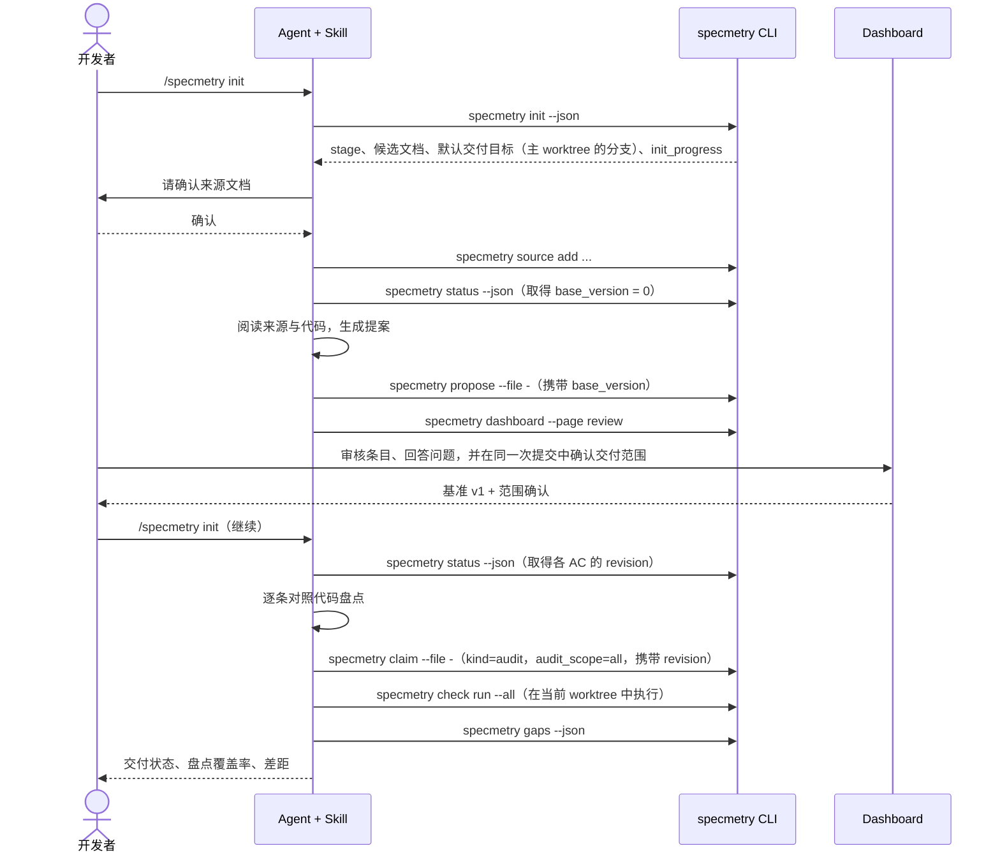
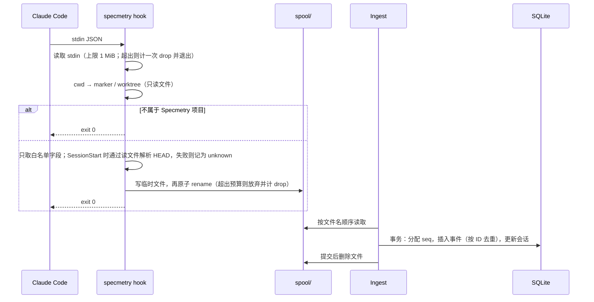

# Specmetry 架构设计

> 状态：Draft v0.3 · 2026-10-13（依据 [codex-review-001](reviews/codex-review-001.md) 与 [codex-review-002](reviews/codex-review-002.md) 修订）
> 实体与推导规则见 [data-model.md](data-model.md)，交换契约见 [`schemas/`](../schemas/)，范围见 [mvp.md](mvp.md)，实施顺序见 [implementation-plan.md](implementation-plan.md)。本文中的决策均为"提议"。

## 1. 架构目标与约束

| 目标 / 约束 | 来源 |
|---|---|
| 不接管 Agent：只通过 Skill（Agent 主动调用）和 Hook（被动观察）接入 | 原则 1 |
| 三层事实严格区分，并由不同通道产生 | 原则 2 |
| **交付判定只针对确定的代码快照**，并与基准版本和人工确认的范围绑定 | 审查 #2、#4 |
| 项目身份共享；执行、证据和代码上下文按 worktree 隔离 | 审查 #3 |
| 先后关系由数据库序号决定；关键写入携带读取时的版本 | 审查 #6 |
| 数据默认只在本地，并遵循统一的隐私与保留契约（§10） | 原则 6、审查 #1 |
| Hook 有明确的延迟预算，出错不影响 Agent | 原则 4、审查 #10 |
| 安装简单、跨平台 | NFR-05、NFR-06 |

## 2. 系统上下文


## 3. 关键设计决策（提议）

| ID | 决策 | 理由 | 代价 |
|---|---|---|---|
| AD-01 | **核心不内置 LLM**；语义工作由用户的 Agent 通过 Skill 完成 | 无需 API Key、账号和网络；Specmetry 本体可确定、可测试 | 提取和盘点的质量取决于用户的 Agent |
| AD-02 | **单一 Go 二进制** | 安装简单、Hook 冷启动快、跨平台 | 前端构建需要 Node |
| AD-03 | **没有必需的常驻进程**：Hook 写 spool，任何 `specmetry` 进程负责入库 | Hook 不依赖守护进程；至少投递一次，入库幂等 | Dashboard 未运行时，事件延迟入库 |
| AD-04 | **在 Hook 进程内、落盘前完成字段白名单过滤**；白名单之外的字段一律不落盘 | 敏感原文永远不会落盘 | 白名单要跟随 Agent 的 Hook 格式维护 |
| AD-05 | **事实只追加，状态由纯函数推导** | 可复现、可测试 | 每次读取都要计算 |
| AD-06 | **所有基准变更统一走"提案 → 审核 → 版本"** | 单一路径，历史完整 | — |
| AD-07 | **只有 Specmetry 自己执行的、经人确认的检查，才产生验证性证据** | 区分自述和证据 | 没有检查的自动化 AC 无法验证 |
| AD-08 | **人类专属操作依靠通道识别和拦截保护**，属于"防误操作"，**不能证明操作者身份** | 同一个 OS 用户下，本地无法做到强隔离 | 恶意 Agent 可以绕过，但会留下痕迹 |
| AD-09 | **全局单一 SQLite 数据库**，仓库内只放 marker | 支持多项目视图；数据不进入客户仓库 | 迁移项目需要导出 |
| AD-10 | **Dashboard 只监听回环地址**，使用令牌，校验 Host 和 Origin，设置 CSP | 防御 DNS rebinding 和 CSRF | — |
| AD-11 | **Agent 适配器隔离**；Claude Code 是第一个适配器 | 不绑定单一 Agent | 其他 Agent 降级使用 |
| AD-12 | **交付判定绑定 Delivery Target 的快照，证据分级**：观测级执行只证明开始和结束两个时刻，worktree 与快照一致；隔离级执行在私有快照目录中、由外部强制只读的环境中执行。验收是否适用于当前快照，由推导决定；沿用只接受隔离级证据。 | 杜绝"旧代码上的验收证明新代码"，并且不对观测级证据作出它无法支持的保证 | 每次目标前进都需要重新运行检查；在隔离执行器上线前（MVP），自动化 AC 也需要人重新验收 |
| AD-13 | **全局 `seq` 决定先后**；关键写入携带读取版本，不一致时拒绝 | 消除同毫秒、时钟回拨和读后写竞争带来的歧义 | 调用方要处理退出码 5 / HTTP 409 并重新读取 |
| AD-14 | **项目身份共享，执行上下文按 worktree 隔离**：检查在调用者所在的 worktree 中执行，所有事实都记录 worktree 和代码上下文 | 不同 worktree 有各自的 HEAD 和 index | 数据模型多一个维度 |
| AD-15 | **不持久化检查输出**：输出只实时透传给调用者的终端，只保存结果码、时长和上下文 | 与隐私契约一致，同时保留可调试性 | 事后无法从 Specmetry 中查看失败日志，需要重新运行 |

## 4. 组件

| 组件 | 职责 | 不负责 |
|---|---|---|
| **CLI** | 解析命令；识别通道；输出人类可读格式或 `--json`（符合 `schemas/`）；在命令开始时机会性地入库 spool；解析 cwd 所在的 worktree 并登记 | 业务规则 |
| **Hook 入口** | 读取 stdin（有大小上限）；不访问数据库、不启动子进程；解析项目、worktree 和会话起点 HEAD；只把白名单字段原子写入 spool；PreToolUse 拦截；遵守延迟预算 | 入库、推导 |
| **Collector / Ingest** | 按顺序入库 spool（分配 `seq`，按事件 ID 去重）；更新会话投影；汇总 drop 计数；清理过期事件 | 解析 Agent 原始格式 |
| **Agent 适配器** | Claude Code：Go 包 `claudecode`，CLI 参数 `claude-code`，数据中的标识 `claude_code`。负责事件映射、拦截规则、`setup` 和卸载。 | 通用逻辑 |
| **Core：基准与范围** | 来源、引用、提案、审核、`reaffirm`、版本、问题、交付目标、范围确认；在写事务内校验版本前置条件 | 推导 |
| **Core：事实** | Claim 批次、检查执行记录、提交关联、验收决定；校验通道和前置条件 | 推导 |
| **推导引擎** | 纯函数：输入事实、快照和 `as_of_seq`，输出进度、AC 交付状态、需求状态、交付状态、差距和指标 | 任何 I/O |
| **Check Runner** | 固定开始时的上下文；在调用者所在的 worktree 中执行（观测级）；超时并终止进程树；转发输出（`--json` 时转发到 stderr）；检测开始和结束时的上下文；标注证据等级。隔离执行器在 MVP 之后提供。 | 决定执行什么；把观测级说成隔离级 |
| **Git Reader** | 封装 `git` CLI：解析 ref、HEAD、工作区状态、对象 ID、按 ref 增量扫描提交、worktree 列表 | 写 git |
| **HTTP API + 前端** | REST JSON；携带前置条件的写接口；内嵌 SPA；安全中间件；变更通知 | 执行检查、设置状态 |
| **Skill 包** | `SKILL.md`、参考文档和 schemas，由 `setup` 安装 | 直接访问数据 |

## 5. 信任边界与操作通道

| 通道 | 识别方式（启发式） | 可执行的操作 |
|---|---|---|
| `agent_cli` | 默认值：stdin 或 stdout 不是 TTY，**或**存在已知的 Agent 环境变量 | 见 [prd.md §3.3](prd.md#33-权限矩阵) 的"Agent"列 |
| `human_cli` | stdin 和 stdout 都是 TTY，没有已知的 Agent 环境变量，并通过交互式确认 | 人类专属操作 |
| `dashboard` | 有效令牌、Host 在白名单内、写请求的 Origin 是同源 | 审核、人工编辑、范围确认、来源确认、回答问题、验收决定 |
| `hook` | 由 `specmetry hook` 进入 | 只写 spool；PreToolUse 拦截 |
| `system` | Specmetry 内部 | 检查执行记录、提交发现、事件入库 |

**能力边界（如实声明）**：这些识别方式都是启发式的。

- 其他 Agent 如果使用伪终端，可能被识别成 `human_cli`。
- 有效的 Dashboard 令牌也不能证明操作者是人。

因此，"人类专属"的含义是"**防止 Agent 误执行**"，不是身份认证。为此有三层配套措施：

- Skill 明确禁止 Agent 通过 CLI、HTTP、浏览器自动化或直接写文件代做人工操作；
- PreToolUse 拦截命中的命令；
- 所有人工操作都记录通道与 actor，可以审计。

PreToolUse 拦截规则（第二道防线，第一道是通道识别）。它适用于 Bash 和 PowerShell 两种工具，按**参数位置**匹配，而不是按关键词匹配：

1. 用 `;`、`&&`、`||`、`|` 和换行，把命令拆成若干段。heredoc 的正文（从 `<<` 标记行之后，到结束定界符）是数据，不参与匹配。
2. 对每一段按 shell 的引号规则切分出参数，找出 basename 为 `specmetry` 或 `specmetry.exe` 的那个参数。
3. 它之后第一个不以 `-` 开头的参数是子命令；对 `scope`、`target`、`source`、`question`、`backup` 这几个命令组，再取下一个非选项参数作为二级子命令。
4. 命中以下任一情况就拒绝：
   - 子命令为 `accept`、`reject`、`waive`、`review`、`purge`、`setup`；
   - 二级子命令为 `scope confirm`、`target set`、`source ack`、`source remove`、`question answer`、`question dismiss`、`backup restore`；
   - 子命令为 `propose`，且参数中有 `--apply`。
5. 如果参数是 `bash -c` / `sh -c` / `pwsh -Command` 的字符串，就对这个字符串递归执行一次上述规则。

因此 `specmetry dashboard --page review`、`echo "specmetry accept"`、`propose --file -` 的 heredoc 中出现的 accept 等字样，都**不会**被误拦。

拦截无法覆盖的情形有两类，它们依赖通道识别（退出码 3）兜底：

- 通过变量间接调用，例如 `s=specmetry; $s accept`；
- 命令参数看不出、要读输入内容才知道的操作，例如 JSON 中的 `claim` `kind = manual`。

`specmetry dashboard` 不在拦截之列：令牌只通过浏览器 URL 的 fragment 传递，不打印到输出（§10.4）。

## 6. 关键流程

### 6.1 项目初始化（`in_development`）



### 6.2 Hook 采集与入库



### 6.3 `sync`

1. `specmetry status --json --session current`：返回基准版本、各 AC 的 revision，以及 `workspace.compare_from`。比较起点按以下优先级选取：
   1. 本 worktree 中上一个 `sync` 或 `audit` 批次记录的 `head`，前提是那时工作区是 `clean`；
   2. 本会话的 `head_start`，前提是已知且在同一 worktree；
   3. 否则为 `none`。
2. 同一输出给出 `workspace.changed_paths`：从比较起点到工作区的已跟踪改动、暂存改动，以及**未跟踪的文件**。只包含路径，不保存。
3. Agent 判断受影响的 AC，用 `claim --file -` 提交批次，携带 `base_version` 和每条的 `target_revision`。比较起点为 `none` 时，Skill 要求 Agent 只对实际核实过的 AC 作出断言。
4. `check run <AC...>`：在当前 worktree 中执行。只有当前 worktree 的 HEAD 恰好等于交付快照、且工作区干净时，结果才会影响交付判定；否则只更新"工作区视图"。
5. `status --json --diff-since <seq>`：输出状态变化。

### 6.4 检查执行与证据等级

见 [data-model.md §4.11.1](data-model.md#4111-证据等级)（等级定义与保证边界）和 [§7.4](data-model.md#74-检查执行的上下文绑定)（执行步骤）。补充说明：

- **进程管理**：Unix 上使用独立进程组；Windows 上使用 Job Object。超时后终止整个进程树。
- **环境**：继承用户的环境，并注入 `SPECMETRY_CHECK=1`。环境变量的值不记录。
- **执行方式**：多个检查默认串行执行。
- **输出流**：带 `--json` 时，stdout 只有一份 `check-run.v1` JSON，检查自身的输出全部转发到 stderr；任何模式下都不保存检查输出。
- **分阶段实现**：

| 阶段 | 执行器 | 证据等级 | 对交付的影响 |
|---|---|---|---|
| MVP（M2） | 观测级：在调用者的 worktree 中执行，只观测开始和结束两个时刻 | `observed` | 可以让 AC 进入 `ready_for_review`；人验收时必须确认 `observed_evidence` 风险；**不沿用**；交付判定标为 `observed` |
| MVP 之后 | 隔离执行器：把快照物化到私有目录，在由隔离后端强制只读的环境中执行，并在执行前后验证 | `snapshot_isolated` | 可以支撑沿用；交付判定可以标为 `snapshot_isolated` |

- **降级与拒绝**：
  - `--isolation required` 在无法建立并验证隔离时，一律不执行，返回退出码 6；在 MVP 中总是如此。
  - `--isolation auto` 只在隔离执行器上线后提供，失败时降级为观测级，并记录原因。
  - 系统在任何情况下都不会把观测级执行记为隔离级。
- **易用性**：普通项目的初始化和日常使用都**不依赖** Docker 或其他隔离后端；只有需要隔离级证据时，才需要准备隔离后端。

### 6.5 验收

1. Dashboard（或交互式 CLI）读取需求详情，包括：
   - 交付快照 `S`；
   - AC 的 `criterion_revision` 和 `requirement_revision`；
   - `S` 上最新的合格执行 `evidence_id` 及其证据等级；
   - **当前决定 `current_decision_id`**（及其类型和操作者）；
   - 当前允许的决定类型，以及必须确认的风险（按 [data-model.md §7.3](data-model.md#73-人工验收的前置条件)）。
2. 界面展示风险说明，人逐项确认。然后提交 `decision.v1`，携带以上全部读取值、`seen_decision_id` 和 `acknowledged_risks`。
3. 服务端在**同一个写事务**内依次完成：
   1. 重新解析 ref；
   2. 比对全部前置条件，包括"最新决定的 ID 是否仍等于 `seen_decision_id`"；
   3. 校验风险确认是否与服务端推导的结果一致。

   任何前置条件不一致，都返回 409（CLI 返回退出码 5），不写入；`error.current` 中给出最新决定。一致时写入 `decisions`（分配 `seq`）。
4. **不自动重试**：客户端收到 409 后，必须重新读取并展示新的状态（例如"已被其他页面拒收"），只有人再次明确操作，才会提交新的请求（携带新的 `seen_decision_id`）。

**批量验收**（P1）只是界面上的便利：对多个 `ready_for_review` 的 AC，逐条提交 `decision.v1`，每条都带各自的前置条件和风险确认。任何一条返回 409，只影响那一条，其余照常处理，**不会**自动重试。

### 6.6 基准变更、父需求修订与范围重新确认

1. 审核者在审核队列中处理提案条目。对 `material` 的需求更新，界面列出它的所有 `active` AC，要求对每个 AC 选择 `reaffirm` / `retire` / `defer`。需要修订、但本提案中没有对应更新条目的 AC，选择 `defer`，之后再通过人工编辑修订。审核不能新增条目。应用顺序见 [data-model.md §5.5](data-model.md#55-一次审核或人工编辑的应用顺序)。
2. 审核提交（`review.v1`）携带 `seen_base_version`，可以附带新的范围确认（`scope`）。
3. 服务端在一个事务内完成以下步骤：
   1. 校验版本；
   2. 应用变更，生成新的基准版本；
   3. 写入 AC 的 `reaffirm` 或退役；
   4. 用新版本号写入范围确认（如果附带了的话）。
4. 未附带范围确认时，范围变为 `SCOPE_STALE`，直到重新确认。

### 6.7 git 扫描

在 ingest、`sync` 和 `status` 时执行，同一项目至少间隔 30 秒。

- 扫描对象：所有本地分支，以及各 worktree 的分离 HEAD。
- 每个 ref 维护自己的游标；用 `git log --format=%H%x00%ct%x00%B <last_tip>..<tip>` 读取增量。
- 只匹配编号；只保存 SHA、时间和关联关系。
- 正文在内存中处理，不保存。

## 7. 推导引擎

- 位于 `internal/domain/derive`，是不依赖 I/O 的纯函数包。
- 输入：截止 `as_of_seq` 的全部事实（含基准和范围）、目标与 `S`、各来源的观测哈希，以及当前 worktree 的代码上下文（只用于工作区视图）。读取磁盘和 git 的工作由调用方在推导**之前**完成，并作为参数传入。
- 规则以 [data-model.md §6](data-model.md#6-推导) 为准，**每条规则都有表驱动测试，以及对应的反例测试**。
- 推导结果不入库。任何输出都附带 `as_of_seq`、`S` 和 `baseline_version`，因此可以复现。

## 8. 本地文件布局

```text
$SPECMETRY_HOME/                  默认 ~/.specmetry（TD-02）；权限见 §11.1
├── config.toml
├── specmetry.db (+ -wal, -shm)   SQLite（WAL）
├── tombstones.json               已删除项目的标识（只追加，§11.4）
├── run/dashboard.json            Dashboard 端口与令牌（仅当前用户可读）
├── spool/<ulid>.json             待入库事件（只包含白名单字段）
├── spool/drops/                  丢弃计数标记（空文件，文件名中带原因）
├── spool/dead/                   无法解析的记录（7 天）
├── logs/specmetry.log            程序日志（不包含 C0 / C1 内容）
└── backups/                      一致性备份（§11.3）

<主 worktree>/.specmetry/project.json   {"schema":"specmetry.project/v1","project_id":"…","name":"…"}
```

Agent 侧的安装位置（TD-03）：

- Skill：`~/.claude/skills/specmetry/`
- Hooks：用户级 `~/.claude/settings.json`（默认），或项目级 `.claude/settings.local.json`

## 9. 接口约定

### 9.1 CLI

- 面向 Agent 的命令都支持 `--json`，输出符合 `schemas/`。
- 输入通过 `--file <path|->` 传入。
- 写命令在 JSON 中携带读取版本（[data-model.md §7.1](data-model.md#71-写入前置条件)）。

| 退出码 | 含义 |
|---|---|
| 0 | 成功 |
| 1 | 内部错误 |
| 2 | 输入或校验错误，或引用的对象不存在（`invalid_input`、`not_found`；未写入任何数据） |
| 3 | 需要人工操作 |
| 4 | 当前目录不属于已初始化的项目 |
| 5 | 读取的版本已过期（`stale_precondition`），需要重新读取（未写入任何数据） |
| 6 | 环境或权限问题：数据目录不可写、git 不可用、数据库 schema 版本比程序新、`--isolation required` 时无法建立隔离（`isolation_unavailable`），等等 |
| 10 | `check run` 已完成，但至少有一个检查不是 `pass` |

### 9.2 HTTP API（MVP）

前缀为 `/api/v1`，所有请求都需要 `Authorization: Bearer <token>`。写请求的请求体符合 `schemas/`，错误一律返回 `error.v1`。HTTP 状态码：

| 状态码 | 错误码 |
|---|---|
| 400 | `invalid_input` |
| 401 | `unauthorized` |
| 403 | `forbidden`（Host 或 Origin 不对）、`human_required` |
| 404 | `not_found`、`not_initialized` |
| 409 | `stale_precondition` |
| 503 | `environment` |
| 500 | `internal` |

| 方法 | 路径 | 用途 | 请求体 / 响应 |
|---|---|---|---|
| GET | `/projects` | 项目列表 | — |
| GET | `/projects/{id}/status` | 完整的读取模型：目标、`S`、范围、来源与观测哈希、交付状态、阻塞差距、`as_of_seq`。Dashboard 从这里取得写请求需要回传的全部版本值。 | 响应：`status.v1` |
| GET | `/projects/{id}/overview` | 交付判定摘要、指标、最近的会话 | — |
| GET | `/projects/{id}/baseline` | 基准树，含进度和交付状态 | — |
| GET | `/projects/{id}/baseline/history` | 版本与变更 | — |
| GET | `/projects/{id}/requirements/{key}` | 需求详情：各 AC 在 `S` 上的执行、在其他上下文中的执行、Claim、决定、允许的决定类型 | — |
| GET | `/projects/{id}/gaps` | 差距 | — |
| GET | `/projects/{id}/proposals?state=pending`、`/proposals/{pid}` | 审核队列、三方对比 | — |
| POST | `/projects/{id}/proposals/{pid}/review` | 审核提交 | `review.v1` |
| POST | `/projects/{id}/baseline/edits` | 人工编辑 | `proposal.v1`（服务端强制 `origin = human_edit`） |
| POST | `/projects/{id}/scope` | 范围确认 | `scope.v1` |
| POST | `/projects/{id}/sources/{sid}/ack` | 来源变化确认 | `source-ack.v1` |
| POST | `/projects/{id}/criteria/{key}/decisions` | 验收决定 | `decision.v1` |
| POST | `/projects/{id}/questions/{key}/answer` | 回答或驳回问题 | `question-answer.v1` |
| GET | `/health` | 版本、spool 积压、drop 计数、Hook 状态、worktree 列表 | — |
| GET | `/changes` | 变更通知（SSE，TD-08） | — |

**不提供**的接口：设置状态、执行检查、删除事实、`purge`、修改交付目标（MVP 中只能在 CLI 中修改）。

## 10. 隐私与数据保留契约

本节是隐私与保留的**唯一规范来源**。其他文档只能引用本节，不能另作规定。

### 10.1 数据分级

| 级别 | 定义 | 本地持久化 | 未来云端同步（MVP 不实现） |
|---|---|---|---|
| **C0 禁止** | 源代码与文件内容；diff；**任意原始命令文本**（包括 Hook 观察到的命令）；工具输出和检查的 stdout / stderr；**环境变量的值**；提示词、完整 Agent 对话和 transcript；密钥；来源文档全文 | **不持久化**（数据库、spool、日志、备份中都不出现） | 永不同步 |
| **C1 仅本地** | 来源引用片段（≤ 500 字符，只能来自已登记的来源，按 §10.7 的策略保存）；各类路径（来源、代码引用、worktree）；检查配置（命令、工作目录、输入路径、理由——它们属于经人确认的基准）；Claim 摘要（≤ 500 字符，不能包含代码块）；人填写的理由和问题回答 | 允许（PD-20，已确认） | **默认只存在本地**；未来同步必须经过**独立授权**（见下文） |
| **C2 同步候选** | 基准条目文本（目标、需求、AC 陈述）；编号与修订；状态与计数；检查结果码、时长、提交 SHA、序号；活动元数据（会话起止、工具类别、成功或失败） | 允许 | 同样需要独立授权（见下文） |

在 MVP 中，所有数据都只在本地，**不存在任何上传路径**。

**未来云端同步的授权边界**（约束未来的设计，MVP 不实现）：

- 同步必须由用户**独立授权**：与登录或订阅分开，作出明确的同意。
- 授权按项目、按数据类别分别给出，可以随时撤销；撤销后停止同步，并说明已上传数据的处理方式。
- C1 默认不在任何授权范围内，必须单独勾选；C0 永不同步。
- 没有授权时，任何代码路径都不得上传数据（由 MVP-PRV-01 及其后续版本的网络测试保证）。

### 10.2 采集与写入规则

1. **Hook**：只写入 [`spool-event.v1`](../schemas/spool-event.v1.schema.json) 允许的字段。白名单中没有任何自由文本字段，所以不需要做脱敏。PreToolUse 拦截时，命令文本只在内存中匹配，不落盘。
2. **检查执行**：输出只实时转发给调用者（带 `--json` 时转发到 stderr，stdout 只有 JSON），不保存；只保存 [data-model.md §4.11](data-model.md#411-check_runs) 中列出的字段。
3. **检查命令**：属于 C1 基准数据，经人确认。命令中**不得**包含密钥字面量（命中密钥规则即拒绝写入）。需要秘密值时，引用环境变量名。
4. **自由文本**（提案文本、问题、Claim 摘要、理由、回答、备注）：写入前做密钥扫描，命中即**拒绝写入**并提示改写；不做替换（替换会改变语义）。所有自由文本都不能包含代码围栏（由 schema 强制）。
5. **来源**：只能登记文档类文件（[data-model.md §4.3](data-model.md#43-sources-与-source_acks)）；每个来源的片段总量有上限（§4.5），防止逐段保存来源全文。
6. **提交**：只保存 SHA、提交时间和关联关系；标题和正文在内存中匹配编号后即丢弃。
7. **程序日志**：只记录错误码、ID 和计数，不记录 C0 / C1 内容。

### 10.3 保留期

见 [data-model.md §9](data-model.md#9-数据分级保留与删除)。

### 10.4 本地 Web 服务

- 只绑定 `127.0.0.1`。
- 令牌每次启动时随机生成，通过系统浏览器打开带 fragment 的 URL 传递，**不打印到 stdout**，只保存在 `run/dashboard.json` 中（权限同 §11.1）。
- 无法打开浏览器时：在 `human_cli` 通道中打印带令牌的 URL；在 `agent_cli` 通道中只提示用户到终端执行。
- 校验 Host（只允许 `127.0.0.1:<port>` 和 `localhost:<port>`）；写请求校验 Origin。
- 设置 CSP `default-src 'self'`、`nosniff`、`no-referrer`；不启用 CORS。

### 10.5 网络边界

| 部分 | 网络 | Specmetry 的保证 |
|---|---|---|
| Specmetry 核心（CLI、Hook、Collector、Dashboard） | 不发出任何出站请求；只监听回环地址 | 保证，并有测试（MVP-PRV-01） |
| 用户的 Agent | 自行联网（模型调用等） | 不控制 |
| 检查命令 | 可能联网（例如下载依赖） | 不控制，也不保证能离线执行 |
| 离线可用的流程 | 人工或录制的提案与自述输入，加上本地可执行的检查，可以完成全部推导 | 保证 |

### 10.6 对仓库的写入

Specmetry 对项目仓库的写入仅限于：

- `.specmetry/project.json`；
- `.git/info/exclude`（默认写入，可用 `--no-exclude` 关闭；不可写时只给出警告）；
- 用户选择项目级安装时，经确认写入的 `.claude/settings.local.json`。前提是这个路径已被 git 忽略（用 `git check-ignore` 检查）；否则拒绝项目级安装，并建议改用用户级安装。

Specmetry 从不修改代码和 git 历史。

计算 `tree_state` 时，**始终排除 `.specmetry/`**（pathspec 排除），所以 marker 文件无论是否写入了 exclude，都不会让工作区变脏（[data-model.md §1](data-model.md#1-建模约定)）。检查命令本身的副作用不在此列：工作区一旦被它弄脏，这次执行就不合格。

### 10.7 来源片段的采集策略、保护与用户控制

PD-20 允许本地保存来源片段，但这**不等于**允许自动持久化任意客户文档的原文。

**采集策略**：

- **只保存显式提交的片段。** Specmetry 从不扫描、复制或导入文档全文。片段只有一个来源：提案中针对某个基准条目、作为引用依据显式提交的 `excerpt`。
- **只来自显式登记的文档。** 来源必须由人在对话或终端中确认后才登记，候选来源永远不会自动登记；只接受文档类文件（[data-model.md §4.3](data-model.md#43-sources-与-source_acks)）。
- **必须可以验证。** 每个片段不超过 500 字符，并且必须能在来源中逐字找到；每个来源的片段总量有上限（data-model §4.5）。
- **全文只在内存中短暂读取。** 读取全文只用于计算哈希和校验片段，读完即丢弃，不写入数据库、日志或备份。

**敏感数据保护**：

- 片段、摘要、理由等文本写入前都做密钥扫描，命中即拒绝；
- 不能包含代码围栏；
- 只存在本地，数据目录受权限保护（§11.1）；
- 程序日志不记录 C1 内容；
- 没有任何网络出口（§10.5）。

**用户控制**（M1 实现）：

| 控制 | 作用 |
|---|---|
| 片段保存模式（项目设置 `excerpt_storage`） | `full`（默认，按 PD-20 保存片段原文）或 `hash_only`（只在内存中校验片段，数据库中只保存 `locator`、片段的 sha256 和校验结果，不保存原文）。切换只影响之后写入的引用。 |
| 移除来源时擦除片段（`source remove --erase-excerpts`，仅限人） | 把该来源所有引用的片段原文置空，只保留 `locator`、片段哈希和校验结果；在维护模式下执行（§11.4 中只追加约束的受控例外），并记录擦除的 `seq`。 |
| 查看 | `status --json` 和 Dashboard 列出每个来源及其引用；人可以随时查看保存了哪些片段。 |
| 删除整个项目 | `purge`（§11.4）。 |

## 11. 本地数据生命周期

### 11.1 权限

- **Unix**：数据目录权限为 `0700`，文件为 `0600`。
- **Windows**：对数据目录设置受保护的 DACL（关闭继承），只授予**当前用户 SID 和 SYSTEM** 完全控制权（TD-22，已确认）。SYSTEM 本来就能凭借特权绕过 DACL，加入它不会削弱对其他本地用户的保护，还能让 Defender、备份等系统服务正常工作。新建的文件继承这个 DACL。`doctor` 会检查实际权限，不符合时报告。
- `run/dashboard.json` 和备份文件的权限与数据目录相同。

### 11.2 迁移

- 迁移只能前向执行。
- **打开数据库的固定顺序**：
  1. 版本保护检查；
  2. **执行墓碑**（§11.4）；
  3. 如果需要迁移：生成迁移前备份，然后迁移；
  4. 正常使用。

  墓碑一定在迁移前备份之前执行，因此从旧备份恢复后再迁移，新生成的备份中也不会含有已删除项目的数据。
- **迁移协调**：迁移前独占创建锁文件 `.migrate.lock`，然后执行 `BEGIN EXCLUSIVE`，其他进程等待或报错（退出码 6）。迁移前用 `VACUUM INTO` 生成一致性备份，在事务内执行迁移，再写入 `meta.schema_version` 和 `min_binary_version`。
- **版本保护**：程序发现数据库的 `schema_version` 高于自己支持的版本，或者自己的版本低于 `min_binary_version` 时，**拒绝打开**（退出码 6），提示升级。

### 11.3 备份

- 只使用一致性备份机制（`VACUUM INTO`），**不直接复制**正在使用的数据库文件。
- 自动备份只在迁移前生成，保留最近 3 份。手动执行 `backup create`、`backup restore` 属于 P1。
- 备份包含**全部项目**的数据，权限同 §11.1。

### 11.4 删除（`purge`）与墓碑

`purge` 只能在 `human_cli` 中执行，需要输入项目名确认。步骤如下：

1. 先向 `tombstones.json` 追加 `{project_id, purged_at}`，并 fsync。这一步放在最前面，保证中途崩溃后也能继续完成删除。
2. 在一个事务内删除该项目的全部行。
3. 删除属于该项目的 spool 文件。
4. 执行 `wal_checkpoint(TRUNCATE)`，然后 `VACUUM`，清除空闲页和 WAL 中的残留。
5. 列出所有在 `purge` 之前生成的备份（它们包含该项目的数据）。默认全部删除；用户也可以选择保留，此时会明确警告"这些备份中仍有该项目的数据"。
6. 询问是否删除仓库中的 `.specmetry/`。

**墓碑生效**：每次打开数据库时（在任何迁移之前，见 §11.2），如果发现库中存在墓碑里列出的项目，就自动重新执行第 2–4 步，并记录日志。这样即使从旧备份恢复（无论用的是 `backup restore` 还是手动复制文件），已删除的项目也不会复活。

删除采用与 schema 版本无关的方式：通过 `sqlite_master` 和 `pragma table_info` 找出所有带 `project_id` 列的表，逐表删除。因此，即使是旧版本 schema 的备份，也能在迁移之前完成删除。

**承诺边界**：`purge` 之后，项目数据不会再出现在当前数据库、WAL、spool 和已删除的备份中。Specmetry **不承诺**物理擦除（文件系统或 SSD 上的残留），也不处理用户自己制作的副本。如果 `tombstones.json` 被删除，墓碑保护随之失效（在文档中说明）。

## 12. Hook 规格与 Agent 兼容性

### 12.1 Claude Code Hook

M3 开工前要对照官方文档核实，并固定一个经过测试的版本范围（TD-12）。

| 事件 | 用途 | 读取的输入字段（只在内存中使用） | 写入 spool 的字段 |
|---|---|---|---|
| SessionStart | 会话开始 | `session_id`、`cwd`、`source` | 会话 ID、worktree 路径、来源类型、`head_start`、`head_start_source` |
| SessionEnd | 会话结束 | `session_id`、`reason` | 会话 ID、结束原因 |
| PostToolUse | 工具成功 | `session_id`、`tool_name` | 会话 ID、工具类别（`shell` / `edit` / `read` / `other`）、`outcome = success` |
| PostToolUseFailure | 工具失败 | 同上 | 同上，`outcome = failure` |
| Stop | 一轮结束 | `session_id` | 会话 ID |
| PreToolUse（Bash、PowerShell） | 拦截 | `tool_input.command`（只在内存中匹配） | 只在拦截时写入：命中的子命令名 |

`tool_input`、`tool_response`、`transcript_path`、提示词，以及所有其他字段，一律不读取或直接丢弃。

### 12.2 项目解析与会话起点 HEAD 的获取

**项目解析**：Hook 不访问数据库，也不启动子进程。

1. 从 cwd 向上查找 `.specmetry/project.json`，找到就用它。
2. 否则，找到最近的 `.git`：
   - 如果它是**文件**（说明在关联 worktree 中），读取其中的 `gitdir:`，再读取该目录下的 `commondir`，得到公共目录；当公共目录名为 `.git` 时，主 worktree 的根目录就是它的父目录，在那里读取 `.specmetry/project.json`（marker 只存在于主 worktree）；
   - 如果它是目录，就在它所在的目录读取 marker。
3. 都找不到（例如裸仓库或非标准布局），视为非 Specmetry 项目：不写 spool，直接以 0 退出。

CLI 则通过 `git rev-parse --git-common-dir` 和数据库中的 `git_common_dir` 匹配项目，不依赖 marker 的位置。

**会话起点 HEAD**：同样不启动子进程，只读文件：

1. 读取 `<gitdir>/HEAD`。`gitdir` 由 cwd 向上查找 `.git` 得到；如果 `.git` 是文件（说明处于 worktree 中），就按其中的指针定位。
2. 如果 HEAD 的内容是 40 位 SHA，直接使用。
3. 如果是 `ref: <name>`，依次查找 `<commondir>/<name>` 文件和 `<commondir>/packed-refs`。
4. 遇到 reftable 格式、文件读取失败或内容格式异常时，记为 `unknown`。

工作区是否干净无法用这种方式得知，所以不采集。**在任何情况下，都不会用入库时的 HEAD 代替。**

### 12.3 延迟预算与丢弃

| 项 | 规则 |
|---|---|
| 输入上限 | stdin 最多读取 1 MiB；超出则丢弃，计一次 `oversize` |
| 内部预算 | 从启动起 200 ms 内没有完成写入，就放弃并计一次 `timeout` |
| 外部超时 | 在 Hook 配置中设置 5 s，作为兜底 |
| 退出 | 始终以 0 退出（PreToolUse 拦截按 Claude Code 协议输出拒绝决定） |
| 丢弃计数 | 在 `spool/drops/` 中写入空标记文件，ingest 时汇总到 `hook_drops`，并在健康页显示 |
| 性能目标 | p95 ≤ 100 ms（含进程启动）；非 Specmetry 项目内 p95 ≤ 30 ms |

### 12.4 兼容性矩阵

| 维度 | Claude Code（MVP 正式支持） | Codex 等（尽力而为，M4 前核实） | 无 Hook 的通用 Agent |
|---|---|---|---|
| 入口 | Skill（`/specmetry …`） | AGENTS.md 片段 + CLI（是否支持 Skill 以核实结果为准） | AGENTS.md 或人工 |
| 活动采集 | Hook | 无 | 无 |
| 人类专属操作拦截 | PreToolUse（Bash、PowerShell）+ 通道识别 | 只有通道识别 | 只有通道识别 |
| 写入数据目录 | 沙箱模式下需要把 `$SPECMETRY_HOME` 加入可写路径 | 默认的工作区沙箱通常禁止写工作区外的目录，需要用户配置可写目录；否则 CLI 返回退出码 6 并给出指引 | 视环境而定 |
| `.git/info/exclude` | 通常可写 | 可能受保护：跳过并警告 | — |
| Shell 工具 | Bash（Windows 上为 Git Bash）、PowerShell；拦截覆盖两者 | 由 Agent 决定，M4 前核实 | 视环境而定 |
| 会话标识 | Hook 提供 | 无，Claim 不关联会话 | 无 |
| `sync` 比较起点 | 上一批次或会话起点 | 上一批次或 `none` | 上一批次或 `none` |
| 人工操作路径 | 用户在**自己的终端**中执行人类专属命令，或使用 Dashboard；Agent 只负责提示，或用 `dashboard --page` 打开页面 | 同左 | 同左 |

`setup` 和 `doctor` 只**检测并给出指引**，不会自动修改其他 Agent 的沙箱配置，也不要求关闭沙箱。

## 13. 性能与可靠性

| 方面 | 设计 |
|---|---|
| 写入并发 | WAL 模式，`busy_timeout` 5 s；每个进程单一写连接；`seq` 在写事务内分配 |
| 至少一次投递 | spool 在事务提交后才删除；重复入库按事件 ID 去重 |
| 崩溃安全 | spool 先写临时文件再 rename；迁移和 `purge` 的顺序保证可以重做（§11） |
| 推导规模 | 每个 AC 只看它在 `S` 上的合格执行和最新的决定，单次遍历即可；索引为 `(project_id, criterion_id, seq)` 和 `(project_id, head_start)` |
| 指标 | 2000 个 AC、10 万条事件时，`status --json` < 1 s，Dashboard 首屏 < 2 s |

## 14. 技术栈选择与取舍

### 14.1 核心语言：Go（建议）

| 选项 | 优点 | 缺点 | 结论 |
|---|---|---|---|
| **Go** | 单一静态二进制，交叉编译简单；冷启动快，适合 Hook；标准库自带 HTTP；可以用 `go:embed` 内嵌前端；贡献者多 | 前后端两种语言 | **采用** |
| Rust | 性能好，类型系统强 | 迭代慢，贡献门槛高，对 I/O 型负载收益有限 | 不采用 |
| TypeScript（Node / Bun） | 前后端统一 | 冷启动不利于 Hook；需要运行时或体积较大的打包 | 不采用 |
| Python | 生态丰富 | 分发困难，冷启动慢 | 不采用 |

### 14.2 存储：SQLite（建议）

| 选项 | 优点 | 缺点 | 结论 |
|---|---|---|---|
| **SQLite（WAL）** | 嵌入式、单文件；事务能力足以支撑 `seq` 与前置条件校验；有 `VACUUM INTO` | 多进程写需要协调（已通过 spool 和迁移锁处理） | **采用** |
| 仓库内文件 | 可以 diff | 难以查询；与"不污染客户仓库"冲突 | 不作为事实来源（TD-01） |
| 嵌入式 KV | 简单 | 没有关系查询 | 不采用 |

驱动的选择见 TD-04，建议使用 `modernc.org/sqlite`。

### 14.3 前端：React + TypeScript + Vite（建议）

| 选项 | 优点 | 缺点 | 结论 |
|---|---|---|---|
| **React + TS + Vite**（用 `go:embed` 内嵌） | 审核队列、三方对比、时间线等交互适合 SPA；贡献者多 | 构建需要 Node；类型需要同步（TD-07） | **采用** |
| Go 模板 + htmx | 单一语言 | 复杂交互实现成本高 | 备选 |
| Svelte / Vue | 轻量 | 相对 React 没有决定性优势 | 不采用 |

### 14.4 交付形态：本地 Web（建议）

不采用桌面应用或 TUI，理由同 v0.1。

## 15. 测试策略与代码结构

| 层次 | 内容 |
|---|---|
| 单元 | 推导决策表逐条覆盖；性质测试（打乱插入顺序后结果相同）；版本前置条件校验；密钥规则；schema 校验 |
| **反例** | [acceptance-criteria.md §4](acceptance-criteria.md#4-反例与异常场景cx) 中的 CX 系列：验证设计本身不会得出错误的交付结论 |
| 存储 | 迁移、迁移锁、版本保护、只追加触发器、`purge` 加墓碑 |
| CLI 黄金测试 | `--json` 输出能通过 `schemas/` 校验并与 golden 文件一致；退出码 |
| Hook | 录制的 payload；延迟基准；canary 测试；大小和时间上限 |
| E2E | 三类夹具加录制的 Agent 输出（确定性回放），三平台 |
| 前端 | Playwright：页面过期时的 409 处理、没有外部请求 |
| Skill 评测 | 真实 Agent 运行夹具，不作为 CI 门槛 |

```text
cmd/specmetry/
internal/
  cli/  app/
  domain/
    baseline/     基准、提案、reaffirm、版本、编号
    scope/        交付目标、范围确认、来源集合哈希
    facts/        Claim、检查执行、提交关联、决定、前置条件
    derive/       纯函数：进度、交付状态、差距、指标
  store/sqlite/   迁移、seq、只追加、墓碑
  worktree/       项目与 worktree 解析、登记
  collector/  adapters/claudecode/  checkrun/  gitx/  secrets/  server/  skillpack/
schemas/  skill/  web/  testdata/fixtures/  docs/
```

依赖方向：`cli` / `server` → `app` → `domain` ← `store`。`domain/derive` 不依赖任何其他包。

## 16. 技术待决策事项

| ID | 问题 | 建议默认 | 最晚决定于 |
|---|---|---|---|
| TD-01 | 基准的事实来源 | SQLite；导出延后到 MVP 之后 | M1 |
| TD-02 | 数据目录与数据库粒度 | **已确认**：全局单库，`~/.specmetry`，可用 `SPECMETRY_HOME` 覆盖 | 已确认（2026-10-13） |
| TD-03 | Skill 与 Hook 的安装范围 | 默认用户级，可选项目级 | M3 |
| TD-04 | SQLite 驱动 | **已确认**：`modernc.org/sqlite`。spike（v1.60.1，Windows）验证了 WAL、`wal_checkpoint(TRUNCATE)`、`BEGIN IMMEDIATE` / `EXCLUSIVE`、触发器 `RAISE(ABORT)`、`VACUUM INTO`，以及两个连接各并发写 200 次时 `seq` 唯一且连续 | 已确认（2026-10-13） |
| TD-05 | git 访问方式 | 调用 `git` CLI；Hook 中只读文件 | M1 |
| TD-06 | Windows 上执行检查的 shell | 优先 `sh`（Git for Windows），找不到时用 `cmd /C`；AC 可以指定 `shell` | M2 |
| TD-07 | API 契约与 TS 类型 | OpenAPI 引用 `schemas/` 作为请求体定义；生成 TS 类型 | M5 |
| TD-08 | Dashboard 刷新 | SSE 通知，断线时退回轮询 | M5 |
| TD-09 | 前端 UI 方案 | 待定；约束：资源全部内嵌 | M5 |
| TD-10 | CLI 框架 | **已确认**：cobra | 已确认（2026-10-13） |
| ~~TD-11~~ | ~~证据新鲜度~~ | **已关闭**：由交付快照模型取代（AD-12） | — |
| TD-12 | Claude Code Hook 事件名与字段的核实，以及兼容版本范围 | 以 §12.1 为初稿 | M3 开工前 |
| TD-13 | 人类专属操作的防护强度 | 启发式通道识别 + 拦截 + 审计记录，并如实声明能力边界 | M2 |
| TD-14 | 编号格式 | `GOAL-1`、`REQ-001`、`AC-001-1`、`Q-001` | M1 |
| TD-15 | 分发渠道 | Releases + 安装脚本 | M6 |
| TD-16 | 迁移策略 | **已确认**：只前向迁移 + 迁移锁 + `VACUUM INTO` 备份 + `min_binary_version` | 已确认（2026-10-13） |
| TD-17 | 提交关联规则 | trailer 优先；正文中的编号也匹配，可以关闭 | M2 |
| TD-18 | 每个 AC 的检查数量 | 至多 1 个 | M1 |
| TD-19 | Dashboard 端口 | 固定默认端口，被占用时递增 | M5 |
| TD-20 | 交换格式的版本策略 | `schema` 字段带主版本号；新增可选字段不升主版本；CLI 同时接受当前和上一个主版本 | M1 |
| TD-21 | 密钥识别规则集与误报处理 | 内置一组常见规则，可在配置中追加；误报时由用户改写文本（不提供绕过开关） | M1 |
| TD-22 | Windows ACL 的具体授权对象 | **已确认**：当前用户 + SYSTEM，受保护的 DACL（关闭继承），子对象继承 | 已确认（2026-10-13） |
| TD-23 | `check.inputs` 的对象 ID 粒度 | 文件取 blob ID，目录取 tree ID | M2 |
| TD-24 | 隔离执行器的后端与验证方法：物化方式（`git worktree add --detach` 或 `git archive`）；各平台的只读强制机制（容器只读挂载、Linux 上的 bubblewrap / Landlock、macOS 沙箱、Windows 待评估）；执行前写入探测与执行后树比对的实现；子模块、LFS 和依赖缓存的处理 | 待定；约束：不能依赖文件权限位；无法验证时绝不标为隔离级；普通项目不强制安装 | 隔离执行器开工前（MVP 之后） |
