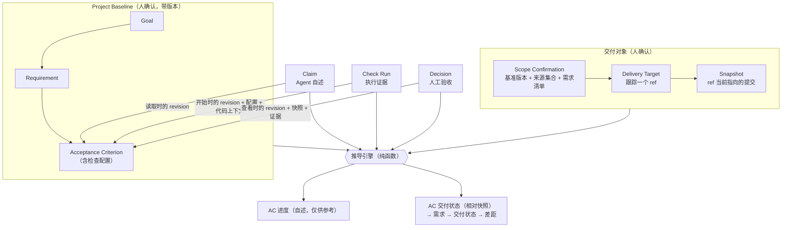
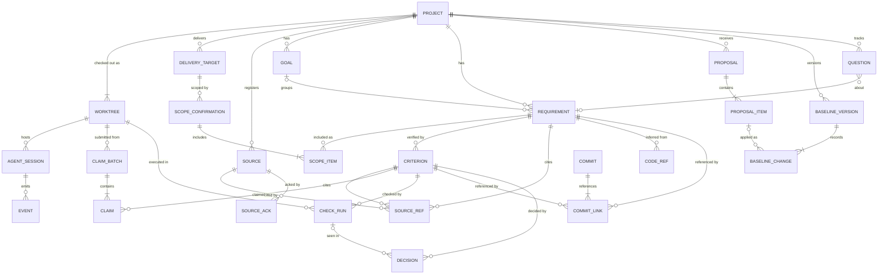
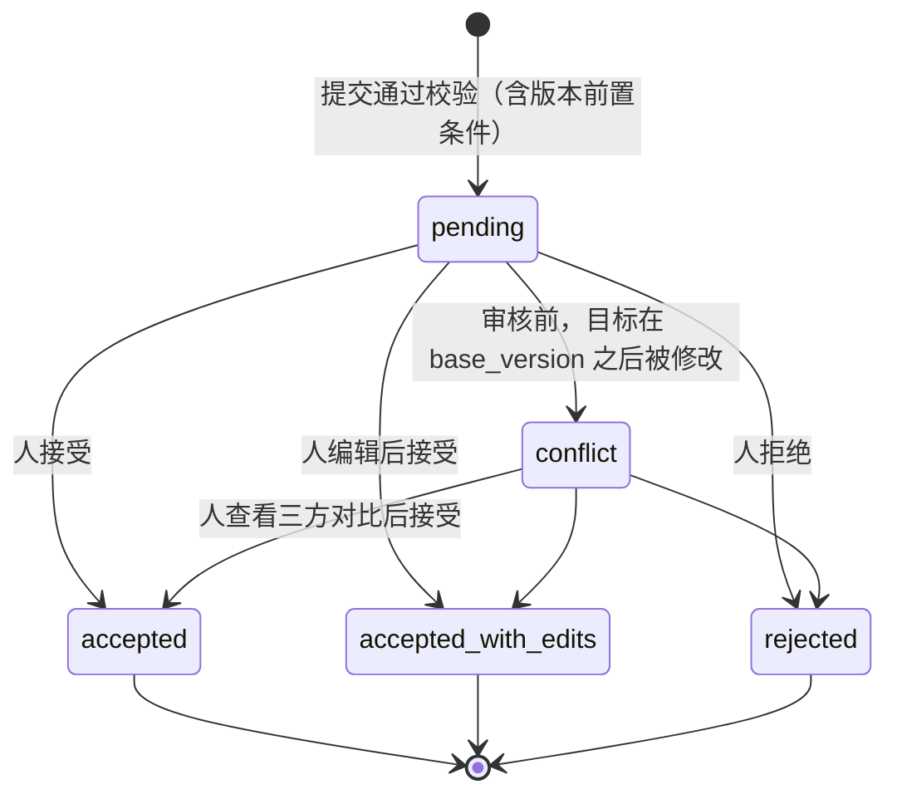
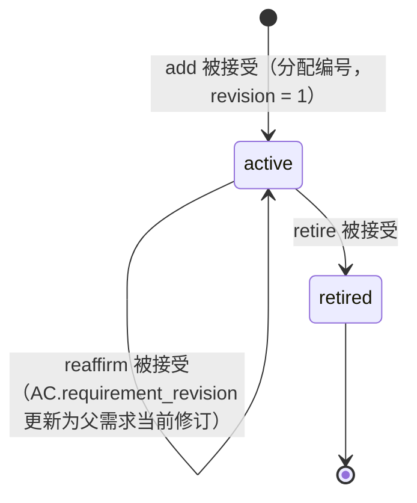
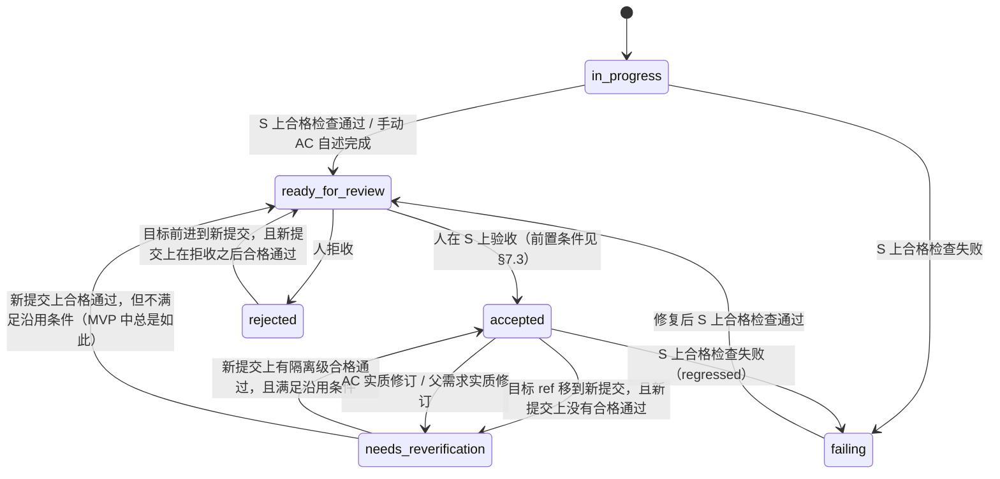
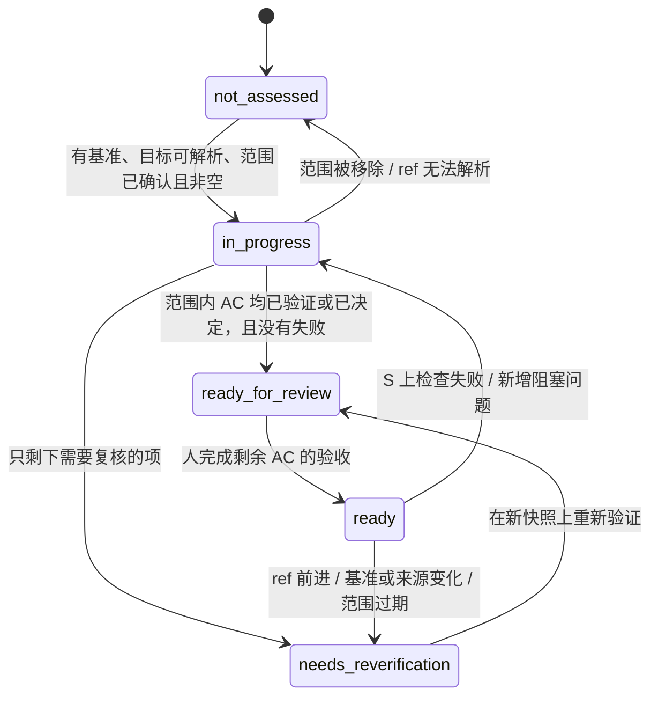

# Specmetry 数据模型

> 状态：Draft v0.3 · 2026-10-13（依据 [codex-review-001](reviews/codex-review-001.md) 与 [codex-review-002](reviews/codex-review-002.md) 修订，处理记录见 [review-resolution.md](review-resolution.md)）
> 本文定义实体、关系、生命周期、版本前置条件和推导规则。**§6 的决策表是推导引擎的规范来源**，代码与测试必须与之一一对应。交换格式的规范来源是 [`schemas/`](../schemas/)。

## 1. 建模约定

| 约定 | 说明 |
|---|---|
| 主键 | ULID（TEXT，26 字符）。只用于标识，**不用于判断先后**。 |
| 事实序号 `seq` | INTEGER，全库单调递增。在写事务内由单行计数器分配；SQLite 的写操作串行执行，所以 `seq` 与提交顺序一致。**判断"最新""之后"一律只看 `seq`**，时间戳只用于展示。 |
| 编号（key） | 人类可读，项目内唯一，永不复用：`GOAL-1`、`REQ-001`、`AC-001-1`、`Q-001`（TD-14） |
| 时间 | INTEGER，UTC Unix 毫秒，仅用于展示 |
| actor | `agent:<agent>`（如 `agent:claude_code`）、`human:<显示名>`、`system` |
| channel | `agent_cli`、`human_cli`、`dashboard`、`hook`、`system` |
| 代码上下文 | 由三项组成：`worktree_id`、`head`（40 位提交 SHA；未知时为 NULL）、`tree_state`（`clean` / `dirty` / `unknown`）。`clean` 指 `git status --porcelain --untracked-files=all --ignore-submodules=none -- . ':(exclude).specmetry'` 输出为空（`--ignore-submodules=none`：产品负责人 2026-10-18 决定 D1）：被 git 忽略的文件不计入；未跟踪文件计入；子模块的变化始终计入，仓库配置（如 `diff.ignoreSubmodules`）不能隐藏；**Specmetry 自己的 `.specmetry/` 始终排除**，不管有没有写入 `.git/info/exclude`。项目级安装只写入已被 git 忽略的 `.claude/settings.local.json`（[architecture.md §10.6](architecture.md#106-对仓库的写入)），所以它也不会让工作区变脏。这条命令在 Specmetry 的受控环境中定义语义（只有仓库自己的配置，architecture §6.1.2），并且只定义语义：Specmetry 不在用户的仓库上直接运行它，读取方式不执行仓库配置的任何程序（过滤器等），也不改变仓库中任何文件的内容或修改时间，见 [WP2.3 规范 §4.3](wp2.3-git-reader.md)（已冻结）。不执行程序就无法与定义一致地判断的情形（受本地过滤器驱动影响、需要比较内容的文件；带稀疏目录条目的索引），结果为"不可判定"，记为 **`unknown`，绝不报告为 `clean`**（产品负责人 2026-10-19 决定 P1）。带稀疏目录条目的索引一律不可判定，并且在任何可能展开索引的命令运行之前就判定，不扩大到所有稀疏检出（P2）。这些是范围的限制，不是允许误报 `clean` 或修改原对象的豁免。此前"差异只会把 `clean` 变成 `dirty`"的说法不成立，已撤回（审查 052 B3-R1）。 |
| project_id | 每张保存项目数据的表都有，用于按项目删除和未来的同步（`projects` 以 `id` 作为项目 ID；`meta`、`maintenance` 是全库表）。见 §1.1 |
| JSON 列 | 应用层按 schema 校验 |
| 自由文本 | 写入前做密钥扫描，命中则**拒绝写入**（不做替换），见 [architecture.md §10](architecture.md#10-隐私与数据保留契约) |

可变性分为两类：

| 类别 | 表 | 规则 |
|---|---|---|
| **只追加（事实）** | `baseline_versions`、`baseline_changes`、`source_refs`、`code_refs`、`source_acks`、`scope_confirmations`、`scope_items`、`claim_batches`、`claims`、`check_runs`、`commits`、`commit_links`、`decisions`、`events` | 应用层禁止 UPDATE、DELETE 和 REPLACE 冲突处理（`INSERT OR REPLACE`、`REPLACE INTO`、`ON CONFLICT REPLACE`），数据库触发器作为第二道防线。REPLACE 通过删除旧行实现，只有开启 `recursive_triggers` 时才会触发删除触发器，所以每个连接都开启它，写事务执行前再确认一次。例外只有 `purge`，以及 `events` 的保留期清理。 |
| **受控可变** | `projects`、`worktrees`、`delivery_targets`、`sources`、`goals`、`requirements`、`acceptance_criteria`、`proposals`、`proposal_items`、`questions`、`agent_sessions`、`git_scan_cursors`、`hook_drops`、`key_counters`、`meta` | 基准三表只能通过"应用基准变更"修改，每次修改记录 `updated_seq`；`proposal_items` 的审核字段、`questions` 的回答字段都只能写一次 |

### 1.1 建表约束（M1 起）

codex-review-004 N1 的结论。`purge` 和墓碑按项目删除数据，并且不依赖 schema 版本（[architecture.md §11.4](architecture.md#114-删除purge与墓碑)），所以建表必须满足：

1. 每张保存项目数据的表都有 `project_id` 列，子表也不例外（例如 `scope_items`），不能只靠父表间接归属；项目登记表 `projects` 以 `id` 作为项目 ID，墓碑逻辑单独处理它。全库表只有 `meta` 和 `maintenance`。schema 不变量测试对所有迁移执行这条规则。
2. 外键只引用同一项目的行。墓碑删除在事务内延迟外键检查（`defer_foreign_keys`），因此删除顺序与表名无关；跨项目的引用会让提交失败，而不是留下残缺数据。
3. 建表语句不声明 `ON CONFLICT REPLACE`；只追加表在创建它的迁移中附加只追加触发器（§1）。

## 2. 概念模型



两种推导结果相互独立：

- **进度（progress）**：来自 Claim 和提交，与代码对象无关，可信度低，只用于展示"Agent 说了什么、做了什么"。
- **交付状态（delivery status）**：来自"在交付快照上执行的合格检查"和"适用于该快照的人工决定"。

**Claim 对交付状态的影响（统一表述）**：

- Claim **不能单独**产生 `accepted` 或 `ready`；
- 对自动化 AC，Claim 不能让它越过 `in_progress`；
- 对手动 AC，`done` 自述只会把它标为 `ready_for_review`，含义是"等待人工查看"，这不是验证；
- 拒收后的新 `done` 自述，可以让手动 AC 回到 `ready_for_review`（§6.3 第 5 条）。

## 3. 实体关系



关键基数：

- **一个项目可以有多个 worktree。** 它们共享项目身份、基准和事实账本，但每条 Claim、Check Run、会话都记录自己所在的 worktree 和代码上下文。
- MVP 中每个项目只有 1 个 `active` 的 Delivery Target（PD-19）。
- 一个需求可以没有 AC，此时为 `needs_criteria`。
- 一个 AC 至多有一个检查（TD-18）。

## 4. 实体定义

### 4.1 `projects` 与 `worktrees`

`projects`：

| 字段 | 类型 | 说明 |
|---|---|---|
| id | ULID PK | 与 marker 中的 `project_id` 相同 |
| name | TEXT | |
| git_common_dir | TEXT NULL | 共享的 git 公共目录；非 git 项目为 NULL |
| main_worktree_id | ULID | |
| stage | TEXT | `docs_only` / `in_development` / `incomplete_docs` |
| settings_json | TEXT | `sources_skipped`、`inventory_skipped`、`excerpt_storage`（`hash_only` 默认 / `full`，PD-24）。不提供 `commit_ref_mode`：MVP 固定匹配 trailer 与正文中的编号（TD-17，产品负责人 2026-10-18 决定） |
| created_at | INTEGER | |

`worktrees`：

| 字段 | 类型 | 说明 |
|---|---|---|
| id | ULID PK | |
| project_id | ULID | |
| path | TEXT | 工作目录的绝对路径（规范化），项目内唯一 |
| git_dir | TEXT NULL | 该 worktree 自己的 git 目录，存放它独立的 HEAD 和 index |
| is_main | BOOLEAN | |
| registered_seq | INTEGER | |
| last_seen_at | INTEGER | |

CLI 或 Hook 第一次在某个 worktree 中出现时，系统会自动登记它：从 cwd 解析出 `git_common_dir`，匹配到对应项目，再登记该 worktree。目录已不存在的 worktree 在读取时标记为 `missing`，历史事实保留。

`init` 的登记规则（项目的识别、marker 与数据库不一致时的处理、再次执行的行为）见 [architecture.md §6.1.2](architecture.md#612-init-的登记规则m1-实现)。`settings_json` 由 `init` 创建：`sources_skipped`、`inventory_skipped`（`--skip-sources`、`--skip-inventory`，只会被设置，不会被清除），以及 `excerpt_storage = hash_only`。TD-17 已决定不提供 `commit_ref_mode`（2026-10-18），所以不加入这个键。

### 4.2 `delivery_targets`、`scope_confirmations`、`scope_items`

`delivery_targets`（受控可变，只能由人修改）：

| 字段 | 类型 | 说明 |
|---|---|---|
| id | ULID PK | |
| project_id | ULID | |
| name | TEXT | 如"首期交付" |
| ref | TEXT | 完整引用名，只能是 `refs/heads/*` 或 `refs/tags/*` |
| created_seq, archived_seq | INTEGER | 更换 ref 时，先归档旧目标，再新建目标 |
| actor, channel | TEXT | `init` 自动创建的默认目标记为 `system` |

`init` 会创建一个默认目标，它的 ref 是主 worktree 当前所在的分支。如果主 worktree 处于分离 HEAD，或者项目不是 git 项目，就不创建目标（差距 `NO_TARGET`）。默认目标只在首次登记项目时创建（名称为 `default`）；再次执行 `init` 不会补建，之后的目标只能由人设置（architecture §6.1.2）。

**快照**（Snapshot）不入库：每次推导时把目标的 `ref` 解析为提交 `S`（`git rev-parse --verify <ref>^{commit}`）。refs 由所有 worktree 共享，所以在任何 worktree 中解析，结果都相同。

`scope_confirmations`（只追加，只能由人产生）：

| 字段 | 类型 | 说明 |
|---|---|---|
| id | ULID PK | |
| seq | INTEGER | |
| project_id, target_id | ULID | |
| baseline_version | INTEGER | 确认时的基准版本号 |
| source_set_hash | TEXT | 确认时的来源集合哈希（§4.3） |
| attestations_json | TEXT | `complete_scope`（必须为 true）；`pending_items_excluded`（确认时仍待审的提案条目数，人已确认它们不属于本范围）；`missing_goals_reviewed`（`incomplete_docs` 项目必须为 true，表示人已补充代码中没有体现的交付目标） |
| acknowledged_waivers_json | TEXT | 人确认继续适用的有效豁免（决定 ID 列表，可以为空；V-T01） |
| seen_scope_confirmation_id | ULID NULL | 确认时读取到的该目标当前范围确认；首次确认为 NULL（V-T02） |
| note | TEXT NULL | |
| actor, channel, confirmed_at | | |

`scope_items`（只追加）：`confirmation_id`、`project_id`、`requirement_id`、`requirement_revision`（确认时的修订）。至少 1 行。

在审核中附带的范围确认（`review.v1` 的 `scope`）里，需求既可以写现有的编号，也可以写**同一次审核中被接受的"新增需求"提案条目的 `item_id`**。服务端在事务内把 `item_id` 解析为新分配的编号；如果该条目没有被接受，整次提交失败。这样，首次审核时就可以一次性确认范围。

### 4.3 `sources` 与 `source_acks`

`sources`：

| 字段 | 类型 | 说明 |
|---|---|---|
| id | ULID PK | |
| project_id | ULID | |
| kind | TEXT | `client_requirement` / `product_doc` / `design_doc` / `issue` / `note` / `other` |
| location | TEXT | `in_repo` / `external` |
| path | TEXT | 仓库内为相对路径（相对主 worktree）；仓库外为绝对路径 |
| acked_sha256 | TEXT | 登记时的哈希，或最近一次人工 `ack` 时的哈希 |
| size_bytes | INTEGER | |
| registered_seq | INTEGER | |
| removed_seq | INTEGER NULL | 移除只能由人操作；移除后引用保留，并显示为 `source_removed` |

`source_acks`（只追加，只能由人产生）：`id`、`seq`、`project_id`、`source_id`、`previous_sha256`、`acked_sha256`（必须等于确认时磁盘上的实际哈希）、`rationale`（必填）、`actor`、`channel`。

文件的当前状态（`unchanged` / `changed` / `missing`）不存储。每次推导前，系统都会读取磁盘、计算当前哈希（`current_sha256`）；这组观测值是推导的**显式输入**（§6），并且会写进输出。

登记规则：

- **类型白名单**：只接受文档类文件（`.md`、`.markdown`、`.txt`、`.rst`、`.adoc`、`.pdf`、`.docx`、`.doc`、`.odt`、`.rtf`、`.html`、`.htm`、`.eml`）。只有人在 `human_cli` 中加上 `--allow-any-type` 时，才能登记其他类型。这样可以防止源代码被登记为来源后，被片段引用逐段复制下来。
- **重复登记**：对已登记、未移除的路径再次执行 `source add`，什么都不做，只返回已有的来源。它**不会**更新 `acked_sha256`，因为更新只能通过人工 `ack` 完成。对已移除的路径再次登记，会创建新的来源记录（新 ID）。

**来源集合哈希**：取所有未移除的来源，按 `id` 排序，把 `"<source_id>:<acked_sha256>\n"` 拼接后计算 sha256。新增、移除或确认来源，都会改变这个哈希（MVP-SRC-06 的含义见 PD-25）。

登记、观测、确认和移除的命令行为见 [architecture.md §6.1.3](architecture.md#613-来源的登记与确认m1-实现)。

### 4.4 基准条目：`goals` / `requirements` / `acceptance_criteria`

三张表的公共字段：

| 字段 | 类型 | 说明 |
|---|---|---|
| id | ULID PK | |
| project_id | ULID | |
| key | TEXT | 在提案条目被接受时分配 |
| status | TEXT | `active` / `retired` |
| revision | INTEGER | 从 1 开始；只有 `material` 变更才加 1 |
| revision_seq | INTEGER | 当前 revision 生效时的 `seq` |
| origin | TEXT | `extracted` / `inferred_from_code` / `manual` |
| confidence | TEXT NULL | `high` / `medium` / `low` |
| created_version, updated_version, retired_version | INTEGER | 基准版本号 |
| updated_seq | INTEGER | |

各表的专属字段：

| 表 | 字段 |
|---|---|
| `goals` | `title`、`description` |
| `requirements` | `goal_id` NULL、`title`、`description`、`kind`（`functional` / `non_functional` / `constraint`）、`priority`（`must` / `should` / `could` / `wont`，PD-12） |
| `acceptance_criteria` | `requirement_id`；**`requirement_revision`**（本 AC 被确认适用于父需求的哪个修订）；`statement`；`verification`（`automated` / `manual`）；检查配置：`check_command` NULL、`check_workdir`（默认 `.`）、`check_shell` NULL、`check_inputs_json` NULL（仓库相对路径列表）、`check_rationale` NULL、`check_timeout_sec`（默认 300）；`check_config_hash` NULL |

约束：

- 有 `check_command` 时：`verification` 必须为 `automated`，且 `check_rationale` 必填（说明这个检查为什么能验证这条 AC）。
- `check_command` 不得包含疑似密钥的字面量。需要秘密值时，改为引用环境变量名，如 `$API_TOKEN`。
- `check_config_hash` = sha256(JCS 规范化的 `{"command","workdir","shell","inputs"}`，其中 `inputs` 排序)。`timeout` 不参与哈希。
- AC 不能在需求之间移动。

**父子适用性**：当 `acceptance_criteria.requirement_revision` ≠ 父需求当前的 `revision` 时，称该 AC"父需求已修订，适用性未确认"（`parent_revised`）。它会进入 `needs_reverification`，直到人通过 `reaffirm`、修订或退役来处理（§7.2）。

### 4.5 `source_refs` 与 `code_refs`

两张表都只追加，并绑定条目的 revision：

| 表 | 字段 |
|---|---|
| `source_refs` | `id`、`seq`、`project_id`、`source_id`、`entity_type`（`goal` / `requirement` / `criterion` / `question`）、`entity_id`、`entity_revision`、`locator`、`excerpt` NULL（≤ 500 字符；`hash_only` 模式下或被擦除后为 NULL）、`excerpt_sha256`、`excerpt_erased_seq` NULL、`verification`（`verified` / `not_found` / `source_missing` / `not_checkable`）、`source_sha256` |
| `code_refs` | `id`、`seq`、`project_id`、`entity_type`、`entity_id`、`entity_revision`、`path`（仓库相对路径）、`lines` NULL、`checked_head`、`exists`（BOOLEAN） |

规则：

- 一条条目"当前的引用"，是 `entity_revision` 等于其当前 revision 的那些引用。
- `material` 更新时，如果没有提供新引用，系统会沿用上一修订的引用，**重新校验**后写成新行。旧行保留，作为历史。
- `code_refs` 只保存路径和行号，**不保存代码内容**。
- 片段的保存与擦除遵循 [architecture.md §10.7](architecture.md#107-来源片段的采集策略保护与用户控制)：`excerpt_storage = hash_only` 时只保存 `excerpt_sha256`；`source remove --erase-excerpts` 在维护模式下把 `excerpt` 置为 NULL 并写入 `excerpt_erased_seq`。这是 `source_refs` 只追加约束的唯一受控例外（另一个例外是 `purge`）。
- **`hash_only` 模式下，片段原文不写入任何位置**：`source_refs.excerpt` 为 NULL；`proposal_items` 的 `sources_json` 和 `final_payload_json` 中，每个引用只保存 `locator` 和 `excerpt_sha256`；输出（`proposal-receipt.v1`、`proposal-show.v1`、`source-list.v1`）、错误信息和程序日志都不回显原文。数据库触发器在插入和更新时都拒绝这些位置出现片段原文（[architecture.md §6.1.4](architecture.md#614-提案的提交m1-实现)）。
- **沿用引用的重新校验**：`material` 更新沿用上一修订的引用时，`full` 引用照常逐字重新校验；`hash_only` 引用没有原文，无法逐字校验——来源的当前哈希仍等于该引用的 `source_sha256` 时沿用原校验结果，否则记为 `not_checkable`（V-P07，标记，不拒绝）。
- **片段总量上限**（只计算保存了原文的片段，即 `full` 模式）：同一来源所有已保存片段的总长度，不超过该来源文本长度的 50%，并且不超过 20000 字符；非文本来源（`not_checkable`）总计不超过 5000 字符。超出时，提交被拒绝（V-P11）。这样可以防止通过片段逐段保存来源全文（C0）。
- 校验只证明一件事：片段确实出现在来源中、路径确实存在。它**不证明**语义正确或覆盖完整。界面上必须如实说明这一点。

### 4.6 `proposals` 与 `proposal_items`

`proposals`：`id`、`seq`、`project_id`、`origin`（`skill_init` / `skill_goals` / `skill_audit` / `skill_sync` / `cli` / `human_edit`）、`actor`、`channel`、`session_id` NULL、`worktree_id`、`summary`、**`base_version`**（提交者读取的基准版本号，来自输入）。

`proposal_items`：

| 字段 | 类型 | 说明 |
|---|---|---|
| id | ULID PK | |
| proposal_id, project_id | ULID | |
| item_index | INTEGER | 条目在提案中的顺序 |
| op | TEXT | `add` / `update` / `retire` / `reaffirm`（`reaffirm` 只用于 criterion） |
| entity_type | TEXT | `goal` / `requirement` / `criterion` |
| target_id | ULID NULL | `update` / `retire` / `reaffirm` 的目标 |
| **target_revision** | INTEGER NULL | 提交者读取到的目标 revision（来自输入） |
| ref | TEXT NULL | `add` 条目在提案内的临时引用 |
| payload_json | TEXT | 提交的 `data`；`retire`、`reaffirm` 为 null |
| suggested_change_class | TEXT NULL | 提议者对 `update` 建议的修订类别；只是建议，审核者必须自己选择（V-R01） |
| sources_json, code_refs_json | TEXT | 校验后的引用：来源为 `source_id`、`locator`、`excerpt_sha256`、`verification`、`source_sha256`（`hash_only` 下不含原文）；代码为 `path`、`lines`、`exists`、`checked_head`（[architecture.md §6.1.4](architecture.md#614-提案的提交m1-实现)） |
| rationale, origin, confidence | | |
| review_state | TEXT | `pending` / `accepted` / `accepted_with_edits` / `rejected` / `conflict` |
| final_payload_json | TEXT NULL | |
| change_class | TEXT NULL | `material` / `editorial` |
| reviewed_by, reviewed_channel, reviewed_seq, review_note | | 只能写一次 |
| applied_version_id | ULID NULL | |

### 4.7 `baseline_versions` 与 `baseline_changes`

| 表 | 字段 |
|---|---|
| `baseline_versions` | `id`、`seq`、`project_id`、`number`（项目内从 1 递增）、`summary`、`actor`、`channel` |
| `baseline_changes` | `id`、`seq`、`project_id`、`version_id`、`change_index`（版本内变更的顺序，从 0 开始）、`entity_type`、`entity_id`、`op`（`add` / `update` / `retire` / `reaffirm`）、`change_class`（只有 `update` 有）、`before_json`（`add` 为 NULL）、`after_json`、`proposal_item_id` NULL（级联变更和审核中 AC 的后续处理为 NULL）、`rationale` NULL（AC 后续处理的理由） |

`before_json` 和 `after_json` 是实体的完整快照：修订号、状态、AC 的 `requirement_revision`，以及按提案数据形态（`goalData` / `requirementData` / `criterionData`）表示的字段值，链接使用编号（`baseline-history.v1` 的 `snapshot`）。提案的三方对比中，"提案读取版本中的值"取自这些快照（[architecture.md §6.1.5](architecture.md#615-提案的审核与人工编辑m1-实现)）。表由迁移 `0005_baseline_changes` 创建（WP1.6）。

### 4.8 `questions`

字段：`id`、`project_id`、`key`、`text`、`context`、`related_type`、`related_id` NULL、`proposal_item_id` NULL、`blocking`、`status`（`open` / `answered` / `dismissed`）、`answer`、`answered_by`、`answered_channel`、`answered_seq`、`origin`、`proposal_id`、`created_seq`。

Question 在提案提交时立即创建（编号按 TD-14 分配），只能由人回答或驳回（[`question-answer.v1`](../schemas/question-answer.v1.schema.json)）。它的来源引用同时写入 `source_refs`（`entity_type = question`，`entity_revision = 1`）。

当 `about` 指向提案内的临时引用时，先记录 `proposal_item_id`：

- 条目被**接受**时，在同一事务中把 `related_type` / `related_id` 回填为新条目（只回填仍为 `open` 的问题；已回答或驳回的问题保持指向条目）；
- 条目被**拒绝**时，问题标记为"关联条目已拒绝"，此后不再计为阻塞问题（§6.8），但仍然保持 `open`，等人驳回。

回答和驳回都在一个 `seq` 中写入 `status`、`answer`、`answered_by`、`answered_channel`、`answered_seq`。`answer` 存放回答，驳回时存放驳回理由；两者由 `status`（`answered` / `dismissed`）区分，`question-list.v1` 中的 `action` 由它推出。问题只能关闭一次，前置条件是问题仍为 `open`（§7.1）。命令行为见 [architecture.md §6.1.6](architecture.md#616-问题的查看回答与驳回m1-实现)。

### 4.9 `agent_sessions`、`events` 与 `hook_drops`

`agent_sessions`（投影）：`id`、`project_id`、`worktree_id`、`agent`、`external_id`、`started_at`、`ended_at`、`end_reason`、`head_start` NULL、`head_start_source`（`hook_file_read` / `unknown`）、`last_event_seq`。`(project_id, agent, external_id)` 唯一。

`events`：

| 字段 | 类型 | 说明 |
|---|---|---|
| id | ULID PK | Hook 进程生成，同时作为去重键 |
| seq | INTEGER | 入库时分配 |
| project_id, worktree_id | ULID | |
| session_id | ULID NULL | |
| agent | TEXT | |
| type | TEXT | `session_start` / `session_end` / `tool_use` / `stop` / `guard_denied` |
| occurred_at | INTEGER | 仅用于展示 |
| payload_json | TEXT | 只包含 [`schemas/spool-event.v1.schema.json`](../schemas/spool-event.v1.schema.json) 允许的字段：工具类别、成功或失败、会话来源、`head_start` 等。**不包含**命令文本、文件路径、工具输入和输出。 |

`hook_drops`（受控可变计数器）：`project_id` NULL、`day`、`reason`（`oversize` / `timeout` / `parse_error` / `write_error`）、`count`。

### 4.10 `claim_batches` 与 `claims`

`claim_batches`：

| 字段 | 说明 |
|---|---|
| id, seq, project_id | |
| kind | `sync` / `audit` / `manual` |
| audit_scope_json | `audit` 时必填：`{"all": true}` 或 `{"requirements": ["REQ-001", ...]}` |
| **base_version** | 提交者读取的基准版本号 |
| worktree_id, head, tree_state | 提交时由 CLI 采集的代码上下文；工作区状态读取返回环境错误时，整个提交以退出码 6 拒绝，不写入、不分配 `seq`（WP2.4 规范 D1，2026-10-20；正常的 `undecidable` 记为 `unknown`） |
| compare_from | `sync` 的比较起点（提交 SHA 或 NULL），以及起点来源：`previous_batch` / `session_start` / `none` |
| session_id, summary, actor, channel | |

`claims`：

| 字段 | 说明 |
|---|---|
| id, seq, project_id, batch_id | |
| target_type | `criterion` / `none`（未映射工作） |
| criterion_id | |
| **criterion_revision** | 提交者读取到的 revision（来自输入，必须等于提交时的当前值） |
| assertion | `done` / `partial` / `not_done` / `blocked` / `unknown`（`unknown` 只用于 `audit`） |
| summary | ≤ 500 字符，单段文字，不能包含代码块 |
| refs_json, refs_check_json | 文件路径与行号、测试名、提交 SHA，以及各自的存在性校验结果 |

**`seq` 与记录身份**（F4，§6.13）：一次 `claim` 提交是一次逻辑写入，分配一个 `seq`；批次与它的全部 Claim（含 `target_type = none` 的未映射工作）共用这个 `seq`。`claim_batches.seq` 在表内唯一，`claims.seq` 可以多行同值。批次与 Claim 各有 `id`，Claim 经 `batch_id` 归属批次。同一批次中同一 AC 至多一条 Claim（V-C03），所以按 AC 取"`seq` 最大的 Claim"没有并列。提交时当前 worktree 第一次出现的，登记 worktree 另取一个 `seq`，与提案相同。依据：批次是一次原子写入，与提案共用一个 `seq` 的方式相同（architecture §6.1.4）。

### 4.11 `check_runs`

| 字段 | 说明 |
|---|---|
| id, seq, project_id, criterion_id | |
| criterion_revision, requirement_revision, check_config_hash | **开始执行时**读取的值；之后不会重新绑定 |
| inputs_json | 开始时 `inputs` 中每个路径在 `head_start` 上的输入记录：保存的路径原值、mode、类型与对象 ID（§4.11.2）；未声明 `inputs` 或非 git 项目时为 NULL |
| worktree_id, workdir | 发起执行的 worktree，以及相对工作目录 |
| evidence_grade | `observed` / `snapshot_isolated`（见下文）。**MVP 只产生 `observed`。** |
| isolation_mode | 调用时请求的隔离模式：`off` / `required` / `auto`（`auto` 留给隔离执行器） |
| isolation_backend, isolation_fallback_reason | 只用于隔离执行器：使用的隔离后端；`auto` 模式下降级为 `observed` 的原因 |
| head_start, head_end | 开始和结束时的 HEAD。隔离级执行时，两者都是物化的快照提交。 |
| tree_state_start, tree_state_end | 开始和结束时的工作区状态（隔离级执行时，指私有快照目录的状态） |
| result | `pass` / `fail` / `error` |
| failure_kind | NULL / `nonzero_exit` / `timeout` / `not_found` / `spawn_error` / `input_missing` / `context_changed`。观测级执行按解释器的最终状态分类，**不产生** `not_found`，新写入的行不含它；这个值保留在枚举中，读取方照常接受（WP2.5 D5，2026-10-25）。`context_changed` 也用于结束上下文读取失败（D6）与进程树没有确认结束（D19），历史记录无法区分这三种原因 |
| exit_code, duration_ms | 按 WP2.5 规范 §10.1 的统一规则：启动的分类（正常启动 / Windows 恢复异常 / 没有启动进程）决定时间字段，主进程的退出状态是否可靠取得决定 `exit_code`（取得时为可靠读到的值，Unix 信号与没有取得时为 NULL，超时等按规范 §6.2 的行），两者分开判断；退出状态何时取得、退出的因果是否已知，都不抹掉可靠读到的值（Review 093 B2-R2）。正常启动时 `duration_ms` 是从协议启动到可靠观察到退出的主进程运行时间（不含收尾；两端都是父端事件，起点不是实际执行的精确时刻），Windows 恢复异常时总是从观察到异常到进入终止阶段（决定终止）的定义区间，不是运行时间。没有启动进程时为 0。正常启动而 D19（进程树没有在时限内确认结束）时：可靠地取得了主进程的退出信息的，照常为运行时间；没有取得的（主进程可能仍在运行，也可能已经退出而没有被可靠观察），为从协议启动到进入终止阶段的区间长度，它只是这一区间的长度，不是实际运行时间，也不是它的上界或下界，`exit_code` 为 NULL。记录本身不能总是区分这两种定义，所以历史展示中 `context_changed` 且 `tree_state_end = unknown` 的记录不把它称为实际运行时间（WP2.5 规范 §10.1，Review 089 B3）。Windows 恢复异常而进程树已确认结束（A12，WP2.5 Q-2 (a)，2026-10-27）时，字段与恢复异常的 D19 相同：`duration_ms` 为从观察到异常到进入终止阶段的定义区间，`exit_code` 为可靠读到的值或 NULL |
| triggered_channel, session_id | |
| started_at, finished_at | 仅用于展示。`started_at` 为协议计时起点（正常启动）或观察到恢复异常的时刻采样的挂钟，不是实际开始执行的时刻；`finished_at` 为写事务开始之前采样的挂钟，D19 时是放弃等待、尝试记录的时刻，不是检查实际结束的时刻 |

**不保存**命令文本（命令在基准中，可以由 `check_config_hash` 找到）、输出、输出尾部，也不保存输出的哈希。

**`seq` 与记录身份**（F4，§6.13）：每次执行在结束之后单独写入（§7.4 第 5 步；进程树没有确认结束时，是放弃等待之后尝试写入，D19），分配一个 `seq`，`check_runs.seq` 在表内唯一；`check run --all` 串行执行，按结束的顺序得到递增的 `seq`。`seq` 表示记录写入的先后，不是开始的时刻；`started_at`、`finished_at` 只用于展示。记录身份为 `id`。依据：`V` 取 `runs(S)` 中 `seq` 最大的一条（§6.1），每次执行一个 `seq` 使它没有并列。

#### 4.11.1 证据等级

| 等级 | 执行方式 | 保证 | **不**保证 |
|---|---|---|---|
| `observed`（观测级） | 在发起执行的 worktree 中直接执行 | **只保证两个时刻**：开始时和结束时，该 worktree 的 HEAD 都等于记录的提交，并且工作区是干净的（排除 `.specmetry/`） | 执行**期间**代码没有变化。以下情况都无法发现：并行编辑后恢复、检查脚本自己改写受跟踪文件后再恢复、HEAD 从 A 切到 B 再切回 A。因此它**不能**被描述为"快照已验证"。 |
| `snapshot_isolated`（隔离级） | Specmetry 把提交 `S` 物化到一个由它独占、新建的私有目录中执行 | 检查进程及其子进程在执行期间读到的所有受跟踪文件内容，都等于 `S` 的树 | 执行环境：依赖缓存、环境变量、外部服务；私有目录中没有用户 worktree 里那些被 git 忽略的文件 |

一次执行只有在以下**全部**得到验证时，才记为 `snapshot_isolated`：

1. **物化**：私有目录是新建的，只有 Specmetry 持有；物化完成后，验证其内容与 `S` 的树完全一致。
2. **只读由外部强制**：检查运行在隔离后端（例如容器或操作系统沙箱的只读挂载）中，受跟踪路径对检查只读，检查进程本身无法解除这一限制；可写的只有临时目录。**仅修改文件权限位不算**，因为同一用户可以自行恢复写权限。
3. **执行前探测**：在隔离环境中尝试写入一个受跟踪路径，这次写入必须失败。
4. **执行后验证**：私有目录的内容仍与 `S` 的树一致。如果不一致，这次执行记为 `error` / `context_changed`，不合格，也不会改记为观测级。

**合格执行**（qualifying run）必须同时满足：

- `head_start = head_end`，且不为 NULL；
- `tree_state_start = tree_state_end = clean`；
- `failure_kind ≠ context_changed`；
- 等级为 `snapshot_isolated` 时，上面 1–4 全部通过。

**进程清理的边界**（WP2.5 D7，2026-10-25）：与上表的代码观测边界分开说明。Check Runner 只终止并确认可确认归属的本次进程组 / Job，以及 Linux 上排他区间内被收养的后代（[WP2.5 规范 §8.7](wp2.5-check-runner.md)）；范围之外的进程在结束上下文读取时与之后可能仍在运行。合格执行只表示两个时刻都一致，**不**表示检查的全部进程都已结束。`observed_evidence` 的风险确认（§7.3）只涉及代码观测的边界，不自动批准进程逃逸的风险。

合格执行的结果只对它的 `head` 这个提交有意义。观测级和隔离级的合格执行都参与 `V` 的计算（§6.1），但只有隔离级可以支撑**沿用**（§6.2），也只有隔离级可以让交付判定标为隔离级（§6.8）。

#### 4.11.2 检查输入的身份（`inputs_json`）

产品负责人于 2026-10-18 批准（M2-Q2，TD-23 的比较语义与错误边界）。读取所用的 git 命令与调用方式（TD-23 的 Git 读取机制）写在 [WP2.3 规范 §4](wp2.3-git-reader.md)（已冻结，2026-10-19），不改变本节的语义。

**记录**：

- 每个声明的输入一项 `{path, mode, type, oid}`：
  - `path` 是检查配置中**保存的原值**；
  - `mode`、`type`、`oid` 是 `head_start` 提交树中对应条目的 mode、对象类型与对象 ID。
- 按 `path` 排序。没有声明 `inputs` 或非 git 项目时，`inputs_json` 为 NULL。
- 示例：`[{"path":"src/a.go","mode":"100644","type":"blob","oid":"5626abf0f72e58d7a153368ba57db4c673c0e171"}]`。

**查找**：

- 在 `head_start`（完整的提交 ID，而不是 `HEAD`）的树中查找与路径**完全相同**的条目。
- 查找所用的路径按 V-P04 的方式规范化：`\` 换成 `/`，再按字面规范化（`path.Clean`）。所以 `./src/a.go`、`src/dir/` 与 M1 校验时的含义一致，`.` 表示仓库根的树。
- 不改写保存的值，也不改变 `check_config_hash`（§4.4），所以 M1 中已保存的配置含义不变。
- git 的路径区分大小写。

**相等**：

- 两份记录的 `{path, mode, type, oid}` 集合完全相同时才相等。只比较对象 ID 不够：同一个 blob 可以同时是普通文件（`100644`）与符号链接（`120000`）。
- AC 声明了 `inputs`，而任一方没有记录（NULL）时，视为不相等。AC 没有声明 `inputs` 时，沿用条件中的输入比较不适用（§6.2）。
- 这一相等关系用于 §6.2 的沿用条件与 §6.3 第 7 条的 `inputs_changed`。

**只要求路径元数据**：记录取自树条目，不要求条目所指的叶对象（文件的 blob、目录自身的树、子模块的提交）在本地可以读取。检查读取的是 worktree，不是对象库。

**读取的层次与结果**：

| 层次 | 例子 | 结果 |
|---|---|---|
| 读取路径所需的对象失败 | `head_start` 的提交或路径上的树对象缺失、损坏；git 不具备安全读取对象的能力（PD-26） | 环境失败：退出码 6，**不执行检查、不写执行记录**（PD-26 的 M2 原则）。能力不具备时，在运行任何读取对象的命令之前拒绝 |
| 路径不存在 | 提交树中没有这个路径（不存在、未跟踪、只有被忽略的文件、空目录、大小写不同、子模块内部的路径）；`head_start` 为 NULL（分支还没有提交） | `error` / `input_missing`（§7.4 第 2 步），不执行命令，计为失败 |
| 叶对象缺失 | 条目存在，但它所指的 blob 或目录树不在本地（例如部分克隆） | 照常记录条目的元数据，不视为缺失 |
| 子模块（gitlink） | 条目类型为 `commit`（mode `160000`），所指的提交本来就不在上级仓库的对象库中 | 照常记录元数据，从不要求它可读 |

**各类路径**：

| 路径 | 记录的类型 | 说明 |
|---|---|---|
| 普通文件 | `blob`（`100644` / `100755`） | 可执行位的变化也算变化 |
| 目录 | `tree`（`040000`） | 目录下任何受跟踪内容的变化都会改变它 |
| 符号链接 | `blob`（`120000`） | 只反映链接文本，链接指向的文件变化不会被发现 |
| 子模块 | `commit`（`160000`） | 子模块的提交决定它的内容；检出的提交不一致时工作区不是 `clean` |
| LFS 管理的文件 | 指针文件的 `blob` | 指针含有内容的 sha256 与大小；Specmetry 不运行 LFS 或任何过滤器 |

### 4.12 `commits`、`commit_links`、`git_scan_cursors`

- `commits`（只追加）：
  - 字段：`id`、`seq`（发现时分配）、`project_id`、`sha`、`committed_at`（提交者时间，UTC Unix 毫秒，只用于显示）。
  - 不保存标题和正文。`(project_id, sha)` 唯一。
  - 只保存至少引用了一个基准编号的提交。
- `commit_links`（只追加）：
  - 字段：`commit_id`、`project_id`、`target_type`（`requirement` / `criterion`）、`target_id`、`link_source`（`trailer` / `message`）。
  - 同一提交对同一实体只有一条，`(commit_id, target_type, target_id)` 唯一。
- `git_scan_cursors`（受控可变）：
  - 字段：`project_id`、`ref`（每个本地分支，加上各 worktree 的分离 HEAD）、`last_tip`、`scanned_seq`。
  - 每次扫描只读取每个 ref 从 `last_tip` 到当前 tip 的增量。
  - 如果历史被改写（旧 tip 不再是新 tip 的祖先），就重新扫描该 ref，靠 SHA 去重。旧 tip 可靠地不存在（例如被回收）时同样按改写处理；旧 tip 存在但不可读、或无法确认时，本次扫描失败（退出码 6），不写入。"可靠地不存在"要求 git 的协议输出与退出码一致、没有任何 stderr 输出，并通过对包索引、包文件与对象目录的存储检查；包索引损坏、对象库不可读等都属于无法确认（审查 052 B2-R）。存储检查要求包与索引双向配对：一个 `.pack` 失去了 `.idx`，或者有不可识别的文件，都是存储不完整，不是正常回收（审查 055 B2-R2）。检查不写入任何文件，不重建索引或修复包。
  - 读取是严格的：必需读取的 tip 或对象读取失败时，整次扫描失败，游标不前进；不因命令返回成功或输出为空就推进游标。遍历不借 commit-graph、grafts 或 multi-pack-index 绕过对象的读取；读取中途失败时，已读到的部分结果一律丢弃（审查 052 B1-R）。
  - **浅克隆**（产品负责人 2026-10-19 决定 P3）：MVP 暂不支持浅克隆的提交扫描。扫描之前只读地检测；是浅克隆，或检测无法确认，都返回环境错误（退出码 6），不写提交、关联、`seq` 或游标，不伪装成成功的空扫描，不自动拉取或修改浅边界。浅克隆期间不建立、不推进游标；恢复为完整仓库之后按既有规则扫描。将来支持时另行设计 deepen / unshallow 与游标的生命周期。
  - 缺少 `worktree list -z` 能力的 git 上，扫描返回环境错误（退出码 6），不增加按行解析的回退（产品负责人 2026-10-19 决定）。
  - 分离 HEAD 的游标以规范化的 worktree 路径为身份，所有 worktree 都包括在内，不限于已登记的（产品负责人 2026-10-18 决定 D2）。
  - 要写进游标的 ref 名称或路径命中密钥规则时，拒绝整次扫描（`invalid_input`，退出码 2），不写提交、关联、`seq` 或游标，不回显（产品负责人 2026-10-18 决定 D7）。
  - 列的设计、读取步骤、路径移动与重用等细节，见 [WP2.3 规范 §5.1、§5.2、§7](wp2.3-git-reader.md)（已冻结）。

**`seq` 与记录身份**（F4，§6.13）：

- 一次扫描中新写入的提交是一次逻辑写入，分配一个 `seq`。这次新写入的 `commits` 共用它，`git_scan_cursors.scanned_seq` 同时更新为它；`commits.seq` 可以多行同值。
- 提交的身份为 `id`（`(project_id, sha)` 唯一）。`commit_links` 没有 `seq`，经 `commit_id` 归属提交，身份为 `(commit_id, target_type, target_id)`。
- 推导只用"发现序号大于 `revision_seq`"（§6.5），与一次扫描是否共用 `seq` 无关。

**关联规则**（M2-Q7 / TD-17，产品负责人 2026-10-18 决定）：

- MVP 固定匹配 `Specmetry-Ref` trailer 与正文中的编号，不提供关闭正文匹配的开关。
- trailer 键不区分大小写；编号按 TD-14 与 `common.v1` 的格式完全匹配，不放宽格式，也不扩大类型（只有需求与 AC）。
- 只关联本项目已有的需求与 AC，包括已退役的；本项目没有的编号忽略。
- 同一提交对同一实体只保留一个关联，trailer 优先。
- 关联只提供参考进度（§6.5），不代表完成、检查通过或验收。
- 匹配的细节（词的边界、trailer 的识别、跨项目的同名编号）见 [WP2.3 规范 §5.3](wp2.3-git-reader.md)。

**关联的生命周期**（审查 044 N1，产品负责人 2026-10-18 决定）：

- 已入库 SHA 的关联在首次入库时固定，MVP 不重算、不补写。
- 没有入库的提交，以后重扫时如果首次满足入库条件，按这次的发现序号入库，不回填旧序号。
- 常规增量扫描不主动回头重算没有入库的旧提交。
- 代价：后来新增的编号，不保证能与此前扫描过的提交建立关联；重扫后的首次入库，可能产生新的参考进度。
- 不保存"所有已见 SHA"，`commit_links` 不增加 `seq`。

**没有新入库提交的扫描**（产品负责人 2026-10-18 决定）：

- 不分配业务 `seq`，可以更新游标（`last_tip` 等），`scanned_seq` 不变。
- `scanned_seq` 是最近一次"有新入库提交、并且写过这个游标"的扫描的 `seq`，从来没有这样的扫描时为 NULL。它只用于诊断，不是推导的输入。
- 首次扫描没有匹配的提交、不同 ref 共用 SHA 等情形的规则，见 [WP2.3 规范 §5.5](wp2.3-git-reader.md)。

### 4.13 `decisions`（人工验收决定）

| 字段 | 说明 |
|---|---|
| id, seq, project_id, criterion_id | |
| decision | `accepted` / `rejected` / `waived` |
| mode | `accepted` 时必填：`normal`（自动化 AC，基于快照上的合格通过）/ `manual`（手动 AC）/ `exception`（自动化 AC 在快照上没有合格执行时的人工例外） |
| criterion_revision, requirement_revision | 人查看时的值（来自输入，必须等于当前值） |
| check_config_hash, inputs_json | 自动化 AC：取自所依据的合格执行（输入记录的格式见 §4.11.2） |
| target_id | 人查看时的交付目标，始终必填 |
| snapshot | 人查看时的快照 `S`；只有 `waived` 可以为 NULL |
| evidence_id | 人查看时，该 AC 在 `S` 上最新的合格执行；没有则为 NULL |
| evidence_grade | `evidence_id` 对应执行的等级（`normal` 验收时由服务端填写） |
| seen_decision_id | 人查看时，该 AC 的当前决定（读取模型中的 `current_decision_id`）；还没有任何决定时为 NULL。用于防止旧页面覆盖刚发生的决定（§7.1）。 |
| acknowledged_risks_json | 人明确确认过的风险：`observed_evidence` / `inconsistent_results` / `no_automated_evidence`（§7.3） |
| rationale | `rejected`、`waived` 和 `exception` 必填 |
| actor, channel | `channel` 只能是 `human_cli` 或 `dashboard` |

**`seq` 与记录身份**（F4，§6.13）：每次决定是一次单独的写入，分配一个 `seq`，`decisions.seq` 在表内唯一；记录身份为 `id`。依据：`decision.v1` 每次只针对一个 AC，`seen_decision_id` 按 AC 与修订成链（§7.1）；当前决定按 `seq` 取最大，没有并列。所依据的执行早于决定，它的 `seq` 严格小于决定的 `seq`。

### 4.14 `meta` 与 `key_counters`

- `meta`：`schema_version`、`min_binary_version`、`seq_counter`。
- `key_counters`：`(project_id, entity_type, scope)` 为主键，加上 `next_value`。AC 的 `scope` 是需求 ID，其他实体的 `scope` 为空字符串。

## 5. 生命周期

### 5.1 提案条目



- 接受指向本提案内需求 `ref` 的 AC 新增条目时，那个需求条目必须同时被接受，否则整次审核提交失败。
- 冲突检测发生在两个时刻：加载审核队列时，以及应用变更的事务内。

### 5.2 基准条目



- 退役需求时，在同一版本中级联退役它的 AC。
- 退役目标时，把它的需求的 `goal_id` 置为 NULL。

### 5.3 交付范围

范围确认没有"状态"字段，它是否适用由推导得出（§6.8）：

- 每个目标的当前范围，是该目标 `seq` 最大的那次确认。
- 当它的 `baseline_version` 不等于当前基准版本，或者 `source_set_hash` 不等于当前来源集合哈希时，范围**过期**（`SCOPE_STALE`）。
- 审核提交可以在同一个事务中先应用基准变更，再写入新的范围确认，从而避免"每次改基准都要单独再确认一次范围"。

### 5.4 验收决定

只追加。对某个 AC，"当前决定"是 `seq` 最大、且 `criterion_revision` 等于当前 revision 的那一条。决定是否适用于当前快照，由 §6.3 推导。

### 5.5 一次审核（或人工编辑）的应用顺序

一次审核提交（或 `propose --apply`）中，所有被接受的条目在**同一个事务**内，按以下固定顺序应用。同一步内部按 `item_index` 的顺序执行。

1. 校验 `seen_base_version`（人工编辑时校验 `base_version`）和冲突确认。
2. 目标：`add`、`update`、`retire`（含级联：把需求的 `goal_id` 置空）。
3. 需求：`add`、`update`、`retire`（含级联：退役其 AC）。`material` 更新使需求的 revision 加 1。
4. AC 的 `add`：新 AC 的 `requirement_revision` 等于父需求在**第 3 步之后**的 revision。
5. AC 的 `update`：被接受的更新（无论 `material` 还是 `editorial`）都会把 AC 的 `requirement_revision` 刷新为父需求当前的 revision，因为审核者是在当前父需求语义下修改它的。`material` 更新使 AC 的 revision 加 1。
6. AC 的 `reaffirm`：在第 3 步之后执行，所以同一提案中"修订需求 + `reaffirm` 其 AC"可以正确生效。
7. AC 的 `retire`。
8. `review.v1` 中的 `criterion_followups`（`reaffirm` / `retire` / `defer`）。它们针对的是第 3 步之后变为 `parent_revised` 的 AC。
9. 回填 Question 的关联（§4.8）。
10. 如果至少有一个条目被接受，就生成新的基准版本，并写入全部变更记录；否则不生成版本。
11. 如果附带了范围确认：解析其中的 `item_id`，校验 `source_set_hash` 和 `pending_items_excluded`（以本次审核完成后的待审数为准，包含 `conflict` 条目），然后绑定到第 10 步之后的当前版本。

需要修订、但本次审核没有修订的 AC，选择 `defer` 即可，之后再通过人工编辑修订。`review.v1` 不能在审核中新增条目。

## 6. 推导

推导是纯函数，输入全部显式给出，共五项：

- 一个项目截止序号 `as_of_seq` 的全部事实（含已确认的基准）；
- 交付目标的 ref 当前解析出的快照 `S`（交付目标本身来自事实）；
- 各来源在磁盘上的观测哈希 `current_sha256`（文件缺失时为 NULL）；
- 参与推导的项目设置：`stage`、`sources_skipped`、`inventory_skipped`；
- 当前 worktree 的代码上下文（只用于工作区视图）。

事实以外的四项是**当前值输入**：它们没有 `seq`，一次命令只取一次。输入的具体规格（F4）见 §6.13，当前值的取得、重放与 `--diff-since` 见 §6.13.1，合法事实域与畸形输入见 §6.14。

**同一组完整输入，无论事实的插入顺序如何，结果都相同。** 输出（`status.v1`、`gaps.v1`）写明 `as_of_seq` 与这次推导使用的全部当前值输入；事实不在输出中，仍从同一项目的数据库读取。因此，结论可以用"同一数据库中截止 `as_of_seq` 的事实"加上"输出记录的当前值输入"重放；只凭 `as_of_seq`、`S` 和 `baseline_version` 不足以重放（§6.13.1）。只有 `active` 的基准条目参与推导。

`--diff-since <seq>` 的含义：两次推导共用本次命令取得的同一份当前值输入（`S`、观测哈希、项目设置），只改变事实的截止序号，分别在 `as_of_seq = <seq>` 和当前 `as_of_seq` 上推导，然后输出差异。它只反映这段时间内**新增事实**带来的变化，不反映代码、来源文件或项目设置本身的变化，也不是过去某次 `status` 实际展示结果的回放（§6.13.1）。

### 6.1 符号

对 AC `a`：

| 符号 | 定义 |
|---|---|
| `S` | 交付目标的 ref 解析出的提交。解析失败时为 NULL。 |
| `r`, `h` | AC 当前的 revision 和 `check_config_hash` |
| `pr`, `ar` | 父需求当前的 revision；AC 的 `requirement_revision` |
| `runs(S)` | 该 AC 的合格执行中，满足 `head = S`、`criterion_revision = r`、`check_config_hash = h` 的那些 |
| `V` | `runs(S)` 中 `seq` 最大的一条的结果：`pass`，或 `fail`（包括 `fail` 和 `error`）；为空时记为 `none` |
| `V.seq`, `V.grade` | 决定 `V` 的那条执行的 `seq` 和证据等级 |
| `inconsistent` | `runs(S)` 中同时存在 `pass` 和非 `pass` 的结果 |
| `D` | 当前决定（§5.4），可能为空 |
| `HIST` | 存在下列任一情况：`a` 在其他提交上的合格 `pass`；`a` 在旧 revision 或旧配置下的合格 `pass`；`a` 的 `accepted` 决定（任何快照、任何 revision） |
| `P` | 进度（§6.5） |

### 6.2 决定的适用性

`D = accepted` 在快照 `S` 上**适用**，当且仅当满足下列条件之一：

1. **直接适用**：`D.snapshot = S`。
2. **沿用**（只适用于自动化 AC 的 `normal` 验收）：同时满足以下条件——
   - `D.snapshot ≠ S`；
   - `V = pass`，并且不存在 `inconsistent`；
   - **`V.grade = snapshot_isolated`**：沿用是在没有人参与的情况下，把人的判断自动延伸到新代码上，所以必须有隔离级证据。观测级证据无法排除执行期间代码被改动，不能支撑沿用。**MVP 只产生观测级证据，因此 MVP 中沿用实际上不会发生**，目标前进后需要人重新验收（规则 7 的原因码 `observed_evidence`）。
   - `D.check_config_hash = h`；
   - 如果声明了 `inputs`：`S` 上的输入记录（`V` 所在执行的 `inputs_json`）与 `D.inputs_json` 按 §4.11.2 相等：保存的路径原值、mode、类型与对象 ID 都相同。

手动 AC 和例外验收**永远不沿用**。沿用不产生新的决定记录，只是推导结果。

`D = waived` 与快照无关：只要 revision 没变、父需求适用性没有失效，就一直适用。豁免按 §5.4 绑定 AC 的 revision：AC 实质修订后，它不再是当前决定，需要人重新决定；父需求实质修订后，AC 先成为 `parent_revised`（§6.3 第 2 条先于第 3 条）。重新确认范围时，已有豁免必须逐条展示，由人确认继续适用（§7.1，V-T01；PD-21）。

### 6.3 AC 交付状态决策表

自上而下，**命中第一条即停止**：

| # | 条件 | 状态 | 原因码 |
|---|---|---|---|
| 1 | `S` 为 NULL | `not_assessed` | `target_unresolved` |
| 2 | `ar ≠ pr` | `needs_reverification` | `parent_revised` |
| 3 | `D = waived` | `waived` | — |
| 4 | 自动化 AC，且 `V = fail` | `failing` | `check_failed`（如果 `D = accepted` 且 `D.seq` 小于该执行的 `seq`，改为 `regressed`） |
| 5 | `D = rejected`，且拒收**没有被解除**。解除条件是 `S ≠ D.snapshot`（代码已经变化），并且：自动化 AC 的 `V = pass` **且 `V.seq > D.seq`**（通过发生在拒收之后）；手动 AC 有 `seq > D.seq` 的 `done` Claim。 | `rejected` | `rework_requested` |
| 6 | `D = accepted` 且在 `S` 上适用（§6.2） | `accepted` | `direct` / `carried_forward` / `exception` / `manual` |
| 7 | 自动化 AC，且 `V = pass` | `ready_for_review` | 拒收已被解除时为 `rework_submitted`；之前在其他快照上有验收、但没能沿用时，按优先级为：`exception_not_carried` > `inconsistent_results` > `inputs_changed` > `observed_evidence`；之前没有验收时为 `first_review` |
| 8 | 手动 AC，且 `D = accepted`（在其他快照上） | `needs_reverification` | `code_changed` |
| 9 | 手动 AC，且 `P = claimed` | `ready_for_review` | `manual_claimed` |
| 10 | `HIST` 为真 | `needs_reverification` | 只要存在旧 revision 或旧配置下的记录，就是 `ac_revised`；否则为 `code_changed` |
| 11 | 其他 | `in_progress` | 自动化 AC 没有检查时，固定为 `no_check`；否则由进度给出：`claimed_without_evidence` / `blocked` / `agent_in_progress` / `not_started` / `unknown` |

要点：

- **Claim 的影响**见 §2 的统一表述：Claim 不能单独产生 `accepted` 或 `ready`；自动化 AC 不会因为 Claim 越过 `in_progress`；手动 AC 的 `done` 自述只会让它进入"等待人工查看"（第 9 条）。
- **拒收只能由"代码变化后、拒收之后的新证据"或人来解除。** 在同一提交上重新运行检查，不能解除拒收；拒收之前就有的通过记录，也不能解除拒收。人则可以在同一快照上明确改判（§7.3）。
- **观测级证据只能把 AC 推到 `ready_for_review`，或者支撑人在同一快照上的直接验收**，永远不会让 AC 在没有人参与的情况下变为 `accepted`。
- 在不同提交上通过、在旧代码上验收，都只会导致 `needs_reverification`，永远不会导致 `accepted`。
- 被 git 忽略的文件和环境变量属于执行环境，不属于代码对象。合格执行会记录它所在的 worktree，供追溯。
- 第 7 条的 `inputs_changed`：AC 声明了 `inputs`，并且 `V` 所在执行的输入记录与 `D.inputs_json` 按 §4.11.2 不相等（M2-Q2）。只改变 mode、对象 ID 不变，同样不相等。

### 6.4 交付状态转移（AC 层面）

状态由事实推导而来。下图表示常见事实对状态的影响，不表示存储的状态机：



### 6.5 进度（与代码对象无关，仅供参考）

对 AC `a`，取 `seq` 最大、且 `criterion_revision = r` 的 Claim：

| 条件 | 进度 |
|---|---|
| 断言为 `done` | `claimed` |
| 断言为 `blocked` | `blocked` |
| 断言为 `partial` | `in_progress` |
| 断言为 `not_done` | `not_started` |
| 断言为 `unknown` | `unknown` |
| 没有 Claim，但存在发现序号大于 `revision_seq` 的关联提交 | `in_progress` |
| 没有 Claim，且 `stage = docs_only` | `not_started` |
| 其他 | `unknown`（未盘点） |

### 6.6 标记

| 标记 | 条件 |
|---|---|
| `conflict` | 进度为 `claimed` 且 AC 为 `failing`；或进度为 `not_started` 且 `V = pass` |
| `claimed_without_evidence` | 进度为 `claimed`，且交付状态不属于 {`ready_for_review`, `accepted`, `waived`} |
| `inconsistent_results` | 见 §6.1 |
| `exception_acceptance` | 适用的决定是 `exception` |
| `observed_evidence` | AC 为 `accepted`（`normal`，依据的执行是观测级），或者为 `ready_for_review` 且 `V.grade = observed` |
| `blocking_question` | 存在关联到该 AC 或其需求的、`open` 且 `blocking` 的 Question |
| `ref_not_found` | 当前修订的引用中，有 `verification = not_found` 的 |
| `inferred` | `origin = inferred_from_code` |
| `source_removed` | 当前修订的来源引用中，有指向已移除来源的（来源的 `removed_seq ≤ as_of_seq`）。M2-Q8，2026-10-18 产品负责人批准 |

**标记的层级**（M2-Q8）：上表是 AC 的标记。需求的标记只有 `inferred`（`origin = inferred_from_code`）、`ref_not_found`（需求当前修订的来源引用中有 `verification = not_found` 的）与 `source_removed`，输出在 `status.v1` 需求的 `flags` 中。目标没有标记字段；引用了已移除来源的目标只产生 `SOURCE_REMOVED` 警告（§6.10）。标记永不阻塞，不改变交付状态。

### 6.7 需求交付状态

设需求的 `active` AC 集合为 `A`：

| # | 条件 | 状态 |
|---|---|---|
| 1 | `A` 为空 | `needs_criteria` |
| 2 | `S` 为 NULL | `not_assessed` |
| 3 | 任一 AC 为 `failing` | `failing` |
| 4 | 任一 AC 为 `rejected` | `rejected` |
| 5 | 任一 AC 为 `in_progress` | `in_progress` |
| 6 | 任一 AC 为 `needs_reverification` | `needs_reverification` |
| 7 | 任一 AC 为 `ready_for_review` | `ready_for_review` |
| 8 | 全部为 `waived` | `waived` |
| 9 | 其他（全部为 `accepted` 或 `waived`，且至少一个 `accepted`） | `accepted` |

### 6.8 交付状态（目标层面）

交付状态是针对 `(target, S, 当前范围, 当前基准版本, as_of_seq)` 的判定。设当前范围中仍为 `active` 的需求集合为 `RS`，其下的 `active` AC 集合为 `AS`。

| # | 条件（自上而下，命中即停） | 交付状态 |
|---|---|---|
| 1 | 存在前置条件差距：`NO_BASELINE`、`NO_TARGET`、`TARGET_UNRESOLVED`、`NO_SCOPE`、`EMPTY_SCOPE`（`RS` 为空） | `not_assessed` |
| 2 | `RS` 中有 `needs_criteria`；或 `AS` 中有 `in_progress` / `failing` / `rejected`；或存在 `BLOCKING_QUESTION` | `in_progress` |
| 3 | 存在 `SCOPE_STALE` 或 `SOURCE_CHANGED`；或 `AS` 中有 `needs_reverification` | `needs_reverification` |
| 4 | `AS` 中有 `ready_for_review` | `ready_for_review` |
| 5 | `AS` 全部为 `waived` | `not_assessed`（`ALL_WAIVED`：没有任何实际交付内容） |
| 6 | 其他 | `ready` |

无论命中哪一条，**所有阻塞差距都会一并列出**。**不变量：交付状态为 `ready`，当且仅当不存在阻塞差距。**

**交付判定的证据等级**（`delivery.evidence_grade`）：取 `AS` 中所有已验收自动化 AC 所依据执行的最弱等级。

- 直接验收：依据 `D.evidence_id` 对应的执行；
- 沿用：依据 `S` 上的隔离级执行。

结果有三种：

- `snapshot_isolated`：全部都是隔离级；
- `observed`：至少一个是观测级；
- `none`：没有任何由执行支撑的自动化验收（只有手动、例外或豁免）。

**MVP 中这个值只可能是 `observed` 或 `none`。** 交付状态 `ready` 本身不变，但凡是展示 `ready` 的地方，都必须同时展示证据等级。等级为 `observed` 时，不得称为"快照已验证"，只能称为"观测级：检查开始和结束时与快照一致"。等级为 `none` 时，只能称为"没有自动化执行证据（依据手动、例外或豁免）"，不得称为已通过自动化验证（PD-17、FR-PRV-09）。证据等级只反映验收所依据的执行：例外验收之后在 `S` 上记录的执行照常输出（`status.v1` 的 `snapshot_run`），不会被删除或隐藏，也不会把这次例外验收的等级改为 `observed`；人可以基于这条执行重新作出 `normal` 验收。

`BLOCKING_QUESTION` 计算三类 `open` 且 `blocking` 的问题：关联到 `RS` 中需求的；关联到 `AS` 中 AC 的；没有关联任何条目的项目级问题。关联条目已被拒绝的问题（§4.8）不计入。

目标层面的转移：



### 6.9 保守规则（无法判断时）

| 情形 | 处理 |
|---|---|
| 目标 ref 无法解析、git 不可用、非 git 项目 | 交付状态为 `not_assessed`，永远不会是 `ready` |
| 执行时工作区不是 `clean`，或执行中 HEAD 发生变化 | 这次执行不合格，不参与交付判定 |
| `tree_state` 为 `unknown` | 视为不合格 |
| Hook 无法取得 HEAD | 会话起点记为 `unknown`，不会用入库时的 HEAD 代替 |
| 同一快照上检查结果不一致 | 不沿用历史验收，必须在该快照上人工决定 |
| 证据只有观测级 | 不沿用；人验收前必须确认 `observed_evidence` 风险；交付判定标为 `observed` |
| 无法验证隔离条件（后端不可用、只读无法强制、物化不一致） | 绝不记为 `snapshot_isolated`。`--isolation required`：不执行，不写记录，退出码 6；`--isolation auto`：降级为观测级执行，并记录原因 |
| 执行后发现私有快照被修改 | `error` / `context_changed`，不合格 |
| 检查输入路径在快照上不存在 | 执行结果为 `error`（`input_missing`），计为失败 |
| 读取的版本已过期 | 拒绝写入（退出码 5 / HTTP 409），要求重新读取 |
| 推导需要的数据缺失（例如 schema 不兼容） | 拒绝推导并报错，而不是给出部分结论 |

### 6.10 差距

每个差距包含：类型、是否阻塞（相对交付目标）、关联条目、原因码、建议的下一步。**交付状态的"原因"就是全部阻塞差距**，二者共用同一套类型。

**项目级差距**：

| 类型 | 条件 | 阻塞 | 建议的下一步 |
|---|---|---|---|
| `NO_BASELINE` | 没有基准版本 | 是 | 审核提案 |
| `NO_TARGET` | 没有 `active` 的交付目标 | 是 | 人设置交付目标 |
| `TARGET_UNRESOLVED` | ref 无法解析 | 是 | 检查分支或标签 |
| `NO_SCOPE` | 该目标没有范围确认 | 是 | 人确认交付范围 |
| `EMPTY_SCOPE` | 当前范围中没有 `active` 的需求 | 是 | 重新确认范围 |
| `ALL_WAIVED` | `AS` 非空，且全部为 `waived` | 是 | 重新确认范围 |
| `SCOPE_STALE` | 基准版本或来源集合在确认后发生了变化 | 是 | 重新确认范围 |
| `SOURCE_CHANGED` | 观测哈希与 `acked_sha256` 不一致，或文件缺失 | 是 | 处理变化，然后由人确认 |
| `BLOCKING_QUESTION` | 见 §6.8 | 是 | 回答问题 |
| `PENDING_REVIEW` | 存在 `pending` 或 `conflict` 的提案条目 | 否 | 审核提案 |
| `INVENTORY_INCOMPLETE` | `stage ≠ docs_only`，没有设置 `inventory_skipped`，并且盘点覆盖率低于 100% | 否 | 补充 audit |

**条目级差距只由交付状态产生**：每个需求或 AC 至多产生 1 个状态差距，外加若干标记类警告。

| 交付状态与原因码 | 差距类型 | 建议的下一步 |
|---|---|---|
| 需求 `needs_criteria` | `NEEDS_CRITERIA` | 补充 AC |
| AC `in_progress` / `no_check` | `NO_CHECK` | 定义检查，或改为 `manual` |
| AC `in_progress` / `claimed_without_evidence` | `CLAIMED_WITHOUT_EVIDENCE` | 在快照上运行检查 |
| AC `in_progress` / 其他原因码 | `NOT_VERIFIED` | 实现并验证 |
| AC `failing` | `FAILING` | 修复 |
| AC `rejected` | `REJECTED` | 返工 |
| AC `needs_reverification` / `parent_revised` | `PARENT_REVISED` | 重新确认、修订或退役 AC |
| AC `needs_reverification` / 其他原因码 | `NEEDS_REVERIFICATION` | 在快照上重新运行检查，或人工复核 |
| AC `ready_for_review` | `AWAITING_REVIEW` | 人工验收 |
| AC `accepted`、`waived`、`not_assessed` | 不产生状态差距（`not_assessed` 时，项目级的 `TARGET_UNRESOLVED` 已经阻塞） | — |

标记类警告（永不阻塞）：`CONFLICT`（`conflict` 标记）、`EXCEPTION_ACCEPTANCE`（`exception_acceptance` 标记）、`INCONSISTENT_RESULTS`（`inconsistent_results` 标记）、`SOURCE_REMOVED`（见下文）。

**`SOURCE_REMOVED`**（M2-Q8，2026-10-18 产品负责人批准）：

- 条件：`active` 的目标、需求或 AC，当前修订的来源引用中有指向已移除来源的。每个这样的条目一个警告，`target_key` 为它的编号，`reason` 为 null，下一步为"检查条目的来源引用"。
- 范围筛选，与条目级差距相同：
  - 有范围确认时（包括已过期的），只为 `RS` 中的需求与 `AS` 中的 AC 产生；目标只在它至少含有一个 `RS` 中的需求时产生；
  - 没有范围确认时，为全部 `active` 的目标、需求与 AC 产生。
- 永不阻塞，不改变交付状态；不替代、消除或推迟既有的阻塞：未移除来源的内容变化仍是 `SOURCE_CHANGED`；移除来源改变了来源集合哈希，已有的范围确认仍是 `SCOPE_STALE`，直到人重新确认。
- 典型过程：移除来源 → `SCOPE_STALE`（阻塞）→ 人重新确认范围 → 引用了已移除来源的条目只剩不阻塞的 `SOURCE_REMOVED`。

**是否阻塞**：

- 存在范围确认时（包括已过期的），只有 `RS` 和 `AS` 中条目的状态差距阻塞，范围外的条目不产生差距。
- 没有范围确认时，所有 `active` 条目的状态差距都照常列出，但都不阻塞，交付由项目级的 `NO_SCOPE` 阻塞；其他项目级差距仍按项目级表的“阻塞”列处理（例如 `SOURCE_CHANGED`、`NO_BASELINE` 照常阻塞）。（2026-10-18 措辞澄清，审查 046 P1：原句“此时阻塞的只有项目级的 `NO_SCOPE`”说的是条目级状态差距；行为不变。产品负责人于 2026-10-18 确认这一澄清，见 review-resolution §59。）

排序：阻塞在前 → 本节表格中的类型顺序 → 编号。

### 6.11 指标

| 指标 | 定义 |
|---|---|
| `delivery_status`、`snapshot`、`baseline_version`、`scope_id`、`as_of_seq` | 判定对象 |
| `scope_acceptance_ratio` | `RS` 中状态为 `accepted` 的需求数 ÷（`RS` 中状态不为 `waived` 的需求数）。分母为 0 时为 null（PD-02，2026-10-18 产品负责人确认：主进度指标为范围内需求的验收率加 AC 状态计数）。 |
| `ac_status_counts` | `AS` 中各交付状态的计数 |
| `claimed_without_evidence` | 带该标记的 AC 数（范围内） |
| `inventory_coverage` | `active` AC 中，当前 revision 至少有一条 `audit` Claim 的比例 |
| `pending_review_items`、`open_questions`、`blocking_questions`、`exception_acceptances` | 计数 |
| `observed_evidence_acceptances` | `AS` 中依据观测级执行验收的 AC 数 |
| `delivery.evidence_grade` | 见 §6.8 |

### 6.12 初始化进度

条件是累积的：结果是从第一步开始、**连续**满足条件的最后一步。

| 值 | 本步条件 |
|---|---|
| `initialized` | 项目已注册 |
| `sources_registered` | 存在未移除的来源，或设置了 `sources_skipped` |
| `baseline_proposed` | 存在提案 |
| `baseline_confirmed` | 存在基准版本 |
| `scope_confirmed` | 当前目标有范围确认（不要求未过期） |
| `inventoried` | `inventory_coverage = 100%`，或设置了 `inventory_skipped`，或 `stage = docs_only` |

### 6.13 推导的输入（F4）

> 状态：**已冻结**（2026-10-18，产品负责人；审查 045 GO，review-resolution §57），是完整首批（WP2.1、WP2.2）的依据。依据是本文 §1、§4、§6.1 ~ §6.12、§7，以及 M1 已实现的写入调用链。审查 044 的 B1 补齐了当前值输入、输出与重放的规则（下文第 2 类与 §6.13.1）。

推导的输入分为三类：

1. **截止 `as_of_seq` 的事实**：下表各类记录中 `seq ≤ as_of_seq` 的部分，以及由它们得到的、该时刻的状态。
2. **当前值输入**：没有 `seq`，不随 `as_of_seq` 变化；一次命令只取一次，取得与重放的规则见 §6.13.1。
   - 交付目标 ref 当前解析出的提交 `S`；
   - 各来源的观测哈希 `current_sha256`（文件缺失时为 NULL）；
   - 项目设置：`stage`，以及 `settings_json` 中的 `sources_skipped`、`inventory_skipped`（没有设置时为 false）：
     - M1 的 `init` 修改这些设置时不分配 `seq`（architecture §6.1.2），所以设置没有历史，推导使用本次命令读到的值。本文不改变既有行为；将来是否提供设置的历史，是 TD-27 中单独的设计问题（architecture §16）。
     - 只有这三项参与推导。`stage` 影响进度（§6.5）、`INVENTORY_INCOMPLETE`（§6.10）与初始化进度（§6.12）；经由进度，它还影响 `in_progress` 的原因码、`conflict` 标记与 `CONFLICT` 警告。`sources_skipped` 影响初始化进度；`inventory_skipped` 影响初始化进度与 `INVENTORY_INCOMPLETE`。三项都不改变任何交付状态，也不改变阻塞差距的存在性、类型与是否阻塞，因而不影响 `ready`；但可以改变诊断原因码（例如 `stage` 使 `in_progress` 的原因码在 `not_started` 与 `unknown` 之间变化），所以不保证差距对象逐字段相同。
     - `settings_json` 的其他键不是推导输入：`excerpt_storage` 只决定保存什么（PD-24）。提交关联在扫描时按固定的规则写入（TD-17，§4.12），没有对应的设置，推导读到的是这些事实。
   - 当前 worktree 的代码上下文（只用于工作区视图）。
3. **参数**：`as_of_seq`；`--diff-since <seq>` 时的起点 `seq`；`--session current`（只影响工作区视图）。

**`seq` 的分配与共享**：

- `seq` 由全库唯一的计数器在写事务中分配，分配值单调递增、从不重复分配（§1）。它表示已提交写入的先后，**不是事实行的唯一标识**。演练或失败的事务回滚计数器，不消耗 `seq`。
- 同一次逻辑写入（调用链中的一次分配及其明确的复用范围）的关联事实可以共享它分到的 `seq`；不同的逻辑写入从不共享。一个写事务也可以分配多个 `seq`。
- 对同一个分配值，每个声明 `UNIQUE` 的序号列至多有一行；这是列约束，不是"一个事务在每张表只改一行"。

| 逻辑写入 | 共享同一个 `seq` 的字段 | 表内唯一的序号列 | 依据 |
|---|---|---|---|
| 提交提案（`propose`） | `proposals.seq`、问题的 `created_seq`、问题的来源引用的 `seq`；条目经 `proposal_id` 归属于提案 | `proposals.seq` | architecture §6.1.4 |
| 审核（`review`），可附带范围 | 至少接受一个条目时：`baseline_versions.seq`、一条或多条 `baseline_changes.seq`；新写入的 `source_refs`、`code_refs` 的 `seq`；被审核条目的 `reviewed_seq`；被修改实体的 `updated_seq`，以及按修订规则需要刷新时的 `revision_seq`；附带范围时的 `scope_confirmations.seq` | `baseline_versions.seq`、`scope_confirmations.seq` | §5.5；architecture §6.1.5、§6.1.7 |
| 人工编辑（`propose --apply`） | 提案的 `seq` 与应用时实际写入或更新的序号字段 | `proposals.seq`、`baseline_versions.seq` | architecture §6.1.5 |
| 设置交付目标（`target set`） | 旧目标的 `archived_seq`、新目标的 `created_seq` | `delivery_targets.created_seq` | architecture §6.1.7 |
| 确认范围（`scope confirm`） | `scope_confirmations.seq` | 同左 | architecture §6.1.7 |
| 来源的登记、确认、移除 | 分别为 `sources.registered_seq`、`source_acks.seq`、`sources.removed_seq` | 都是 | architecture §6.1.3 |
| 回答或驳回问题 | `questions.answered_seq` | — | architecture §6.1.6 |
| 登记 worktree（`init`、首次出现） | 每个 worktree 各取一个：`worktrees.registered_seq` | 同左 | architecture §6.1.2 |
| 提交 Claim 批次（`claim`，M2） | `claim_batches.seq` 与批次中全部 `claims.seq`（含 `target_type = none` 的未映射工作） | `claim_batches.seq` | §4.10 |
| 记录一次检查执行（M2） | `check_runs.seq` | 同左 | §4.11、§7.4 |
| 记录一次决定（M2） | `decisions.seq` | 同左 | §4.13 |
| 一次 git 扫描新发现的提交（M2） | 这次新写入的 `commits.seq`，以及 `git_scan_cursors.scanned_seq` | — | §4.12 |

表中标为 M2 的四行是 F4 的最小技术方案，依据写在 §4.10 ~ §4.13；这些表尚未建立，其中的 `UNIQUE` 约束在对应工作包的迁移中实现。它们不改变用户可见的行为。

**状态在 `as_of_seq` 时的取法**（同一个 `seq` 的关联事实一起保留或一起排除；同一个 `seq` 之内的顺序只用 `change_index`、`item_index` 与 §5.5 的应用顺序，不用 ULID、输入数组的顺序或新造的全局排序）：

| 输入 | 在 `as_of_seq` 时 | 记录身份 |
|---|---|---|
| 交付目标 | `created_seq ≤ as_of_seq`，并且 `archived_seq` 为 NULL 或大于 `as_of_seq` 的那一个是活动目标 | `id` |
| 基准版本号 | `seq ≤ as_of_seq` 的版本中最大的 `number`；没有时为 0 | `id`（`seq` 表内唯一） |
| 基准实体（目标、需求、AC） | 取 `seq ≤ as_of_seq` 的变更中，该实体最后一条（按 `seq`，同一 `seq` 内按 `change_index`）的变更后快照：状态、修订、AC 的 `requirement_revision` 与字段值。没有这样的变更时，该实体在这一时刻还不存在。编号、`origin`、AC 所属的需求在创建后不变，取实体行的值。`revision_seq` 是该修订首次出现的那条变更的 `seq`。检查配置哈希 `h` 按 §4.4 的公式由该修订的检查配置计算 | 实体的 `id`；变更为 `id`，版本内由 `change_index` 定序 |
| 范围确认与条目 | `seq ≤ as_of_seq` 的确认；每个目标的当前范围是其中 `seq` 最大的一条 | 确认为 `id`；条目为复合主键 `(confirmation_id, requirement_id)` |
| 来源与来源集合 | `registered_seq ≤ as_of_seq`，并且 `removed_seq` 为 NULL 或大于 `as_of_seq` 的来源属于来源集合。已确认的哈希：`seq ≤ as_of_seq` 的最后一条 `source_acks` 的 `acked_sha256`；没有时为登记时的哈希（存在确认记录时，是第一条确认的 `previous_sha256`；否则是 `sources.acked_sha256`）。来源集合哈希按 §4.3 由这些值重算 | 来源为 `id`；确认为 `id`（`seq` 表内唯一） |
| 来源引用与代码引用 | `seq ≤ as_of_seq` 的引用；一条条目"当前的引用"是 `entity_revision` 等于它在这一时刻的修订的那些（§4.5） | `id` |
| 提案与条目 | `proposals.seq ≤ as_of_seq` 的提案；条目的审核状态：`reviewed_seq ≤ as_of_seq` 时为记录的状态，否则为 `pending`；是否处于冲突按 architecture §6.1.5 的动态判断，只看 `seq ≤ as_of_seq` 的变更 | 提案为 `id`；条目为 `id`，提案内由 `item_index` 定序 |
| 问题 | `created_seq ≤ as_of_seq` 的问题；`answered_seq` 为 NULL 或大于 `as_of_seq` 时为 `open`。关联：指向提案条目、并且该条目在这一时刻已被接受时，关联到该条目产生的实体；该条目在这一时刻已被拒绝时，问题不再计为阻塞（§6.8） | `id` |
| Claim 批次与 Claim | `seq ≤ as_of_seq`；使用 `kind`、`audit_scope_json`、`criterion_id`、`criterion_revision`、`assertion` | 批次与 Claim 各自的 `id`；Claim 经 `batch_id` 归属批次 |
| 检查执行 | `seq ≤ as_of_seq`；使用 `criterion_id`、`criterion_revision`、`check_config_hash`、`inputs_json`、`head_start`、`head_end`、`tree_state_start`、`tree_state_end`、`result`、`failure_kind`、`evidence_grade`、`worktree_id` | `id` |
| 提交与关联 | `commits.seq ≤ as_of_seq` 的提交及其关联。这一取法成立的前提是关联与提交一起写入、之后不再补写：产品负责人 2026-10-18 决定已入库提交的关联在首次入库时固定，不重算、不补写；首次满足条件的未入库提交按入库时的 `seq` 写入，不回填旧序号（§4.12，审查 044 N1） | 提交为 `id`（`(project_id, sha)` 唯一）；关联为 `(commit_id, target_type, target_id)` |
| 决定 | `seq ≤ as_of_seq`；使用全部字段 | `id`（`seq` 表内唯一） |

**未知状态**（都按保守方向处理，§6.9）：

| 状态 | 处理 |
|---|---|
| `S` 为 NULL（ref 无法解析、没有目标、非 git 项目） | §6.3 第 1 条、§6.8 第 1 条 |
| 执行的 `head_start` 或 `head_end` 为 NULL；`tree_state` 为 `unknown` | 执行不合格（§4.11.1） |
| 来源的 `current_sha256` 为 NULL（文件缺失） | 视为变化：`SOURCE_CHANGED` |
| 执行或决定没有 `inputs` 记录，而 AC 当前声明了 `inputs` | 输入记录视为不相等（§4.11.2） |
| `evidence_grade` | MVP 中只有 `observed`；隔离级只出现在通用合法事实域的合成用例中（§6.14） |
| 决定的 `snapshot` 为 NULL | 只允许豁免（§4.13） |

**跨写入的时序约束**（各自依据现有规则，不统一改为非严格比较）：

| 约束 | 比较 | 依据 |
|---|---|---|
| `V` 的取值 | `runs(S)` 中 `seq` 最大的一条 | §6.1 |
| 当前决定 | 当前修订下 `seq` 最大的决定（`decisions.seq` 表内唯一，没有并列） | §5.4 |
| 每个目标的当前范围 | `seq` 最大的范围确认（表内唯一） | §5.3 |
| 进度所用的 Claim | 当前修订下 `seq` 最大的 Claim；同一批次中同一 AC 至多一条（V-C03），没有并列 | §6.5 |
| 进度中的关联提交 | 发现序号 `>` 实体的 `revision_seq` | §6.5 |
| 拒收的解除 | 自动化 AC：`V.seq > D.seq`；手动 AC：`done` Claim 的 `seq > D.seq` | §6.3 第 5 条 |
| `regressed` | `D.seq` `<` 该失败执行的 `seq` | §6.3 第 4 条 |
| `normal` 接受所依据的执行 | 执行的 `seq` `<` 决定的 `seq`（不同的逻辑写入） | §7.3（写入前置条件） |

#### 6.13.1 当前值的取得、重放与 `--diff-since`

> 状态：按审查 044 的 B1 写明，经审查 045 GO，**已冻结**（2026-10-18，review-resolution §57）。保留 M1 `init` 更新设置的行为，不增加设置的历史或 `seq`；不提供重放的 CLI、API 或持久化表。

**一次命令的取值**：

- 一次命令（`status`、`gaps`，或 Dashboard 的一次状态读取）对每项当前值输入只取一次；这次命令中的全部推导，包括 `--diff-since` 的两次，都使用这一份取值。
- 项目设置在读取事实、确定 `as_of_seq` 的同一个读事务中读取，之后不再读取数据库中的设置。
- `S`、来源观测与 worktree 上下文由调用方在推导之前取得（architecture §7）。
- 推导函数不做 I/O，也没有缺省值：任何一项输入缺失都是调用错误，不由推导自行补齐。来源观测中，NULL 表示观测到文件缺失（`SOURCE_CHANGED`，§6.10），与"没有这个来源的观测"不同；后者是缺少输入。
- 输出中的当前值输入，就是这次推导实际使用的值。设置只输出这三项，不透传整个 `settings_json`。

**完整输入**：一个推导结果的完整输入是：

- 项目（`project.id`）与截止 `as_of_seq` 的事实；
- `S`；
- `as_of_seq` 时来源集合中每个来源的观测哈希；
- 三项项目设置；
- 参数；
- 只对工作区视图：worktree 上下文。

在同一版本的推导规则下，同样的完整输入必须得到同样的结果。只凭 `seq`、`S` 和 `baseline_version`，不足以证明结果可以复现。

**重放**：用原查询的完整输入重新推导。各项输入的来源：

| 输入 | 正常查询时 | 重放时 |
|---|---|---|
| 项目与截止 `as_of_seq` 的事实 | 从数据库读取 | 输出的 `project.id` 与 `as_of_seq`；事实仍从同一项目的数据库读取，按 §6.13 的取法只取 `seq ≤ as_of_seq` 的部分。输出不包含事实，**不是事实的备份** |
| `S` | 解析目标的 ref | `status.v1` 的 `target.snapshot`（`target` 为 null 时 `S` 为 NULL）；`gaps.v1` 的 `snapshot` |
| 来源观测哈希 | 读取磁盘 | `sources[]` 的 `id` 与 `current_sha256`，覆盖 `as_of_seq` 时来源集合中的每个来源（两种输出都有） |
| 项目设置 | 与事实在同一个读事务中读取 | `project.stage`、`project.sources_skipped`、`project.inventory_skipped`（两种输出都有） |
| 参数 | 命令行 | `as_of_seq`；`--diff-since` 时为 `status.v1` 的 `diff_since_seq`；`--session current` 时，`workspace` 中有 `compare_from` |
| worktree 上下文（只用于工作区视图） | 读取当前 worktree | `status.v1` 的 `workspace`：`worktree_id`、`head`、`tree_state`，以及 `--session current` 时的 `compare_from`、`changed_paths`。工作区视图不进入交付推导，`gaps.v1` 不需要它 |

重放的规则：

- **不得**用重放时的当前值替换原来的取值：不重新解析 `S`，不重新观测来源，不读取当前的项目设置。
- 缺少必要的输入时不能重放，应报告缺少的项；**不得静默用当前值补齐**，也不得改用更小的截止序号。例如：
  - 输出中没有项目设置；
  - `as_of_seq` 时来源集合中的某个来源没有观测哈希，或 `sources[]` 中有不属于这个集合的来源；
  - 数据库中没有这个项目，或缺少 `seq ≤ as_of_seq` 的事实（例如项目已被 `purge`，或数据库来自更早的备份）。
- 当前设置后来改变时（例如 `init --skip-sources`、`init --stage`），用原输入重放仍得到原结果；用新的设置推导，得到的是另一组输入的结果。
- `project.name` 等展示字段不是推导输入。
- 本轮的重放是规格与测试中的操作（MVP-ST-14），不提供重放的 CLI、API 或持久化表。
- 可重放的推导输出是 `status.v1` 与 `gaps.v1`。`init.v1` 的 `init_progress` 是 `init` 给出的引导提示，不带 `as_of_seq`，不属于可重放的推导输出（M1 已验收，不修改）。

**`--diff-since <seq>`**：

- 两次推导共用本次命令取得的同一份当前值输入（`S`、观测哈希、项目设置、worktree 上下文），只改变事实的截止序号：一次为 `as_of_seq = <seq>`，一次为当前的 `as_of_seq`。两次推导之间不重新读取设置。
- `changes_since` 只比较 AC 的交付状态与进度。按 §6.3、§6.5，它们不依赖来源观测与 worktree 上下文，所以起点的推导不需要只属于起点来源集合的来源的观测，输出也不另列这些来源。
- 它不比较历史上的设置，也不表示设置的变化已经纳入事实历史。只有设置改变、没有新事实时，`as_of_seq` 不变，`changes_since` 为空；不虚构事实序号或历史事实的变化。设置变化的影响只体现在两次独立命令的输出之间（`project.*` 的取值不同）。
- 结果不是过去某次 `status` 实际展示结果的回放：过去那次使用的是当时的当前值输入。
- 重放 `--diff-since` 的输出，需要 `diff_since_seq`、`as_of_seq`、共用的 `S` 与项目设置，以及截止 `as_of_seq` 的事实。

### 6.14 合法事实域与畸形输入

> 状态：选项 (a) 由产品负责人于 2026-10-18 批准；本节经审查 045 GO，**已冻结**（2026-10-18，review-resolution §57）。

**合法事实历史**：生产写入能够产生的事实集合。§6 的规则与 acceptance-criteria §3 的不变量，对合法事实历史作出业务结果的保证。它满足：

- 写入前置条件：§7.1 的读取版本、§7.3 的验收前置条件与 §8.3 的校验规则。例如：`normal` 接受所依据的执行是该 AC 当前修订、当前检查配置下 `runs(S)` 中最新的合格通过，并且早于决定；`exception` 接受时 `V = none`；`manual` 接受只针对手动 AC；拒收、豁免与例外都有理由；`seen_decision_id` 等于写入时的前一条决定。
- 事实不变量：
  - `seq` 的分配与共享按 §6.13；
  - 事实只追加；每条事实属于一个项目，引用只指向同一项目的行（§1.1）；
  - 检查执行绑定开始时的修订与配置（§7.4）；Claim 与决定绑定提交时的修订；
  - 基准实体的修订只随基准版本变化（§7.2）；
  - 范围确认的 `seen_scope_confirmation_id` 链与豁免集合满足 V-T01、V-T02。
- 合法但不能 `ready` 的历史同样是合法事实历史，例如当前决定是拒收、接受之后又有合格的失败、父需求已修订而 AC 没有后续处理、范围过期、来源变化、阻塞问题。

**两个输入域**：

- **MVP 合法事实域**：只含观测级执行，因而没有沿用。集成测试、CX 集成测试与 E2E 使用它。
- **通用合法事实域**：另含合成的隔离级执行，它们同样满足上述条件（例如 `head_start = head_end = S`）。只用于单元测试，验证将来适用的沿用规则；合成用例通过不表示 MVP 具有隔离执行或自动沿用的能力。

**当前值输入的取值域**：

- 项目设置没有 `seq`，`init` 可以在任何时候修改它们。所以 `stage` 的任一取值、两个跳过标记的任一组合，都可以与任一合法事实历史组成合法输入，例如已经登记了来源、又设置了 `sources_skipped`。
- `S` 可以是 NULL 或任一提交；每个来源的观测哈希可以是任一值或 NULL。
- 生成器应当变化这些取值，不能只用默认值（acceptance-criteria §3.1）。

**畸形输入**（选项 (a)）：违反上述写入前置条件或事实不变量、生产写入无法产生的组合，例如 `S` 上没有任何合格执行的 `normal` 接受；`evidence_id` 指向另一个 AC、另一个快照或不早于决定的执行；跨项目的引用；在 `seq` 表内唯一的列中出现两行同一 `seq`。

- 推导对畸形输入**不作业务结果的保证**；测试只要求不崩溃、结果确定（同样的输入得到同样的输出）。
- §6.9 的保守规则与既有的错误处理保持不变，例如 schema 不兼容、推导需要的数据缺失时拒绝推导并报错。
- 不能仅因 `seq` 相同就判为畸形：同一次逻辑写入共享 `seq` 是合法的（§6.13）。
- 推导不额外校验这些不变量（选项 (b) 没有被采用）。

## 7. 版本前置条件与修订规则

### 7.1 写入前置条件

**所有关键写入都携带"读取时的版本"。** 服务端在写事务内比对；只要有一项不一致，就整体拒绝：CLI 返回退出码 5，API 返回 HTTP 409（错误码 `stale_precondition`），并给出当前值。

| 写入 | 需要携带的读取版本 | 不一致的情形 |
|---|---|---|
| 提案提交 | `base_version`；`update` / `retire` / `reaffirm` 条目的 `target_revision` | 当前基准版本 ≠ `base_version`，或目标 revision ≠ `target_revision` |
| 提案审核（人） | 审核者看到的 `seen_base_version`；冲突条目需要明确确认 | 当前版本 ≠ `seen_base_version` |
| Claim 批次 | `base_version`；每条 Claim 的 `target_revision` | 任一不一致 |
| 验收决定（人） | `target_id`、`snapshot`、`criterion_revision`、`requirement_revision`、`evidence_id`、**`seen_decision_id`** | 目标已不是 `active`；目标 ref 已不指向 `snapshot`；任一 revision 已变；`S` 上最新的合格执行已不是 `evidence_id`；**该 AC 当前修订下最新决定的 ID 已不是 `seen_decision_id`**（两者都为空时视为一致）。`waived` 只校验 `target_id`、两个 revision 和 `seen_decision_id`，因为它与代码无关，所以不校验 `snapshot` 和 `evidence_id`。 |
| 范围确认（人） | `target_id`、`baseline_version`、`source_set_hash`、`attestations.pending_items_excluded`、`acknowledged_waivers`、**`seen_scope_confirmation_id`** | 任一不一致。`pending_items_excluded` 必须等于当前 `pending` 和 `conflict` 条目的总数。`acknowledged_waivers` 必须恰好等于**有效豁免集合**：确认的需求下、`active` AC 的当前决定（§5.4）为 `waived`，并且父需求适用性没有失效；已失效的历史豁免（AC 已修订或退役、父需求已修订、已被更新的决定取代、需求不在范围内）不得列入（V-T01）。`seen_scope_confirmation_id` 必须等于该目标当前的范围确认，首次确认时为 NULL（V-T02），用来防止旧页面覆盖刚写入的确认。AC 的 revision 由两处保证：任何 revision 变化都会产生新的基准版本，所以 `baseline_version` 不再一致；每条豁免绑定 AC 的 revision，所以豁免集合也不再一致。附带在审核中时，以上各项都以审核完成后的状态为准，`baseline_version` 取审核完成后的版本（§5.5 第 11 步）。要停止某项豁免，先对该 AC 作出新的决定。 |
| 来源确认（人） | `observed_sha256` | 磁盘上的当前哈希 ≠ `observed_sha256` |
| 回答问题（人） | 问题仍为 `open` | 已被回答或驳回 |
| 检查执行 | 由执行器自己在开始时读取并固定（§7.4） | — |

**验收决定的并发保护**：

- 读取接口（`status.v1` 中每个 AC 的 `current_decision_id`，以及 Dashboard 的需求详情）返回该 AC 当前修订下最新决定的 ID。
- 写入时，写事务必须以 **`BEGIN IMMEDIATE`** 开始，**先取得写锁，再**读取最新决定并与 `seen_decision_id` 比较，然后插入。普通的延迟事务先读后写，可能基于旧快照比较，然后在升级为写事务时失败，不能视为已经实现了并发保护。验证方法：用两个独立的数据库连接，同时竞争同一个决定版本（MVP-ACC-11）。
- 不一致就整体拒绝：CLI 返回退出码 5，API 返回 409，并在 `error.current` 中给出最新决定的 ID、类型、操作者和时间。
- **客户端不得自动重试**：CLI 和 Dashboard 收到 409 后，必须重新读取并展示新的决定，由人重新作出明确的操作。重新读取后，携带新的 `seen_decision_id` 明确改判，是允许的。

### 7.2 修订规则

| 规则 | 说明 |
|---|---|
| 强制 `material` | AC 的 `verification`、`check_command`、`check_workdir`、`check_shell`、`check_inputs` |
| 其他字段 | 由审核者选择 `material` 或 `editorial`；`check_timeout_sec` 和 `check_rationale` 可以是 `editorial`。审核时接受 `update` 条目必须明确选择（V-R01）；提案中的 `change_class` 只是建议（人工编辑见 V-P09） |
| AC 从 `r` 修订到 `r+1` | 针对 `r` 的 Claim、执行和决定都不再参与推导 |
| **需求 `material` 修订** | 父需求的 revision 加 1，它的所有 `active` AC 立即成为 `parent_revised`。审核者应在同一次审核中，对每个 AC 选择 `reaffirm`（仍然适用，保留已有的执行与决定）、`retire`，或 `defer`（暂不处理，保持 `parent_revised`，之后再通过人工编辑修订）。同一次审核中被接受的 AC 更新，也会刷新它的 `requirement_revision`（§5.5 第 5 步）。 |
| `reaffirm` | 把 AC 的 `requirement_revision` 设为父需求当前的 revision，AC 自身的 revision 不变。Agent 可以提议，由人接受。 |
| 需求 `editorial` 修订 | 不影响 AC |
| 代码变化 | 不修改任何事实。快照 `S` 改变后，推导结果自然改变（§6.2、§6.3）。 |

### 7.3 人工验收的前置条件

所有决定还须满足 §7.1 的前置条件（包括 `seen_decision_id`）。

| 决定 | 前置条件 | 必须确认的风险 | 适用范围 |
|---|---|---|---|
| `accepted` / `normal` | 自动化 AC；`V = pass`；`evidence_id` 是 `runs(S)` 中最新的一条；父需求适用性没有失效。允许人在自己拒收之后、重新读取后，于同一快照上明确改判。 | 依据的执行是观测级 → `observed_evidence`；`runs(S)` 结果不一致 → `inconsistent_results` | `S`；只有依据隔离级证据时，才可能按 §6.2 沿用 |
| `accepted` / `manual` | 手动 AC；`S` 可解析；父需求适用性没有失效 | 无 | 只适用于 `S` |
| `accepted` / `exception` | 自动化 AC；`V = none`（`S` 上没有任何等级的合格执行，并且不是失败）；必须填写理由 | `no_automated_evidence` | 只适用于 `S`；永不沿用；带 `EXCEPTION_ACCEPTANCE` 警告；计入 `exception_acceptances`。状态输出和界面必须显示：例外验收、理由、适用的快照、证据等级 `none`（PD-17） |
| 任何 `accepted` | 不允许在 `V = fail` 时作出（必须先修复、修改检查，或豁免） | — | — |
| `rejected` | 必须填写理由 | — | 直到代码变化后（`S ≠` 拒收时的快照）出现新的合格 `pass`（手动 AC：新的 `done` 自述），或者人作出新的决定（§6.3 第 5 条） |
| `waived` | 必须填写理由；父需求适用性没有失效 | — | 与快照无关，修订后失效：绑定 AC 的 revision；重新确认范围时须由人确认继续适用（V-T01） |

**风险确认（V-D01）**：`acknowledged_risks` 必须**恰好等于**服务端根据该决定推导出的风险集合，多一项、少一项都返回 `invalid_input`。这保证界面确实展示过这些风险。界面必须展示的文字：

- `observed_evidence`："这次检查是观测级证据：Specmetry 只确认检查开始和结束时，worktree 的 HEAD 等于快照，并且工作区干净；无法确认执行期间代码没有被修改或切换（例如并行编辑后恢复、HEAD 切换后恢复）。"（这段文字只涉及代码观测的边界；确认它不表示接受进程清理边界之外的进程，WP2.5 D7，§4.11.1。）
- `inconsistent_results`："该快照上的检查结果不一致，可能是不稳定的测试或环境差异。"
- `no_automated_evidence`："该快照上没有任何合格的自动化证据。这次验收只适用于当前快照，不会沿用，并会在交付判定中单独列出。"

例外验收不能用来把观测级证据"升级"为隔离级，也不能在检查失败时使用。

### 7.4 检查执行的上下文绑定

**观测级执行**（`--isolation off`，MVP 唯一可用的执行方式）：

1. 在执行器所在的 worktree `W`（由调用时的 cwd 决定）中，**在命令开始时一次**读取全部所选 AC 的 `r`、`ar`、`h` 和检查配置，**固定下来**（WP2.5 D13，2026-10-25）。批次进行中 AC 被修订或退役，后面的执行仍按固定的配置执行并记录旧修订，只对旧修订有效；§6 的逐条规则不变。
2. 记录 `head_start`、`tree_state_start`；如果声明了 `inputs`，记录各路径在 `head_start` 上的输入记录（§4.11.2）。路径不存在时，结果为 `error` / `input_missing`；读取路径所需的对象失败时，返回退出码 6，不执行检查、不写执行记录（PD-26）。
3. 在 `W/<workdir>` 中执行。检查的输出实时转发给调用者，**不保存**：
   - 不带 `--json` 时，检查的 stdout 和 stderr 原样转发到 stdout 和 stderr；
   - 带 `--json` 时，stdout **只**输出一份 `check-run.v1` JSON，检查的 stdout 和 stderr 都转发到 stderr。
   - 主进程退出之后（包括正常退出），终止本次进程组 / Job 中残留的后代并确认结束（D11）；清理保证的范围见 §4.11.1（D7）。
4. 只在保证范围内的进程确认结束之后，记录 `head_end`、`tree_state_end`。如果开始时工作区是 `clean`，而结束时不再是 `clean`，或者 HEAD 发生了变化，结果记为 `error` / `context_changed`。中途变化后又恢复的情况，观测级**无法发现**（§4.11.1）。
   - **结束上下文读取失败**（树已确认结束，D6）：同样记为 `error` / `context_changed`，已读到的值保留，读不到的 `head_end` 为 NULL、`tree_state_end` 为 `unknown`，不合格；之后停止。含义是“无法证明稳定”，不是“已证明发生变化”。
   - **进程树没有在时限内确认结束**（D19）：不读取结束上下文，尝试记录为 `error` / `context_changed`，`head_end` 为 NULL，`tree_state_end` 为 `unknown`，不合格；之后停止。时间字段的含义见 §4.11。
   - **Windows 恢复的结果异常而进程树已确认结束**（WP2.5 Q-2 (a)，2026-10-27；规范 §8.6 A12）：用户代码可能已运行。这是新增的异常尝试记录语义，不是 D19 的分支。没有被写事务之前的取消截断时（取消按 D8 不记录），不读取结束上下文，尝试记录为 `error` / `context_changed`，`head_end` 为 NULL，`tree_state_end` 为 `unknown`，不合格；之后停止。时间字段与 `exit_code` 见 §4.11。历史记录不能区分它与 D6、D19，也不能证明用户代码实际执行过。
5. 用第 1、2 步固定下来的值写入 `check_runs`（`evidence_grade = observed`），不会重新读取 AC。如果执行期间 AC 被修订，这条执行仍然只属于旧 revision。

**停止、取消与退出码**（WP2.5 D6、D8、D18 ~ D20，2026-10-25；组合见 [WP2.5 规范 §8.6](wp2.5-check-runner.md)）：

- 取消：写事务开始之前生效时，当前项不记录；写事务已经开始时，按实际的提交或回滚结果，不承诺没有记录。之后的不执行，之前已提交的保留，退出码 6。取消与进程树没有确认结束同时发生时，按 D19。
- 已创建本次的检查进程，经过终止与确认的窗口之后仍不能确认其保证范围内已经结束（D19 的 F1、Windows 恢复之前的管理失败而终止未确认、恢复异常而终止未确认；WP2.5 Q-1，2026-10-27）：除下面的停止与退出码 6 之外，同一进程从此拒绝新的检查调用，直到进程结束；之后进程结束、资源释放都不恢复。没有创建进程、或终止已经确认的管理失败，不因那次失败而触发。
- 结束上下文读取失败（D6）、进程树没有确认结束（D19）、Windows 恢复异常而进程树已确认结束（Q-2 (a)）、输出转发不完整（D20：由其他状态决定当前项是否记录、是否合格，输出不完整本身不使它失败或不合格）、输出复制的停止任务没有确认结束（D21：同样由其他状态决定当前项，复制完整时仍记为完整）、写入失败或提交结果不确定：都停止，退出码 6。
- 执行开始之后的组合故障按 1 > 6 > 10 > 0 取退出码。退出码 6 不表示可以安全地自动重跑；没有记录或读取不到记录，都不能说明检查没有运行。
- `--all` 选不到可执行的 AC、而 `W` 尚未登记时（D18）：只做 worktree 的登记，分配这条事实的 `seq`，输出空的 `runs`；登记失败时退出码 6。

**隔离模式**：

- `--isolation required`：在 MVP 中，因为还没有隔离执行器，一律不执行检查、不写记录，返回退出码 6（`environment`，详情为 `isolation_unavailable`）。隔离执行器上线后，只有满足 §4.11.1 中第 1–3 条时才执行，并在执行后验证第 4 条；任何一条不满足，都按同样方式拒绝。
- `--isolation auto`：留给隔离执行器。能建立隔离时按隔离级执行；不能建立时，降级为观测级执行，并记录 `isolation_fallback_reason`。

**隔离执行器**（MVP 之后，后端选择见 TD-24）：在私有快照目录中执行上述第 1–5 步，并且执行前后都要验证隔离条件。

## 8. 交换格式

规范定义在 [`schemas/`](../schemas/)（JSON Schema 2020-12）。CLI 和 API 都按 schema 严格校验：未知字段视为错误。

| Schema | 用途 | 方向 |
|---|---|---|
| `common.v1` | 共享定义：编号、SHA、代码上下文、错误 | — |
| `proposal.v1` | 提案（含 `base_version`、`target_revision`） | Agent 或人 → CLI / API |
| `claims.v1` | 自述批次（含 `base_version`、`target_revision`、`audit_scope`） | Agent → CLI |
| `status.v1` | 状态读取模型（含所有需要回传的版本号、观测哈希、目标和来源，以及重放所需的当前值输入，§6.13.1） | CLI / API → Agent 或人 |
| `init.v1` | `init --json` 的输出 | CLI → Agent |
| `check-run.v1` | `check run --json` 的输出（不含检查输出） | CLI → Agent |
| `gaps.v1` | `gaps --json` 的输出（含重放所需的当前值输入，§6.13.1） | CLI → Agent |
| `review.v1` | 提案审核提交（含 `seen_base_version`、AC 的后续处理、可选的范围确认） | 人 → CLI / API |
| `decision.v1` | 验收决定（含前置条件） | 人 → CLI / API |
| `scope.v1` | 范围确认 | 人 → CLI / API |
| `source-ack.v1` | 来源变化确认 | 人 → CLI / API |
| `question-answer.v1` | 回答或驳回问题 | 人 → CLI / API |
| `source-list.v1` | `source list --json`：来源、观测哈希、引用与片段保存情况 | CLI → Agent 或人 |
| `source-add.v1` | `source add --json` 的结果 | CLI → Agent |
| `proposal-receipt.v1` | `propose --json` 的结果（条目 ID、校验标记；不回显片段） | CLI → Agent 或人 |
| `claim-receipt.v1` | `claim --json` 的结果（批次身份、`seq`、采集的代码上下文、`sync` 的 `compare_from`、逐项的引用存在性结果；不回显摘要与测试名；M2-Q9，WP2.4 规范，已冻结） | CLI → Agent |
| `proposal-list.v1` | `proposal list --json` | CLI → Agent 或人 |
| `proposal-show.v1` | `proposal show --json`：条目、审核状态、冲突条目的三方对比（`base` / `current` / `proposed`） | CLI → Agent 或人 |
| `baseline-show.v1` | `baseline show --json`：已确认的基准（含 revision，供提案携带） | CLI → Agent 或人 |
| `baseline-history.v1` | `baseline history --json`：每个版本及其全部变更 | CLI → Agent 或人 |
| `question-list.v1` | `question list --json` | CLI → Agent 或人 |
| `target-scope.v1` | `target show --json` 与 `scope show --json`：交付目标、当前范围、新确认需要携带的值（含有效豁免） | CLI → Agent 或人 |
| `error.v1` | 错误信封 | CLI / API → 调用者 |
| `spool-event.v1` | Hook 落盘记录（采集白名单的规范定义） | Hook → spool |

示例与 schema 层面的反例：

- `schemas/examples/valid/`：每种文档的合法示例；
- `schemas/examples/invalid-cases.json`：SCH-01 ~ SCH-97，每条都是对合法示例打的 JSON Patch，打补丁后必须校验失败。

M0 的 CI 会校验这两者（WP0.4）。凡是需要数据库状态才能判断的拒绝（版本过期、编号不存在、命中密钥规则），都由 acceptance-criteria 覆盖。

**读取模型的 schema**：M1 需要的已经补齐（上表 `source-list.v1` 至 `target-scope.v1`，2026-10-14）。`doctor --json` 的 schema 在 M3 开工前补齐；Dashboard 专用的 GET 接口在 M5 开工前补齐，并由 OpenAPI 引用（[implementation-plan.md §3](implementation-plan.md#3-设计细化截止点)）。

### 8.1 示例：提案

```json
{
  "schema": "specmetry.proposal/v1",
  "origin": "skill_goals",
  "base_version": 3,
  "summary": "客户邮件：订单查看改为只能看自己的订单",
  "items": [
    {
      "op": "update", "type": "requirement", "target": "REQ-002", "target_revision": 1,
      "data": { "title": "用户只能查看自己的订单" },
      "rationale": "客户 10-10 邮件要求",
      "sources": [{ "source": "notes/client-mail-1010.txt", "excerpt": "普通用户只能看到自己的订单" }]
    },
    {
      "op": "add", "type": "criterion", "ref": "c1",
      "data": {
        "requirement": "REQ-002",
        "statement": "用户 A 请求用户 B 的订单时返回 404",
        "verification": "automated",
        "check": {
          "command": "go test ./internal/orders -run TestOrderIsolation",
          "workdir": ".",
          "timeout_sec": 120,
          "inputs": ["internal/orders/isolation_test.go"],
          "rationale": "TestOrderIsolation 用两个用户访问对方的订单，断言返回 404"
        }
      },
      "origin": "extracted", "confidence": "high"
    },
    { "op": "reaffirm", "type": "criterion", "target": "AC-002-1", "target_revision": 1,
      "rationale": "列表接口返回 200 仍然适用" }
  ],
  "questions": []
}
```

### 8.2 示例：自述批次

```json
{
  "schema": "specmetry.claims/v1",
  "kind": "sync",
  "base_version": 4,
  "summary": "实现订单隔离",
  "claims": [
    {
      "target": "AC-002-2", "target_revision": 1, "assertion": "done",
      "summary": "订单查询增加 owner 过滤，补充 TestOrderIsolation",
      "refs": { "files": [{ "path": "internal/orders/query.go", "lines": "40-62" }], "tests": ["TestOrderIsolation"] }
    }
  ],
  "unmapped_work": []
}
```

### 8.3 校验规则

处理方式分三种：

- **拒绝**：退出码 2，不写入任何数据，以 JSON Pointer 指出错误位置。
- **过期**：退出码 5，不写入任何数据，返回当前的版本值。
- **标记**：照常写入，同时记录校验结果，并给出警告。

| ID | 规则 | 处理 |
|---|---|---|
| V-P01 | 严格符合 schema；`origin = human_edit` 只允许来自人工编辑通道（交互式终端中的 `propose --apply`、Dashboard 编辑），Agent 通道使用它会被拒绝（退出码 3） | 拒绝 |
| V-P02 | `base_version` 等于当前基准版本；每个 `target_revision` 等于目标当前的 revision | 过期 |
| V-P03 | `ref` 在提案内唯一；`target`、`requirement`、`goal`、`about` 指向 `active` 编号或本提案内的 `ref`；同一 `target` 至多出现一次 | 拒绝 |
| V-P04 | 自动化 AC 的 `check` 必须有 `rationale`；`workdir` 和 `inputs` 规范化后不得越出仓库根；`timeout_sec` 在 1–3600 之间。**命令中的换行**（WP2.5 D3、D4，2026-10-25 产品决定；**待实施**：在 WP2.5 的实现中加入，此前现有代码不执行）：`shell = cmd` 的 `command` 不得含 CR 或 LF；`sh`、`bash` 或省略 `shell` 的 `command` 不得含 CR（LF 允许）；不规范化。只校验本次写入的 `check`（`add` 的 `check`，或 `update` 中给出的 `check`）；已保存的不符合的配置保持可读、不改写，`check run` 在执行前拒绝（退出码 2）。这一规则不写成共用的 `checkSpec` schema 约束，因为读取模型（`baseline-show.v1`）复用它 | 拒绝 |
| V-P05 | `check.command` 及所有文本字段都不能命中密钥规则；所有文本字段都不能包含代码围栏；标题只能有一行 | 拒绝 |
| V-P06 | `sources[].source` 是已登记且未移除的来源；`excerpt` ≤ 500 字符 | 拒绝 |
| V-P07 | 片段校验结果：`verified` / `not_found` / `source_missing` / `not_checkable` | 标记 |
| V-P08 | `inferred_from_code` 条目至少有 1 个 `code_refs`；路径是否存在 | 缺少引用时拒绝；路径不存在时标记 |
| V-P09 | `origin = human_edit` 时，每个 `update` 条目都必须带 `change_class`；强制 `material` 的字段一律按 `material` 处理 | 拒绝 |
| V-P11 | 加上本次提交的片段之后，每个来源已保存原文的片段总量不超过 §4.5 的上限（只计算 `full` 模式下保存的原文，M2） | 拒绝 |
| V-S01 | `source add`：只接受白名单中的文件类型（§4.3），除非人在 `human_cli` 中使用 `--allow-any-type` | 拒绝 |
| V-C01 | 严格符合 schema；`kind = manual` 只允许来自 `human_cli`（否则退出码 3） | 拒绝 |
| V-C02 | `base_version` 和每个 `target_revision` 都是当前值 | 过期 |
| V-C03 | `target` 是 `active` 的 AC 编号；同一批次内不重复；`unknown` 断言只能用于 `audit` | 拒绝 |
| V-C04 | `summary` ≤ 500 字符，单段文字，不能包含代码围栏（三个反引号）；不能命中密钥规则 | 拒绝 |
| V-C05 | `audit` 批次必须声明 `audit_scope`；`requirements` 中的编号必须是当前 `active` 的需求（D2），每条 Claim 的目标 AC 必须属于声明的需求，不要求覆盖全部 AC（D3）；后两项在写锁下判断（WP2.4 规范，2026-10-20 负责人决定，规范已冻结） | 拒绝 |
| V-C06 | 文件路径是否存在、提交能否被 git 解析：格式合法的提交前缀只有唯一指向可读的提交才算解析成功；不存在、指向非提交对象或真实歧义为 `unknown_commit`（标记）；对象损坏、读取失败、无法可靠分类或 PD-26 拒绝时整个提交以退出码 6 拒绝（WP2.4 规范 E4，2026-10-20 负责人决定，规范已冻结） | 标记 |
| V-D01 | 验收决定的 `acknowledged_risks` 恰好等于服务端推导的风险集合（§7.3） | 拒绝 |
| V-D02 | 验收决定的全部读取版本（含 `seen_decision_id`）都是当前值（§7.1） | 过期 |
| V-R01 | 审核中被接受（`accepted`、`accepted_with_edits`，包括冲突条目）的 `update` 条目必须带 `change_class`；强制 `material` 的字段一律按 `material` 处理；提案中建议的类别不能代替审核者的选择（PD-04 方案 A） | 拒绝 |
| V-T01 | 范围确认的 `acknowledged_waivers` 恰好等于服务端计算的有效豁免集合；已失效的历史豁免不得列入（§7.1；PD-21） | 过期 |
| V-T02 | 范围确认的 `seen_scope_confirmation_id` 等于该目标当前的范围确认（首次确认为 NULL）（§7.1） | 过期 |

## 9. 数据分级、保留与删除

数据分级与保留契约的规范定义在 [architecture.md §10](architecture.md#10-隐私与数据保留契约)。各表的归属：

| 表或文件 | 级别 | 保留 |
|---|---|---|
| 基准条目、提案、版本与变更、问题、决定、范围确认 | C2（基准与状态）/ C1（理由与回答） | 直到 `purge` |
| `source_refs.excerpt`、各类路径、检查配置、Claim 摘要 | C1 | 直到 `purge` |
| `check_runs`、`commits`、`commit_links` | C2（只含结果码、SHA、序号） | 直到 `purge` |
| `events`、`hook_drops` | C2（活动元数据） | 30 天 |
| `spool/`、`spool/dead/` | 同 `events` | 入库后删除；死信保留 7 天 |
| `backups/` | 包含全部项目数据 | 保留最近 3 份；`purge` 时按用户的选择处理（[architecture.md §11](architecture.md#11-本地数据生命周期)） |

## 10. 相关待决策事项

已确认：PD-02（2026-10-18）、PD-03、PD-04、PD-12、PD-16 ~ PD-22、PD-24、PD-25、PD-26（[prd.md §9](prd.md#9-产品待决策事项)）。技术：TD-01、TD-14、TD-18、TD-20、TD-21、TD-26 已确认；TD-23 的比较语义与错误边界已确认（2026-10-18，§4.11.2），Git 读取机制待定；TD-06 已决定（2026-10-25，WP2.5 D1 ~ D4，review-resolution §106）；TD-17、TD-24、TD-25 待确认（[architecture.md §16](architecture.md#16-技术待决策事项)）；TD-27 分两部分：当前值输入与重放的语义已冻结（§6.13.1，2026-10-18），是否提供设置的历史待定。M2-Q8 与畸形输入的选项 (a) 已批准（2026-10-18，review-resolution §55）。
