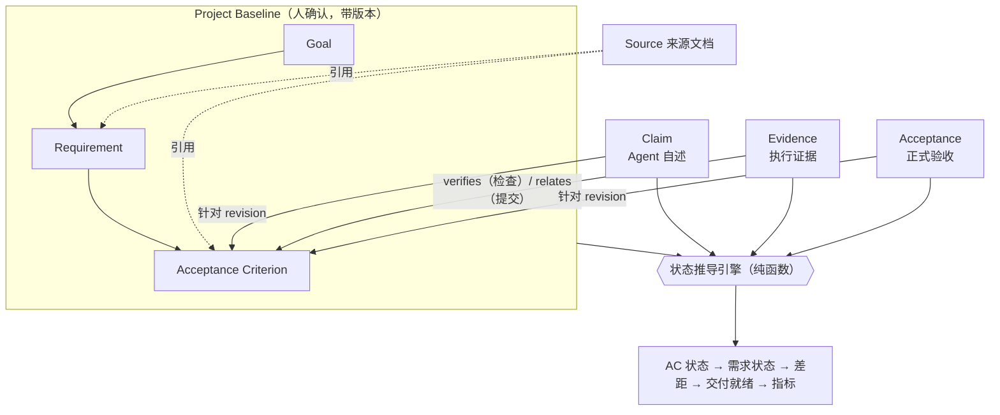
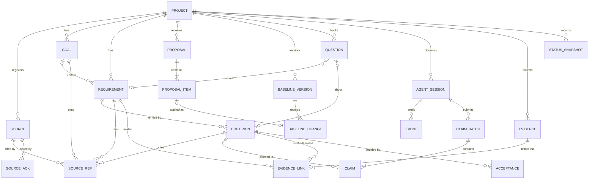
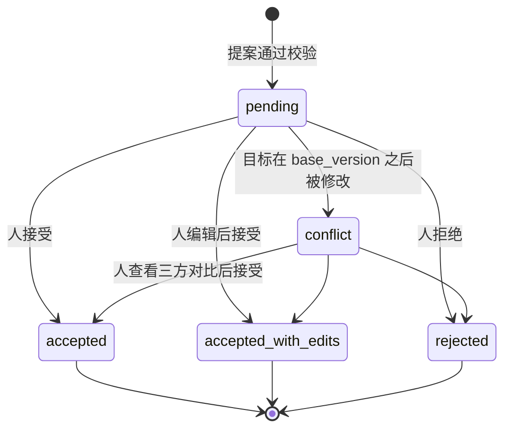
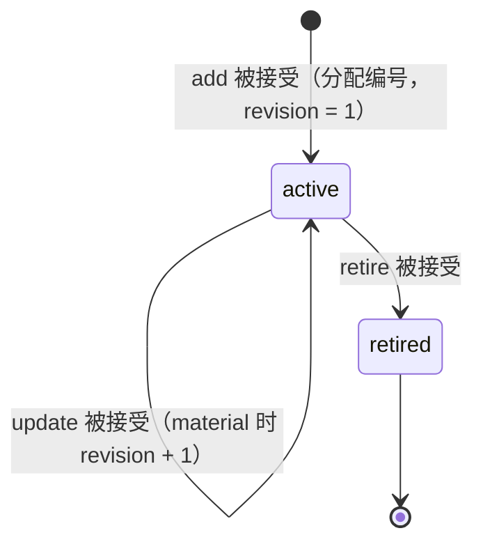

# Specmetry 数据模型

> 状态：Draft v0.1 · 2026-10-13
> 本文定义实体、关系、生命周期和状态推导规则。**§6 的决策表是状态引擎的规范来源**，代码与测试都必须与之一一对应。

## 1. 建模约定

| 约定 | 说明 |
|---|---|
| 主键 | ULID（TEXT，26 字符），全局唯一，按时间有序 |
| 编号（key） | 人类可读，项目内唯一，**永不复用**：`GOAL-1`、`REQ-001`、`AC-001-1`、`Q-001`（TD-14）。AC 编号中嵌入的是创建时所属需求的序号。 |
| 时间 | INTEGER，UTC Unix 毫秒 |
| actor | `agent:<agent>`（如 `agent:claude_code`、`agent:unknown`）、`human:<显示名>`、`system` |
| channel | `agent_cli`、`human_cli`、`dashboard`、`hook`、`system` |
| project_id | 每张表都有该字段，用于按项目删除和未来的同步 |
| JSON 列 | 由应用层按 schema 校验；数据库层只保证是合法 JSON |
| 自由文本 | 持久化前一律经过脱敏（[architecture.md §10.3](architecture.md#103-脱敏)） |

可变性分为两类：

| 类别 | 表 | 规则 |
|---|---|---|
| **只追加（事实）** | `baseline_versions`、`baseline_changes`、`source_acks`、`events`、`claim_batches`、`claims`、`evidence`、`evidence_links`、`acceptances`、`status_snapshots` | 应用层禁止 UPDATE 和 DELETE，数据库触发器作为第二道防线；只有 `purge` 和保留期清理（仅 `events`）例外 |
| **受控可变** | `projects`、`sources`、`goals`、`requirements`、`acceptance_criteria`、`proposals`、`proposal_items`、`questions`、`agent_sessions`、`key_counters` | 基准三表只能通过"应用基准变更"修改；`proposal_items` 的审核字段只能写一次；`questions` 的回答字段只能写一次；`agent_sessions` 是由事件重建的投影 |

## 2. 概念模型



## 3. 实体关系



关键基数：

- 一个需求可以没有 AC，此时状态为 `needs_criteria`，这本身就是一个差距。
- 一个需求最多属于一个目标（可以不属于任何目标）。
- 一条 Claim 至多指向一个 AC（未映射工作不指向任何 AC）。
- 一条证据可以链接多个目标：一个提交可以引用多个需求；一次检查只链接一个 AC。
- 一个 AC 至多有一个检查（TD-18）。

## 4. 实体定义

### 4.1 `projects`

| 字段 | 类型 | 说明 |
|---|---|---|
| id | ULID PK | 与 marker 中的 `project_id` 相同 |
| name | TEXT | |
| root_path | TEXT | 主 worktree 的绝对路径（规范化） |
| git_common_dir | TEXT NULL | 用于把其他 worktree 归属到本项目 |
| stage | TEXT | `docs_only` / `in_development` / `incomplete_docs`（检测值或用户覆盖值） |
| settings_json | TEXT | `sources_skipped`、`inventory_skipped`、`readiness_scope`（PD-01）、`commit_ref_mode`（TD-17） |
| last_scanned_head | TEXT NULL | git 增量扫描位置 |
| created_at, updated_at | INTEGER | |

### 4.2 `sources`

| 字段 | 类型 | 说明 |
|---|---|---|
| id | ULID PK | |
| project_id | ULID | |
| kind | TEXT | `client_requirement` / `product_doc` / `design_doc` / `issue` / `note` / `other` |
| location | TEXT | `in_repo` / `external` / `snapshot`（粘贴文本的快照，P1） |
| path | TEXT | 仓库内为相对路径；仓库外为绝对路径 |
| title | TEXT NULL | |
| sha256 | TEXT | 登记时的哈希，或最近一次 `source ack` 时的哈希 |
| size_bytes | INTEGER | |
| registered_at | INTEGER | |
| removed_at | INTEGER NULL | 软删除，保留历史引用 |

当前文件状态（`unchanged` / `changed` / `missing`）不存储，在读取时与磁盘比对得出。

`source_acks`（只追加）记录每一次"变化已处理"的确认：`id`、`project_id`、`source_id`、`previous_sha256`、`sha256`、`actor`、`channel`、`note`、`acked_at`。确认时同时更新 `sources.sha256`。

### 4.3 基准条目：`goals` / `requirements` / `acceptance_criteria`

三张表的公共字段：

| 字段 | 类型 | 说明 |
|---|---|---|
| id | ULID PK | |
| project_id | ULID | |
| key | TEXT | 项目内唯一，在提案条目被接受时分配 |
| status | TEXT | `active` / `retired` |
| revision | INTEGER | 从 1 开始；只有 `material` 变更才会加 1 |
| origin | TEXT | `extracted` / `inferred_from_code` / `manual` |
| confidence | TEXT NULL | `high` / `medium` / `low`（`manual` 为 NULL） |
| created_version, updated_version, retired_version | INTEGER | 对应的基准版本号 |
| created_at, updated_at | INTEGER | |

各表的专属字段：

| 表 | 字段 |
|---|---|
| `goals` | `title`、`description` |
| `requirements` | `goal_id` NULL、`title`、`description`、`kind`（`functional` / `non_functional` / `constraint`）、`priority`（`must` / `should` / `could` / `wont`，PD-12） |
| `acceptance_criteria` | `requirement_id`、`statement`、`verification`（`automated` / `manual`）、`check_command` NULL、`check_workdir`（默认 `.`）、`check_timeout_sec`（默认 300）、`check_shell` NULL（TD-06） |

约束：

- `check_command` 非空时，`verification` 必须为 `automated`。
- AC 不能在需求之间移动；如需移动，退役后重新新增。

### 4.4 `source_refs`

| 字段 | 类型 | 说明 |
|---|---|---|
| id | ULID PK | |
| project_id, source_id | ULID | |
| entity_type | TEXT | `goal` / `requirement` / `criterion` / `question` |
| entity_id | ULID | |
| locator | TEXT NULL | 例如 `L12-L18`、`§2.3`、`p.4` |
| excerpt | TEXT | ≤ 1000 字符 |
| verification | TEXT | `verified` / `not_found` / `source_missing` / `not_checkable`（非文本来源，例如 PDF） |
| source_sha256 | TEXT | 建立引用时来源文件的哈希 |
| created_at | INTEGER | |

### 4.5 `proposals` 与 `proposal_items`

`proposals`：

| 字段 | 类型 | 说明 |
|---|---|---|
| id | ULID PK | |
| project_id | ULID | |
| origin | TEXT | `skill_init` / `skill_goals` / `skill_audit` / `skill_sync` / `cli` / `human_edit` |
| actor, channel | TEXT | |
| session_id | ULID NULL | |
| summary | TEXT | |
| base_version | INTEGER | 提交时的基准版本号（尚无基准时为 0） |
| created_at | INTEGER | |

提案是否仍待处理不单独存储：只要还有条目处于 `pending` 或 `conflict`，提案就是待处理的。

`proposal_items`：

| 字段 | 类型 | 说明 |
|---|---|---|
| id | ULID PK | |
| proposal_id, project_id | ULID | |
| seq | INTEGER | 条目在提案中的顺序 |
| op | TEXT | `add` / `update` / `retire` |
| entity_type | TEXT | `goal` / `requirement` / `criterion` |
| target_id | ULID NULL | `update` 和 `retire` 的目标 |
| ref | TEXT NULL | `add` 条目在提案内的临时引用 |
| payload_json | TEXT | 提议的值 |
| sources_json | TEXT | 来源引用及其校验结果 |
| code_refs_json | TEXT NULL | `inferred_from_code` 条目的代码依据及存在性校验 |
| rationale | TEXT NULL | |
| origin, confidence | TEXT | |
| review_state | TEXT | `pending` / `accepted` / `accepted_with_edits` / `rejected` / `conflict` |
| final_payload_json | TEXT NULL | 编辑后接受时的最终值 |
| change_class | TEXT NULL | `update` 条目的 `material` / `editorial` |
| reviewed_by, reviewed_channel, reviewed_at, review_note | | 只能写一次 |
| applied_version_id | ULID NULL | |

### 4.6 `baseline_versions` 与 `baseline_changes`

| 表 | 字段 |
|---|---|
| `baseline_versions` | `id`、`project_id`、`number`（项目内从 1 递增，唯一）、`summary`、`actor`、`channel`、`created_at` |
| `baseline_changes` | `id`、`project_id`、`version_id`、`entity_type`、`entity_id`、`op`、`change_class`、`before_json`、`after_json`、`proposal_item_id` |

一次审核提交，在一个事务中产生一个版本和多条变更记录。级联产生的变更（如退役需求时连带退役其 AC）也逐条记录。

### 4.7 `questions`

| 字段 | 类型 | 说明 |
|---|---|---|
| id | ULID PK | |
| project_id | ULID | |
| key | TEXT | `Q-001` |
| text, context | TEXT | |
| related_type, related_id | TEXT, ULID NULL | 关联的需求或 AC |
| proposal_item_id | ULID NULL | 关联到尚未确认的提案条目；条目被接受后回填 `related_id` |
| blocking | BOOLEAN | |
| status | TEXT | `open` / `answered` / `dismissed` |
| answer, answered_by, answered_channel, answered_at | | 只能写一次 |
| origin, proposal_id | | |
| created_at | INTEGER | |

Question 在提案提交时**立即创建**。它不改变基准，因此不需要先审核才能存在。

### 4.8 `agent_sessions`（投影）与 `events`

`agent_sessions`：`id`、`project_id`、`agent`、`external_id`（Agent 自己的会话 ID）、`started_at`、`ended_at`、`end_reason`、`head_start`、`head_end`、`last_event_at`。`(project_id, agent, external_id)` 唯一。它在入库时由事件增量维护；事件过了保留期被清理时，会话记录保留。

`events`：

| 字段 | 类型 | 说明 |
|---|---|---|
| id | ULID PK | 由 Hook 进程生成 |
| project_id | ULID | |
| session_id | ULID NULL | |
| agent | TEXT | |
| type | TEXT | `session_start` / `session_end` / `command` / `file_edit` / `stop` / `guard_denied` |
| occurred_at, ingested_at | INTEGER | |
| payload_json | TEXT | 只含白名单字段，且已脱敏 |
| dedupe_key | TEXT UNIQUE | 等于 Hook 生成的事件 ID |

### 4.9 `claim_batches` 与 `claims`

`claim_batches`：`id`、`project_id`、`kind`（`sync` / `audit` / `manual`）、`actor`、`channel`、`session_id` NULL、`summary`、`git_head`、`created_at`。

`claims`：

| 字段 | 类型 | 说明 |
|---|---|---|
| id | ULID PK | |
| project_id, batch_id | ULID | |
| target_type | TEXT | `criterion` / `none`（未映射工作） |
| criterion_id | ULID NULL | |
| criterion_revision | INTEGER NULL | 提交时 AC 的 revision |
| assertion | TEXT NULL | `done` / `partial` / `not_done` / `blocked`；未映射工作为 NULL |
| summary | TEXT | ≤ 500 字符 |
| refs_json | TEXT | `files[{path, lines}]`、`tests[]`、`commits[]` |
| refs_check_json | TEXT | 每个引用的校验结果：`ok` / `missing` / `unknown_commit` |
| created_at | INTEGER | |

### 4.10 `evidence` 与 `evidence_links`

`evidence`：

| 字段 | 类型 | 说明 |
|---|---|---|
| id | ULID PK | |
| project_id | ULID | |
| kind | TEXT | `check_run` / `commit` |
| result | TEXT | `check_run`：`pass` / `fail` / `error`；`commit`：`info` |
| triggered_channel | TEXT NULL | 是谁触发了检查（`agent_cli` / `human_cli`） |
| session_id | ULID NULL | |
| git_head | TEXT NULL | |
| git_dirty | BOOLEAN NULL | |
| command, command_sha256, shell | TEXT NULL | 检查命令（已脱敏）及其哈希 |
| exit_code, duration_ms | INTEGER NULL | |
| output_tail | TEXT NULL | 最后 4 KB，已脱敏 |
| output_sha256 | TEXT NULL | 完整输出的哈希 |
| log_path | TEXT NULL | 完整日志位置；超过保留期后文件被删除，记录保留 |
| commit_sha, commit_subject, committed_at | NULL | 提交类证据。标题脱敏后截断到 200 字符。`(project_id, commit_sha)` 唯一。 |
| occurred_at, created_at | INTEGER | |

`evidence_links`：

| 字段 | 类型 | 说明 |
|---|---|---|
| evidence_id, project_id | ULID | |
| target_type | TEXT | `criterion` / `requirement` |
| target_id | ULID | |
| target_revision | INTEGER NULL | `verifies` 链接必须填写 |
| relation | TEXT | `verifies`（只有 `check_run` → 它所绑定的 AC）/ `relates`（提交 → 被引用的需求或 AC） |
| link_source | TEXT | `check_binding` / `commit_trailer` / `commit_message` |

主键为 `(evidence_id, target_type, target_id)`。

每条证据至少有一个链接：git 扫描只把至少引用了一个基准编号的提交存为证据。引用了已退役条目的提交照常链接，用于保留历史；引用了不存在编号的提交则忽略。活动页中的完整提交列表实时从 git 读取，不入库。

### 4.11 `acceptances`

| 字段 | 类型 | 说明 |
|---|---|---|
| id | ULID PK | |
| project_id, criterion_id | ULID | |
| criterion_revision | INTEGER | |
| decision | TEXT | `accepted` / `rejected` / `waived` |
| rationale | TEXT | `rejected` 和 `waived` 必填 |
| actor, channel | TEXT | `channel` 只能是 `human_cli` 或 `dashboard` |
| evidence_ids_json | TEXT | 决定时该 AC 最新的 `verifies` 证据 |
| git_head | TEXT NULL | |
| supersedes_id | ULID NULL | 被取代的前一个决定 |
| decided_at | INTEGER | |

### 4.12 `status_snapshots` 与 `key_counters`

- `status_snapshots`：`id`、`project_id`、`taken_at`、`baseline_version`、`trigger`（`ingest` / `check` / `claim` / `acceptance` / `baseline`）、`metrics_json`（§6.8）。
- `key_counters`：`(project_id, entity_type, scope)` 为主键，加上 `next_value`。目标、需求和问题的 `scope` 为空字符串（项目级序列）；AC 的 `scope` 为所属需求的 ID（每个需求一个序列，用来生成 `AC-001-1`、`AC-001-2`……）。分配编号与应用变更在同一事务中完成。

## 5. 生命周期

### 5.1 提案条目



规则：

- 接受一个 `criterion` 的 `add` 条目时，如果它指向的是本提案内的 `requirement`，那个需求条目必须已被接受，或在同一次提交中被接受。否则，这次审核提交整体失败。
- 冲突在加载审核队列时检测，应用变更前会再检测一次。

### 5.2 基准条目（目标 / 需求 / AC）



- `retired` 是终态。要恢复，只能新增条目，并会得到新编号。
- 退役一个需求时，在同一版本中级联退役它的所有 AC。
- 退役一个目标时，在同一版本中把它的需求的 `goal_id` 置为 NULL。

### 5.3 待澄清问题

`open` → `answered` 或 `dismissed`。MVP 中两者都是终态。回答后如果需要改基准，另行提交提案。

### 5.4 验收决定

只追加。对某个 `(criterion, revision)`，"当前决定"是最新的那一条。新决定通过 `supersedes_id` 指向被取代的决定。

## 6. 状态推导

状态推导是纯函数：**同一组事实，无论插入顺序如何，都得出同一结果。** 只有 `active` 的基准条目参与推导。

### 6.1 AC 推导的输入

对每个 `active` 的 AC，记当前 revision 为 `r`，revision `r` 生效的时间为 `tR`：

| 符号 | 定义 |
|---|---|
| `D`, `tD` | 针对 revision `r` 的当前验收决定，以及它的时间。没有则为空。 |
| `t0` | 如果 `D = rejected`，则 `t0 = tD`；否则 `t0 = -∞`。拒收之后，只有拒收之后产生的事实才有效。 |
| `E`, `tE` | 链接到该 AC、`relation = verifies`、`target_revision = r`、`occurred_at > t0` 的最新证据结果（`pass` / `fail` / `error`）及其时间 |
| `C`, `tC` | `criterion_revision = r`、`created_at > t0` 的最新 Claim 断言及其时间 |
| `ACT` | 是否存在 `relation = relates` 的证据，链接到该 AC 或其所属需求，且 `occurred_at > max(t0, tR)`。因此，早于当前 revision 生效时间的提交不会让 AC 进入 `in_progress`。 |
| `H` | 是否存在针对旧 revision（`< r`）的验收决定或 `verifies` 证据 |

### 6.2 AC 状态决策表

自上而下，**命中第一条即停止**：

| # | 条件 | 状态 | 含义 |
|---|---|---|---|
| 1 | `D = waived` | `waived` | 已豁免：本次交付不要求 |
| 2 | `D = accepted`，且 `E ∈ {fail, error}`，且 `tE > tD` | `regressed` | 已验收，但之后检查失败了 |
| 3 | `D = accepted` | `accepted` | 已验收 |
| 4 | `D = rejected`，且拒收之后没有 `E`，也没有断言为 `done` / `partial` / `blocked` 的 `C` | `rejected` | 被拒收，需要返工。拒收之后的提交和 `not_done` 自述都不会改变这一状态。 |
| 5 | `E ∈ {fail, error}` | `failing` | 检查未通过 |
| 6 | `E = pass` | `verified` | 有证据，等待验收 |
| 7 | `C = done` | `claimed` | Agent 自述完成，没有证据 |
| 8 | `C = blocked` | `blocked` | Agent 报告受阻 |
| 9 | `C = partial`，或 `ACT` 为真 | `in_progress` | 进行中 |
| 10 | `H` 为真 | `stale` | AC 已实质修订，旧的证据或验收不再有效，需要复核 |
| 11 | 其他 | `not_started` | 未开始 |

几个要点：

- `C = not_done` 本身不推动状态，结果取决于其他事实；拒收后提交 `not_done`，状态仍保持 `rejected`。
- Claim 永远不能让 AC 越过 `claimed`。
- 规则 2 和规则 3 意味着：已验收的 AC，在之后的检查又通过后，会回到 `accepted`。

### 6.3 AC 标记

标记与状态正交，可以同时存在多个：

| 标记 | 条件 |
|---|---|
| `conflict` | `C = done` 且 `E ∈ {fail, error}`；或 `C = not_done` 且 `E = pass` |
| `unverifiable` | `verification = automated` 且 `check_command` 为空 |
| `evidence_behind_head` | `E` 对应证据的 `git_head` 不等于当前 HEAD（附落后的提交数，P1） |
| `dirty_evidence` | `E` 对应的证据是在有未提交改动的工作区上产生的 |
| `blocking_question` | 存在 `open` 且 `blocking` 的 Question，关联到该 AC 或其所属需求 |
| `unverified_source` | 该 AC 或其需求有 `verification = not_found` 的来源引用 |
| `inferred` | 该 AC 或其需求的 `origin = inferred_from_code` |

### 6.4 需求状态聚合

设该需求的 `active` AC 集合为 `S`，其中非 `waived` 的子集为 `N`。自上而下，命中第一条即停止：

| # | 条件 | 需求状态 |
|---|---|---|
| 1 | `S` 为空 | `needs_criteria` |
| 2 | `S` 全部为 `waived` | `waived` |
| 3 | 任一 AC 为 `regressed` | `regressed` |
| 4 | 任一 AC 为 `failing` | `failing` |
| 5 | 任一 AC 为 `rejected` | `needs_rework` |
| 6 | 任一 AC 为 `stale` | `stale` |
| 7 | `N` 全部为 `accepted` | `accepted` |
| 8 | `N` 全部属于 {`accepted`, `verified`} | `verified` |
| 9 | `N` 全部属于 {`accepted`, `verified`, `claimed`} | `claimed` |
| 10 | 任一 AC 为 `blocked` | `blocked` |
| 11 | 任一 AC 属于 {`in_progress`, `claimed`, `verified`, `accepted`} | `in_progress` |
| 12 | 其他 | `not_started` |

`priority = wont` 的需求照常推导状态，但不参与差距、就绪判定和指标。

### 6.5 展示分组

| 展示分组 | AC 状态 | 需求状态 |
|---|---|---|
| 未开始 | `not_started` | `not_started` |
| 进行中 | `in_progress` | `in_progress` |
| 自述完成 | `claimed` | `claimed` |
| 已验证 | `verified` | `verified` |
| 已验收 | `accepted`、`waived` | `accepted`、`waived` |
| 需关注 | `failing`、`regressed`、`rejected`、`stale`、`blocked` | `failing`、`regressed`、`needs_rework`、`stale`、`blocked`、`needs_criteria` |

### 6.6 差距规则

| 差距类型 | 触发条件 | 基础严重度 | 建议的下一步 |
|---|---|---|---|
| `PENDING_REVIEW` | 存在 `pending` 或 `conflict` 的提案条目 | medium | 审核提案 |
| `BLOCKING_QUESTION` | 存在 `open` 且 `blocking` 的 Question | high | 回答问题 |
| `SOURCE_CHANGED` | 来源文件的哈希已变化或文件缺失，且之后没有 `ack` | medium | 用 `/specmetry goals` 生成差异提案，或确认无需变更 |
| `NEEDS_CRITERIA` | 需求状态为 `needs_criteria` | high | 补充验收标准 |
| `UNVERIFIABLE` | AC 带 `unverifiable` 标记 | medium | 定义检查命令，或改为 `manual` |
| `REGRESSED` | AC 为 `regressed` | high | 修复回退 |
| `FAILING` | AC 为 `failing` | high | 修复 |
| `CONFLICT` | AC 带 `conflict` 标记 | high | 核实自述与证据 |
| `REWORK` | AC 为 `rejected` | high | 按验收意见返工 |
| `STALE` | AC 为 `stale` | medium | 重新运行检查并验收 |
| `BLOCKED` | AC 为 `blocked` | high | 处理阻塞 |
| `CLAIM_UNVERIFIED` | AC 为 `claimed` | medium | 运行检查或人工验收 |
| `AWAITING_ACCEPTANCE` | AC 为 `verified` | low | 人工验收 |
| `IN_PROGRESS` | AC 为 `in_progress` | medium | 继续实现，完成后 sync |
| `NOT_STARTED` | AC 为 `not_started` | medium | 实现 |

每个未处于 `accepted` / `waived` 的 AC，恰好产生一个与其状态对应的差距；带标记的 AC 可以额外产生 `CONFLICT` 或 `UNVERIFIABLE`。

严重度按需求的优先级调整：

| 优先级 | 调整 |
|---|---|
| `must` | 保持基础严重度 |
| `should` | 降一级（high → medium → low） |
| `could` | 一律为 low |
| `wont` | 不产生差距 |

`PENDING_REVIEW`、`BLOCKING_QUESTION` 和 `SOURCE_CHANGED` 是项目级差距，保持基础严重度。

排序依次按：严重度降序 → 本表中的类型顺序 → 优先级 → 编号。

### 6.7 交付就绪

`ready` 当且仅当以下条件**同时**满足：

1. 至少存在一个基准版本；
2. 所有 `active` 且属于就绪范围的需求，状态都是 `accepted` 或 `waived`（就绪范围默认只含 `must`，见 PD-01）；
3. 不存在 `open` 且 `blocking` 的 Question。

不满足时，逐条输出原因。原因代码与上面的条件一一对应：

| 原因代码 | 对应条件 | 附带信息 |
|---|---|---|
| `NO_BASELINE` | 条件 1 | — |
| `REQUIREMENT_INCOMPLETE` | 条件 2，每个不满足的需求一条 | 需求编号、需求状态、该需求下的相关差距 |
| `BLOCKING_QUESTION` | 条件 3，每个阻塞问题一条 | 问题编号 |

以下情况不阻塞就绪，但会作为警告输出：存在待审核提案；存在来源变化；`should` 需求未完成；存在带 `evidence_behind_head` 或 `dirty_evidence` 标记的已验收 AC。

### 6.8 指标

| 指标 | 定义 |
|---|---|
| `must_acceptance_ratio` | 状态为 `accepted` 的 `must` 需求数 ÷（`must` 需求数 − 状态为 `waived` 的 `must` 需求数）。分母为 0 时为 null。（PD-02） |
| `ac_buckets` | 按展示分组统计的 AC 数，按优先级分开统计（不含 `wont`） |
| `claim_unverified` | 状态为 `claimed` 的 AC 数 |
| `conflicts` | 带 `conflict` 标记的 AC 数 |
| `evidence_coverage` | 自动化 AC 中，存在当前 revision 的 `verifies` 证据（任何结果）的比例 |
| `unverifiable` | 带 `unverifiable` 标记的 AC 数 |
| `open_questions`, `blocking_questions` | 问题数 |
| `pending_review_items` | 待审核的提案条目数 |
| `readiness` | `ready` / `not_ready`，以及原因数 |

### 6.9 初始化进度

`init_progress` 由数据推导，定义见 [prd.md §4.1.1](prd.md#411-初始化流程)。条件是累积的：结果是从第一步开始、**连续**满足条件的最后一步。例如设置了 `inventory_skipped`，但还没有基准版本，结果仍然停在前面的步骤。

| 值 | 本步条件 |
|---|---|
| `initialized` | 项目已注册 |
| `sources_registered` | 存在未移除的来源，或设置了 `sources_skipped` |
| `baseline_proposed` | 存在提案 |
| `baseline_confirmed` | 存在基准版本 |
| `inventoried` | 存在 `kind = audit` 的 Claim 批次，或设置了 `inventory_skipped`，或 `stage = docs_only` |

## 7. Revision 与失效规则

| 规则 | 说明 |
|---|---|
| 哪些字段的变更强制为 `material` | AC 的 `verification`、`check_command`、`check_workdir`、`check_shell` |
| 其他字段 | `statement` 等由审核者选择 `material` 或 `editorial`；`check_timeout_sec` 可以是 `editorial` |
| AC revision 从 `r` 变为 `r+1` 后 | 针对 `r` 的验收、`verifies` 证据和 Claim 不再参与推导（如果当前 revision 没有新事实，就命中决策表第 10 条 `stale`） |
| 需求的 `material` 变更 | 不直接影响其 AC 的状态；UI 会提示审核者检查相关 AC |
| 代码变化 | 不使证据失效（TD-11），只产生 `evidence_behind_head` 标记 |
| 退役 | 退役条目不参与任何推导；历史与事实保留 |

## 8. Agent 交换格式

两种格式都通过 `--file` 或 stdin 提交，严格校验：未知字段视为错误。

### 8.1 提案：`specmetry.proposal/v1`

```json
{
  "schema": "specmetry.proposal/v1",
  "origin": "skill_init",
  "summary": "从客户需求文档提取的初始基准",
  "items": [
    {
      "op": "add", "type": "goal", "ref": "g1",
      "data": { "title": "上线订单管理 MVP", "description": "客户首期交付范围" },
      "origin": "extracted", "confidence": "high",
      "sources": [{ "source": "docs/client-brief.md", "locator": "L3-L5", "excerpt": "首期需要上线订单管理" }]
    },
    {
      "op": "add", "type": "requirement", "ref": "r1",
      "data": { "goal": "g1", "title": "用户可以用邮箱和密码登录", "kind": "functional", "priority": "must" },
      "origin": "extracted", "confidence": "high",
      "sources": [{ "source": "docs/client-brief.md", "locator": "L12-L18", "excerpt": "用户需要使用邮箱和密码登录系统" }]
    },
    {
      "op": "add", "type": "criterion", "ref": "c1",
      "data": {
        "requirement": "r1",
        "statement": "使用正确的邮箱和密码登录时返回会话令牌；密码错误时返回 401",
        "verification": "automated",
        "check": { "command": "go test ./internal/auth -run TestEmailLogin", "workdir": ".", "timeout_sec": 120 }
      },
      "origin": "extracted", "confidence": "medium"
    },
    {
      "op": "add", "type": "requirement", "ref": "r2",
      "data": { "title": "订单可以导出为 CSV", "kind": "functional", "priority": "should" },
      "origin": "inferred_from_code", "confidence": "medium",
      "code_refs": [{ "path": "internal/export/csv.go" }],
      "rationale": "代码中已实现，但需求文档未提及"
    },
    {
      "op": "update", "type": "requirement", "target": "REQ-004",
      "data": { "priority": "should" },
      "rationale": "客户邮件同意延后",
      "sources": [{ "source": "notes/client-mail-1010.txt", "excerpt": "报表功能可以放到二期" }]
    },
    { "op": "retire", "type": "criterion", "target": "AC-007-2", "rationale": "客户取消该限制" }
  ],
  "questions": [
    {
      "text": "密码找回走短信还是邮件？", "about": "r1", "blocking": true,
      "sources": [{ "source": "docs/client-brief.md", "locator": "L20", "excerpt": "支持找回密码" }]
    }
  ]
}
```

### 8.2 自述：`specmetry.claims/v1`

```json
{
  "schema": "specmetry.claims/v1",
  "kind": "sync",
  "summary": "实现邮箱登录与会话令牌",
  "claims": [
    {
      "target": "AC-001-1",
      "assertion": "done",
      "summary": "新增 /login 接口并签发会话令牌；补充 TestEmailLogin",
      "refs": {
        "files": [{ "path": "internal/auth/login.go", "lines": "10-58" }],
        "tests": ["TestEmailLogin"],
        "commits": ["3f2a9c1"]
      }
    },
    { "target": "AC-001-2", "assertion": "blocked", "summary": "缺少短信服务商配置，见 Q-002" }
  ],
  "unmapped_work": [
    { "summary": "重构日志初始化", "refs": { "files": [{ "path": "internal/log/log.go" }] } }
  ]
}
```

### 8.3 校验规则

处理方式分两种：

- **拒绝**：整个提交被拒绝，返回退出码 2，不写入任何数据，并以 JSON Pointer 指出错误位置。
- **标记**：照常写入，同时记录校验结果，并在响应中给出警告。

| ID | 规则 | 处理 |
|---|---|---|
| V-P01 | schema 严格校验，`schema` 版本受支持；顶层 `origin` 必须是 `skill_init` / `skill_goals` / `skill_audit` / `skill_sync` / `cli` 之一（`human_edit` 只由 `propose --apply` 和 Dashboard 编辑在内部生成） | 拒绝 |
| V-P02 | `add` 必须带有提案内唯一的 `ref`；`update` / `retire` 必须带有 `target`，且指向 `active` 条目的编号 | 拒绝 |
| V-P03 | `requirement`、`goal`、`about` 字段必须指向 `active` 的编号，或本提案内的 `ref` | 拒绝 |
| V-P04 | 长度：title ≤ 200，description ≤ 4000，statement ≤ 1000，excerpt ≤ 1000，rationale ≤ 1000 | 拒绝 |
| V-P05 | 有 `check` 时，`verification` 必须为 `automated`；`workdir` 规范化后不得越出项目根；`timeout_sec` 在 1–3600 之间 | 拒绝 |
| V-P06 | `sources[].source` 必须是已登记的来源（路径或 ID） | 拒绝 |
| V-P07 | 引用片段校验：统一换行、合并连续空白、去掉首尾空白后，在来源文本中逐字出现 → `verified`；未出现 → `not_found`；文件缺失 → `source_missing`；非 UTF-8 文本 → `not_checkable` | 标记 |
| V-P08 | `inferred_from_code` 条目至少有 1 个 `code_refs` | 拒绝 |
| V-P09 | `code_refs` 的路径存在 | 标记 |
| V-P10 | 同一提案内，同一个 `target` 至多出现一次 | 拒绝 |
| V-C01 | schema 严格校验 | 拒绝 |
| V-C02 | `target` 必须是 `active` 的 AC 编号 | 拒绝 |
| V-C03 | `assertion` 必须是 `done` / `partial` / `not_done` / `blocked` 之一；`blocked` 时 `summary` 必填 | 拒绝 |
| V-C04 | `summary` ≤ 500 字符；`unmapped_work` ≤ 50 条 | 拒绝 |
| V-C05 | 同一批次内，同一个 `target` 至多出现一次 | 拒绝 |
| V-C06 | `kind = manual` 只允许来自 `human_cli` 通道 | 拒绝（退出码 3：需要人工操作） |
| V-C07 | `refs.files` 存在；`refs.commits` 能被 git 解析 | 标记 |
| V-ALL | 所有文本字段先脱敏再保存；命中脱敏时在响应中给出警告 | 标记 |

## 9. 数据保留与删除

| 数据 | 默认保留期 |
|---|---|
| `events` | 90 天（P1 可配置） |
| 检查的完整日志（`logs/checks/`） | 30 天。证据记录本身永久保留。 |
| `spool/dead/` | 30 天 |
| 其他所有表 | 永久，直到 `purge` |

`specmetry purge`：只能在交互式终端中执行，需要输入项目名确认。它删除该项目在数据库中的全部行、检查日志和 spool 文件，并询问是否同时删除仓库中的 `.specmetry/`。其他项目不受影响。

## 10. 相关待决策事项

PD-01、PD-02、PD-03、PD-04、PD-12、PD-13（[prd.md §9](prd.md#9-产品待决策事项)）；TD-01、TD-11、TD-14、TD-17、TD-18（[architecture.md §16](architecture.md#16-技术待决策事项)）。
