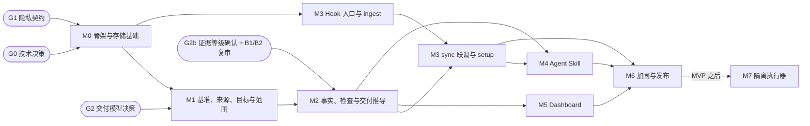

# Specmetry MVP 实施计划

> 状态：Draft v0.3 · 2026-10-13（含 codex-review-002 的处理）
> 依据：[mvp.md](mvp.md)（范围）、[data-model.md](data-model.md)（模型与推导）、[`schemas/`](../schemas/)（契约）、[acceptance-criteria.md](acceptance-criteria.md)（验收）、[review-resolution.md](review-resolution.md)（审查处理）。
> 本计划只排顺序、依赖和退出条件，不估工期。

## 1. 实施原则

1. **契约先行**：`schemas/` 是 CLI 和 API 输入输出的规范来源。实现不能先于 schema 改变格式；要改格式，必须先改 schema 和文档。
2. **推导引擎测试先行**：`domain/derive` 先把 data-model §6 的决策表写成表驱动测试，再实现。每条规则都要有对应的反例（CX）。
3. **独立的检查器**：测试代码中实现一个不复用推导引擎的 `ready` 复核器（不变量 #2），在全部 E2E 中运行。
4. **每个里程碑都可以独立验收**：退出条件是该里程碑全部的 P0 验收项和 CX 项（见 acceptance-criteria 各表的"里程碑"列）。P1 项不阻塞。
5. **范围纪律**：实施中发现需要新功能时，先修改 mvp.md 并获得确认；不能"顺手实现"。
6. **设计变更流程**：修改文档 → 修改 schema（如果涉及，按 TD-20 判断是否升级版本）→ 修改或新增验收项 → 实现。

## 2. 开工前提条件

| 门槛 | 内容 | 阻塞哪个里程碑 |
|---|---|---|
| G0 技术决策 | 确认 TD-02（数据目录）、TD-04（SQLite 驱动；需要先做一个 spike，验证 `VACUUM INTO` 和 WAL 检查点）、TD-10（CLI 框架）、TD-16（迁移策略）、TD-22（Windows ACL 授权对象） | M0 |
| G1 隐私契约 | 确认 PD-20（C1 允许的内容） | M0 中的存储部分 |
| G2 交付模型 | 确认 PD-16（沿用，仅限隔离级证据）、PD-17（例外验收）、PD-19（交付目标形态）、PD-21（范围粒度）；确认 PD-03、PD-04、PD-12 的建议默认 | M1（因为它们会冻结 `decision`、`scope` 和 `proposal` 的契约） |
| G2b 证据等级 | 确认 PD-22（MVP 只提供观测级证据，交付判定标为观测级，人验收时确认风险）；codex 对 B1、B2 的复审通过 | M2（Check Runner 与人工决定的契约在此冻结） |
| G3 许可证 | PD-10 | 接受外部贡献之前（不阻塞内部编码） |

## 3. 设计细化截止点

以下项目已经在模型层面关闭，只剩实现细节需要在对应模块开工前确定。**这些细节都不会改变数据模型或交换契约。**

| 项 | 内容 | 截止 | 关联 |
|---|---|---|---|
| Windows ACL | 授权对象（当前用户；是否加入 SYSTEM）、实现方式、`doctor` 的检测方法 | M0 开工前 | 审查 #12、TD-22 |
| SQLite 驱动 spike | 验证 `VACUUM INTO`、`wal_checkpoint(TRUNCATE)`、`BEGIN EXCLUSIVE`、触发器 | M0 开工前 | TD-04 |
| 密钥规则集 | 内置规则清单、正反样本、配置扩展方式 | M1 开工前 | TD-21 |
| 人类读取模型的 schema | `proposal show`（含三方对比和 `item_id`）、`baseline show/history`、`source list` 的 `--json` 输出 | M1 开工前 | 第二轮自检 #5 |
| `doctor --json` 的 schema | 版本、路径、权限、Hook 与 Skill、spool、兼容版本 | M3 开工前 | 第二轮自检 #5 |
| 隔离执行器的后端 | TD-24：物化方式、只读强制机制、写入探测、执行后比对、子模块和 LFS | M7 开工前（MVP 之后） | codex-002 B1 |
| Windows 上执行检查的 shell | 默认 shell 的探测顺序；`shell` 字段的取值映射 | M2 开工前 | TD-06 |
| `inputs` 的对象 ID | 文件和目录的取值方式；子模块的处理 | M2 开工前 | TD-23 |
| 备份恢复命令（P1） | `backup restore` 的锁、原子替换、恢复后的墓碑处理 | M2 开工前 | 审查 #12 |
| Claude Code Hook 核实 | 事件名、输入字段、PreToolUse 拒绝协议、PowerShell 工具名；固定经过测试的版本范围；更新 architecture §12.1 | M3 开工前 | 审查 #10、TD-12 |
| 其他 Agent 的约束 | Codex 等的沙箱可写路径、是否支持 Skill、受保护的 git 路径；更新兼容矩阵 | M4 开工前 | 审查 #11 |
| Dashboard 技术细节 | OpenAPI 组织方式、SSE、UI 方案、端口 | M5 开工前 | TD-07、08、09、19 |

## 4. 依赖关系

**可以并行**的部分：

- M3 的 Hook 入口和 ingest（只依赖 M0），可以与 M1、M2 并行；
- M5 可以在 M2 的读取模型（`status.v1`）稳定后开始，与 M3、M4 并行。

## 5. 里程碑

### M0 工程骨架与存储基础

**目标**：后续所有模块依赖的基础设施，以及审查 #6（`seq`）和 #12（存储生命周期）中的基础部分。

| 工作包 | 内容 |
|---|---|
| WP0.1 | Go module、cobra CLI 骨架、`version` 与 `doctor`（框架）、lint、三平台 CI |
| WP0.2 | 数据目录与权限：Unix `0700` / `0600`，Windows 受保护的 DACL；`SPECMETRY_HOME`；`config.toml` |
| WP0.3 | SQLite 存储：WAL、`busy_timeout`、单一写连接；迁移框架（`.migrate.lock`、`BEGIN EXCLUSIVE`、`VACUUM INTO` 备份、`schema_version` / `min_binary_version`）；`seq` 计数器；只追加触发器辅助；墓碑检查的挂载点 |
| WP0.4 | 内嵌 `schemas/`，选定 JSON Schema 2020-12 校验库；CI 校验所有 schema 本身，`schemas/examples/valid/` 全部通过，`invalid-cases.json`（SCH-01 ~ 53）全部失败；`error.v1` 输出。设计阶段只用一个精简的自制校验器做过自检，正式校验库的结果以 M0 为准。 |
| WP0.5 | 测试基座：临时 HOME、夹具仓库构造器（用脚本创建 git 仓库、分支、worktree）、golden 工具、伪终端辅助、canary 搜索工具 |
| WP0.6 | 前端工程骨架（Vite + React + TS），通过 `go:embed` 内嵌，并提供跳过前端的构建标签 |

**退出条件（P0）**：MVP-PLT-01、MVP-PRV-05、MVP-PRV-06、MVP-STO-01 ~ 04。
**交付物**：可以运行的 `specmetry version`、`specmetry doctor`；空库的迁移 v1；CI 通过。

### M1 基准、来源、交付目标与范围

**目标**：审查 #4、#5、#8 和中-1 的实现；#3、#6 中属于写入侧的部分。

| 工作包 | 内容 |
|---|---|
| WP1.1 | 项目与 worktree 的解析和登记（git 公共目录）、marker、`init`（输出 `init.v1`，包括 `init_progress` 和 `baseline_version`）、阶段检测、候选来源、默认交付目标 |
| WP1.2 | 通道识别：TTY、已知的 Agent 环境变量、交互式确认组件 |
| WP1.3 | 密钥规则与自由文本校验（拒绝写入） |
| WP1.4 | 来源：`add` / `list` / `remove` / `ack`，哈希，来源集合哈希，变化检测 |
| WP1.5 | 提案：schema 校验、版本前置条件、引用片段校验、代码引用、编号分配（AC 按需求的作用域分配） |
| WP1.6 | 审核：逐条决定、冲突检测与三方对比、版本与变更记录、级联、父需求修订与 AC 后续处理、`reaffirm`、`propose --apply` |
| WP1.7 | 待澄清问题（只能由人回答） |
| WP1.8 | `target set`、`scope confirm`（独立提交，或附带在审核中）、声明校验 |

**退出条件（P0）**：acceptance-criteria 中标注 M1 的全部 P0 项，以及 CX-14、CX-17（CLI 部分）。标注为"M1 / M2"的项，在 M1 中只验证写入侧（退出码、写入的数据、`init --json` 的输出），推导侧（差距、交付状态）在 M2 中验证。
**可选（P1）**：MVP-INIT-08、INIT-10、INV-05。

### M2 事实、检查执行与交付推导

**目标**：审查 #1（检查侧）、#2、#3（执行与扫描）、#6（Claim、决定、检查）、#7、#9 和 #12（`purge`）的实现。**这是 MVP 的核心里程碑。**

| 工作包 | 内容 |
|---|---|
| WP2.1 | **推导引擎（测试先行）**：适用性、AC 决策表、进度、标记、需求聚合、目标交付状态、差距、指标、初始化进度、保守规则；性质测试 |
| WP2.2 | 独立的 `ready` 复核器（测试代码） |
| WP2.3 | Git Reader：解析 ref、porcelain 状态、对象 ID、按 ref 维护游标的增量扫描、提交关联（只保存 SHA） |
| WP2.4 | Claim：前置条件、代码上下文、`audit_scope`、覆盖率、会话关联（在 M3 之前，只按"上一批次"取比较起点） |
| WP2.5 | Check Runner（观测级）：开始时固定上下文、在调用者的 worktree 中执行、进程树、输出转发（`--json` 时转发到 stderr，stdout 只有 JSON）、合格判定、`context_changed`、`inputs`、标注 `evidence_grade = observed`；`--isolation required` 返回退出码 6，不写记录。**不实现**隔离执行器。 |
| WP2.6 | 决定：前置条件（含 `seen_decision_id`，在写事务中原子比较）、风险推导与确认（V-D01）、`normal` / `manual` / `exception`、交互式的 `accept` / `reject` / `waive`（收到退出码 5 后重新读取，不自动重试） |
| WP2.7 | `status --json`（`status.v1`）、`gaps`、人类可读输出、`--diff-since <seq>` |
| WP2.8 | `purge` 与墓碑生效；（P1）`backup create`、`backup restore` |
| WP2.9 | 夹具与 oracle：`fx-docs-only`、`fx-in-dev`（含 feature 分支和 worktree 脚本）、`fx-incomplete`、`fx-scale`；完整的 CX 测试套件 |

**退出条件（P0）**：标注 M2 的全部 P0 项（包括 M1 / M2 项的推导侧；INIT-07、INIT-09、BL-18、WT-02 ~ 05、INV-01 ~ 04、CLM、EV（含 EV-12、EV-13）、ACC（ACC-03 除外，含 ACC-10、ACC-11）、ST（ST-06 除外）、PRV-03、PLT-05、COL-12），以及 **CX-01 ~ CX-22、CX-24 的检查部分、CX-25 ~ CX-28 的 MVP 部分**（CX-08 的 UI 部分和 CX-23 除外）。
**可选（P1）**：INV-06、STO-05。
**里程碑评审**：M2 结束时，用 CX 结果和 E2E-1、E2E-2 的 CLI 版本做一次设计复核，确认推导规则在真实夹具上没有产生意外结论，然后再进入 M4 和 M5。

### M3 Hook 采集与 setup

**目标**：审查 #10 的实现，以及 #1 在 Hook 侧的部分。

| 工作包 | 内容 |
|---|---|
| WP3.0 | （开工前）核实 Hook 事件与字段，固定版本范围，更新 architecture §12.1 |
| WP3.1 | Hook 入口：输入上限、内部预算、不访问数据库的项目与 worktree 解析、读文件获取 HEAD、白名单、原子写 spool、drop 标记 |
| WP3.2 | PreToolUse 拦截（Bash、PowerShell），宁可误拦 |
| WP3.3 | ingest：`seq`、去重、会话投影、drop 汇总、死信、30 天保留 |
| WP3.4 | `setup` / `setup --uninstall`：用户级或项目级、展示改动、交互式确认 |
| WP3.5 | `sync` 的比较起点（加入 `session_start`）和 `changed_paths` |
| WP3.6 | `doctor`：Claude Code 版本、权限、Hook 与 Skill 状态 |

**退出条件（P0）**：标注 M3 的全部 P0 项（INIT-05、INIT-06、CLM-04 的会话部分、WT-03 的会话与事件部分、ACC-03、COL-01 ~ 11、COL-13、COL-15、PRV-04、PLT-04），以及 CX-24 的 `setup` 部分。

### M4 Agent Skill

**目标**：审查 #9（Skill 侧）和 #11（禁止事项与兼容）的实现。**开始 dogfooding。**

| 工作包 | 内容 |
|---|---|
| WP4.0 | （开工前）核实其他 Agent 的约束，更新兼容矩阵 |
| WP4.1 | Skill 包：`SKILL.md`；参考文档（粒度指南、交换格式、版本前置条件与退出码 5 的处理、禁止事项、worktree 与交付视图的区别） |
| WP4.2 | Skill 静态检查（命令树、禁止事项、schema 一致性） |
| WP4.3 | 评测框架，在三个项目夹具上运行 |
| WP4.4 | dogfooding：把 acceptance-criteria 导入为 Specmetry 自身的基准 |

**退出条件（P0）**：MVP-SK-01 ~ 07。
**可选（P1）**：MVP-SK-08。

### M5 Dashboard

| 工作包 | 内容 |
|---|---|
| WP5.1 | OpenAPI（请求体引用 `schemas/`），并审查"没有设置状态的接口"（MVP-ST-06） |
| WP5.2 | 服务端：令牌（不输出到 stdout）、Host 与 Origin、CSP、SSE、各端点、409 |
| WP5.3 | 页面：项目列表、概览（目标、快照、交付状态、阻塞差距）、基准树、审核队列（含 AC 后续处理和范围确认）、需求详情（含决定）、差距、健康 |
| WP5.4 | Playwright 测试套件（含页面过期时的处理、没有外部请求） |

**退出条件（P0）**：标注 M5 的全部 P0 项（BL-05 的 UI 部分、ACC-01 的 API 部分、ACC-07 的 API 部分、ST-06、COL-14、UI-01 ~ 14），以及 CX-08 的 UI 部分、CX-23。

### M6 加固与发布

| 工作包 | 内容 |
|---|---|
| WP6.1 | E2E-1 ~ 8，三平台运行，断言全部不变量 |
| WP6.2 | 隐私：在禁止出站网络的环境中运行（PRV-01）；C0 canary 综合测试（PRV-02） |
| WP6.3 | 在发布候选版本上回归性能基准（ST-08、COL-01、UI-04 已分别在 M2、M3、M5 首次通过），并验证路径健壮性（PLT-02） |
| WP6.4 | 打包分发（TD-15）；README：快速上手、数据位置、隐私契约摘要、能力边界 |
| WP6.5 | 3 个真实项目试用，并输出 dogfooding 报告 |

**退出条件**：[mvp.md §7](mvp.md#7-mvp-完成定义) 中的全部条件；发布 v0.1.0。

### M7 隔离执行器（MVP 之后，不属于 v0.1.0）

**目标**：提供 `snapshot_isolated` 证据，让沿用（PD-16）在实际中生效。开工前确定 TD-24。

| 工作包 | 内容 |
|---|---|
| WP7.1 | 私有快照物化与树一致性验证 |
| WP7.2 | 至少一个平台上的只读强制后端（由隔离后端强制，不依赖文件权限位），以及执行前写入探测 |
| WP7.3 | 执行后树比对；`--isolation required` 与 `auto` 的完整语义 |
| WP7.4 | 追加 CX-26 ~ CX-28 的隔离级部分，以及沿用相关的集成测试（ACC-09 的隔离级部分） |

在 M7 完成之前，任何文档、界面和输出都不得声称"快照已验证"。

## 6. 审查问题的关闭计划

| 审查问题 | 设计状态 | 实现验证（里程碑；目前均未开始） | 验证依据 |
|---|---|---|---|
| #1 隐私 | 本轮 | M2（检查）、M3（Hook）、M6（综合） | EV-05、EV-11、COL-05、PRV-02 |
| #2 交付代码绑定 | 主体：v0.2；剩余部分见 B1 | M2 | CX-01、CX-02、CX-19 ~ 22 |
| codex-002 B1 证据与快照一致性 | v0.3 设计已解决（分级证据；MVP 只有观测级，并收窄保证）；**待复审冻结** | M2（观测级、不沿用、风险确认）；M7（隔离级） | EV-13、ACC-09 ~ 10、CX-26 ~ 28 |
| #3 worktree | 本轮 | M1（登记）、M2（执行与扫描） | WT-*、CX-03、CX-04 |
| #4 交付范围 | 本轮 | M1（确认）、M2（推导） | TGT-*、CX-05、CX-06、CX-18 |
| #5 父需求依赖 | 本轮 | M1（后续处理）、M2（推导） | BL-18 ~ 20、CX-07 |
| #6 前置条件与 `seq` | 主体：v0.2；剩余部分见 B2 | M0（`seq`）、M1（写入侧）、M2（Claim、决定、检查） | STO-04、BL-03、BL-10、CX-08、CX-09、CX-13 ~ 15 |
| codex-002 B2 旧页面覆盖拒收 | v0.3 设计已解决（`seen_decision_id`）；**待复审冻结** | M2（CLI）、M5（API 与界面） | ACC-11、CX-08 (e)(f) |
| #7 检查语义 | 本轮 | M2 | ACC-04 ~ 06、CX-19 ~ 21 |
| #8 来源确认 | 本轮 | M1 | SRC-03、SRC-04、CX-17 |
| #9 盘点 | 本轮 | M2（模型）、M4（Skill） | INV-*、CX-10、SK-06 |
| #10 Hook | 模型：本轮；细节：M3 开工前 | M3 | COL-*、ACC-03 |
| #11 跨 Agent | 措辞：本轮；核实：M4 开工前 | M3、M4、M5 | SK-03、UI-14、CX-23 |
| #12 数据生命周期 | 模型：本轮；ACL：M0 开工前；恢复：M2 开工前 | M0、M2 | PRV-03、05、06、STO-*、CX-11 |
| 中-1 引用归属 | 本轮 | M1 | BL-04、BL-22 |
| 中-2 退出条件 | 本轮 | — | 本计划的结构 |
| 中-3 离线边界 | 本轮 | M6 | PRV-01 |

## 7. 风险跟踪

| 风险 | 触发信号 | 应对 |
|---|---|---|
| 推导规则在真实项目上过于保守，导致很难得到 `ready` | M2 评审或 dogfooding 中，大量 `needs_reverification` 被认为不合理 | 先确认是否是规则缺陷，再修改 data-model §6 与对应的 CX；**不能**为了"好看"放宽保守规则 |
| 检查会弄脏工作区，导致执行普遍不合格 | dogfooding 中 `context_changed` 频繁出现 | 完善文档与 `doctor` 的提示；不放宽合格判定 |
| Claude Code Hook 接口变化 | WP3.0 核实结果与 §12.1 不一致 | 只修改适配器映射；`spool-event.v1` 不变 |
| JSON Schema 校验库对 2020-12 支持不完整 | WP0.4 选型时发现 | 在 M0 中更换库，或调整 schema 写法（不改变语义） |
