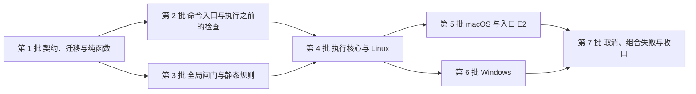

# WP2.5 Check Runner：生产实施与验收计划

> 状态：**已审查并采纳**（2026-10-31；审查 120 计划技术 GO；review-resolution §151、§152）。
>
> - **第一批**（§4.1）获条件授权：PR #46（本计划）的合并核验与 master push CI 全部成功之后才生效，另开实现 PR。
> - **未授权**：后续批次、实现 PR 的合并与 WP2.5 的验收。
>
> 本文依据已冻结的 [WP2.5 规范](wp2.5-check-runner.md)（§22），安排生产实现的分批、顺序、接线与验收证据。它不改变冻结的规则，不扩大 MVP 范围；本文本身不授权实施，授权见 review-resolution。各批的开工、合并与 WP2.5 的验收，都由负责人分别决定（§9）。本文不含生产代码，也不修改 Schema、迁移或 workflow。

## 1. 固定的依据

| 依据 | 固定的版本 | 用法 |
|---|---|---|
| WP2.5 规范 | 冻结于 2026-10-31：冻结的文档提交 `f99d648`，合并提交 `1d3f456`（PR #45）；技术基准为第 10 版第二稿 `f2b5c87` | 全部规则。§22 的采纳清单、优先关系与限定；§21.11 的冻结之后的工作 |
| 交换契约 | `1d3f456` 中的 `schemas/`：`check-run.v1`、`error.v1`、`common.v1`、`status.v1` | 实现不能先于 Schema 改变格式（implementation-plan §1） |
| 数据模型 | data-model §4.11、§4.11.1、§4.11.2、§6、§7.4 | `check_runs` 的字段、合格判定与执行步骤 |
| 验收项 | acceptance-criteria 的 MVP-EV-01 ~ 32、CX 与不变量（规范 §13 的映射） | 每批的验收与证据 |
| 已验收的上游 | WP2.1、WP2.2（推导与复核器）；WP2.3 库层（`gitx`，含 `Clean` 的方案 B 边界）；WP2.4（Claim） | 只调用，不改语义 |
| 原型的证据 | `prototype/wp25`（P-1 ~ P-5，原型文档） | 只作设计依据与证据；**不是生产实现**（§2.3） |

冻结之后，若实施中发现规则无法实现或彼此冲突，先报告，经独立审查与负责人决定之后再修订规范（规范 §22.3 第 5、6 项）；不在实现中自行变通。

## 2. WP2.5 的边界

### 2.1 在范围内

规范 §1 的范围，以及规范 §21.11 列出的全部 P：

- **命令**：`specmetry check run [AC...] [--all] [--isolation off|required] [--json]` 的完整处理顺序（规范 §3、§4），包括执行之前的全部检查与 D18 的空批次。
- **执行与记录**：
  - 代码上下文、输入记录与合格判定（规范 §7）；
  - 结果分类（规范 §6，D5、D12、D17）；
  - `check_runs` 的写入与迁移 0009（规范 §10、§19.10；D14 的约束实现）；
  - 输出 `check-run.v1` 与文本（规范 §11），错误为 `error.v1`（D10）。
- **进程**：
  - 三个平台的进程组 / Job、收尾协议与时限（规范 §8，G2）；
  - Linux 的全局闸门与能力探测（G4、G6）；
  - macOS 的 kqueue 加 waitid，生产调用入口 E2（G5、C-13）；
  - Windows 的启动链与恢复的结果（G7）；
  - F1 的资源所有权（G3）；
  - 宿主的禁用状态、准入与资源清单（G1、C-4、D21、Q-1）。
- **输出与取消**：
  - 输出接口与受控目的端（规范 §9.1，G10，D20）；
  - 取消（D8、G9）。
  - 组合失败与持久化的叠加（规范 §8.6，G15）。
- **解释器**：查找、来源、PATH 与命令传递（规范 §5，D1 ~ D4，G8、G11，C-18）；D3、D4 在写入路径上的业务校验（V-P04 的扩展，data-model §8.3）。
- **静态规则**：C-9 的两类规则的生产 lint（规范 §19.4）。

### 2.2 不在范围内

- 隔离执行器、`snapshot_isolated`、`--isolation auto` 的执行（M7）。
- `status`、`gaps` 中执行结果的展示（WP2.7）；验收决定（WP2.6）；完整的 CX 套件与 E2E 的 CLI 版本（WP2.9）；Hook 与会话关联（M3）。
- 维护事项 M-1、M-14 ~ M-17、N-087-1 的修复。实施中遇到它们，只登记观测。
- 规范冻结时声明的 L（规范 §22.5）：它们不因生产实现而被宣称已验证；能构造的部分按 §19 的生产测试做。

### 2.3 原型与生产的关系

- 生产包不导入 `prototype/wp25`，原型模块也不进入生产构建。
- 生产代码可以参考原型的设计，但须按冻结规范重新实现，并在生产测试中重新取证。
- 原型的诊断结果不计入生产验收；模型与接缝的结果不计作原生故障或生产事务的保证。

## 3. 顺序的原则

1. **契约先行**：凡涉及交换格式或表结构的批次，提交顺序固定为：
   1. Schema 与示例；
   2. 迁移；
   3. 写入或读取它们的实现；
   4. 业务测试。

   顺序与 implementation-plan §1 第 1、6 条一致。没有 Schema 的变化时，跳过第 1 步，不预先改格式。
2. **测试先行**：纯函数部分（分类、真值表、时间字段、合格判定）先写表驱动测试，每条规则对应规范中的行与反例。
3. **每批独立**：
   - 每批一个 PR，有固定的代码点，经独立审查、负责人合并。
   - 合并之前，常规 CI 在最终 HEAD 上正式成功。
   - 不顺带实现后续批次的内容。
4. **中间状态不暴露给用户**：`check run` 命令在第 7 批才注册到 CLI 的命令树（§9 的决定 2，负责人确认方案 (a)）。之前各批通过包内接口与测试入口验证，不在 master 上出现行为不完整的用户命令。
5. **故障注入不掩盖真实错误**：
   - 测试接缝只在真实前提成立时替换结果。
   - 注入点之外的真实错误照常进入终判。
   - 每个注入都有不注入的对照。

   这条沿用原型审查（Review 116 B-116-2）的教训，是证据要求，不是新的规则。

## 4. 分批与依赖

第 5、6 批都只依赖第 4 批，可以并行审查；合入同一基线时，保留共享核心的回归。第 7 批在两者之后。

### 4.1 第 1 批：契约、迁移与纯函数（第一批的具体交付）

**范围**（§152）：

- 只有下列四项。
- 不纳入工具链、依赖或 CI 配置的变更。
- 不注册 `check run`。
- 不接入检查进程、全局闸门、平台管理或生产入口 E2。
- 不提前实现第 2 批的读快照等接口。

**提交顺序**：

1. Schema 与示例；
2. 迁移；
3. 纯函数的固定预期测试；
4. 相应的实现与存储接线；
5. 集成验证。

这同时满足 §3 的契约先行与纯函数的测试先行。

**交付**：

1. **Schema 与示例**（D14 的约束实现）：
   - `check-run.v1` 中执行项的条件约束（`if/then`），按规范 §19.10 的 D14 列表：
     - 允许 `context_changed` 与退出码 0；
     - 允许信号的 `fail` 与 NULL；
     - 不因 `error` 自动要求不合格。
   - 合法示例：每类结果至少一个，包括 `context_changed` 带退出码 0、信号的 `fail`。
   - 非法示例：D14 每一条约束各一个，包括 Review 089 所举的 `pass + timeout + exit_code 0`。它们写入 `schemas/examples/invalid-cases.json`。
   - `internal/contract` 的既有测试覆盖编译、合法通过与非法失败。
2. **迁移 `0009_check_runs`**：
   - 表、列与约束，按规范 §10.1 的完整设计。下列不是穷尽的列举：
     - 结果的一致性 CHECK；
     - 新行排除 `not_found`（D5）；
     - `evidence_grade = observed`；
     - `project_id` 与同项目外键；
     - `seq` 唯一。
   - 附加只追加的触发器（`AppendOnlyTriggers`）。迁移文件中包含触发器的定义，不只引用函数名。
   - 编号连续；按 development.md §5 判断是否设置 `min_binary_version`，在迁移的 PR 中说明理由。
3. **存储层**：
   - 在 `DB.WriteTx` 中写入一条 `check_runs`，用 `NextSeq` 分配 `seq`；
   - 首次登记 worktree 时另取一个 `seq`，与事实写入在同一事务中（规范 §10.3）；
   - 记录绑定开始时的修订，之后基准改变不拒绝写入（D13、CX-15）；不照搬 `0008_claims` 的当前修订校验；
   - `dbdump` 显式查询与映射，保留原始事实，不在读取中推导（规范 §18 的“实现时”）。
4. **纯函数**（测试先行）：
   - 分类：规范 §6.2 的表与优先规则；
   - 上下文变化：规范 §7.2 的表；
   - 真值表：规范 §19.10 的每一行；
   - 时间字段与 `exit_code` 的统一规则：规范 §10.1，含 D19 的两种定义区间与 A6、A12；
   - `qualifying`：规范 §7.4；
   - D9 的批次汇总。

**实施与验收的限定**（Review 120 §4）：

- **D14**：
  - 每条约束都有合法与非法的固定预期，不只测典型的 `pass`。
  - 保留 `context_changed` 带退出码 0、信号的 `fail` 带 NULL，以及历史 `not_found` 的读取兼容。
  - 不给 `exit_code` 加全局的 `maximum=255`，不因 `error` 自动判为不合格。
- **NULL**：JSON 的 `null` 与 SQLite 的 NULL 分开测试。SQL CHECK 的未知值不能让非法行通过：例如 `pass` 带 NULL 退出码被拒绝，信号的 `fail` 带 NULL 通过。
- **存储**：首次 worktree 登记失败、事实写入失败与事务回滚时，由存储测试验证行与 `seq` 的状态；不引入 SQLite 的自动重试或新的错误映射。
- **纯函数**：
  - 测试的预期直接来自冻结条文的行与合法的事件序列。
  - 再与推导引擎已验收的行为对照。共用同一个实现相互比对，不能作为独立的正确性证明。
  - 不改变 WP2.1、WP2.2 已验收的语义。`derive` 中的 `qualifying` 未导出；是否抽取内部的公共纯函数，在实现 PR 中确定并经审查。
- **业务测试**：还要覆盖 Schema 无法表达的结束上下文与完整的 `qualifying`。

**验收与证据**：

| 内容 | 验收项与反例 | 证据 |
|---|---|---|
| D14 的约束与示例 | 规范 §19.10 的反例 | 契约测试：合法示例通过，非法示例失败 |
| 迁移与只追加 | MVP-EV-07；不变量 7（`seq` 严格递增）；`TestEveryTableHasProjectID`、`TestProductionSQLNeverUsesReplace` | 存储测试；迁移的升级与 CHECK 的拒绝用例 |
| 分类与真值表 | MVP-EV-04 的分类部分；规范 §19.10 的每一行 | 表驱动测试，测试名标注规则的行 |
| `qualifying` 与 D9 | MVP-EV-24 的计算部分；规范 §7.4 | 固定预期的表驱动测试，再与推导引擎对照 |
| 存储的写入与回滚 | 规范 §10.3；D13、CX-15 | 首次登记、事实写入与回滚的行与 `seq`；固定旧修订的写入 |

三平台的常规 CI 即可，不需要真实的进程环境。

### 4.2 第 2 批：命令入口与执行之前的检查

不启动检查的进程。实现规范 §4.1 的第 1 ~ 10 步与 §3：

- **解析与选择**：
  - 解析：`--isolation required` 为退出码 6，`auto` 为退出码 2（D16）。
  - 选择：显式 AC 与 `--all`；重复的 AC 整体预检（D15）；按编号排序（E1）。
- **配置与 worktree**：
  - 配置在一个读事务中一次固定（D13）。
  - worktree 路径的密钥扫描。
- **静态规则与写入路径的校验**：
  - 执行之前的静态规则：D3、D4 的 CR / LF。
  - 写入路径上同一规则的业务校验（V-P04 的扩展），不写成共用 Schema 的约束。
- **解释器**：查找与来源（规范 §5.3、§5.4，G8、G11）。Windows 只取 `gitx` 所用 Git 对应的 Git for Windows 的 `usr\bin`；任一不可用时整批退出码 6（D1）。
- **git 与输出句柄**：
  - PD-26 的拒绝；私有临时区；交付目标快照 `S` 的读取。
  - 输出句柄的类型判断，不受支持的 Writer 在启动之前拒绝（D20 (i)、C-7）。
- **宿主对象**（G1）：禁用状态、准入（同锁检查与置位）、每项之前再检查、资源清单的数据结构（规范 §19.1）。置位的生产路径在第 4 ~ 6 批接入；本批用测试接缝置位。
- **空批次**：只登记的写事务（D18、E3）。
- **D10 的错误输出**：只用 `error.v1` 的既有字段，`problem` 为受控文本。

**验收与证据**：

- **验收项**：MVP-EV-06、MVP-EV-13 与 CX-28(a)、MVP-EV-20、MVP-EV-21 与 CX-29、MVP-EV-27，以及 MVP-EV-19 中查找与来源的部分。
- **D15、D16**：各自的拒绝用例。
- **G1**：§19.1 生产测试的准入部分。
  - 置位发生在准入之前、之间与之后；
  - 被拒绝的调用没有数据库与 git 访问（计数的测试接缝）；
  - 清单为空之后仍拒绝。
- **每个拒绝路径**：比较全部事实表，断言没有新行、没有分配 `seq`（规范 §7.5 的总表）。
- **布局与 PATH**（规范 §19.8 的布局矩阵）：
  - 标准安装在 CI 上测试；便携版、Scoop、MinGit 能在 CI 上构造的部分测试，其余如实记为 L。
  - PATH 的大小写、重复与缺失。
  - 符号链接、联接、短文件名与大小写的排除。

### 4.3 第 3 批：全局闸门与静态规则

- **闸门**（规范 §19.4，G4、C-8）：进程级的共享 / 排他租约，等待可取消且没有固定的总上界；git 的先后与自锁标记。
- **接入**：`gitx`、`doctor` 与 ACL 检查改为经闸门启动与回收子进程。只改接线，不改它们已验收的语义；既有测试保持通过。
- **SIGCHLD 的前提**（C-10）：`signal.Ignored(SIGCHLD)` 为真时不启动。
- **C-9 的两类规则**（规范 §19.4）：
  - 第一类：启动与回收的闸门。
  - 第二类：macOS waitid 的原始入口与指令，白名单只含一个包，平台、指令与用途逐项列出。
  - 实现：生产 lint 按类型解析调用目标，扫描 `.s` 文件与指令。第三方依赖只做第一类的扫描。标准库与 `golang.org/x/sys` 不套用第二类。
  - 方案的选择（§9 的决定 5）：
    - 优先采用不新增依赖的可靠方案，例如标准库 `go/types` 加 `go list`；
    - 具体设计在本批固定并经审查；
    - 不能因为不新增依赖而牺牲类型解析、平台或汇编的覆盖；
    - 需要新增依赖时（例如 `golang.org/x/tools`）先提出，经负责人批准。
  - 运行方式：作为常规测试的一部分，在三个 `GOOS` 上分别分析。

**验收与证据**：

- **§19.4 的生产测试**：
  - 闸门的排他区间与并发检查；
  - 进程内并发的 `Execute`；
  - 取消中的等待；
  - 自锁标记。
- **反例**：绕过闸门的启动；另一个回收者。
- **lint 的导入者测试**：
  - 每一种被禁止的调用（含方法值、函数变量与类型别名）都被发现；
  - 第二类白名单之外出现 `//go:linkname` 或 `//go:cgo_import_dynamic` 被发现；
  - 白名单包中的其他系统调用被发现；
  - 每一类都有通过的对照。
- 仓库现有的生产代码通过 lint。

### 4.4 第 4 批：执行核心与 Linux

第一次端到端的执行，在 Linux 上完成。

- **执行路径**（规范 §4.2）：
  - 开始与结束的上下文；
  - 输入记录 L1 ~ L4（L1 为退出码 6、不执行、不记录；L2 为 `input_missing`、不启动进程）；
  - 命令行的适配器（C-18，`sh`、`bash`、`pwsh`）；
  - 环境：注入 `SPECMETRY_CHECK=1`；标准输入为空设备（E8）。
- **收尾协议**（规范 §8.5，S0 ~ S6）：
  - J 阶段先建立截止，再启动停止任务；
  - 共享时钟与 `T_kill`、`T_drain`、`T_join`（G2）；
  - F1（G3、C-15）；观察失败不可撤销（C-19）。
- **Linux 平台层**：
  - 进程组、subreaper 与 pidfd（C-14）；
  - 排他区间与拒绝路径的收尾（C-20）；
  - 能力探测（G6）；
  - 组信号之前核对组长（C-11）；确认结束只看成员枚举（C-12）；
  - 主进程退出之后的后代（D11）；信号（D12）；
  - 清理保证的范围（D7）。
- **输出**（规范 §9.1，G10，D20）：
  - 继承句柄的生产路径，受控内存目的端的管道路径；
  - 容量规则（C-5、C-6）；O1 ~ O3；
  - 停止任务与资源清单（C-2、C-3）；
  - O3 与 D21 的宿主禁用（C-4），接入第 2 批的宿主对象。
- **记录**：
  - 正常、超时、`spawn_error`、`input_missing`；
  - D6、D19 的尝试记录与 Q-1 的禁用；
  - 写事务与提交之前的校验（规范 §4.2 第 6 步）；
  - 文本与 `--json` 输出（E4，MVP-EV-12）；
  - 批次汇总（D9）。

**验收与证据**（Linux CI，带 `-race`）：

- **解释器的准备**（N-120-2）：Linux CI 上的 `sh`、`bash`、`pwsh` 最迟在本批准备并验证。缺失时测试失败，不以平台的 SKIP 代替。需要的 CI 资源变更届时另行授权。
- **验收项**：
  - MVP-EV-01、02、03（Linux：后台、双重 fork、`setsid` 脱离与收养）、04、05 与 12、08、09；
  - CX-16；
  - MVP-EV-10 与 17 的 L1 ~ L4；
  - MVP-WT-02 与 CX-04、MVP-WT-03；
  - MVP-INV-03；
  - CX-15；
  - CX-24 的检查部分；CX-26、27 的执行部分；
  - MVP-EV-22、24、25、26；
  - MVP-EV-28（测试接缝）；
  - MVP-EV-29。
- **门槛的生产测试**：
  - §19.1：O3、D21、F1 的置位；晚到的错误；
  - §19.2：在假时钟上逐分支核对，含 F1 与 S1 的跳转；
  - §19.3；
  - §19.6：注入每一项的失败；
  - §19.9：子进程实际继承的描述符的枚举；
  - §19.10：每一行的业务测试，含 D19 的两种定义。
- **规范 §15 的“收尾”各条**：
  - 不返回的复制任务与永不返回的停止（测试接缝）；
  - 封闭之后没有写入；
  - O3 之后同一宿主中新的调用被拒绝，清单清空之后仍被拒绝。
- 每个用例结束时断言没有遗留进程（测试基座的遗留断言）。

### 4.5 第 5 批：macOS 与入口 E2

- **macOS 平台层**：
  - 进程组；`sysctl` 的成员枚举、预算与错误出口；
  - kqueue `EVFILT_PROC` 加 waitid 的结构；
  - W1 ~ W5、K1、K2、C1 的解码，W3b 按 Q-3 (a)（规范 §19.5）。
- **生产调用入口 E2**：
  - 放在 C-9 第二类白名单中唯一的包里；
  - `//go:cgo_import_dynamic` 从 libSystem 导入 `waitid`，`//go:linkname` 取得 `syscall.syscall6`，每个架构一份跳板；
  - 包的调用者只在闸门包中（第一类）。
- **工具链**（N-120-1，最迟在本批之前落实，§8，§9 的决定 3）：
  - 可靠地选择固定的 Go 补丁版本；
  - 防止工具链的自动切换；
  - 构建与测试断言实际的 Go 版本与 `CGO_ENABLED`，与预期不符即失败。

  `golang.org/x/sys` 的版本固定。升级 Go 或 x/sys 时复核入口：linkname 是 x/sys 之外“被容忍”的用法，可能收紧（规范 §21.5）。

**验收与证据**：

- **两个架构**：MVP-EV-32 在 arm64 与 x86_64 上分别执行，使用入口 E2。
  - x86_64 需要新的 CI 作业（§9 的决定 4）。
  - 它与 macOS 两个架构上的解释器准备与验证，最迟在本批就绪（N-120-2）；资源变更届时另行授权。
- **macOS 上的执行**：MVP-EV-03、25、28。
- **§19.5 的生产测试**：
  - 注入 `ENOMEM`、`EINTR` 与核对不一致；
  - 跳板的测试；
  - 身份或结构的核对不成立时为观察失败，不规范化为退出码。
- **作业日志**：读取实际的 OS 版本、内核、Go 版本与 `CGO_ENABLED`。日志的记录是补充；版本与 CGO 的判定由上述断言完成。
- **较旧的 macOS**：可以取得较旧版本的 runner 时，增加下限附近的版本（规范 §21.11 的 macOS 一行；§9 的决定 4）。
- **限制保持 L**：已测组合以外的版本与硬件（规范 §22.5），不因生产测试通过而被宣称已验证。

### 4.6 第 6 批：Windows

- **启动链**（规范 §19.7，G7）：
  - 挂起创建、Job、确认与恢复；
  - `ResumeThread` 的四种结果；
  - 恢复之前的管理失败（E5、A4、A5）；
  - 恢复的结果异常：A6 与 A12，按 Q-1、Q-2 (a)；
  - 父端期限与句柄的移交。
- **终止**：终止请求与实际结束分开（C-17）。
- **退出码与解释器**：
  - 退出码原样记录，不推断信号（D17）；
  - `cmd`、`pwsh`、`powershell`；
  - Git for Windows 的 `sh` / `bash`，MSYS 与 MSVCRT 的命令行规则（C-18）；
  - PATH 前置只作用于本次检查及其后代（D2）。
- **已测的启动分支**（C-16）。

**验收与证据**：

- **解释器的准备**（N-120-2）：Windows 上的 `cmd`、`pwsh`、`powershell` 与 Git for Windows 的 `sh` / `bash` 最迟在本批准备并验证。缺失时测试失败；资源变更届时另行授权。
- **验收项**：
  - MVP-EV-03（Git Bash 的后代）；
  - MVP-EV-19（Windows 的来源与 PATH）；
  - MVP-EV-31（A4、A5、A12 与宿主禁用）；
  - MVP-EV-04 中 `cmd`、`powershell` 的部分。
- **§19.7 的生产测试**：
  - 每一步的注入；
  - 句柄关闭与移交的核对；
  - 与规范 §8.6、持久化的组合。
- **未构造的原生失败点**：如实记为 L，不冒称已验证。

### 4.7 第 7 批：取消、组合失败与收口

- **取消**（D8、G9）：
  - Unix 上向 CLI 进程发送 SIGINT、SIGTERM；
  - Windows 上在独立的控制台进程组中发送 CTRL_C / CTRL_BREAK；
  - 生产入口捕获 SIGTERM；
  - 与事务的组合（规范 §17.5 G15）。
- **组合失败**：规范 §8.6 A、B、C、D、E 表的每一行；持久化失败叠加在之前的状态之上；提交阶段的错误为“结果不确定”。
- **CLI 的接线**：注册 `check run`（§3 第 4 条）。`cli.Execute` 在生产中只以 `os.Stdout`、`os.Stderr` 调用（规范 §9.1）。

**验收与证据**（三平台）：

- **取消与组合失败**：
  - MVP-EV-23；
  - MVP-EV-30：每一行都有用例；
  - CX-30（D7）；
  - CX-02 的执行部分。
- **端到端的收口**：
  - MVP-EV-05 的完整隐私：数据库、WAL、日志、备份、私有临时区与数据目录中都没有 canary；
  - MVP-ST-10 中 `check run --json` 的部分：输出通过 `check-run.v1` 的校验，错误输出通过 `error.v1`；
  - 两个进程并发执行时，`seq` 唯一、各自的行完整；
  - 终端、重定向与 PTY 的进程级测试，按现有基座在支持的平台运行，跳过的如实记录；
  - MVP-ACC-09 的集成部分（WP2.5 的一半：执行之后经推导进入 `ready_for_review`，没有人参与时不变为 `accepted`）。
- **不变量与 G15**：
  - 不变量 4、6、7、9；
  - 规范 §15 中尚未覆盖的条目；
  - G15 的逐分支对照表：§8.6 的每一行对应到测试名。
- **WP2.5 的验收证据包**（§7）。

## 5. 接线总览

| 关注点 | 规则所在 | 生产位置（建议，第一次实施时确定） | 批次 |
|---|---|---|---|
| CLI 与处理顺序 | 规范 §3、§4 | `internal/cli` 的 `check run` 命令；Runner 的编排放在独立的包中 | 2、7 |
| 记录与持久化 | 规范 §10、§19.10 | 迁移 0009；`internal/store/sqlite` 的写入 | 1、4 |
| 分类、时间与合格判定 | 规范 §6、§7、§10.1 | Runner 包中的纯函数 | 1 |
| 全局闸门 | 规范 §19.4 | 一个闸门包，`gitx`、`doctor`、ACL 检查接入 | 3 |
| 平台入口 | 规范 §8.2、§19.5 ~ §19.7 | 按平台的进程管理包；macOS 的 waitid 入口为第二类白名单中唯一的包 | 4、5、6 |
| 资源持有与宿主禁用 | 规范 §19.1、§19.3 | 进程级的宿主对象；资源清单 | 2、4 |
| 取消 | 规范 §8.4 | `cmd/specmetry` 的信号捕获，经上下文传给 Runner | 7 |
| 输出 | 规范 §9.1、§19.9 | 继承句柄的路径；受控内存目的端（测试使用） | 4 |
| 事务与失败处理 | 规范 §4.2、§8.6、§11.4 | Runner 的写事务与 §8.6 的叠加规则 | 4、7 |

包名与文件布局是实现细节，在第一批的 PR 中写定并经审查；它们不改变规则。Runner 的测试使用独立的包，具体布局在实施 PR 中确定；CLI 包只保留少量的接线测试。独立的测试包是工程安排，不表示 M-16 已解决，也不保证今后的耗时（§8，N-120-3）。

## 6. 每批共同的证据要求

- **固定对象**：每轮审查有固定的 HEAD、树与 base；代码点之后的纯文档提交不改变代码与 workflow。
- **CI 回执**：常规 CI 在最终 HEAD 上正式成功，回执写入 PR 描述：
  - 八个作业的实际 checkout；
  - 合并快照的父提交与树；
  - SKIP 与 FAIL；
  - 新增的作业（若有）的版本信息。
- **追溯**：测试函数的注释写验收项编号（development.md §6），规则的测试写规范的行或条目编号。
- **平台与跳过**：
  - 需要的解释器随首次使用的批次在 CI 上明确准备并验证（N-120-2）：Linux 最迟第 4 批，macOS 两个架构最迟第 5 批，Windows 最迟第 6 批。缺失时测试失败，不静默跳过（规范 §15 的“平台”）。CI 资源的变更届时另行授权。
  - 平台无关的跳过如实列出。
- **失败处理**：
  - CI 失败时停止并报告，不自行重跑；重跑须负责人逐次授权，并保留首次失败的记录。
  - 维护事项的再次出现只登记观测。
- **证据的类别**：真实执行、注入与测试接缝分开报告。接缝只证明消费者的处理，不证明原生故障。
- **偏离**：实施中发现需要偏离冻结规范时，先停下报告，不带入代码。

## 7. WP2.5 的验收

在第 7 批合并之后，由负责人决定。证据包包括：

- 每一批的合并提交、审查结论与 master push CI；
- 验收项与测试的对照表：MVP-EV-01 ~ 32、规范 §13 中的 CX 与不变量、G1 ~ G15 的生产测试；
- 三个平台与 macOS 两个架构的执行记录；
- 冻结时声明的 L 的现状：哪些由生产测试补上了能构造的部分，哪些仍为 L（规范 §22.5）；
- 与 WP2.6、WP2.7 的接口：MVP-ACC-09 的闭环与 `status` 中的展示，在那两个工作包中完成。

验收不以原型、模型、接缝或常规 CI 的通过代替真实的业务与事务证据。M2 的整体验收在其余工作包之后，由负责人另行决定。

## 8. 工具链、依赖与验证预算

**当前的版本**（master `1d3f456`）：

| 项 | 版本 | 说明 |
|---|---|---|
| Go | `go.mod` 为 `go 1.27`，没有 `toolchain` 行 | CI 的 `actions/setup-go@v7.0.0` 按 `go-version-file: go.mod` 解析版本。run 41183578045 与 41184821491 的三个 Go 测试作业实际为 go1.27.3，但这是解析的结果，不是固定。P-5 的证据是在 Go 1.27.3、`CGO_ENABLED=0` 下取得的 |
| `golang.org/x/sys` | v0.49.0 | 与 P-5 相同 |
| `modernc.org/sqlite` | v1.60.1 | 不变 |
| `github.com/spf13/cobra` | v1.10.2 | 不变 |
| `github.com/santhosh-tekuri/jsonschema/v6` | v6.0.3 | 契约测试 |
| golangci-lint | v2.14.0 | 不变 |

**计划的约束**：

- **不新增运行时依赖**。C-9 的 lint 若需要新的依赖（例如 `golang.org/x/tools`），须负责人批准（§9 的决定 5）。
- **工具链**（N-120-1，§9 的决定 3）：入口 E2 的生产实现要求固定 Go 的补丁版本与 `CGO_ENABLED`。
  - 最迟在第 5 批之前落实：
    - 可靠地选择补丁版本，例如在 setup-go 中显式指定版本；
    - 防止工具链的自动切换；
    - 构建与测试断言实际的 Go 版本与 `CGO_ENABLED`，与预期不符即失败。
  - 不能只凭 `go.mod` 的 `toolchain` 行或作业日志中的打印宣称绝对锁定。
    - 本地的默认工具链更高时，Go 的工具链选择不因这一行而降级。
    - setup-go 读取 `toolchain` 行还是 `go` 行，取决于调用之前的配置。
    - 依据是 Review 120 N-120-1 所引的固定源码。
  - 其他等效的接线也可以，经审查采用。第一批不改工具链、依赖或 CI 配置（§152）。
  - 升级 Go 或 x/sys 时，在 macOS 两个架构上复核入口 E2 的构建、绑定与运行测试；不新增静态或生产 ABI 的保证。
- **验证预算**：
  - 每批记录三平台上新增包的测试耗时，与 master `1d3f456` 的 run 41183578045 比较。
  - **M-16 的历史风险与当前的测量值分开**（N-120-3）。M-16 是历史上观测到的 Windows 上 `internal/cli` 测试接近期限的风险，其原因没有确定。当前的测量值如下表：它们是观测值，不是最大耗时的保证，也不是根因或 M-16 关闭的依据。

    | `internal/cli` | master run 41183578045 | PR #46 run 41184821491 | 当前的期限 |
    |---|---:|---:|---|
    | Ubuntu（普通测试，含 race） | 536.131 s | 540.777 s | 600 s（`go test` 的默认值） |
    | macOS | 135.782 s | 123.246 s | 600 s（`go test` 的默认值） |
    | Windows（独立的 CLI 步骤） | 391.027 s | 352.376 s | 1200 s（`-timeout 20m`） |

    数值取自六份作业日志的 `ok` 行（Review 120 §6，已独立复核）。当前最接近期限的是 Ubuntu 的普通 race 测试。
  - Runner 的测试放在独立的包中，可以减轻同包串行测试的压力，但不能消除机器资源的竞争，也不保证今后不超时。需要调整预算时，另提具体依据，经负责人授权。
  - 真实进程的测试都有自己的截止与收尾断言，不使用没有上界的等待。
  - 每轮审查只推送一个固定代码点；CI 只在负责人授权时重跑。

## 9. 负责人的决定

2026-10-31，review-resolution §152。审查对象 `c1c30e0` 中的选项与建议保留为历史；本表是采纳之后的版本。

| # | 事项 | 决定 | 最迟的落实 |
|---|---|---|---|
| 1 | 第一批的开工 | 只授权 §4.1，另开实现 PR；PR #46 的合并核验与 master push CI 全部成功之后生效。后续批次、实现 PR 的合并与工作包的验收都不授权 | 第一笔生产变更之前（实施登记） |
| 2 | 中间批次在 master 上的形态 | 方案 (a)：`check run` 在第 7 批才注册，之前只经包内接口与测试入口。任何提前暴露须另行决定 | — |
| 3 | 工具链的固定 | 第一批不纳入工具链、依赖或 CI 配置的变更。按 N-120-1 落实可靠的补丁版本选择、防止自动切换、实际版本与 CGO 不符即失败（§8） | 第 5 批之前 |
| 4 | CI 的作业与解释器 | 解释器随首次使用的批次准备并验证（N-120-2）；macOS x86_64 作业随第 5 批。较旧的 macOS runner 与受限容器按可用性提出；不可用时按冻结的规则保留证据的限制，不缩小支持承诺。资源变更届时另行授权 | Linux 第 4 批；macOS 两个架构第 5 批；Windows 第 6 批 |
| 5 | C-9 lint 的实现方式 | 优先采用不新增依赖的可靠方案，第 3 批固定具体设计；需要新增依赖时先提出（§4.3） | 第 3 批的设计与实施之前 |
| 6 | Runner 测试的位置 | 独立的包，具体布局在实施 PR 中确定。不表示 M-16 已解决（N-120-3） | 第一批的包布局 |
| 7 | 验收的时点与证据包 | 第 7 批合并之后，由负责人按 §7 的证据包另行决定 | WP2.5 验收之前 |

本计划没有提出新的产品选择、支持范围或信息保留的变化，也没有改变冻结的规则。若实施中某项会改变冻结的规则，或需要新的产品或兼容政策，须先报告。
