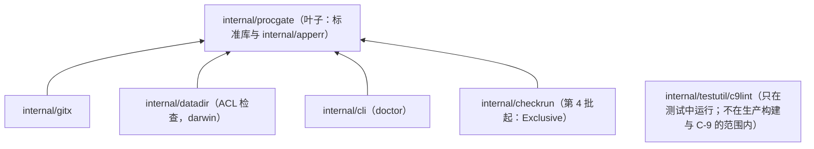

# WP2.5 Check Runner：生产实施与验收计划

> 状态：**已审查并采纳**（2026-10-31；审查 120 计划技术 GO；review-resolution §151、§152）。
>
> - **第一批**（§4.1）获条件授权：PR #46（本计划）的合并核验与 master push CI 全部成功之后才生效，另开实现 PR。2026-10-31 已生效（§153），实施登记见 §10。审查 121、122 之后在受审范围内技术通过，实现 PR #47 获条件授权以 merge commit 合并（§155）。
> - **第二批**（§4.2）获条件授权：PR #47 的合并核验与 master push CI 全部成功之后才生效，另开实现 PR，不合并（§155）。2026-11-01 已生效（§156），实施登记见 §11。审查 123 ~ 125 之后在受审范围内技术通过，实现 PR #48 获条件授权以 merge commit 合并（§161）。
> - **第三批**（§4.3）只获具体设计准备的条件授权：PR #48 的合并核验与 master push CI 全部成功之后才生效，另开纯文档 PR，不合并（§161）。2026-11-01 已生效（§162），具体设计见 §12。审查 126 为设计技术 NO-GO（B-126-1 ~ 5），§12 已修订为第二稿，Q-B3-1 (a) 的最小可行性验证计划另成文档（[wp2.5-c9-link-proof-plan.md](wp2.5-c9-link-proof-plan.md)），待独立复审（§163）。审查 127 为设计技术 NO-GO（B-126-2 ~ 5 在设计范围内关闭；残余 B-126-1-R；新增 B-127-1、B-127-2），§12 已修订为第三稿，链接验证计划已修订为第二稿，待独立复审（§164）。审查 128 为设计技术 NO-GO（三项阻塞的主体修订成立而各有残余），§12 已修订为第四稿，链接验证计划已修订为第三稿，待独立复审（§165）。审查 129 为设计技术 NO-GO（B-126-1-R、N-128-1 在设计层面关闭；B-127-1、B-127-2 仍有残余），§12 已修订为第五稿，链接验证计划已修订为第四稿，待独立复审（§166）。审查 130 认定共享的 pidfd 缺陷与 B-127-2 在设计层面关闭、链接验证计划第四稿定向技术 GO（执行未授权），唯一的文档阻塞是 B-130-1；§12 已做最小收尾为第六稿，待独立复审（§167）。审查 131 技术 GO（B-130-1、N-130-1／2 在设计规格层面关闭，B-127-1 在受审的设计范围内整体关闭），负责人条件授权以 merge commit 合并 PR #49 作为纯文档设计；文档合并不是提案的采纳、实现的授权或工作包的验收（§168）。PR #49 已合并为 `30bc8aa`；链接方法的只读审计见 [wp2.5-c9-link-method-audit.md](wp2.5-c9-link-method-audit.md)（§169）。审查 132 对审计记录限定技术 GO：原方法停止正确，仍不可执行；提案 M-1 ~ M-5 没有作为完整可执行的方案采纳，M-2 的弱结论不足以支持原 Q-B3-1 (a)。负责人条件授权以 merge commit 合并 PR #50 作为审计记录，原 (a) 强命题的限定证明准备在其合并核验成功之后获条件授权（§170）。PR #50 已合并为 `9c58606`；原 (a) 强命题的限定证明准备见 [wp2.5-c9-strong-claim-proof-prep.md](wp2.5-c9-strong-claim-proof-prep.md)，待独立审查（§171）。审查 133 对证明准备记录限定技术 GO（没有任何实际产物的 absent / present 证据；H-1 未采纳，原方法继续停止；F-5 与信号能力的方案仍未解决），N-133-1、N-133-2 已做最小精化；负责人条件授权以 merge commit 合并 PR #51，H-1 方法候选稿与依赖策略的决策准备在其合并核验成功之后获条件授权，不采纳 H-1，不选择缩小的 (a)，不批准依赖例外或新的 L（§172）。PR #51 已合并为 `56d41b9`；H-1 的方法候选稿与依赖策略的决策准备见 [wp2.5-c9-host-set-method-draft.md](wp2.5-c9-host-set-method-draft.md)，待独立审查（§173）。审查 134 对它为文档技术 NO-GO（B-134-1 ~ 4），第二稿已定向修订，待独立复审；(b) 是待决的保证弱化方案，不是技术必选项（§174）。审查 135 关闭 B-134-1、2、4，残余 B-134-3-R 与新增 B-135-1 仍为 NO-GO，第三稿已定向修订（§175）；审查 136 关闭 B-135-1，B-134-3-R 尚余派生列表的来源接点，第四稿已定向修订（§176）；审查 137 对第四稿文档技术 GO（B-134-3-R 关闭，B-134-3 整体收口；N-137-1 已精化），条件授权以 merge commit 合并 PR #52 作为方法候选稿记录（H-1 未采纳，执行未授权），方案 (b) 的精确例外与保证变化决策稿在其合并核验成功之后获条件授权，不选择 (b)，不批准例外或新的 L（§177）。PR #52 已合并为 `d12a347`，master push CI 重跑失败的 lint 作业之后正式成功；方案 (b) 的决策稿（[wp2.5-c9-dependency-exception-draft.md](wp2.5-c9-dependency-exception-draft.md)）待独立审查，不合并，(b) 未选择（§178）。审查 138 为文档技术 NO-GO（B-138-1），第二稿已定向修订，待独立复审，不合并（§179）。审查 139 对第二稿为文档技术 GO，决策稿获条件授权以 merge commit 合并，作为决策准备记录：政策与风险未接受，实施未授权（§180）。PR #53 已合并为 `0c16055`。负责人 2026-11-10 选择方案 (b) 的路径 1（采纳 T-1，接受 L-b1a 的限定；T-2 暂不决定），只授权 G-4 方法规格的纯文档准备（[wp2.5-c9-exception-identity-method.md](wp2.5-c9-exception-identity-method.md)），待独立审查；冻结条款与本计划的同步须另行审查与决定，本计划的规则不变（§181）。审查 140 对方法稿第一稿为文档技术 NO-GO（B-140-1 ~ 4），第二稿已定向修订，待独立复审；本计划的规则不变（§182）。审查 141 对第二稿仍为文档技术 NO-GO（残余 B-140-4-R，新增 B-141-1），第三稿已定向修订，待独立复审；按 §183 的授权，本计划只改了第 2 种调用的命令规格（§12.10 的两处与 §12.14 第 2 条：原模板 `{{json context}}` 在固定工具链上不能解析，改为模板 T2），其余规则不变（§183）。审查 142 对第三稿在限定的文档范围内技术 GO，方法稿作为方法规格准备记录条件授权合并；待决项保留，实施与执行未授权，本计划的规则不变（§184）。PR #54 已合并为 `0a7ce6c`；C-9 限定取证计划与前置决定稿见 [wp2.5-c9-limited-evidence-plan.md](wp2.5-c9-limited-evidence-plan.md)，待独立审查，只有推荐；本计划的规则不变，工具的实现与执行未授权（§185）。审查 143 对它的第一稿为文档技术 NO-GO，第二稿待定向复审；本计划的规则不变（§186）。审查 144 对第二稿仍为文档技术 NO-GO（残余 B-143-2-R），第三稿待定向复审；本计划的规则不变（§187）。审查 145 对第三稿仍为文档技术 NO-GO（残余 B-143-2-R/P），第四稿待定向复审；本计划的规则不变（§188）。审查 146 对第四稿为文档技术 GO，它作为限定取证计划准备记录合并；本计划的规则不变，工具的实现与执行未授权（§189）。
> - **未授权**：第三批的实现、Q-B3-1 (a) 可行性验证的执行、第四批及之后的批次与 WP2.5 的验收。
>
> 本文依据已冻结的 [WP2.5 规范](wp2.5-check-runner.md)（§22），安排生产实现的分批、顺序、接线与验收证据。它不改变冻结的规则，不扩大 MVP 范围；本文本身不授权实施，授权见 review-resolution。各批的开工、合并与 WP2.5 的验收，都由负责人分别决定（§9）。本文不含生产代码，也不修改 Schema、迁移或 workflow。

## 1. 固定的依据

| 依据 | 固定的版本 | 用法 |
|---|---|---|
| WP2.5 规范 | 冻结于 2026-10-31：冻结的文档提交 `f99d648`，合并提交 `1d3f456`（PR #45）；技术基准为第 10 版第二稿 `f2b5c87` | 全部规则。§22 的采纳清单、优先关系与限定；§21.11 的冻结之后的工作 |
| 交换契约 | `1d3f456` 中的 `schemas/`：`check-run.v1`、`error.v1`、`common.v1`、`status.v1` | 实现不能先于 Schema 改变格式（implementation-plan §1） |
| 数据模型 | data-model §4.11、§4.11.1、§4.11.2、§6、§7.4 | `check_runs` 的字段、合格判定与执行步骤 |
| 验收项 | acceptance-criteria 的 MVP-EV-01 ~ 32、CX 与不变量（规范 §13 的映射） | 每批的验收与证据 |
| 已验收的上游 | WP2.1、WP2.2（推导与复核器）；WP2.3 库层（`gitx`，含 `Clean` 的方案 B 边界）；WP2.4（Claim） | 只调用，不改语义 |
| 原型的证据 | `prototype/wp25`（P-1 ~ P-5，原型文档） | 只作设计依据与证据；**不是生产实现**（§2.3） |

冻结之后，若实施中发现规则无法实现或彼此冲突，先报告，经独立审查与负责人决定之后再修订规范（规范 §22.3 第 5、6 项）；不在实现中自行变通。

## 2. WP2.5 的边界

### 2.1 在范围内

规范 §1 的范围，以及规范 §21.11 列出的全部 P：

- **命令**：`specmetry check run [AC...] [--all] [--isolation off|required] [--json]` 的完整处理顺序（规范 §3、§4），包括执行之前的全部检查与 D18 的空批次。
- **执行与记录**：
  - 代码上下文、输入记录与合格判定（规范 §7）；
  - 结果分类（规范 §6，D5、D12、D17）；
  - `check_runs` 的写入与迁移 0009（规范 §10、§19.10；D14 的约束实现）；
  - 输出 `check-run.v1` 与文本（规范 §11），错误为 `error.v1`（D10）。
- **进程**：
  - 三个平台的进程组 / Job、收尾协议与时限（规范 §8，G2）；
  - Linux 的全局闸门与能力探测（G4、G6）；
  - macOS 的 kqueue 加 waitid，生产调用入口 E2（G5、C-13）；
  - Windows 的启动链与恢复的结果（G7）；
  - F1 的资源所有权（G3）；
  - 宿主的禁用状态、准入与资源清单（G1、C-4、D21、Q-1）。
- **输出与取消**：
  - 输出接口与受控目的端（规范 §9.1，G10，D20）；
  - 取消（D8、G9）。
  - 组合失败与持久化的叠加（规范 §8.6，G15）。
- **解释器**：查找、来源、PATH 与命令传递（规范 §5，D1 ~ D4，G8、G11，C-18）；D3、D4 在写入路径上的业务校验（V-P04 的扩展，data-model §8.3）。
- **静态规则**：C-9 的两类规则的生产 lint（规范 §19.4）。

### 2.2 不在范围内

- 隔离执行器、`snapshot_isolated`、`--isolation auto` 的执行（M7）。
- `status`、`gaps` 中执行结果的展示（WP2.7）；验收决定（WP2.6）；完整的 CX 套件与 E2E 的 CLI 版本（WP2.9）；Hook 与会话关联（M3）。
- 维护事项 M-1、M-14 ~ M-17、N-087-1 的修复。实施中遇到它们，只登记观测。
- 规范冻结时声明的 L（规范 §22.5）：它们不因生产实现而被宣称已验证；能构造的部分按 §19 的生产测试做。

### 2.3 原型与生产的关系

- 生产包不导入 `prototype/wp25`，原型模块也不进入生产构建。
- 生产代码可以参考原型的设计，但须按冻结规范重新实现，并在生产测试中重新取证。
- 原型的诊断结果不计入生产验收；模型与接缝的结果不计作原生故障或生产事务的保证。

## 3. 顺序的原则

1. **契约先行**：凡涉及交换格式或表结构的批次，提交顺序固定为：
   1. Schema 与示例；
   2. 迁移；
   3. 写入或读取它们的实现；
   4. 业务测试。

   顺序与 implementation-plan §1 第 1、6 条一致。没有 Schema 的变化时，跳过第 1 步，不预先改格式。
2. **测试先行**：纯函数部分（分类、真值表、时间字段、合格判定）先写表驱动测试，每条规则对应规范中的行与反例。
3. **每批独立**：
   - 每批一个 PR，有固定的代码点，经独立审查、负责人合并。
   - 合并之前，常规 CI 在最终 HEAD 上正式成功。
   - 不顺带实现后续批次的内容。
4. **中间状态不暴露给用户**：`check run` 命令在第 7 批才注册到 CLI 的命令树（§9 的决定 2，负责人确认方案 (a)）。之前各批通过包内接口与测试入口验证，不在 master 上出现行为不完整的用户命令。
5. **故障注入不掩盖真实错误**：
   - 测试接缝只在真实前提成立时替换结果。
   - 注入点之外的真实错误照常进入终判。
   - 每个注入都有不注入的对照。

   这条沿用原型审查（Review 116 B-116-2）的教训，是证据要求，不是新的规则。

## 4. 分批与依赖


第 5、6 批都只依赖第 4 批，可以并行审查；合入同一基线时，保留共享核心的回归。第 7 批在两者之后。

### 4.1 第 1 批：契约、迁移与纯函数（第一批的具体交付）

**范围**（§152）：

- 只有下列四项。
- 不纳入工具链、依赖或 CI 配置的变更。
- 不注册 `check run`。
- 不接入检查进程、全局闸门、平台管理或生产入口 E2。
- 不提前实现第 2 批的读快照等接口。

**提交顺序**：

1. Schema 与示例；
2. 迁移；
3. 纯函数的固定预期测试；
4. 相应的实现与存储接线；
5. 集成验证。

这同时满足 §3 的契约先行与纯函数的测试先行。

**交付**：

1. **Schema 与示例**（D14 的约束实现）：
   - `check-run.v1` 中执行项的条件约束（`if/then`），按规范 §19.10 的 D14 列表：
     - 允许 `context_changed` 与退出码 0；
     - 允许信号的 `fail` 与 NULL；
     - 不因 `error` 自动要求不合格。
   - 合法示例：每类结果至少一个，包括 `context_changed` 带退出码 0、信号的 `fail`。
   - 非法示例：D14 每一条约束各一个，包括 Review 089 所举的 `pass + timeout + exit_code 0`。它们写入 `schemas/examples/invalid-cases.json`。
   - `internal/contract` 的既有测试覆盖编译、合法通过与非法失败。
2. **迁移 `0009_check_runs`**：
   - 表、列与约束，按规范 §10.1 的完整设计。下列不是穷尽的列举：
     - 结果的一致性 CHECK；
     - 新行排除 `not_found`（D5）；
     - `evidence_grade = observed`；
     - `project_id` 与同项目外键；
     - `seq` 唯一。
   - 附加只追加的触发器（`AppendOnlyTriggers`）。迁移文件中包含触发器的定义，不只引用函数名。
   - 编号连续；按 development.md §5 判断是否设置 `min_binary_version`，在迁移的 PR 中说明理由。
3. **存储层**：
   - 在 `DB.WriteTx` 中写入一条 `check_runs`，用 `NextSeq` 分配 `seq`；
   - 首次登记 worktree 时另取一个 `seq`，与事实写入在同一事务中（规范 §10.3）；
   - 记录绑定开始时的修订，之后基准改变不拒绝写入（D13、CX-15）；不照搬 `0008_claims` 的当前修订校验；
   - `dbdump` 显式查询与映射，保留原始事实，不在读取中推导（规范 §18 的“实现时”）。
4. **纯函数**（测试先行）：
   - 分类：规范 §6.2 的表与优先规则；
   - 上下文变化：规范 §7.2 的表；
   - 真值表：规范 §19.10 的每一行；
   - 时间字段与 `exit_code` 的统一规则：规范 §10.1，含 D19 的两种定义区间与 A6、A12；
   - `qualifying`：规范 §7.4；
   - D9 的批次汇总。

**实施与验收的限定**（Review 120 §4）：

- **D14**：
  - 每条约束都有合法与非法的固定预期，不只测典型的 `pass`。
  - 保留 `context_changed` 带退出码 0、信号的 `fail` 带 NULL，以及历史 `not_found` 的读取兼容。
  - 不给 `exit_code` 加全局的 `maximum=255`，不因 `error` 自动判为不合格。
- **NULL**：JSON 的 `null` 与 SQLite 的 NULL 分开测试。SQL CHECK 的未知值不能让非法行通过：例如 `pass` 带 NULL 退出码被拒绝，信号的 `fail` 带 NULL 通过。
- **存储**：首次 worktree 登记失败、事实写入失败与事务回滚时，由存储测试验证行与 `seq` 的状态；不引入 SQLite 的自动重试或新的错误映射。
- **纯函数**：
  - 测试的预期直接来自冻结条文的行与合法的事件序列。
  - 再与推导引擎已验收的行为对照。共用同一个实现相互比对，不能作为独立的正确性证明。
  - 不改变 WP2.1、WP2.2 已验收的语义。`derive` 中的 `qualifying` 未导出；是否抽取内部的公共纯函数，在实现 PR 中确定并经审查。
- **业务测试**：还要覆盖 Schema 无法表达的结束上下文与完整的 `qualifying`。

**验收与证据**：

| 内容 | 验收项与反例 | 证据 |
|---|---|---|
| D14 的约束与示例 | 规范 §19.10 的反例 | 契约测试：合法示例通过，非法示例失败 |
| 迁移与只追加 | MVP-EV-07；不变量 7（`seq` 严格递增）；`TestEveryTableHasProjectID`、`TestProductionSQLNeverUsesReplace` | 存储测试；迁移的升级与 CHECK 的拒绝用例 |
| 分类与真值表 | MVP-EV-04 的分类部分；规范 §19.10 的每一行 | 表驱动测试，测试名标注规则的行 |
| `qualifying` 与 D9 | MVP-EV-24 的计算部分；规范 §7.4 | 固定预期的表驱动测试，再与推导引擎对照 |
| 存储的写入与回滚 | 规范 §10.3；D13、CX-15 | 首次登记、事实写入与回滚的行与 `seq`；固定旧修订的写入 |

三平台的常规 CI 即可，不需要真实的进程环境。

### 4.2 第 2 批：命令入口与执行之前的检查

不启动检查的进程。实现规范 §4.1 的第 1 ~ 10 步与 §3：

- **解析与选择**：
  - 解析：`--isolation required` 为退出码 6，`auto` 为退出码 2（D16）。
  - 选择：显式 AC 与 `--all`；重复的 AC 整体预检（D15）；按编号排序（E1）。
- **配置与 worktree**：
  - 配置在一个读事务中一次固定（D13）。
  - worktree 路径的密钥扫描。
- **静态规则与写入路径的校验**：
  - 执行之前的静态规则：D3、D4 的 CR / LF。
  - 写入路径上同一规则的业务校验（V-P04 的扩展），不写成共用 Schema 的约束。
- **解释器**：查找与来源（规范 §5.3、§5.4，G8、G11）。Windows 只取 `gitx` 所用 Git 对应的 Git for Windows 的 `usr\bin`；任一不可用时整批退出码 6（D1）。
- **git 与输出句柄**：
  - PD-26 的拒绝；私有临时区；交付目标快照 `S` 的读取。
  - 输出句柄的类型判断，不受支持的 Writer 在启动之前拒绝（D20 (i)、C-7）。
- **宿主对象**（G1）：禁用状态、准入（同锁检查与置位）、每项之前再检查、资源清单的数据结构（规范 §19.1）。置位的生产路径在第 4 ~ 6 批接入；本批用测试接缝置位。
- **空批次**：只登记的写事务（D18、E3）。
- **D10 的错误输出**：只用 `error.v1` 的既有字段，`problem` 为受控文本。

**验收与证据**：

- **验收项**：MVP-EV-06、MVP-EV-13 与 CX-28(a)、MVP-EV-20、MVP-EV-21 与 CX-29、MVP-EV-27，以及 MVP-EV-19 中查找与来源的部分。
- **D15、D16**：各自的拒绝用例。
- **G1**：§19.1 生产测试的准入部分。
  - 置位发生在准入之前、之间与之后；
  - 被拒绝的调用没有数据库与 git 访问（计数的测试接缝）；
  - 清单为空之后仍拒绝。
- **每个拒绝路径**：比较全部事实表，断言没有新行、没有分配 `seq`（规范 §7.5 的总表）。
- **布局与 PATH**（规范 §19.8 的布局矩阵）：
  - 标准安装在 CI 上测试；便携版、Scoop、MinGit 能在 CI 上构造的部分测试，其余如实记为 L。
  - PATH 的大小写、重复与缺失。
  - 符号链接、联接、短文件名与大小写的排除。

### 4.3 第 3 批：全局闸门与静态规则

- **闸门**（规范 §19.4，G4、C-8）：进程级的共享 / 排他租约，等待可取消且没有固定的总上界；git 的先后与自锁标记。
- **接入**：`gitx`、`doctor` 与 ACL 检查改为经闸门启动与回收子进程。只改接线，不改它们已验收的语义；既有测试保持通过。
- **SIGCHLD 的前提**（C-10）：`signal.Ignored(SIGCHLD)` 为真时不启动。
- **C-9 的两类规则**（规范 §19.4）：
  - 第一类：启动与回收的闸门。
  - 第二类：macOS waitid 的原始入口与指令，白名单只含一个包，平台、指令与用途逐项列出。
  - 实现：生产 lint 按类型解析调用目标，扫描 `.s` 文件与指令。第三方依赖只做第一类的扫描。标准库与 `golang.org/x/sys` 不套用第二类。
  - 方案的选择（§9 的决定 5）：
    - 优先采用不新增依赖的可靠方案，例如标准库 `go/types` 加 `go list`；
    - 具体设计在本批固定并经审查；
    - 不能因为不新增依赖而牺牲类型解析、平台或汇编的覆盖；
    - 需要新增依赖时（例如 `golang.org/x/tools`）先提出，经负责人批准。
  - 运行方式：作为常规测试的一部分，在三个 `GOOS` 上分别分析。

**验收与证据**：

- **§19.4 的生产测试**：
  - 闸门的排他区间与并发检查；
  - 进程内并发的 `Execute`；
  - 取消中的等待；
  - 自锁标记。
- **反例**：绕过闸门的启动；另一个回收者。
- **lint 的导入者测试**：
  - 每一种被禁止的调用（含方法值、函数变量与类型别名）都被发现；
  - 第二类白名单之外出现 `//go:linkname` 或 `//go:cgo_import_dynamic` 被发现；
  - 白名单包中的其他系统调用被发现；
  - 每一类都有通过的对照。
- 仓库现有的生产代码通过 lint。

### 4.4 第 4 批：执行核心与 Linux

第一次端到端的执行，在 Linux 上完成。

- **执行路径**（规范 §4.2）：
  - 开始与结束的上下文；
  - 输入记录 L1 ~ L4（L1 为退出码 6、不执行、不记录；L2 为 `input_missing`、不启动进程）；
  - 命令行的适配器（C-18，`sh`、`bash`、`pwsh`）；
  - 环境：注入 `SPECMETRY_CHECK=1`；标准输入为空设备（E8）。
- **收尾协议**（规范 §8.5，S0 ~ S6）：
  - J 阶段先建立截止，再启动停止任务；
  - 共享时钟与 `T_kill`、`T_drain`、`T_join`（G2）；
  - F1（G3、C-15）；观察失败不可撤销（C-19）。
- **Linux 平台层**：
  - 进程组、subreaper 与 pidfd（C-14）；
  - 排他区间与拒绝路径的收尾（C-20）；
  - 能力探测（G6）；
  - 组信号之前核对组长（C-11）；确认结束只看成员枚举（C-12）；
  - 主进程退出之后的后代（D11）；信号（D12）；
  - 清理保证的范围（D7）。
- **输出**（规范 §9.1，G10，D20）：
  - 继承句柄的生产路径，受控内存目的端的管道路径；
  - 容量规则（C-5、C-6）；O1 ~ O3；
  - 停止任务与资源清单（C-2、C-3）；
  - O3 与 D21 的宿主禁用（C-4），接入第 2 批的宿主对象。
- **记录**：
  - 正常、超时、`spawn_error`、`input_missing`；
  - D6、D19 的尝试记录与 Q-1 的禁用；
  - 写事务与提交之前的校验（规范 §4.2 第 6 步）；
  - 文本与 `--json` 输出（E4，MVP-EV-12）；
  - 批次汇总（D9）。

**验收与证据**（Linux CI，带 `-race`）：

- **解释器的准备**（N-120-2）：Linux CI 上的 `sh`、`bash`、`pwsh` 最迟在本批准备并验证。缺失时测试失败，不以平台的 SKIP 代替。需要的 CI 资源变更届时另行授权。
- **验收项**：
  - MVP-EV-01、02、03（Linux：后台、双重 fork、`setsid` 脱离与收养）、04、05 与 12、08、09；
  - CX-16；
  - MVP-EV-10 与 17 的 L1 ~ L4；
  - MVP-WT-02 与 CX-04、MVP-WT-03；
  - MVP-INV-03；
  - CX-15；
  - CX-24 的检查部分；CX-26、27 的执行部分；
  - MVP-EV-22、24、25、26；
  - MVP-EV-28（测试接缝）；
  - MVP-EV-29。
- **门槛的生产测试**：
  - §19.1：O3、D21、F1 的置位；晚到的错误；
  - §19.2：在假时钟上逐分支核对，含 F1 与 S1 的跳转；
  - §19.3；
  - §19.6：注入每一项的失败；
  - §19.9：子进程实际继承的描述符的枚举；
  - §19.10：每一行的业务测试，含 D19 的两种定义。
- **规范 §15 的“收尾”各条**：
  - 不返回的复制任务与永不返回的停止（测试接缝）；
  - 封闭之后没有写入；
  - O3 之后同一宿主中新的调用被拒绝，清单清空之后仍被拒绝。
- 每个用例结束时断言没有遗留进程（测试基座的遗留断言）。

### 4.5 第 5 批：macOS 与入口 E2

- **macOS 平台层**：
  - 进程组；`sysctl` 的成员枚举、预算与错误出口；
  - kqueue `EVFILT_PROC` 加 waitid 的结构；
  - W1 ~ W5、K1、K2、C1 的解码，W3b 按 Q-3 (a)（规范 §19.5）。
- **生产调用入口 E2**：
  - 放在 C-9 第二类白名单中唯一的包里；
  - `//go:cgo_import_dynamic` 从 libSystem 导入 `waitid`，`//go:linkname` 取得 `syscall.syscall6`，每个架构一份跳板；
  - 包的调用者只在闸门包中（第一类）。
- **工具链**（N-120-1，最迟在本批之前落实，§8，§9 的决定 3）：
  - 可靠地选择固定的 Go 补丁版本；
  - 防止工具链的自动切换；
  - 构建与测试断言实际的 Go 版本与 `CGO_ENABLED`，与预期不符即失败。

  `golang.org/x/sys` 的版本固定。升级 Go 或 x/sys 时复核入口：linkname 是 x/sys 之外“被容忍”的用法，可能收紧（规范 §21.5）。

**验收与证据**：

- **两个架构**：MVP-EV-32 在 arm64 与 x86_64 上分别执行，使用入口 E2。
  - x86_64 需要新的 CI 作业（§9 的决定 4）。
  - 它与 macOS 两个架构上的解释器准备与验证，最迟在本批就绪（N-120-2）；资源变更届时另行授权。
- **macOS 上的执行**：MVP-EV-03、25、28。
- **§19.5 的生产测试**：
  - 注入 `ENOMEM`、`EINTR` 与核对不一致；
  - 跳板的测试；
  - 身份或结构的核对不成立时为观察失败，不规范化为退出码。
- **作业日志**：读取实际的 OS 版本、内核、Go 版本与 `CGO_ENABLED`。日志的记录是补充；版本与 CGO 的判定由上述断言完成。
- **较旧的 macOS**：可以取得较旧版本的 runner 时，增加下限附近的版本（规范 §21.11 的 macOS 一行；§9 的决定 4）。
- **限制保持 L**：已测组合以外的版本与硬件（规范 §22.5），不因生产测试通过而被宣称已验证。

### 4.6 第 6 批：Windows

- **启动链**（规范 §19.7，G7）：
  - 挂起创建、Job、确认与恢复；
  - `ResumeThread` 的四种结果；
  - 恢复之前的管理失败（E5、A4、A5）；
  - 恢复的结果异常：A6 与 A12，按 Q-1、Q-2 (a)；
  - 父端期限与句柄的移交。
- **终止**：终止请求与实际结束分开（C-17）。
- **退出码与解释器**：
  - 退出码原样记录，不推断信号（D17）；
  - `cmd`、`pwsh`、`powershell`；
  - Git for Windows 的 `sh` / `bash`，MSYS 与 MSVCRT 的命令行规则（C-18）；
  - PATH 前置只作用于本次检查及其后代（D2）。
- **已测的启动分支**（C-16）。

**验收与证据**：

- **解释器的准备**（N-120-2）：Windows 上的 `cmd`、`pwsh`、`powershell` 与 Git for Windows 的 `sh` / `bash` 最迟在本批准备并验证。缺失时测试失败；资源变更届时另行授权。
- **验收项**：
  - MVP-EV-03（Git Bash 的后代）；
  - MVP-EV-19（Windows 的来源与 PATH）；
  - MVP-EV-31（A4、A5、A12 与宿主禁用）；
  - MVP-EV-04 中 `cmd`、`powershell` 的部分。
- **§19.7 的生产测试**：
  - 每一步的注入；
  - 句柄关闭与移交的核对；
  - 与规范 §8.6、持久化的组合。
- **未构造的原生失败点**：如实记为 L，不冒称已验证。

### 4.7 第 7 批：取消、组合失败与收口

- **取消**（D8、G9）：
  - Unix 上向 CLI 进程发送 SIGINT、SIGTERM；
  - Windows 上在独立的控制台进程组中发送 CTRL_C / CTRL_BREAK；
  - 生产入口捕获 SIGTERM；
  - 与事务的组合（规范 §17.5 G15）。
- **组合失败**：规范 §8.6 A、B、C、D、E 表的每一行；持久化失败叠加在之前的状态之上；提交阶段的错误为“结果不确定”。
- **CLI 的接线**：注册 `check run`（§3 第 4 条）。`cli.Execute` 在生产中只以 `os.Stdout`、`os.Stderr` 调用（规范 §9.1）。

**验收与证据**（三平台）：

- **取消与组合失败**：
  - MVP-EV-23；
  - MVP-EV-30：每一行都有用例；
  - CX-30（D7）；
  - CX-02 的执行部分。
- **端到端的收口**：
  - MVP-EV-05 的完整隐私：数据库、WAL、日志、备份、私有临时区与数据目录中都没有 canary；
  - MVP-ST-10 中 `check run --json` 的部分：输出通过 `check-run.v1` 的校验，错误输出通过 `error.v1`；
  - 两个进程并发执行时，`seq` 唯一、各自的行完整；
  - 终端、重定向与 PTY 的进程级测试，按现有基座在支持的平台运行，跳过的如实记录；
  - MVP-ACC-09 的集成部分（WP2.5 的一半：执行之后经推导进入 `ready_for_review`，没有人参与时不变为 `accepted`）。
- **不变量与 G15**：
  - 不变量 4、6、7、9；
  - 规范 §15 中尚未覆盖的条目；
  - G15 的逐分支对照表：§8.6 的每一行对应到测试名。
- **WP2.5 的验收证据包**（§7）。

## 5. 接线总览

| 关注点 | 规则所在 | 生产位置（建议，第一次实施时确定） | 批次 |
|---|---|---|---|
| CLI 与处理顺序 | 规范 §3、§4 | `internal/cli` 的 `check run` 命令；Runner 的编排放在独立的包中 | 2、7 |
| 记录与持久化 | 规范 §10、§19.10 | 迁移 0009；`internal/store/sqlite` 的写入 | 1、4 |
| 分类、时间与合格判定 | 规范 §6、§7、§10.1 | Runner 包中的纯函数 | 1 |
| 全局闸门 | 规范 §19.4 | 一个闸门包，`gitx`、`doctor`、ACL 检查接入 | 3 |
| 平台入口 | 规范 §8.2、§19.5 ~ §19.7 | 按平台的进程管理包；macOS 的 waitid 入口为第二类白名单中唯一的包 | 4、5、6 |
| 资源持有与宿主禁用 | 规范 §19.1、§19.3 | 进程级的宿主对象；资源清单 | 2、4 |
| 取消 | 规范 §8.4 | `cmd/specmetry` 的信号捕获，经上下文传给 Runner | 7 |
| 输出 | 规范 §9.1、§19.9 | 继承句柄的路径；受控内存目的端（测试使用） | 4 |
| 事务与失败处理 | 规范 §4.2、§8.6、§11.4 | Runner 的写事务与 §8.6 的叠加规则 | 4、7 |

包名与文件布局是实现细节，在第一批的 PR 中写定并经审查；它们不改变规则。Runner 的测试使用独立的包，具体布局在实施 PR 中确定；CLI 包只保留少量的接线测试。独立的测试包是工程安排，不表示 M-16 已解决，也不保证今后的耗时（§8，N-120-3）。

## 6. 每批共同的证据要求

- **固定对象**：每轮审查有固定的 HEAD、树与 base；代码点之后的纯文档提交不改变代码与 workflow。
- **CI 回执**：常规 CI 在最终 HEAD 上正式成功，回执写入 PR 描述：
  - 八个作业的实际 checkout；
  - 合并快照的父提交与树；
  - SKIP 与 FAIL；
  - 新增的作业（若有）的版本信息。
- **追溯**：测试函数的注释写验收项编号（development.md §6），规则的测试写规范的行或条目编号。
- **平台与跳过**：
  - 需要的解释器随首次使用的批次在 CI 上明确准备并验证（N-120-2）：Linux 最迟第 4 批，macOS 两个架构最迟第 5 批，Windows 最迟第 6 批。缺失时测试失败，不静默跳过（规范 §15 的“平台”）。CI 资源的变更届时另行授权。
  - 平台无关的跳过如实列出。
- **失败处理**：
  - CI 失败时停止并报告，不自行重跑；重跑须负责人逐次授权，并保留首次失败的记录。
  - 维护事项的再次出现只登记观测。
- **证据的类别**：真实执行、注入与测试接缝分开报告。接缝只证明消费者的处理，不证明原生故障。
- **偏离**：实施中发现需要偏离冻结规范时，先停下报告，不带入代码。

## 7. WP2.5 的验收

在第 7 批合并之后，由负责人决定。证据包包括：

- 每一批的合并提交、审查结论与 master push CI；
- 验收项与测试的对照表：MVP-EV-01 ~ 32、规范 §13 中的 CX 与不变量、G1 ~ G15 的生产测试；
- 三个平台与 macOS 两个架构的执行记录；
- 冻结时声明的 L 的现状：哪些由生产测试补上了能构造的部分，哪些仍为 L（规范 §22.5）；
- 与 WP2.6、WP2.7 的接口：MVP-ACC-09 的闭环与 `status` 中的展示，在那两个工作包中完成。

验收不以原型、模型、接缝或常规 CI 的通过代替真实的业务与事务证据。M2 的整体验收在其余工作包之后，由负责人另行决定。

## 8. 工具链、依赖与验证预算

**当前的版本**（master `1d3f456`）：

| 项 | 版本 | 说明 |
|---|---|---|
| Go | `go.mod` 为 `go 1.27`，没有 `toolchain` 行 | CI 的 `actions/setup-go@v7.0.0` 按 `go-version-file: go.mod` 解析版本。run 41183578045 与 41184821491 的三个 Go 测试作业实际为 go1.27.3，但这是解析的结果，不是固定。P-5 的证据是在 Go 1.27.3、`CGO_ENABLED=0` 下取得的 |
| `golang.org/x/sys` | v0.49.0 | 与 P-5 相同 |
| `modernc.org/sqlite` | v1.60.1 | 不变 |
| `github.com/spf13/cobra` | v1.10.2 | 不变 |
| `github.com/santhosh-tekuri/jsonschema/v6` | v6.0.3 | 契约测试 |
| golangci-lint | v2.14.0 | 不变 |

**计划的约束**：

- **不新增运行时依赖**。C-9 的 lint 若需要新的依赖（例如 `golang.org/x/tools`），须负责人批准（§9 的决定 5）。
- **工具链**（N-120-1，§9 的决定 3）：入口 E2 的生产实现要求固定 Go 的补丁版本与 `CGO_ENABLED`。
  - 最迟在第 5 批之前落实：
    - 可靠地选择补丁版本，例如在 setup-go 中显式指定版本；
    - 防止工具链的自动切换；
    - 构建与测试断言实际的 Go 版本与 `CGO_ENABLED`，与预期不符即失败。
  - 不能只凭 `go.mod` 的 `toolchain` 行或作业日志中的打印宣称绝对锁定。
    - 本地的默认工具链更高时，Go 的工具链选择不因这一行而降级。
    - setup-go 读取 `toolchain` 行还是 `go` 行，取决于调用之前的配置。
    - 依据是 Review 120 N-120-1 所引的固定源码。
  - 其他等效的接线也可以，经审查采用。第一批不改工具链、依赖或 CI 配置（§152）。
  - 升级 Go 或 x/sys 时，在 macOS 两个架构上复核入口 E2 的构建、绑定与运行测试；不新增静态或生产 ABI 的保证。
- **验证预算**：
  - 每批记录三平台上新增包的测试耗时，与 master `1d3f456` 的 run 41183578045 比较。
  - **M-16 的历史风险与当前的测量值分开**（N-120-3）。M-16 是历史上观测到的 Windows 上 `internal/cli` 测试接近期限的风险，其原因没有确定。当前的测量值如下表：它们是观测值，不是最大耗时的保证，也不是根因或 M-16 关闭的依据。

    | `internal/cli` | master run 41183578045 | PR #46 run 41184821491 | 当前的期限 |
    |---|---:|---:|---|
    | Ubuntu（普通测试，含 race） | 536.131 s | 540.777 s | 600 s（`go test` 的默认值） |
    | macOS | 135.782 s | 123.246 s | 600 s（`go test` 的默认值） |
    | Windows（独立的 CLI 步骤） | 391.027 s | 352.376 s | 1200 s（`-timeout 20m`） |

    数值取自六份作业日志的 `ok` 行（Review 120 §6，已独立复核）。当前最接近期限的是 Ubuntu 的普通 race 测试。
  - Runner 的测试放在独立的包中，可以减轻同包串行测试的压力，但不能消除机器资源的竞争，也不保证今后不超时。需要调整预算时，另提具体依据，经负责人授权。
  - 真实进程的测试都有自己的截止与收尾断言，不使用没有上界的等待。
  - 每轮审查只推送一个固定代码点；CI 只在负责人授权时重跑。

## 9. 负责人的决定

2026-10-31，review-resolution §152。审查对象 `c1c30e0` 中的选项与建议保留为历史；本表是采纳之后的版本。

| # | 事项 | 决定 | 最迟的落实 |
|---|---|---|---|
| 1 | 第一批的开工 | 只授权 §4.1，另开实现 PR；PR #46 的合并核验与 master push CI 全部成功之后生效。后续批次、实现 PR 的合并与工作包的验收都不授权 | 第一笔生产变更之前（实施登记） |
| 2 | 中间批次在 master 上的形态 | 方案 (a)：`check run` 在第 7 批才注册，之前只经包内接口与测试入口。任何提前暴露须另行决定 | — |
| 3 | 工具链的固定 | 第一批不纳入工具链、依赖或 CI 配置的变更。按 N-120-1 落实可靠的补丁版本选择、防止自动切换、实际版本与 CGO 不符即失败（§8） | 第 5 批之前 |
| 4 | CI 的作业与解释器 | 解释器随首次使用的批次准备并验证（N-120-2）；macOS x86_64 作业随第 5 批。较旧的 macOS runner 与受限容器按可用性提出；不可用时按冻结的规则保留证据的限制，不缩小支持承诺。资源变更届时另行授权 | Linux 第 4 批；macOS 两个架构第 5 批；Windows 第 6 批 |
| 5 | C-9 lint 的实现方式 | 优先采用不新增依赖的可靠方案，第 3 批固定具体设计；需要新增依赖时先提出（§4.3） | 第 3 批的设计与实施之前 |
| 6 | Runner 测试的位置 | 独立的包，具体布局在实施 PR 中确定。不表示 M-16 已解决（N-120-3） | 第一批的包布局 |
| 7 | 验收的时点与证据包 | 第 7 批合并之后，由负责人按 §7 的证据包另行决定 | WP2.5 验收之前 |

本计划没有提出新的产品选择、支持范围或信息保留的变化，也没有改变冻结的规则。若实施中某项会改变冻结的规则，或需要新的产品或兼容政策，须先报告。

## 10. 第一批的实施登记（2026-10-31，写代码之前）

本节在第一笔生产变更之前单独提交（review-resolution §153）。它只登记实施的安排，不改变冻结的规则；实施中发现需要改变冻结规则，或需要新的产品或兼容政策时，先停下报告。

### 10.1 固定的起点与依据

| 项 | 值 |
|---|---|
| 起点 | master `ad592c33306828e96b59f6e7be77dc4af8995bd9`（PR #46 的合并提交），树 `7195eda32a9ef35eb6510c8a17be1157d91e9739`；master push CI run 41195787296 正式成功（8/8，八个作业都检出 `ad592c3`，没有 FAIL，SKIP 集合与之前相同） |
| 实现分支 | `feat/wp2.5-batch1`，另开实现 PR，不合并 |
| 冻结规范 | 文档提交 `f99d648`，技术基准 `f2b5c87`：§6.2、§7.2、§7.4、§10、§11.2、§11.3、§19.10、§22.4 |
| 计划 | 本文 §4.1（随 PR #46 合并） |
| 审查的限定 | Review 120 §4 |
| 授权 | review-resolution §152：只授权 §4.1；后续批次、实现 PR 的合并与工作包的验收都未授权 |

### 10.2 交付范围

只有 §4.1 的四项：

1. **D14 契约与示例**：
   - `check-run.v1` 中执行项的条件约束；
   - 合法与非法示例，每条约束都有固定预期；
   - 保留 `context_changed` 带退出码 0、信号的 `fail` 带 NULL，以及历史 `not_found` 的读取兼容；
   - 不加全局的 `maximum=255`，不因 `error` 自动判为不合格。
2. **迁移 0009**：
   - 按冻结的完整设计（规范 §10.1）实现列、CHECK、同项目外键、`seq` 与只追加的触发器；
   - 新写入排除 `not_found`；
   - CHECK 中可为 NULL 的列一律用 `IS` / `IS NOT` 比较，并用测试固定 SQLite 的 NULL 行为，使未知值不能让非法行通过；
   - 覆盖升级、项目隔离、只追加与约束的拒绝；
   - `min_binary_version` 的判断见 §10.5。
3. **存储与映射**：
   - 在 `DB.WriteTx` 的事务中，依次做首次 worktree 登记、分配 `seq`、写入 `check_runs`；
   - `dbdump` 显式查询与映射，保留原始事实；
   - 记录绑定开始时的修订，之后基准改变不拒绝写入；
   - 验证首次登记失败、事实写入失败与事务回滚时的行与 `seq`。
4. **纯函数与必要的测试**：
   - 分类、上下文变化、真值表、时间与可靠的退出码、D19 / A6 / A12、`qualifying`、D9；
   - 测试先行，预期直接来自冻结条文与合法的事件序列；
   - 再与已验收的推导行为对照，不以共用同一实现相互证明；
   - 不改变 WP2.1、WP2.2 已验收的语义。

**不做**：

- 不注册 `check run`，不接入检查进程、全局闸门、平台管理或生产入口 E2。
- 不实现第 2 批的读快照等接口。
- 不改工具链、依赖、workflow、测试预算或维护事项。

### 10.3 包与文件的布局

| 路径 | 内容 |
|---|---|
| `schemas/check-run.v1.schema.json` | 执行项的 D14 条件约束：`allOf` 中七个 `if/then` |
| `schemas/examples/valid/check-run.results.json` | 新的合法示例：每类结果，含 `context_changed` 带退出码 0、信号的 `fail`、合格的 `error` 与不合格的 `pass` |
| `schemas/examples/invalid-cases.json` | 追加 SCH-191 ~ SCH-208：D14 每条约束的反例，含 Review 089 的 `pass + timeout + exit_code 0` |
| `internal/contract/checkrun_d14_test.go` | 每条约束与每个允许边界的固定预期；拒绝时核对出错的字段 |
| `internal/store/sqlite/migrations/0009_check_runs.sql` | 表、CHECK、同项目外键、索引与只追加的触发器 |
| `internal/store/sqlite/checkruns_test.go` | 约束与 NULL、项目隔离、只追加、清理与升级 |
| `internal/checkrun/`（新的生产包） | 分类、上下文变化、时间与退出码、合格判定、D9 汇总、写入 |
| `internal/checkrun/*_test.go` | 纯函数的固定预期测试（先于实现提交）；存储测试；与推导引擎的对照 |
| `internal/testutil/dbdump/dbdump.go` | `check_runs` 的显式查询与映射 |

Runner 的测试在 `internal/checkrun` 自己的包中，不放进 `internal/cli`（§9 的决定 6）。这不表示 M-16 已解决。

### 10.4 接口的安排

包内导出，第一批没有命令使用它们：

| 接口 | 规则 |
|---|---|
| `Classify(Observation) (Outcome, error)` | §6.2 的优先级（含 0a、0b、A12），命中行的 `exit_code`（§10.1），记录的结束上下文（§7.1、§10.1） |
| `ContextChanged(start, end Context) bool` | §7.2 |
| `Timing(Events) (Times, error)` | §10.1 的时间字段：按启动的分类（正常启动、恢复异常、没有进程）决定 |
| `Qualifying(...)`、`Row.Qualifying()` | §7.4 |
| `TargetSnapshot(s, heads, commandHead) bool` | §11.2 的 D9 |
| `Write(ctx, tx, projectID, where, Run) (Row, error)` | §10.3：同一事务中的首次登记与写入，读回写入的行 |

- 没有合法事件序列能产生的观察（例如没有进程却有退出状态、D19 却读了结束上下文），返回 `ErrObservation`：它是调用方的缺陷，不是检查的结果。
- 不改 `internal/domain/derive`：`qualifying` 仍未导出。Runner 按 §7.4 的条文另行实现同一公式，再经 `derive.Derive` 输出的 `RunView.Qualifying` 与 `SnapshotRun` 对照。两个实现不共用代码。

### 10.5 `min_binary_version`

不设置，理由：

- 0009 只新增一张表，不改变已有表的结构或语义。
- 只认识 v8 的旧程序遇到 v9 的数据库，已由打开时的 schema 版本检查拒绝（`guardVersion`，退出码 6）。
- development §5 只在迁移需要旧程序拒绝打开、而 schema 版本检查不够时设置；0002 ~ 0008 也都没有设置。

迁移测试固定：升级之后 `min_binary_version` 仍为空；只认识 v8 的程序打开 v9 的数据库被拒绝，文件不变。

### 10.6 提交顺序与验证清单

**提交顺序**（只在最后推送一个固定代码点）：

1. 本登记（纯文档）；
2. Schema 与示例，以及契约的固定预期测试；
3. 迁移 0009 与迁移测试；
4. 纯函数的固定预期测试：先于实现提交，这一提交中 `internal/checkrun` 尚不能编译；
5. 纯函数的实现、写入与 `dbdump` 的映射；
6. 集成验证：存储测试与推导对照。

**验证清单**：

- 本地：`go test -tags nowebui ./...`、`go vet -tags nowebui ./...`、`gofmt`。本机没有 golangci-lint，lint 由 CI 的 lint 作业运行。
- 三平台的常规 CI 在最终 HEAD 上正式成功，回执写入 PR 描述：实际 checkout、合并快照、FAIL、SKIP 的变化、新增包 `internal/checkrun` 在三个平台上的耗时。
- 失败时停止报告，不自行重跑 CI，不触发原型诊断。

### 10.7 开工之前已知的事项

- **测试工具 `factgen/legality` 的一条规则早于 D6、D19、A12**：它要求 `failure_kind = context_changed` 当且仅当上下文确实变化。WP2.5 冻结的 D6、D19、A12 在上下文没有被证明变化时也记为 `context_changed`（规范 §7.2）。例如非 git 项目中的 D19（开始与结束的 HEAD 都为 NULL，开始为 `unknown`），或开始不干净、结束上下文读取失败而 HEAD 相同的 D6，都会被它判为不合法的历史。
  - 第一批不改这个已验收的测试工具；推导对照直接用 `toderive` 与 `derive.Derive`，不经过它。
  - 后续批次若用它检查 Runner 写入的历史，须先提出它的修订，经审查与负责人决定。

## 11. 第二批的实施登记（2026-11-01，写代码之前）

本节在第二批的第一笔代码变更之前单独提交（review-resolution §156）。它只登记实施的安排，不改变冻结的规则。常规的实现细节在这里确定，不再增加一轮计划审查（§155 第 3 项）；实施中发现与冻结规范冲突，或必须扩大范围时，先停下报告。

### 11.1 固定的起点与依据

| 项 | 值 |
|---|---|
| 起点 | master `47f568066c4e4e18cbf28fff2a01cfdda7d34ee4`（PR #47 的合并提交），树 `34715f8d7e3ae5478d6009554039e6aba6bc1e10`；master push CI run 41214044060 正式成功（8/8，八个作业都检出 `47f5680`，没有 FAIL，SKIP 集合与之前相同） |
| 实现分支 | `feat/wp2.5-batch2`，另开实现 PR，不合并 |
| 冻结规范 | 文档提交 `f99d648`，技术基准 `f2b5c87`：§3、§4.1、§5.2 ~ §5.4、§5.6、§5.7、§7.5、§8.6（规则 5、6，D、E 表）、§9.1、§10.3、§11.1、§11.2、§11.4、§17.3（D10、D15、D16、E1、E3）、§19.1、§19.8、§19.9、§22 |
| 计划 | 本文 §4.2 |
| 授权 | review-resolution §155 第 3 项：只授权第二批；第三批及之后的批次、第二批实现 PR 的合并与工作包的验收都未授权 |

### 11.2 范围的对应

| 授权的范围（§155） | 规范 | 实现 |
|---|---|---|
| 参数、选择与排序 | §3；§4.1 第 1、5 步；D15、D16、E1 | 命令行的语义检查（第 1 步）；显式 AC 与 `--all` 的选择，按编号排序（第 5 步） |
| 一致读取 | §3 的“配置的固定时刻”；§4.1 第 3 ~ 5 步；D13 | 一个读取事务固定全部所选的修订、配置与哈希（§11.5） |
| 执行之前的检查 | §4.1 第 4、6 ~ 9 步；§5.3、§5.4、§5.6、§5.7；§9.1；§19.8、§19.9 | worktree 路径的扫描；D3 / D4；解释器的查找与来源；PD-26、私有临时区、`S`；输出句柄的类型 |
| D3 / D4 的写入校验 | §5.6、§5.7；data-model §8.3 V-P04 | `propose`、`review`（含 `accepted_with_edits`）与人工编辑的业务路径；不进入共享 Schema |
| G1 | §4.1 第 2 步；§8.6 规则 6 与 E 表；§19.1 | 宿主对象：禁用状态、原子准入、每项之前的再检查、资源清单的数据结构；置位用受控的测试接缝（§11.7） |
| 空批次 | §4.1 第 8、10 步；§8.6 D 表；§10.3；D18、E3、D9 | 已登记时零写入；未登记时只登记的写事务 |
| D10 | §11.4；§17.3 D10；`error.v1` | 只用既有字段，`message` 与 `problem` 为受控文本（§11.6） |

**不做**：

- 不注册 `check run`（方案 (a)），不启动检查进程，也不为探测而运行解释器。
- 不实现 §4.2 的执行路径：开始与结束的上下文、输入记录、收尾、分类之后的写入与文本输出（第 4 批起）。
- 不实现受控内存目的端（第 4 批，§11.11 第 2 项），不实现全局闸门与 C-9 lint（第 3 批），不实现平台的进程机制与生产入口 E2。
- 不改工具链、依赖、workflow、测试预算、维护事项与 `factgen/legality`；不改冻结时保留的证据限制。

### 11.3 包与文件的布局

| 路径 | 内容 |
|---|---|
| `internal/checkrun/options.go` | `Options` 与第 1 步的语义检查 |
| `internal/checkrun/host.go` | 宿主对象（G1）：进程级的唯一实例 |
| `internal/checkrun/prepare.go` | `Prepare` 与 `Batch`：第 2 ~ 10 步的编排 |
| `internal/checkrun/selection.go` | 读取事务（第 3 ~ 5 步）、选择与静态规则（第 6 步） |
| `internal/checkrun/interpreter.go`、`interpreter_unix.go`、`interpreter_windows.go` | 解释器的查找、最终路径与 worktree 排除（第 7 步） |
| `internal/checkrun/output.go` | 输出句柄的类型（第 9 步） |
| `internal/checkrun/document.go` | 空批次（第 10 步）与 `check-run.v1` 的文档 |
| `internal/baseline/record.go` | `Check.LineBreakProblem`：D3、D4 的唯一实现 |
| `internal/proposal/proposal.go` | `CheckStatic`（`propose`）与 `CheckEditedData`（`review` 的编辑）调用它 |
| `internal/baseline/apply.go` | `setFields` 调用它：`review`（含 `accepted_with_edits`）与人工编辑写入基准时 |
| `internal/gitx/gitx.go` | `ExecPath`：用 `gitx` 所用的 git，在它的受控环境中运行 `git --exec-path`（§19.8 第 1 步；§11.11 第 3 项） |
| `internal/checkrun/*_test.go` | Runner 的测试（独立的包，不放进 `internal/cli`） |
| `internal/baseline`、`internal/proposal`、`internal/gitx` 的测试 | 规则与写入路径；`ExecPath` |
| `internal/cli` 的一个测试 | 三条写入路径经 CLI 的接线（MVP-EV-21、CX-29 的“集成”）：只此一个 |

### 11.4 接口

包内导出，第二批没有命令使用它们（方案 (a)）：

| 接口 | 规则 |
|---|---|
| `Options{Criteria []string; All bool; Isolation string; JSON bool}` | 命令行解析之后的值：AC 参数按给出的顺序；`--isolation` 省略时为 `off` |
| `Output{Stdout, Stderr io.Writer}` | `cli.Execute` 收到的原始 Writer（§19.9），不是 `termtext` 包装之后的 |
| `Prepare(ctx, Options, Output) (*Batch, error)` | 第 1 ~ 10 步，按 §4.1 的顺序；用进程级的宿主对象。任何一步失败都返回 `*apperr.Error`，之前打开的都已关闭，准入已释放 |
| `Batch` | 已准入的一次调用：项目与 `W`、`W` 的 worktree ID（未登记时为空）、固定的各项（`Item`）、`S`（NULL 为空串）、检查输出的两个目的端；空批次时还有完成的文档 `Document` |
| `Item` | AC 编号与 ID、固定的 `r`、`ar`、`h` 与检查配置（`baseline.Check` 的副本）、第 7 步选定的解释器 |
| `Interpreter{Shell, Path, PathPrefix}` | `Path` 为最终路径；`PathPrefix` 只在 Windows 的 `sh` / `bash` 时为 `<R>\usr\bin`（D2 的 PATH 前置在第 6 批使用） |
| `(*Batch).Recheck() error` | §19.1 规则 3：每一项开始之前在锁下再读禁用状态 |
| `(*Batch).Close() error` | 关闭私有临时区与数据库，释放准入（`active` 减 1） |
| `Document`、`RunItem` | `check-run.v1` 的文档与执行项，字段按 Schema；本批只构造空批次的文档（`runs` 为空），并在返回之前校验。由写入的行构造执行项在第 4 批（§4.2 第 6 步） |
| `baseline.Check.LineBreakProblem() string` | D3、D4：`cmd` 的命令不得含 CR 或 LF；`sh`、`bash` 与省略 `shell` 的命令不得含 CR（含引号之内）；`pwsh`、`powershell` 不在范围内；不规范化 |
| `gitx.ExecPath(ctx, dir) (string, error)` | `git --exec-path` 的输出，去掉行尾 |

宿主对象不导出类型，生产代码只有一个实例。测试经 `export_test.go` 取得独立的宿主对象与受控的接缝（§11.7、§11.8）；它们不进入生产构建。

### 11.5 读取事务的生命周期

- **开始**：第 3 步打开数据库之后（没有数据库或项目未登记为退出码 4，版本与只读的拒绝按 `DB.WriteTx` 的既有检查先行）。
- **事务**：一个 `DB.WriteTx`（`BEGIN IMMEDIATE`），只读不写，与 `baseline show` 等既有读取路径相同；不调用 `NextSeq`，不分配 `seq`。
- **读取的内容**，都在这一个事务中：
  - 项目（`project.Lookup`）；
  - `W` 是否已登记与它的 worktree ID；本项目已登记的全部 worktree 的路径（第 7 步的排除）；
  - 全部 AC 的记录（`baseline.LoadAll`）与保存的 `check_config_hash`；
  - 有效的交付目标（`scope.ActiveTarget`），第 8 步按它解析 `S`。
- **结束**：读完即提交（没有写入），把需要的值复制为 Go 的值。之后的第 4 ~ 10 步与之后的批次只使用这些固定的值，不重新读取当前的配置替换它们。
- **错误的顺序**：读取在一个事务中完成，但拒绝按 §4.1 的步骤顺序判定：先第 4 步的扫描，再第 5 步的选择，再第 6 步的静态规则。读取本身不写入，提前读取不改变任何可观察的结果。
- **空批次的登记**（第 10 步）是另一个写事务，见 §11.9。

### 11.6 错误的优先级与受控的信息

各步按 §4.1 的顺序，命中第一个失败的步骤即返回；同一步中的多个问题一起列出。`message` 与 `problem` 都是受控文本：不回显命令行参数的值、命令、路径或环境变量的值；AC 编号来自基准。

| 步骤 | 情况 | 错误码 / 退出码 | `details` |
|---|---|---|---|
| 1 | 同时给出 AC 与 `--all`，或两者都没有 | `invalid_input` / 2 | — |
| 1 | `--isolation auto`；其他非 `off`、`required` 的值（D16） | `invalid_input` / 2 | `--isolation` |
| 2 | `--isolation required` | `environment` / 6 | `--isolation`：`isolation_unavailable` |
| 2 | 宿主已被禁用（C-4、D21、Q-1） | `environment` / 6 | — ；`message` 按第一次置位的原因，给出清单中仍有的项数 |
| 3 | 没有数据库或项目未登记 | `not_initialized` / 4 | 既有 |
| 4 | `W` 未登记，路径或 git 目录命中密钥规则 | `invalid_input` / 2 | `worktree path`、`worktree git directory`（与 `claim` 相同） |
| 5 | 显式 AC：不存在（含格式不对、其他类型的编号、只在待审提案中）、已退役、手动、没有检查；重复（D15，指向后出现的位置） | `invalid_input` / 2 | `argument <n>`（AC 参数的 1 起位置）逐项 |
| 6 | D3 / D4 | `invalid_input` / 2 | `<AC 编号>` 逐项 |
| 7 | 解释器不可用；无法核实位置 | `environment` / 6 | `<AC 编号>`：`shell_unavailable` 与 `shell` 的取值，逐项 |
| 8 | PD-26；私有临时区；`S` 或空批次的 HEAD 读取失败 | `environment` / 6 | `gitx` 的既有受控信息 |
| 9 | 检查输出的目的端不是 `*os.File` | `internal` / 1 | `stdout` / `stderr`：“the output cannot carry check output” |
| 10 | 空批次的登记：确认未提交（D3）/ 结果不确定（D4） | `environment` / 6 | — ；`message` 按 §8.6 D 表 |
| 10 | 空批次的文档校验失败（C1） | `internal` / 1 | 登记已提交，不回滚 |

- 每个 `message` 都写明这一次没有执行任何检查；退出码 6 不暗示可以安全地重跑（D8）。
- 第 5 步的 `problem`：不存在、已退役、手动、没有检查各有固定的文本；重复为“repeats argument <m>”。
- 第 9 步按每个用于检查转发的目的端判定：不带 `--json` 时为原始的 stdout 与 stderr；带 `--json` 时检查的两个流都到原始的 stderr，所以只判定 stderr（stdout 只承载 Specmetry 自己最后的文档）。

### 11.7 G1 的安排

- **宿主对象**：包级的唯一实例，一把互斥锁保护禁用状态（第一次置位的原因）、`active` 与资源清单（§19.1 的表）。
- **准入**（规则 1）：在锁下读禁用状态并给 `active` 加 1，在同一个临界区内。位置在第 1 步之后、`--isolation required` 之后、任何数据库与 git 的访问之前。
- **再检查**（规则 3）：`Batch.Recheck` 在锁下读禁用状态；已禁用时为 `environment` / 6，“这个进程在本次调用期间被禁用”。调用点（每一项的第 1 步之前）在第 4 批接入。
- **置位与资源清单**（规则 2）：宿主对象提供一个原语，在同一个临界区中把项加入资源清单并置位禁用状态；移除清单中的项不改变禁用状态，也没有复位的入口。生产中的调用点（S6 的移交点）在第 4 ~ 6 批接入；本批只经测试接缝调用这一原语。
- **本批不做**：资源清单中各项的观察任务、“已结束记录”与晚到错误的保存（规则 4、5 的后半）随第 4 批的复制与停止任务实现；本批的拒绝说明只给出清单中仍有的项数。

### 11.8 固定预期与验证

预期直接写在测试中，来自冻结条文，不由被测的实现算出。

- **命令行**（第 1、2 步）：两者都有 / 都没有、`auto`、其他取值为 2；`required` 为 6 且 `isolation_unavailable`；它们都没有数据库与 git 的访问。
- **G1**：
  - 置位在准入之前：拒绝；在准入之后：已准入的调用由 `Recheck` 拒绝，新的调用被拒绝；并发的准入与置位（`-race`）：每个调用要么被准入拒绝，要么被准入之后由 `Recheck` 拒绝，`active` 的计数一致。
  - 资源清单清空之后仍拒绝；被拒绝的调用没有数据库与 git 的访问。
- **没有访问的证明**（计数的接缝）：git 用记录每次启动的 `PassthroughGit`（进程边界的计数）；数据库用 `Prepare` 唯一打开数据库处的计数接缝，并断言数据目录的文件不变。
- **选择与排序**：显式 AC 乱序给出、按编号排序（`AC-002-10` 在 `AC-002-9` 之后，`AC-010-1` 在 `AC-002-10` 之后）；D15 的多处重复；不存在、退役、手动、没有检查、其他类型的编号与格式不对的参数一起列出，位置正确；`--all` 排除退役、手动与没有检查的 AC，包括交付范围之外的 AC。
- **固定配置**：读取事务之后的测试接缝修改数据库中的修订与配置（例如把命令改成含 CR、把 `shell` 改成 `cmd`）：`Batch` 中的值、第 6 步与第 7 步的结果都按固定的值。
- **D3 / D4**：`cmd` 的 LF、CR、CRLF；`sh`、`bash` 与省略 `shell` 的 CR（含引号之内）；`sh` 的 LF 通过；`pwsh`、`powershell` 不受影响。写入路径：`propose` 的 `add` 与带 `check` 的 `update`；`review` 的接受与 `accepted_with_edits`；人工编辑；不含 `check` 的 `update` 不重新校验已保存的配置；已保存的不符合的配置照常可读（`baseline show`），第 6 步拒绝；人工 `material` 修订之后第 6 步通过。`problem` 中没有命令（canary）。
- **解释器**：
  - Unix：`/bin/sh` 的最终路径；PATH 中的空项与相对项（含 `.`）被忽略；不存在的、目录、没有执行权限的候选被跳过；经 PATH 绝对路径、符号链接到达的 worktree 之内的候选被排除，下一个合格的被选中；`cmd`、`powershell` 不可用；已登记 worktree 的最终路径取不到时不可用。
  - 排除的比较：分隔符边界上的前缀；Windows 与 macOS 不区分大小写，Linux 区分（纯函数，按显式的参数测试三种比较）。
  - Windows：`git --exec-path` 的布局（`ucrt64`、`mingw64`、`clang64`、`clangarm64`、`mingw32` 与大小写；其他目录、缺少 `msys-2.0.dll`、缺少 `sh.exe`、精简发行没有 `usr\bin`）以夹具目录验证；CI 上的标准安装找到 `C:\Program Files\Git\usr\bin\sh.exe` 与 `bash.exe`；`cmd`、`powershell` 取自系统目录；`pwsh` 不按 `PATHEXT` 扩展；联接与符号链接的排除；短文件名能构造时测试，不能时如实跳过并记录。
  - 便携版、MinGit 能以夹具构造的部分测试；Scoop 的 shim 不能在 CI 上构造，记为 L（§19.8）。
- **第 8 步**：不安全的 git（PD-26）为 6，之后没有私有临时区与 `S` 的读取；没有目标、ref 解析不到时 `S` 为 NULL；读取失败为 6。
- **第 9 步**：`*os.File` 为继承路径；`bytes.Buffer` 与类型为 `*os.File` 的 nil 为 1；`--json` 时只判定 stderr。
- **空批次**：`W` 已登记时数据库没有任何变化（含 `last_seen_at`）；未登记时只有一条 worktree 的登记、`seq` 加 1；D9 的真与假；注入登记失败（D3）为 6、没有写入；注入提交阶段的失败（D4）为 6、说明可能已登记；PD-26 与 HEAD 的读取失败（D5）为 6、没有登记。
- **拒绝路径**：比较数据库的全部表与 `seq` 计数，断言没有新行、没有分配 `seq`；只有空批次的登记按 D2 有一条 worktree 与一个 `seq`。
- **错误的优先级**：相邻步骤的组合各一例（例如项目未登记与错误的参数为 4；密钥路径与错误的参数为扫描的 2；参数错误与 D3 为选择的 2；D3 与解释器不可用为 2；解释器不可用与 PD-26 为解释器的 6；PD-26 与不受支持的目的端为 6；不受支持的目的端与空批次为 1、没有登记）。
- **错误文档**：每个拒绝都转换为 `error.v1` 并通过校验；没有 canary。

**本地**：`gofmt`、`go vet -tags nowebui ./...`、`GOOS=linux` 与 `GOOS=darwin` 的 vet；`go test -tags nowebui` 改动与依赖的包。本机没有 golangci-lint，由 CI 的 lint 作业运行。

**CI**：三平台的常规 CI 在最终 HEAD 上正式成功，回执写入 PR 描述：实际 checkout、合并快照、FAIL、SKIP 的变化与原因、`internal/checkrun` 等改动包的耗时（与 run 41214044060 比较）。

### 11.9 空批次

- `W` 已登记（读取事务中读到）：不再打开登记的写事务；固定读取所用的事务（§11.5，`DB.WriteTx`）不写入。没有任何写入（含 `last_seen_at`），输出已有的 `worktree_id`（D1、E3）。（按 Review 123 N-123-1 精化，§158。）
- `W` 未登记：一个写事务。事务中先按路径查找：已被并发的调用登记时同样不写，按 D1 输出；否则 `project.EnsureWorktree` 登记并分配 `seq`（D2）。
- 失败的区分（§8.6 规则 3 的方法）：记下事务的函数体是否已经成功返回。函数体失败为“确认未提交”（D3）；函数体成功之后的错误只能来自提交，为“结果不确定”（D4）。
- 文档：`worktree_id`、`is_target_snapshot`（D9：命令开始时的 HEAD 与 `S` 比较，用第一批的 `TargetSnapshot`）、`isolation = off`、空的 `runs`；返回之前按 `check-run.v1` 校验，失败为 1（C1），登记已提交、不回滚。文本与 JSON 的写出随命令的接线（第 4、7 批）。

### 11.10 提交顺序与失败出口

**提交顺序**（只在最后推送一个固定代码点）：

1. 本登记与 review-resolution §156（纯文档）；
2. D3 / D4 的规则与写入路径（`baseline`、`proposal`），与它们的测试；
3. `gitx.ExecPath` 与它的测试；
4. 命令行与宿主对象（`options.go`、`host.go`），与它们的测试；
5. 读取事务、选择、静态规则与 `Prepare` 的编排（第 3 ~ 6 步），与它们的测试；
6. 解释器（第 7 步），与它的测试；
7. 第 8 ~ 10 步（git、输出句柄、空批次与文档），与它们的测试；
8. CLI 的一个写入路径测试。

没有 Schema 与迁移的变化，§3 的契约先行跳过第 1、2 步。

**失败出口**：

- 发现与冻结规范冲突、必须扩大范围，或需要新的产品与兼容政策：停下报告，不带入代码。
- 本地或 CI 失败：停止报告；不自行重跑 CI，不扩修，不触发原型诊断。
- CI 上不能构造的布局或平台条件：如实记为 SKIP 或 L，并在回执中列出原因。

### 11.11 开工之前已知的事项

1. **已登记而路径已不存在的 worktree**：§19.8 规定排除的根取不到最终路径时，解释器不可用（退出码 6，“无法核实解释器的位置”）。worktree 的登记不会被删除，所以删除过一个已登记的链接 worktree 的项目，之后每次非空的 `check run` 都会在第 7 步被拒绝。本批按冻结的规则实现并测试；这一后果是否需要调整，属于产品与规范的决定，作为待决事项报告，不在实现中变通。
2. **受控内存目的端**：第 9 步的识别在本批只有两类：`*os.File` 为继承路径，其他 Writer 在启动之前拒绝。受控目的端的类型与它的规则（§9.1：同步、不阻塞、容量、封闭与所有者入口）随第 4 批的管道路径一起实现，届时加入第三类。在此之前它被拒绝，与 §9.1 对“其他 Writer”的处理一致。
3. **`gitx.ExecPath`**：§19.8 第 1 步要求用 `gitx` 所用的 git、在它的受控环境中运行 `git --exec-path`；`gitx` 没有现成的调用，本批新增这一只读调用，不改 `gitx` 已验收的语义。
4. **G1 规则 4、5 的后半**：见 §11.7。
5. **`factgen/legality`** 的差额照旧（§10.7），本批不使用它。

### 11.12 Review 123 之后的定向修复登记（2026-11-01，写代码之前）

本节在 B-123-1、B-123-2 的代码修复之前单独提交（review-resolution §158）。只修这两项及其回归，并处理 N-123-1；不改变冻结的规则，不扩大范围。发现必须改变冻结政策或扩大范围时停下报告。

**固定起点**：PR #48 的 HEAD `1a2eda18ba137ba31cb796ce22ad90c415a027db`，树 `4d1cae71587fa378d58b388bec2ac6a6645cbd67`，base `47f568066c4e4e18cbf28fff2a01cfdda7d34ee4`。

**B-123-1：错误信封的数量边界**

- **位置**：本批错误构造的一个共同边界 `refusal(code, message, problems)`，三个入口都经过它：显式 AC 的选择拒绝（第 5 步）、D3 / D4 的拒绝（第 6 步）、解释器不可用（第 7 步）。
- **规则**：
  - 每一步仍检查全部参数与所选的 AC，不只检查前 200 个，也不新增“最多 200 个 AC”的限制。
  - `details` 按原顺序保留至多 200 条真实的项（`error.v1` 的 `maxItems`）；保留的每一项仍是它真实的参数位置或 AC 编号。
  - 问题超过 200 个时，`message` 用受控文本写明问题的总数与省略的数目。
  - 原步骤、错误码与退出码不变。不改 Schema 的上限，不改 `apperr` 的其他调用。
- **回归预期**：三个入口各自 199、200、201 个问题：经实际的 `apperr.ToEnvelope`、JSON 序列化与 `error.v1` 校验；`details` 为 199、200、200 条，位置连续；只有 201 时 `message` 写明 201 个问题、省略 1 个。另外，问题只在第 201 项时，三个入口仍拒绝，`details` 只有那一项。

**B-123-2：关闭结果的完整消费**

- **`ReleaseError`**：一次没有确认释放的关闭。它带有受控的资源名称（“the data directory's tmp directory”“the database”“a handle opened to resolve a path”）与每次关闭自己返回的错误；`Error()` 只是受控文本，原始错误经 `errors.Is` / `errors.As` 取得。关闭出错不证明资源仍然打开，也不证明已经释放：不再关闭第二次，由进程的退出释放；调用者负责报告。
- **`Prepare` 失败的收尾**：
  - 只调用一次 `Batch.Close`，保存它的结果。
  - 返回的错误以原步骤的错误为准：错误码、退出码与 `details` 不变，`message` 写明没有执行任何检查。
  - 关闭没有确认释放时，`message` 另加受控的清理说明，写明哪些资源没有确认释放、不再重试、由进程退出释放。
  - 原步骤的错误与关闭的错误都保留在返回的错误链中。`apperr.From` / `ToEnvelope` 取到的是带说明的那一份，清理信息不会丢失。
- **`Batch.Close`**：
  - 每个资源只关闭一次。
  - 第一次的结果保存在批次上，之后每次调用都返回同一个结果：全部关闭都返回 nil 时为 nil，否则为同一个 `*ReleaseError`。
  - `closed` 只表示已经尝试关闭；第二次调用返回 nil 只在第一次也确认释放时出现。
- **Windows 的 `finalPath`**：
  - 读出路径之后，消费自己取得的句柄的 `CloseHandle` 结果。关闭出错时返回 `ReleaseError`，不返回路径。
  - 查找器把它记为这次查找的失败：不当作普通候选的缺失而跳到下一个候选，也不当作根取不到而改判“无法核实”。
  - 第 7 步以 `environment` / 6 拒绝，`message` 为受控文本。
  - 普通候选不存在或无法解析的规则不变。
- **不变**：
  - 原步骤的优先级与退出码；
  - C-4 / D21 的宿主禁用条件，不因关闭错误而新增；
  - 已验收的 `gitx`、SQLite 的语义；
  - 不提前实现第 4 批的任务管理。
- **组合**：B-123-1 的数量说明在原步骤的 `message` 中，清理说明接在它之后。两者都在 `message` 的前部，不受 `ToEnvelope` 对过长文本的截断影响；`details` 仍至多 200 条。
- **测试接缝**（只在测试中设置，生产中为 nil）：
  - 关闭的结果接缝：在每次关闭自己的结果上追加注入的错误，从不替换它（`errors.Join`）。
  - Windows 的句柄接缝：在关闭之前把句柄设为禁止关闭（`HANDLE_FLAG_PROTECT_FROM_CLOSE`），使真实的 `CloseHandle` 失败；测试之后取消保护并关闭，检查结果。这是由测试有意造成的原生失败，不是自然发生的关闭故障。
- **回归预期**，在实际的编排中，每项都有健康的对照：
  - 原步骤失败，同时私有临时区与数据库的关闭失败：原步骤的错误码、退出码与 `details` 不变，清理说明列出两项，两个注入的错误都可取得。
  - `Batch.Close` 的第一次错误在第二次调用时仍是同一个值，底层的关闭各只有一次。
  - Windows：路径读取成功而 `CloseHandle` 失败时，`finalPath` 不返回路径；第一个候选的句柄关闭失败而后面的候选正常时，查找仍失败；`Prepare` 为 6，不是 `shell_unavailable`。
  - 原生关闭失败与注入的错误并存时，两者都在（Windows 句柄）。私有临时区与数据库的原生关闭失败没有构造，只有注入的证据，如实标注。
  - 201 个参数问题，同时数据库的关闭失败：`details` 为 200 条，`message` 同时有数量说明与清理说明，通过 `error.v1` 校验。
- **测试自己的清理**：检查 `Batch.Close` 与测试数据库的关闭结果。

**N-123-1**：§11.9 已精化为“不再打开登记的写事务；固定读取所用的事务不写入”。不为此新增 `ReadTx` 接口。

**不变的范围**：
- 已删除 worktree 的待决规范问题维持原规则，不记为已接受的 L。
- `factgen/legality`、维护事项、工具链、依赖、workflow 与预算都不改。

### 11.13 Review 124 之后的定向修复登记（2026-11-01，写代码之前）

本节在 B-123-2-R 的代码修复之前单独提交（review-resolution §160）。只修这一项及其回归；不改变冻结的规则，不扩大范围。发现必须改变冻结政策或扩大范围时停下报告。

**固定起点**：PR #48 的 HEAD `b6542be72315260d5ad04049627fcf773b7aaa3a`，树 `e186e00c9d812d479e1bacb8498e4ee73c25789d`，base `47f568066c4e4e18cbf28fff2a01cfdda7d34ee4`。

**修复**（只在 `internal/checkrun/interpreter.go` 的查找器）：

- `released` 由单个错误改为按发生顺序保存的错误列表。
- `final` 每次从 `finalPath` 得到含有 `*ReleaseError` 的错误时，追加 `finalPath` 返回的完整错误：同次路径读取的错误与注入的错误都在其中，不只是 `errors.As` 找到的那一份。
- `releaseFailure` 返回受控的 `environment` 错误，后面按发生顺序接上保存的全部错误（`errors.Join`）。`message` 的文字与退出码 6 不变；原始错误只经 `errors.Is` / `errors.As` 取得，不进入展示的文本。

**不变的规则**：

- **遍历不变**：`newFinder` 在一个根的关闭失败之后继续解析其余的根；`onPath` 在一个候选的关闭失败之后继续后面的候选；Windows 的 `gitForWindows` 的顺序也不变。每个已取得的句柄只由 `finalPath` 关闭一次，不再关闭第二次。
- **失败不被清除**：保存过任何关闭失败之后，查找失败。`lookup` 在 `find` 之前与之后都检查，后续的成功不清除它；它不是 `shell_unavailable` 的问题，也不是“无法核实”。
- **优先级不变**：关闭失败、无法核实、找到与否、取消的先后与现在相同。
- **普通情形不变**：不含 `*ReleaseError` 的错误（路径不存在或无法解析）仍是候选跳过或根无法核实，不进入保存的链。
- **Unix 不受影响**：`finalPath` 不取得句柄，从不返回 `*ReleaseError`。
- **其余不改**：`Prepare` / `Batch.Close`、`failed`、`ReleaseError`、`released` 与两处局部 lint 豁免；`apperr`、Schema、冻结规范、`gitx` / SQLite、依赖、workflow 与预算；没有新的宿主禁用条件，没有第四批的任务管理。

**回归预期**（只在 Windows：句柄的关闭只在那里发生）：

- **两个根**：`OnRelease` 对前两次句柄关闭依次追加 E1、E2，查找器有两个自建的登记根。
  - 句柄关闭恰为 2 次：查找在 `find` 之前即失败，不再取得句柄。
  - 退出码 6，没有路径与问题；`errors.Is` 取得 E1 与 E2，`errors.As` 取得 `*ReleaseError`。
- **两个候选**：根先在没有注入时解析；PATH 的两个目录各有 `pwsh.exe`，两次候选的句柄关闭依次追加 E1、E2。
  - 句柄关闭恰为 2 次；退出码 6，没有路径与问题；E1 与 E2 都可取得。
- **信封**：两种情形各经第 7 步的入口与实际的 `ToEnvelope` 校验 `error.v1`；文本中没有根、候选的路径或注入的文本。
- **对照**（接缝的证据）：
  - 第一个候选的关闭追加 E1、第二个候选健康：仍拒绝，E1 可取得，关闭 2 次；
  - 第一个 PATH 目录没有 `pwsh.exe`、第二个健康：选中第二个，关闭 1 次；
  - 两个候选都健康：选中第一个，关闭 1 次。
- **保留的回归**：`TestFinalPathConsumesItsClose`（原生、注入与两者并存，真实结果不被注入覆盖）、`TestLookupFailsOnACloseFailure`（原生：第一个候选的关闭失败而下一个健康，根的关闭失败）、`TestPrepareHandleCloseFailure` 与 Windows 的查找测试。
- **证据类别**：E1、E2 由 `OnRelease` 追加在每次关闭自己的结果（nil）上，是注入的证据；不新增原生的故障实验。
- **局限**：“同次读取的错误也在链中”没有动态构造，只由代码的读取与保存方式保证；不新增读取错误的接缝。

## 12. 第三批的具体设计（第六稿，2026-11-04，按 Review 126 ~ 130 修订；Review 131 技术 GO，纯文档设计）

本节固定计划 §4.3 的具体设计（review-resolution §161 第 3 项、§162 ~ §168），供审查使用。

- **它不授权第三批的实现，也还不是实施的依据**：本设计经 Review 131 技术 GO，负责人条件授权作为纯文档设计合并（§168）；文档合并不是 §12.11 提案的采纳、实现的授权或工作包的验收。实现仍须负责人对 §12.11 的待决事项作出决定、完成必要的同步，再固定实施范围与测试前置并另行授权，不能直接照未决的方案实施。
- 本节不改变冻结的规则。超出冻结条文字面的具体化与新增的约束，都在 §12.11 列为提案，待审查与负责人决定，实施不自行采用。
- 第一稿（PR #49 的 `db7ff8a`）经 Review 126 为设计技术 NO-GO（B-126-1 ~ 5）；第二稿（`8ac8425`）经 Review 127 为设计技术 NO-GO：B-126-2 ~ 5 在设计范围内关闭，B-126-1 的主体修订成立而残余 B-126-1-R，新增 B-127-1（工具的控制）与链接计划的 B-127-2（收尾）；第三稿（`2060f78`）经 Review 128 为设计技术 NO-GO：三项阻塞的主体修订成立，各有残余（B-126-1-R 的分类优先级；B-127-1 的关闭责任、夹具与 Linux 的前提；B-127-2 的异常接手与截止守卫）；第四稿（`f670176`）经 Review 129 为设计技术 NO-GO：B-126-1-R 与 N-128-1 在设计层面关闭，B-127-1、B-127-2 的主体修订成立而仍有残余（共享的 pidfd 准入与关闭的竞态，按一项计；Windows 上的输出持有者；半构造的交接；报告的截止出口；版本的适用性）；第五稿（`84e978e`）经 Review 130 为设计技术 NO-GO：共享的 pidfd 缺陷与 B-127-2 在设计层面关闭，唯一的文档阻塞是 B-130-1（c9lint 包终判在 `D` 之后的打印），N-130-1／2 是非阻塞的措辞精化。五稿都保留在 Git 历史中；本节是第六稿，只修订 B-130-1 与 N-130-1／2。第六稿（`b26b15d`）经 Review 131 技术 GO：B-130-1、N-130-1／2 在设计规格层面关闭，B-127-1 在受审的设计范围内整体关闭。
- Q-B3-1 (a) 的最小可行性验证计划另成一份文档：[wp2.5-c9-link-proof-plan.md](wp2.5-c9-link-proof-plan.md)（第五稿：只同步 Review 130 的 N-130-1／2 措辞，Review 131 认定关闭；技术方案是 Review 130 定向技术 GO 的第四稿）。它的执行未授权；其中的静态审计（S-2、S-3、S-4、S-6、S-7）仍是执行之前的门槛，没有通过：只读审计见 [wp2.5-c9-link-method-audit.md](wp2.5-c9-link-method-audit.md)（§169），认定按现方法执行路径停止；Review 132 对审计记录限定技术 GO，原方法仍不可执行，提案 M-1 ~ M-5 没有作为完整可执行的方案采纳（§170）。原强命题的限定证明准备见 [wp2.5-c9-strong-claim-proof-prep.md](wp2.5-c9-strong-claim-proof-prep.md)（§171）；审查 133 对它限定技术 GO，没有任何实际产物的 absent / present 证据，提案 H-1 未采纳，原方法继续停止（§172）。H-1 的方法候选稿与依赖策略的决策准备见 [wp2.5-c9-host-set-method-draft.md](wp2.5-c9-host-set-method-draft.md)（§173）；审查 134 对第一稿为文档技术 NO-GO，第二稿已定向修订（§174）；审查 135 关闭 B-134-1、2、4，残余 B-134-3-R 与新增 B-135-1，第三稿已定向修订（§175）；审查 136 关闭 B-135-1，残余 B-134-3-R 的派生来源接点，第四稿已定向修订（§176）；审查 137 对第四稿文档技术 GO，B-134-3-R 关闭，候选稿作为方法候选稿记录获条件授权合并，H-1 未采纳（§177）。方案 (b) 的精确例外与保证变化决策稿另成文档，待独立审查；本节的规则与 Q-B3-1 的推荐不变（§178）。审查 138 对它为文档技术 NO-GO，第二稿已定向修订，待独立复审；本节不变（§179）。审查 139 对第二稿为文档技术 GO，它作为决策准备记录获条件授权合并；(b) 与任一路径都未选择，本节不变（§180）。其中对 Q-B3-1 的推荐（(b) 并附条件）只是待负责人决定的推荐，不是技术必选项，§12.11 的表没有据此修改。负责人 2026-11-10 选择方案 (b) 的路径 1（T-1、L-b1a）；条款的同步（决策稿 §5.1 的 R-7 ~ R-12）须另行审查与决定，本节与 §12.11 的表不变；G-4 的方法规格另成文档，待独立审查（§181）。审查 140 对方法稿第一稿为文档技术 NO-GO，第二稿待独立复审；本节与 §12.11 的表不变（§182）。审查 141 对第二稿仍为文档技术 NO-GO，第三稿待独立复审；§12.10、§12.14 中第 2 种调用的模板按 §183 的授权改为 T2，本节其余内容与 §12.11 的表不变（§183）。审查 142 对第三稿文档技术 GO（限定），方法稿作为准备记录条件授权合并；G-4 没有因此满足，本节与 §12.11 的表不变（§184）。C-9 限定取证计划与前置决定稿（[wp2.5-c9-limited-evidence-plan.md](wp2.5-c9-limited-evidence-plan.md)）按引用使用本节的调用、预算与控制协议，不改变它们；待独立审查（§185）。它的第二稿（§186）新增的证据域、记录链与退出状态，是取证工具自己的范围与消费规则，同样不改变本节；E-10 中仍须负责人确认的部分（“不产生后代”的限定前提与清理未知的处理），在那里单列为首次真实工具调用之前的待决项。第三稿（§187）在取证工具自己的收尾链上加了截止复核、到期锁存与截止资格，同样不改变本节，也不改变第 13 条。第四稿（§188）只写定父端最后消费的唯一顺序，同样不改变本节；收尾（§189）只精化它 §6.6 五种状态表的最后一行。

### 12.0 修订对照

**第六稿**（按 Review 130；只做下列最小修订，其他内容不变）：

| Review 130 | 第五稿的问题 | 第六稿的修订 | 位置 |
|---|---|---|---|
| B-130-1 | 包终判在到 `D` 之后仍要求“打印每条记录的未决项”再非零退出；打印是 `D` 之后新增的同步 I/O，输出端不消费时父端到不了退出 | 到 `D` 只消费已发布的状态并确定非零退出；完整打印不再是退出的前提；诊断在 `D` 之前登记，由唯一的诊断任务输出，父端最多等到原来的 `D`；未完成即记为诊断缺失，不再同步打印、刷新、关闭、查询或等待；晚到的成功不恢复结论。补一个固定的回归预期 | §12.14 第 13 条、§12.12 |
| N-130-1 | “`关闭中` 之后不能使用旧 fd” 可能被读成禁止合法预留的使用 | 禁止的是没有有效预留的旧快照登记与使用；合法的 `已预留` / `运行中` 在归还之前仍持有使用责任；`关闭中` 只封闭新的预留；真实 `Close` 之后绝不再使用 | §12.14 第 9 条规则 6、另文 §8.3 |
| N-130-2 | 交错表第 6 行的“放弃之后关闭一次”缺少前提 | 只在 `Wait` 已发布并封闭时关闭；`Wait` 尚未返回时，放弃本身不触发关闭 | §12.14 第 9 条交错表、另文 §8.3 |

共享的 pidfd 缺陷与 B-127-2 在设计层面关闭（Review 130）；状态机、七种交错与其他已关闭项都不变，两份协议的定义保持一致。

**第五稿**（按 Review 129）：

| Review 129 | 第四稿的问题 | 第五稿的修订 | 位置 |
|---|---|---|---|
| 共享的 pidfd 阻塞（影响 B-127-1 与 B-127-2，按一项计） | 关闭条件只看“已开始的请求”，没有封闭尚待登记或已预留的请求；关闭之后的整数 fd 可能被复用 | 两份协议共用一个 pidfd 状态机：请求在锁下预留时就占有使用责任；关闭者在同一锁下封闭准入（`关闭中`）；已预留或运行中的请求都阻止关闭；请求结束或到期放弃之后才在锁外关闭一次；不用旧快照；“Wait 已返回而回收未知”时封闭之后可以关闭，请求仍占用就继续持有。七种交错的固定预期 | §12.14 第 9 条、另文 §8.3 |
| B-127-1：Windows 上的输出持有者 | `ExtraFiles` 在 Windows 上不受支持 | H 只用三个标准句柄：`Stdout` 持有目标写端而不写，`Stderr` 作有界的就绪反馈，`Stdin` 作释放通道；在原启动任务关闭目标父写端之前完成握手；各描述符的关闭者 | §12.12 |
| B-127-1：半构造的交接 | 读端的移交点不定 | 两个管道都建立之后才移交读端；此前失败由启动任务关闭全部已建立的端；补一个固定故障预期 | §12.12、§12.14 第 4 条 |
| E-10：版本与身份 | 只要求三个版本彼此相等；身份的措辞过强 | 分析者、`VERSION` 与 `GOVERSION` 都须是 go1.27.3（第三批工具方案的适用性守卫，不改 `go.mod` 或 workflow）；身份核对只支持关联与追溯，要结合受控的安装来源，不单独认证原产 | §12.14 第 1 条、§12.11 的 E-10 |
| B-127-2：报告的截止出口 | `F` 分支同步补写标准错误 | 不在 `F` 补写；报告只在清扫确认且 `now < F − 20 秒` 时准入；`F` 只消费已发布的状态并以非零状态退出 | 另文 §8.3、§8.4 |

B-126-1-R 与 N-128-1 在设计层面关闭（Review 129）；B-126-2 ~ 5 与已成立的精化保持。本稿不重新展开它们。

**第四稿**（按 Review 128）：

| Review 128 | 第三稿的问题 | 第四稿的修订 | 位置 |
|---|---|---|---|
| B-126-1-R（残余） | A ① / A ③ 与 pre-started 的 C 可以同时成立；“返回之后 `Process` 非 nil 就是等待阶段”不适用于 pre-started 与 `Output` 的前置出口 | 改为有顺序的决策树：取得租约之后先识别 pre-started（调用之前 `Process` 或 `ProcessState` 非 nil）并归 C，不再进入 A 的判断；其余输入再依次判断取得之后的取消、前置条件、执行与 B / C。B 只消费本次成功启动与本次唯一的 `Wait`。撤回笼统的推论 | §12.4、§12.6、§12.11 的 E-5、§12.12 |
| B-127-1（残余） | 读端与写端没有唯一的关闭责任，成功的判据没有消费关闭的结果；`Start` 失败之后仍调用 `Cmd.Wait`；超量的处理未定；“输出不关闭”夹具留下没有持有者的后代；Linux 非 pidfd 路径的串行有 `ready` 的前提 | 每个描述符的唯一持有者与关闭者，逐出口写定关闭与结果的消费；`Start` 失败不调用 `Wait`；超量即停止读取并关闭；夹具改为测试直接拥有的受控输出持有者；Linux 只经启动任务在 `Wait` 之前取得的 pidfd 终止，不用 `Process.Kill`；E-10 按三种调用分别给出依据，并核对 Go 可执行文件的身份 | §12.12、§12.14、§12.11 的 E-10 |
| B-127-2（残余） | Start 失败的清扫入口与回收门槛相反；同步观察跨过截止之后的新动作没有守卫；文件的收尾 | 链接计划 §8.3：Start 进行中、StartFailed（C）、Wait 已返回而回收未知、已回收四种状态的责任表；各活动的截止与每个决策点的时钟守卫；文件与报告的唯一责任 | 另文 §8.3 |
| N-128-1 | C9 的“删去最后一行”不一定命中 | 只有删去的最后一行独立确认是必需的记录时才计作覆盖，否则这个变体未命中 | 另文 §5.3 |

B-126-2 ~ 5 保持设计层面的关闭；N-127-1、N-127-2、N-127-4 与 U-3 的精化保持（Review 128 §7）。本稿不重新展开它们。

**第三稿**（按 Review 127）：

| Review 127 | 第二稿的问题 | 第三稿的修订 | 位置 |
|---|---|---|---|
| B-126-1-R | 把 `Process` 为 nil 一概当作“没有创建子进程”；而 Unix 的 `forkExec` 在 exec 失败之后的 `Wait4` 只重试 EINTR，不检查其他错误 | 启动与回收的知识分三类：A 闸门能可靠证明在创建之前失败（只限闸门自己观察到的前置条件，有固定源码依据）；B 已交付 `Process`、之后确认回收；C 其余，包括没有交付 `Process` 而内部的创建与清理无法确认。C 类保留租约、`Cmd`、原始启动错误与未知的责任，PID 记为未知，不发信号；不按错误文字、`Op` 或 errno 分类 | §12.4、§12.6、§12.11 的 E-5、§12.12 |
| B-126-1 的夹具与 panic 限定 | 双 panic、责任记录的份数、夹具读取 `Process` 的依据、`Wait` 替身之后的真实 `Wait` | `started` 与随后 `Wait` 的两个 panic 值都保留，一个租约只登记一份记录；读取 `Process` 与发终止须有同步取得的启动证据；`Wait` 替身之后的唯一真实 `Wait` 在独立的任务中，父端有截止的出口 | §12.6、§12.12 |
| B-127-1 | 向 `-PID` 发组信号与回收没有串行；以 `WaitDelay` 当作等待的上界；由没有 `ErrWaitDelay` 推出没有后代 | 重写工具的控制协议：登记先于运行；启动与唯一的 `Wait` 在同一个任务中；输出经自建的管道由读取任务收尾；父端只按 `W` / `D` 查询；只以 `Process` 自己发终止，按平台写出身份的依据（darwin 不发）；“不产生后代”是写明条件与依据的限定前提（E-10），未获确认时不默认成立 | §12.11 的 E-10、§12.14 |
| B-127-2 | 链接验证的“向会话发信号”与后代的收尾 | 链接计划 §8 重写：撤回 `setsid` / `timeout` 的方案与相应推论；Linux 驱动程序设为 child subreaper，直接启动工具，每个直接子进程有唯一的等待者，以不回收的子进程查询确认子树为空，单一的绝对时间线 | 另文 §8 |
| N-127-1 | `MatchFile` 不等于文件的分类；工具标签取了宿主的 | 只看非测试的 `.go` 文件；匹配之后按 `import "C"` 与 `CgoEnabled` 分入 `CgoFiles` 或忽略；目标配置的 `ToolTags` / `ReleaseTags` 取自该配置下 `go list` 的 `context`；标准库与 x/sys 在生产变体中只能导入标准库与 x/sys | §12.10、§12.12 |
| N-127-2 | AST 的裁剪；`GoVersion` 的形式 | 只清空函数体的语句列表，保留 `BlockStmt` 及其位置，不把 `Body` 置为 nil；包级函数字面量与泛型函数的对照；`GoVersion` 规范为 `go1.N` | §12.10、§12.12 |
| N-127-3 | 截断与映射的对照 | 收窄 C9 的删除内容与命中条件；采集完整性的依据；交叉核对只覆盖产物 A 的文本符号；未知的映射得 T，不得 absent | 另文 §5.3、§7 |
| N-127-4 | `Xsigaction` 的来源 | 更正：`libc_linux_amd64.go` 的构建约束与文件名互斥，在任何配置下都不编入；linux/amd64 上的 `Xsigaction` 经 `X__sigaction`、`___libc_sigaction` 调用 `Xsignal`，属于对象引用一类 | §12.8、§12.11、另文 §4.1 |
| U-3 | “仓库代码由第二类禁止”过宽 | 限定为已列的原始入口、指令与文件；普通的 `unsafe` 与经函数值的调用不被第二类禁止，也不被发现 | §12.11 |

B-126-2 ~ 5 在设计范围内已经关闭（Review 127）；本稿只做上表的修订，不重新展开它们的设计。

**第二稿**（按 Review 126）：

| Review 126 | 第一稿的问题 | 第二稿的修订 | 位置 |
|---|---|---|---|
| B-126-1 | `Wait` 返回即释放，“其他错误”也释放；回收是否发生没有判据 | 回收的判据：正常返回之后按 `cmd.Process` 与 `cmd.ProcessState` 分类；回收未知时保留租约、`*exec.Cmd` 与原始错误（保留记录，由闸门实例持有），返回包装原错误的 `*UnreapedError`；`started` panic、标准库 panic 与 `fn` panic 的持有责任；夹具的独立释放者与唯一的 `Wait` | §12.4、§12.6、§12.12 |
| B-126-2 | 全部只分析 `nowebui`，默认生产构建的文件没有覆盖 | 分开分析条件与生产构建条件；条件差异检查（不启动子进程，用 `go/build` 的匹配）；纯嵌入文件的精确例外（路径、内容哈希、约束行与导入），漂移即拒绝；第三方包的生产变体须与分析变体相同 | §12.10 |
| B-126-3 | `os.Interrupt` / `os.Kill` 被当作取值固定的信号 | 撤回。信号实参只接受 `syscall.Signal` 类型、取值已知的常量表达式；`main` 的等价接线（`syscall.SIGINT`）列为提案 E-1，本轮不改 `main` | §12.7、§12.8、§12.9、§12.11、§12.12 |
| B-126-4 | 全源码导入器没有 `unsafe` 的特殊规则 | `unsafe` → `types.Unsafe`，不装载文档占位包；包的身份、`ImportMap` 的作用域、导入的完成、缓存与标准库的语言版本；固定的装载对照 | §12.10、§12.12 |
| B-126-5 | Windows 的同源入口不全 | 按固定源码逐项列出平台、对象、类别与位置：补上 `syscall.CreateProcessAsUser`、`windows.ShellExecute`，以及 `syscall` 与 `x/sys/windows` 的 `(*Proc).Call`、`(*LazyProc).Call`；X1、X2 的提案随之修订 | §12.9、§12.11、§12.12 |
| §4 | 自锁标记、`waited` 钩子、C-10 的持续前提 | 自锁标记是每次取得的持有者身份，只在闸门的锁下比较；`waited` 只对应原有的“`Start` 成功并执行了 `Wait`”的出口；C-10 的持续前提只有规则范围内的静态支持 | §12.5、§12.7、§12.8 |
| §5 | 第三方预筛的保证、未覆盖的部分、额外的约束 | 预筛的保证限于它能证明的范围；未覆盖的边界单列（U-1 ~ U-7），不宣称覆盖，也不自动接受为 L；超出冻结字面的约束逐项列为提案（E-1 ~ E-9），写明会拒绝的无害写法 | §12.10、§12.11 |
| §6、§7 | Q-B3-1 (a) 的证明判据；Q-B3-2 的预算口径 | Q-B3-1 补充源码事实（第三方的原始入口与汇编包装）；(a) 先做最小可行性验证，计划另成文档；Q-B3-2 改为每个 CI 作业内一个 120 秒的总预算，有唯一的绝对截止、准入、工作与清理余量 | §12.11、§12.14、另文 |

### 12.1 固定的起点与依据

| 项 | 值 |
|---|---|
| 起点 | master 合并提交 `53fe5195fe0a4efe0e7b974f43d990e6e9c09ad8`（PR #48；父提交 `47f5680`、`3b53afc`；树 `2891c97`），master push CI 已核验（§162）。第二稿的修订起点是 PR #49 的 `db7ff8a`（树 `918b7e7`），第三稿的修订起点是 `8ac8425`（树 `b157722`），第四稿的是 `2060f78`（树 `91afd37`），第五稿的是 `f670176`（树 `0b97abf`），第六稿的是 `84e978e`（树 `6093ef7`），base 不变 |
| 规则 | 冻结规范 §19.4（G4：闸门、git 的先后、取消、自锁、C-9）、§8.2（排他区间的三个条件）、§8.4（排队中取消）、§19.3（F1 之后释放排他租约）、§21.3 与 §22.2 中 C-8、C-9、C-10 的采纳与限定、§22.5 的保留限制 |
| 计划 | §4.3（范围与验收）；§4.7（第 7 批的取消测试）；§8（工具链、依赖与预算）；§9 的决定 2（`check run` 到第 7 批才注册）与决定 5（C-9 优先不新增依赖） |
| 现有代码（只读核对） | 生产代码中启动或回收子进程的入口只有三处：`internal/gitx/gitx.go` 的 `commandIO`（全部 git；生产为 `cmd.Run()`，测试接缝为 `Start` / 钩子 / `Wait`）、`internal/cli/doctor.go` 的 `gitCheck`（`exec.Command("git", "--version").Output()`）、`internal/datadir/acl_darwin.go` 的 `listACLs`（`exec.Command("/bin/ls", …).Output()`，只在 darwin）。与信号有关的只有 `cmd/specmetry/main.go` 的 `signal.NotifyContext(context.Background(), os.Interrupt)`。生产代码中没有原始入口、`NewLazyDLL` / `NewProc` / `Call`、`//go:linkname` 或 `//go:cgo_` 指令；其余进程调用都在 `_test.go` 与 `internal/testutil` 中 |
| 源码依据 | Go 1.27.3（tag 对应的提交 `2aae1000ea1d4b28923b96db28acf4e3b99d6aff`，CI 解析到的版本，§8）。本机只有 Go 1.27.1；本稿引用的标准库与工具文件都与固定提交做了逐字节比较（只读）：`os/exec/exec.go`、`os/exec.go`、`os/exec_posix.go`、`os/exec_unix.go`、`os/exec_windows.go`、`os/pidfd_linux.go`、`os/signal/signal.go`、`os/signal/signal_unix.go`、`syscall/exec_unix.go`、`syscall/exec_windows.go`、`syscall/dll_windows.go`、`syscall/zsyscall_windows.go`、`syscall/types_windows.go`、`syscall/syscall_linux.go`、`syscall/syscall_darwin*.go`、`syscall/zerrors_{linux,darwin}_{amd64,arm64}.go`、`unsafe/unsafe.go`、`go/internal/srcimporter/srcimporter.go`、`go/types/{api,decl,literals,stmt,version}.go`、`cmd/go/internal/work/gc.go`、`cmd/go/internal/gover/{gover,version}.go`、`cmd/link/internal/ld/{deadcode,main}.go` 相同；第三稿另比较的 `os/wait_unimp.go`、`os/wait_waitid.go`、`go/ast/ast.go`、`go/build/build.go`、`go/types/util.go`、`internal/buildcfg/cfg.go`、`cmd/go/internal/{cfg/cfg,envcmd/env,list/list,list/context,load/pkg,toolchain/select,work/buildid}.go` 也相同；第四稿另比较的 `runtime/extern.go` 也相同；`golang.org/x/sys` v0.49.0 的 `unix/zsyscall_linux.go`（`PidfdOpen`、`PidfdSendSignal`）取自本机模块缓存；`runtime/os_windows.go`、`cmd/go/internal/work/exec.go`、`cmd/link/internal/ld/lib.go` 不同，本稿引用前两者的位置按固定提交的行号，且所引的内容相同，不依赖第三个。依赖：`golang.org/x/sys` v0.49.0、`modernc.org/libc` v1.77.1（本机模块缓存，只读；两者缓存的 ziphash 与 `go.sum` 一致，没有重新校验解包的目录） |
| 依赖 | `go.mod` 不变；不新增依赖（§12.10 的装载只用标准库与 `go` 命令） |

### 12.2 范围

**第三批实现**（经授权之后）：

- 新的闸门包 `internal/procgate`：进程中唯一的共享 / 排他租约，写者优先，等待可取消，自锁标记，启动或回收未知时的保留，C-10 的检查。
- 三个生产入口改为经闸门启动与回收：`gitx`、doctor、macOS 的 ACL 检查。只改接线，不改它们已验收的语义。
- C-9 的静态检查（`internal/testutil/c9lint`）：两类规则、条件差异检查与导入者测试；仓库的生产代码通过它。第三方依赖按 Q-B3-1 的决定处理。
- E-1 获采纳时：`cmd/specmetry/main.go` 的信号实参改为 `syscall.SIGINT`（§12.7）。

**不在第三批**（与第四批及之后的接口边界）：

- 排他区间内的平台动作：Linux 的基线读取、能力探测（G6）、subreaper 的设置与清除、pidfd、`waitid`、清扫（第 4 批）；macOS 的 `waitid` 入口 E2 与它的包（第 5 批）；Windows 的 Job 与挂起启动（第 6 批）。第三批只给出它们的位置与接口的扩展点（§12.4 的 `Interval`）。
- 执行核心：`Execute`、开始与结束上下文的 git、输入记录、收尾协议、记录与输出（第 4 批）。“git 的先后”（开始上下文的 git 在排他租约之前回收，结束上下文的 git 在释放之后运行）在第 4 批的执行路径中接线；第三批提供自锁标记，使排他期间的 git 失败即暴露。
- 动态的入口绕过与额外回收者的验证（需要第 4 批的基线）；对应的验收不计作本批完成。
- Q-B3-1 (a) 的链接证明（另有可行性验证计划，执行未授权）。
- 公开的 `check run` 命令（第 7 批）；检查进程的启动。
- 工具链、依赖、workflow 与预算的变更。

### 12.3 包与依赖方向



- **`internal/procgate`** 是叶子包：只导入标准库（`context`、`errors`、`os/exec`、`os/signal`（只用 `signal.Ignored`）、`sync`、`syscall`）与 `internal/apperr`。它不导入 `gitx`、`datadir` 或任何业务包，所以 `datadir`（被 `gitx` 与存储层导入）也可以导入它，不形成环。
- **唯一的实例**：包级的未导出变量 `global`，导出的函数都作用于它；包外不能构造实例，第三批的 `Interval` 没有动作方法，普通的生产调用者无法另造入口。包内测试经 `export_test.go` 构造独立实例检验语义，不改变全局实例；测试中的独立实例不等于生产中另有实例。最终以实际的引用扫描（C-9）核对。
- **平台层的位置**（第 4 ~ 6 批）：启动与回收检查进程的平台动作都属于闸门（C-9 第一类只允许闸门包使用这些能力），放在 `internal/procgate` 中按 GOOS 分开的文件里；若某批需要子包，由该批的设计列入第一类白名单并经审查。macOS 的 `waitid` 入口放在 `internal/procgate/e2waitid`（C-9 第二类白名单中唯一的包，第 5 批加入）。
- **`internal/testutil/c9lint`**：规则的分析器。它自己要运行 `go env` 与 `go list`（启动子进程）并导入 `go/build`、`go/parser`、`go/scanner`、`go/types`，所以放在规范定义的 C-9 范围之外（“生产包，不含 `_test.go` 与 `internal/testutil`”），也不进入生产构建。

### 12.4 接口

```go
package procgate

// Run starts cmd under a shared lease: cmd.Run() when started is nil;
// otherwise cmd.Start(), started(), and cmd.Wait(). ctx bounds the wait
// for the lease and carries the self-lock mark. Once the lease is held,
// Run decides in order: a cmd whose Process or ProcessState is already
// set was started elsewhere, so Run does not start it and keeps the
// lease; then, if ctx is done, Run returns without starting cmd; then
// preconditions that make Start fail first. Whether cmd is killed on a
// later cancellation is cmd's own (exec.CommandContext).
//
// The lease is released only when this call can have created no
// process or once this call's Wait confirms the reap (ProcessState is
// set). Otherwise the lease, cmd and the original error are retained
// for the life of the process, and Run returns an *UnreapedError.
func Run(ctx context.Context, cmd *exec.Cmd, started func()) error

// Output is Run with cmd.Output() and no started hook. For a cmd not
// started before, a preset cmd.Stdout makes Output fail before anything
// starts.
func Output(ctx context.Context, cmd *exec.Cmd) ([]byte, error)

// Exclusive runs fn under the exclusive lease (spec §19.4): it waits
// until no shared lease is held, keeps new shared requests out while
// it waits, checks C-10, and calls fn with ctx marked as this holder's.
// The lease is released when fn returns; it is retained if fn panics.
func Exclusive(ctx context.Context, fn func(ctx context.Context, iv *Interval) error) error

// Interval is the exclusive interval fn runs in. Batch 3 gives it no
// methods; batches 4 to 6 add the platform actions (baseline, probe,
// subreaper, starting and reaping the check) as its methods.
type Interval struct{ /* unexported */ }

// UnreapedError reports a shared lease retained because no reap was
// confirmed: Start failed in a way not shown to precede process
// creation, cmd was started elsewhere, or Wait returned without
// ProcessState. Unwrap returns the original error.
type UnreapedError struct{ Err error }

// HookPanic is the value Run panics with when started panicked.
type HookPanic struct {
	Value     any   // what started panicked with
	WaitErr   error // what the one Wait after it returned
	WaitPanic any   // what that Wait panicked with, if it did
	Retained  bool  // whether the lease was retained
}

// State is a read-only snapshot, for tests and diagnostics; nothing
// decides on it.
func State() Snapshot

type Snapshot struct {
	SharedHeld, SharedWaiting int // SharedHeld includes retained shared leases
	ExclusiveHeld             bool
	ExclusiveWaiting          int
	Starts                    uint64     // shared leases that reached Start
	Retained                  []Retained // in the order they were retained
}

// Retained describes a lease kept for the life of the process.
type Retained struct {
	Exclusive bool
	Phase     string // "start", "pre-started", "wait", "started-panic", "std-panic" or "fn-panic"
	Pid       int    // 0 when unknown
	Err       error  // the original start or Wait error, if there was one
	Panicked  bool
}

var (
	ErrSelfLock       error // apperr internal: a holder of the exclusive lease asked for a lease
	ErrSigchldIgnored error // C-10: this process ignores SIGCHLD; no check may start
	ErrUnreaped       error // errors.Is target matched by every *UnreapedError
)
```

- **调用方的映射**：
  - `ErrSelfLock` 是 `internal`（退出码 1）：持有排他租约的代码申请租约，是程序错误，失败即暴露。
  - 排队中被取消：返回包装了 `ctx.Err()` 的错误，没有启动任何进程。`gitx` 沿用既有的映射（`ctx.Err() != nil` → `environment`，“git was interrupted”）。第 4 批把排他排队中的取消映射为退出码 6、当前项不记录（§8.4）。
  - `ErrSigchldIgnored`：第 4 批映射为不启动、退出码 6、不记录（C-10，D7 的不启动）。
  - `*UnreapedError`：包装 `Start` 或 `Wait` 的原错误，`Unwrap` 返回原错误，所以 `errors.Is` / `errors.As` 的结果不变。§12.6 的 A 类启动错误（如查找失败的 `exec.ErrNotFound`）原样返回，不包装。调用方沿用既有的映射，不新增分支：`gitx` 先看 `ctx.Err()`，再看 `*exec.ExitError`（只在已回收时出现）与 `exec.ErrNotFound`，否则落入 “cannot run git”；doctor 照旧为 “git is required but was not found on PATH”；ACL 检查照旧包装。保留的租约留在闸门中（§12.6）。
- **钩子 `started`**：只为 `gitx` 既有的生命周期测试接缝（`testHookCommand` 的 “started”）保留 `Start` 与 `Wait` 之间的位置；生产传 nil，等价于 `cmd.Run()`。`HookPanic` 只在这个接缝中出现。

### 12.5 租约的状态、等待与释放

**状态**（都在一个互斥锁 `mu` 之下）：

| 字段 | 含义 |
|---|---|
| `shared` | 持有中的共享租约数，含保留的共享租约 |
| `holder` | 当前排他持有者的身份（`*holder`），没有时为 nil；保留的排他租约使它保持 |
| `waitingExclusive` | 仍在等待的排他请求数（写者优先只计它） |
| `waitingShared` | 等待中的共享请求数（只供 `State`） |
| `retained` | 保留记录的列表（§12.6），只追加 |
| `starts` | 到达 `Start` 的共享租约数（只供 `State`） |
| `changed` | 一个通道：每次状态改变时在锁下关闭并换新，等待者据此醒来 |

**持有者身份与自锁**（Review 126 §4）：

- 每次取得排他租约都新建一个 `*holder`（只有指向所属闸门的指针，没有其他可变状态），在 `mu` 之下写入 `g.holder`，并以未导出的键放进传给 `fn` 的上下文。指针身份区分每一次取得：旧的 `*holder` 与之后的持有者不会相等。
- 申请（共享或排他）的第一步在 `mu` 之下进行：从 `ctx` 取出标记 `h`；`h != nil`、`h` 属于本闸门且 `g.holder == h` → 解锁，返回 `ErrSelfLock`，不排队。不在锁外读持有状态，也不另设永久的 `bool` 或原子变量。
- 释放排他租约时在 `mu` 之下把 `g.holder` 置为 nil；之后带旧标记的上下文不再触发自锁，按普通请求排队。
- `fn` panic 而保留排他租约时，`g.holder` 保持为该持有者：若有调用方恢复了 panic 并继续使用带该标记的上下文，仍得到 `ErrSelfLock`（失败即暴露，而不是永远等待自己）。
- 属于另一个闸门实例（包内测试的独立实例）的标记不触发自锁。
- 局限：标记只随上下文传递。doctor 与 ACL 检查没有上下文（§12.7），不能带标记；第四批的排他路径不得调用它们，这是第四批的接线约束，不是任意调用都能自动检测的自锁。

**取得**（共享与排他相同的循环）：

1. 加锁；自锁检查（上）。
2. 登记为等待者（排他：`waitingExclusive++`）。
3. 循环：
   - **先看上下文**：`ctx` 已取消 → 退出排队（排他：`waitingExclusive--`，并换新 `changed` 唤醒被写者优先挡住的共享请求），解锁，返回取消的错误。即使此刻租约已经可以取得，也不取得（§19.4 “取消与释放同时发生”）。取得与取消的先后按锁下的协议事件裁定，不按日志或打印的时间。
   - **可以取得**：共享：`holder == nil`，且 `waitingExclusive == 0`；排他：`holder == nil`，且 `shared == 0`。取得（计数或写入 `holder`），退出排队，解锁，返回。
   - **否则**：在锁下记下当前的 `changed`，解锁，`select` 等待 `changed` 被关闭或 `ctx.Done()`，再加锁回到循环开头。因为通道是在锁下记下的，此后的任何状态改变都会关闭它，不会丢失唤醒。
4. 排队用可按上下文中断的 `select` 实现，不用不可中断的条件变量。等待没有固定的总上界（C-8）；没有超时。

**释放**：只由闸门在 `Run`、`Output` 与 `Exclusive` 的出口释放，每个租约至多一次；保留的租约不释放（§12.6）。共享：`shared--`；排他：`holder = nil`；然后换新 `changed`。

**写者优先与饥饿**：有排他请求在等待时，新的共享请求等待；排他请求之间不保证先后。持续不断的排他请求可以使共享请求一直等待；生产 CLI 一个进程只执行一条命令，这只可能出现在进程内的并发调用中（§19.4 “生产 CLI 中的排队”）。保留的共享租约使之后的排他请求一直等待（可取消），与 §19.4 的“子进程不结束、`Wait` 不返回时，一直持有”相同。不为此增加期限或禁用条件（那是影响用户行为的政策，须另行提出）。

### 12.6 启动与回收的知识边界，各出口的责任

**有顺序的决策树**（B-126-1-R；第四稿按 Review 128 改为有顺序的判断，使 A / B / C 互斥）。共享租约的请求按下列顺序处理，先命中者为准，之后的判断不再进行：

0. 自锁、排队中取消：没有取得租约（§12.5），不进入本树。
1. **pre-started**（取得租约之后的第一个判断）：调用之前 `cmd.Process != nil` 或 `cmd.ProcessState != nil` → **C（阶段 `pre-started`）**。闸门不调用 `Start`、`Run` 或 `Output`，保留租约与已有对象的未知责任，返回 `*UnreapedError`。它只能证明本次闸门没有启动这个 `Cmd`，不能证明所交的 `Cmd` 没有正在运行或尚未回收的进程。之后的取消、`Output` 的前置错误与 `Start` 的前置错误都不再判断。
2. **取得之后的取消**：闸门自己的 `ctx` 已经取消 → **A ①**：不调用任何启动函数，释放。
3. **前置条件**（此时已知调用之前 `Process` 与 `ProcessState` 都为 nil）：
   - `Output` 而 `cmd.Stdout != nil` → **A ③**：调用 `cmd.Output()`，它在调用 `Run` 之前返回（`os/exec/exec.go:1028` ~ `1031`）；释放，原错误不包装。
   - `cmd.Err != nil` 或 `cmd.Path == ""` → **A ②**：调用启动函数，`Cmd.Start` 在重复调用的检查（`:656` ~ `658`）或 `Err` / `Path` 的检查（`:672` ~ `680`）处返回，都在建立描述符（`:721` 起）与 `os.StartProcess`（`:744`）之前；释放，原错误不包装。`Err` 由 `Command` 的查找失败写入（`:457` ~ `482`）。
4. **执行**：
   - `Run` 带 `started`：闸门依次调用 `Start`、`started`、`Wait`，自己知道所在的阶段。
   - `Output` 与不带 `started` 的 `Run`（调用 `cmd.Output()` / `cmd.Run()`）：返回之后，`cmd.Process` 为 nil 即本次的启动失败；非 nil 即本次的 `Start` 成功，并执行了本次的 `Wait`。这一推论**只在第 1 步已经排除 pre-started 之后**成立：`Process` 只由本次 `os.StartProcess` 的结果赋值（失败时为 nil，`os/exec_posix.go` 的 `startProcess`），赋值之后 `Start` 不再返回错误；`ProcessState` 只由本次 `Wait` 写入（`:944`、`:948`）。
5. **分类**：
   - 本次启动失败 → **C（阶段 `start`）**：保留租约、`Cmd` 与原启动错误，PID 未知。依据：`syscall.forkExec` 在子进程 exec 失败之后调用 `Wait4`，只重试 EINTR，不检查其他错误，仍返回原启动错误与 PID 0（`syscall/exec_unix.go:228` ~ `244`），所以没有交付 `Process` 不能证明没有遗留的内部子进程。第 3 步之外的启动错误（管道、环境、上下文、`os.StartProcess` 本身）不能由现有的 API 与创建之前的失败可靠地区分；不按错误文字、`*os.PathError` 的 `Op` 或 errno 分类。
   - 本次 `Wait` 返回且 `ProcessState` 非 nil → **B**：释放。`Process.Wait` 只在等待成功之后返回非 nil 的状态（Linux pidfd 分支 `os/pidfd_linux.go:83` ~ `123`，Unix `os/exec_unix.go:32` ~ `75`，Windows `os/exec_windows.go:18` ~ `53`）。B 只消费本次 `Wait` 的结果，不消费历史的 `ProcessState`（第 1 步已经排除）。
   - 本次 `Wait` 返回而 `ProcessState` 为 nil → **C（阶段 `wait`）**。
   - 标准库在启动或等待之中 panic → **C（阶段 `std-panic`）**；`started` 钩子的 panic 见出口表。

**三类的定义**（由上面的树唯一确定）：

| 类 | 含义 | 共享租约 |
|---|---|---|
| A | 能可靠证明本次没有创建子进程：第 2、3 步 | 释放 |
| B | 本次成功启动，并由本次唯一的 `Wait` 确认回收 | 释放 |
| C | 其余：pre-started、本次启动失败、本次 `Wait` 没有确认回收、标准库 panic | **保留** |

- 撤回第三稿“返回之后 `Process` 非 nil 就是等待阶段”的笼统推论，改为第 4 步的限定。
- 本稿不采纳“标准库内部调用过 `Wait4`，所以一定回收成功”这一前提；C 类是保守的结果，不是对标准库行为的断言。
- Windows 同样按这棵树处理，不另设“`CreateProcess` 失败即没有进程”的平台例外。
- 前置条件由闸门在调用之前、在同一个 goroutine 中读取；调用方把 `cmd` 交给闸门之后不得再修改它。
- C 类只记录事实：没有交付 `Process` 时 PID 记为未知（`Retained.Pid` 为 0），**不据此发信号或做任何补救**；不重试 `Wait`，不加期限，不新增禁用条件，不修改调用方的错误映射。
- 第 2 步是闸门 API 的新语义（Review 128 §3.3）：闸门的 `ctx` 与 `Cmd` 自带的上下文不同时，会比直接调用 `cmd.Run` 更早拒绝。现有三处接线中，`gitx` 用同一个调用方上下文，doctor 与 ACL 检查用 `context.Background()`，结果不变。它随 E-5 一起确认，不扩大为修改 `gitx` 的取消映射。
- 影响（E-5）：可以证明本次没有创建子进程的只有 A 类。例如：以名字启动而查找失败（`cmd.Err` 非 nil，doctor 的 “git not found”）属于 A；以绝对路径启动不存在的程序（Unix 上是 fork 之后 exec 失败）、pre-started 的 `Cmd`（即使同时设置了 `Stdout`，或取得租约之后 `ctx` 已经取消）都属于 C，会使同一进程中之后的排他请求一直等待（可以取消）。
- 闸门不重写 Go 的启动器，也不读取 `Cmd` 的未导出状态。

**保留记录**（C 类或 panic）：

- **持有者**：闸门实例（生产中是唯一的全局实例）。记录在 `mu` 之下登记到 `g.retained`，此后在本进程中不删除，也没有释放它的接口。
- **一个租约只登记一份**：每个租约有一个“已登记”的标记，在 `mu` 之下设置。同一个租约的多个异常（例如 `started` 与随后的 `Wait` 都 panic）合并在同一条记录中：不追加第二条，也不以后一项覆盖前一项。
- **内容**：租约的种类；阶段；共享时的 `*exec.Cmd`（使 `cmd.Process` 及其句柄或 pidfd 保持可达，不被垃圾回收的清理释放）；PID（已交付 `Process` 时取自它；阶段 `start` 时为未知）；原始的启动错误或 `Wait` 错误；panic 时的原 panic 值（双 panic 时两个都在）。阶段 `pre-started` 的 PID 取自调用方交来的 `Process`（只有 `ProcessState` 非 nil 时记为未知）。
- **计数**：保留的共享租约仍计入 `shared`；保留的排他租约使 `holder` 保持。之后的排他请求（保留排他时则是所有请求）一直等待，可以取消。这与 §19.4 中“子进程不结束、`Wait` 不返回时，一直持有”的语义相同。生产 CLI 中，`gitx` 返回错误会使命令在申请排他租约之前结束；第 4 批的接线核对这一点。
- **可见性**：`State().Retained` 返回复制的摘要；包内测试核对记录持有的 `*exec.Cmd` 与传入的是同一个指针。
- 只有 A、B 两类释放、C 类保留到进程结束，是对冻结条文“在它被回收（`Wait` 返回）之后释放”的严格解释，列为提案 E-5（§12.11）。

**共享租约**（`Run` / `Output`）的出口，按决策树的顺序：

| 出口 | 类 | 租约 | 返回 |
|---|---|---|---|
| 自锁 | — | 没有取得 | `ErrSelfLock` |
| 排队中取消 | — | 没有取得；排队的登记已撤回 | 包装了 `ctx.Err()` 的错误；没有启动进程 |
| 第 1 步：调用之前 `cmd.Process` 或 `cmd.ProcessState` 已经非 nil | C（阶段 `pre-started`） | 保留；闸门不调用 `Start`、`Run` 或 `Output` | `*UnreapedError` |
| 第 2 步：取得之后、调用之前，闸门的 `ctx` 已经取消 | A ① | 释放；不调用启动函数 | 包装了 `ctx.Err()` 的错误；没有启动进程 |
| 第 3 步：前置条件使 `Output` 或 `Start` 先返回 | A ③、A ② | 释放 | 原错误（如查找失败的 `exec.ErrNotFound`），不包装 |
| 本次启动失败 | C（阶段 `start`） | 保留（`Cmd`、原启动错误、PID 未知） | `*UnreapedError`，包装原启动错误 |
| 本次 `Wait` 返回，已回收（含 `*exec.ExitError`、复制错误、上下文终止之后的错误） | B | 释放 | 原错误或 nil |
| 本次 `Wait` 返回，回收未知 | C（阶段 `wait`） | 保留（`Cmd`、PID、原错误） | `*UnreapedError` |
| 调用方的上下文在启动之后被取消 | — | 由 `exec.CommandContext` 终止子进程（既有行为）；之后按 B / C 分类 | 同上 |
| 子进程不结束，`Wait` 不返回 | — | 一直持有 | 不返回（§19.4：没有协议给定的上界；不新增超时、终止策略或清理降级） |
| `started` 钩子 panic（只在测试接缝；本次 `Start` 已成功） | B 或 C（阶段 `started-panic`） | 先在 `mu` 之下为本租约置“保留”，并以 `defer` 在出口按它登记唯一的一条记录；然后调用唯一的一次 `cmd.Wait()`。已回收 → 撤销“保留”并释放；回收未知 → 登记（含钩子的 panic 值与 `Wait` 的错误）；`Wait` 本身也 panic → 登记（含两个 panic 值） | 以 `HookPanic{Value, WaitErr, WaitPanic, Retained}` 重新 panic：两个 panic 值都在其中，第二个不覆盖第一个 |
| 标准库在 `Start`、`Wait`、`Run` 或 `Output` 之中 panic | C（阶段 `std-panic`） | 保留，记下 panic 值 | 以原值重新 panic |

**排他租约**（`Exclusive`）的出口：

| 出口 | 租约 | 返回 |
|---|---|---|
| 自锁（嵌套的 `Exclusive`） | 没有取得 | `ErrSelfLock` |
| 排队中取消 | 没有取得；`waitingExclusive` 已减 1，共享请求被唤醒 | 包装了 `ctx.Err()` 的错误 |
| 取得之后 C-10 不成立 | 释放；不调用 `fn` | `ErrSigchldIgnored` |
| `fn` 返回 | `fn` 返回之后释放 | `fn` 的错误，原样 |
| 取得之后、`fn` 之中被取消 | 由持有者按正常流程处理（第 4 批：S0 之前的取消为不启动）；`fn` 返回之后释放 | `fn` 的错误 |
| `fn` panic | 保留（阶段 `fn-panic`，记下 panic 值；`holder` 保持）：区间内的进程是否已经结束未知 | 以原值重新 panic |

- F1 之后释放排他租约是规范的规定（§19.3），由第 4 批的 `fn` 正常返回实现；Linux 之后的检查由基线拒绝，三个平台都由宿主的禁用拒绝（Q-1）。基线不能代替三个平台的禁用；闸门本身不新增禁用条件。
- 闸门自己产生的错误只有自锁、取消（排队中，或取得之后、启动之前）、C-10 与 `*UnreapedError` 四种；它得到的其他错误都原样返回，或包装在 `*UnreapedError` 中，不吞掉。
- 保留并重新 panic 是冻结条文没有规定的异常出口，列为提案 E-4。生产 CLI 不恢复 panic，进程随之结束；保留只在有调用方恢复 panic 时（测试、将来的长驻入口）才有意义。

### 12.7 接线（只改接线，不改已验收的语义）

| 调用者 | 现在 | 第三批之后 | 不变的语义 |
|---|---|---|---|
| `gitx.commandIO` | 生产 `cmd.Run()`；测试接缝 `Start`、`testHookCommand("started")`、`Wait`、`testHookCommand("waited")` | `procgate.Run(ctx, cmd, started)`：生产 `started` 为 nil；接缝时 `started` 记下“已启动”并调用 “started” 钩子。`Run` 正常返回之后，只有“已启动”为真、且钩子仍非 nil 时才调用 “waited” 钩子：与原有的出口相同（`Start` 成功并执行了 `Wait`，不论 `Wait` 的错误）。排队中取消、`ErrSelfLock` 与 `Start` 失败都不产生 “waited” | 参数、目录、环境、输入输出、`exec.CommandContext` 的终止、结果的映射（`ctx.Err()`、`*exec.ExitError`、`exec.ErrNotFound`、其他）都不变。只在映射的最前面加一条：`ErrSelfLock` 原样返回（`internal`），不被改写为 “cannot run git”。`*UnreapedError` 落入既有的分支 |
| doctor 的 `gitCheck` | `exec.Command("git", "--version").Output()` | `procgate.Output(context.Background(), exec.Command("git", "--version"))` | 不可取消（规范：没有上下文）；任何错误仍是 “git is required but was not found on PATH”；输出照旧去掉空白 |
| `datadir.listACLs`（darwin） | `exec.Command("/bin/ls", args...).Output()` | `procgate.Output(context.Background(), exec.Command("/bin/ls", args...))` | 不可取消；错误照旧包装为 “cannot list access control lists with /bin/ls: …” |

- `exec.Command` / `exec.CommandContext` 只构造 `*exec.Cmd`，不启动；调用者照旧构造并设置字段，再交给闸门。闸门不把“只构造 `Cmd`”当作启动，也不改动 `Cancel` 或 `WaitDelay`。
- 自锁标记依赖上下文的传递：doctor 与 ACL 检查没有上下文，不能带标记；第四批的排他路径不得调用它们（§12.5 的局限）。
- **`main` 的信号接线**（B-126-3）：
  - 现状 `signal.NotifyContext(context.Background(), os.Interrupt)`。按 §12.9 修订之后的信号规则，`os.Interrupt` 是可以被赋值的包级变量（`os/exec_posix.go:20` ~ `23`），不再被接受，`main` 会有一个发现。
  - 等价接线：`signal.NotifyContext(context.Background(), syscall.SIGINT)`。**本轮不改 `main`**；是否采用由提案 E-1 决定，采纳之后在第三批的实现中修改。
  - 等价的依据：`os.Interrupt` 的初值就是 `syscall.SIGINT`，所在文件的构建约束为 `unix || (js && wasm) || wasip1 || windows`，三个平台都适用；`Notify` 按 `syscall.Signal` 的数值登记（`os/signal/signal_unix.go:35` ~ `46`，同一构建约束）；Windows 运行时把 CTRL_C 与 CTRL_BREAK 作为 `SIGINT` 交付（`runtime/os_windows.go:1051` ~ `1052`）。所以只要 `os.Interrupt` 没有被修改，两者登记的是同一个信号。
  - 三个平台的预期：Linux 与 macOS 上 SIGINT 取消传给 `cli.Execute` 的上下文；Windows 上控制台的 Ctrl+C / Ctrl+Break 同样取消；与现在的行为相同。
  - 验证：第三批只有静态验证（六个配置中 `main` 零发现，§12.12 的信号对照）。目前没有自动化测试覆盖 `main` 的中断路径（现有的缺口，不是第三批引入的）。三个平台的端到端中断测试在第 7 批（§4.7：Unix 的 SIGINT、SIGTERM，Windows 独立控制台进程组中的 CTRL_C / CTRL_BREAK）；届时加入的 SIGTERM 同样使用常量。

### 12.8 C-10 的位置与拒绝

- **位置**：`Exclusive` 取得租约之后、调用 `fn` 之前（§19.4 排他租约的第 1 步）。第 4 批的基线、能力探测与 subreaper 都在它之后。
- **检查**：Unix 上 `signal.Ignored(syscall.SIGCHLD)`；为真 → 释放租约（区间尚未启动任何进程），不调用 `fn`，返回 `ErrSigchldIgnored`（不启动，退出码 6，不记录）。Windows 没有 SIGCHLD，检查恒为成立；Windows 的对照不启用 Unix 的前提。
- **不检查的**：共享租约（规范只在 S0 检查）；`SA_NOCLDWAIT`（由运行时的配置保证，§19.5 P3）。`signal.Ignored` 不是宿主全部信号配置的证明（C-10 的限定）。
- **持续的前提**（Review 126 §4，修订）：`signal.Ignored` 只说明检查时的处置，不证明运行期间没有其他修改。C-9 的信号规则（§12.9）只在它的范围内静态拒绝对已知 API 的引用：仓库生产代码的全部引用，以及第三方的对象引用；它不覆盖标准库与运行时的内部、第三方的原始系统调用与汇编（U-4）、cgo，也不证明不存在规则之外的修改方式。所以 C-10 的持续前提只有这个范围内的静态支持，不是保证。现有依赖 `modernc.org/libc` 的 `Xsignal` 以运行时的信号值调用 `signal` 的函数，属于范围之内、会被发现的对象引用；linux/amd64 上的 `Xsigaction` 也经它到达（Q-B3-1；Review 127 N-127-4 更正了第二稿把它写成原始系统调用的错误）。依赖中以原始系统调用到达内核的能力在范围之外（U-4）。

### 12.9 C-9：规则的具体化

规则按 `go/types` 解析出的对象判断，不按名称匹配。“对象”指 `types.Info.Uses` 中标识符所指的 `types.Object`；比较用对象的完整名（`types.Func.FullName()`，如 `(*os/exec.Cmd).Start`、`os.StartProcess`），先经 `Origin()` 与别名的展开（`types.Unalias`），并结合选择器信息（`types.Info.Selections`）与实例化之后的签名。

**第一类：启动与回收的闸门**

禁用对象表（闸门包之外的任何引用都是违规；“引用”包括调用、方法值、方法表达式、取函数值赋给变量、经类型别名、点导入或嵌入提升的选择）。固定源码：Go 1.27.3、`golang.org/x/sys` v0.49.0；“依据”一列标明冻结条文或待决的提案：

| 组 | 对象 | 平台 | 依据 |
|---|---|---|---|
| `os/exec` | `(*Cmd).Start`、`(*Cmd).Run`、`(*Cmd).Output`、`(*Cmd).CombinedOutput`、`(*Cmd).Wait` | 全部 | 冻结 |
| `os` | `StartProcess`、`(*Process).Wait` | 全部 | 冻结 |
| `syscall` | `ForkExec`、`StartProcess`、`Exec`、`Wait4` | linux、darwin | 冻结 |
| `syscall` | `StartProcess`（`syscall/exec_windows.go:307`）；`Exec`（同一文件 `:453`，在 Windows 上返回 `EWINDOWS`，为一致仍列入） | windows | 冻结 |
| `syscall` | `CreateProcess`（`syscall/zsyscall_windows.go:540`）、`CreateProcessAsUser`（同一文件 `:226`） | windows | X1 |
| `golang.org/x/sys/unix` | `Exec`、`Wait4` | linux、darwin | 冻结 |
| `golang.org/x/sys/unix` | `Waitid` | linux（darwin 上没有定义） | 冻结 |
| `golang.org/x/sys/windows` | `CreateProcess`（`windows/zsyscall_windows.go:1955`）、`CreateProcessAsUser`（`:715`）、`ShellExecute`（`:4274`） | windows | X1 |
| `os/signal` | `Ignore`、`Notify`、`Reset` | 全部，按信号规则 | 冻结 |
| `os/signal` | `NotifyContext`（在标准库内部调用 `Notify`，`os/signal/signal.go:293` ~ `301`） | 全部，按信号规则 | X4 |
| 第 5 批 | `internal/procgate/e2waitid` 的 `Waitid` | darwin | 冻结（第二类的说明） |

- **不列入的**（如实记录）：Windows 没有僵尸与回收，通用的句柄等待（`WaitForSingleObject`、`GetExitCodeProcess` 等）不是回收能力，不列入；Windows 上第一类的等待只有 `(*os.Process).Wait` 与 `(*exec.Cmd).Wait`。`(*Proc).Call` / `(*LazyProc).Call` 以名字调用任意 DLL 函数（包括 `CreateProcessW`），属于第二类的原始入口（X2），只约束仓库代码；第三方经它们的调用不被任何一类发现（U-4）。
- **表的自检**：每个对象在表中所列的平台上必须能在类型信息中找到（前提是该配置的依赖闭包中有它所属的包）；预期存在而找不到 → 分析失败，不当作“没有使用”。只要求表中写明该平台确有定义的对象。没有被类型分析的生产变体不靠自检补覆盖，而由 §12.10 的条件差异检查处理。
- **信号规则**（修订，B-126-3）：对 `signal.Ignore`、`Notify`、`Reset`、`NotifyContext` 的引用，只有同时满足下列条件才不算违规：
  1. 它是直接调用（不是方法值、函数值或其他引用）；
  2. 至少有一个信号实参，且没有 `...` 展开；
  3. 每一个信号实参在调用处的类型与取值（`types.Info.Types`）是 `syscall.Signal` 类型、取值已知的常量表达式；
  4. 在定义了 `SIGCHLD` 的配置中，取值不等于该配置的 `syscall.SIGCHLD`（linux 为 `0x11`，darwin 为 `0x14`，见 `syscall/zerrors_*.go`）。Windows 没有 `SIGCHLD`，只要求前三条。
  - 撤回第一稿的“标准库中取值固定的变量 `os.Interrupt`、`os.Kill`”：它们是可以被赋值的包级变量，不是常量。规则不做全程序的写入或取址分析，而是不接受任何变量。
  - 结果：`syscall.SIGINT`、`syscall.SIGTERM`、`syscall.Signal(2)` 被接受；`os.Interrupt`、`os.Kill`（即使没有被修改）、局部或包级变量、函数的返回值、显式转换为 `os.Signal` 的表达式（接口值不是常量）、`sigs...`、没有实参、`syscall.SIGCHLD` 或与它等值的常量都是违规。这是超出冻结字面的新约束（E-1），会拒绝无害的写法。
  - 第三方对这些对象的引用同样按第 1 ~ 4 条判断（规范禁止对 SIGCHLD 的引用；取值不能确定即违规）。
- **间接形式**（X3、E-2）：在闸门包之外，下列写法也是违规，因为它们使禁用的方法可以经动态派发或反射到达：
  - 类型为 `exec.Cmd`、`*exec.Cmd`、`os.Process`、`*os.Process`，或其结构中含有这些类型（字段、元素、指针，递归；经别名展开）的值，被显式或隐式地转换为接口类型或 `unsafe.Pointer`（包括作为 `any` 实参传给 `fmt`、`reflect` 等）；
  - 声明中嵌入了这四种类型之一的结构体（嵌入使禁用的方法被提升）；
  - 以这四种类型之一（或含有它们的类型）作为类型实参实例化泛型函数或泛型类型。

  隐式转换按每个**敏感表达式**（类型为上述类型或含有它们的表达式）所处的位置判断：调用实参（按实例化之后的签名，含变参）、赋值与短变量声明的左侧、带类型的变量声明、`return` 的结果类型、复合字面量的字段 / 元素 / 键、通道发送、`==` / `!=` 的另一侧为接口、显式转换。敏感表达式所处位置的期望类型无法确定时 → 违规（失败关闭），不跳过；普通表达式不做这项判断，不会因此被拒绝。
  这些规则只适用于仓库自己的生产包；第三方依赖只做对象表的引用扫描（冻结：第三方只做第一类）。第三方中经接口派发、反射、原始入口或汇编到达的能力不被发现（§12.11 的 U 项）。
- **闸门包的白名单**（第三批）：

  | 包 | 对象 | 平台 | 用途 |
  |---|---|---|---|
  | `internal/procgate` | `(*os/exec.Cmd).Run` | 全部 | `Run`（`started` 为 nil） |
  | `internal/procgate` | `(*os/exec.Cmd).Start`、`(*os/exec.Cmd).Wait` | 全部 | `Run`（有 `started`）；`started` panic 之后的唯一一次 `Wait` |
  | `internal/procgate` | `(*os/exec.Cmd).Output` | 全部 | `Output` |

  白名单是精确的：闸门包中出现表外的禁用对象 → 违规；表中的项在该配置中没有被使用 → 违规（陈旧的项，E-7）。第 4 ~ 6 批加入平台动作时，在各自的设计中扩充这张表并经审查。闸门包自身不受“间接形式”的限制。

**第二类：原始系统调用入口与指令**（只约束仓库自有的生产包）

原始入口（按平台；固定源码）：

| 包 | 对象 | 平台 | 依据 |
|---|---|---|---|
| `syscall` | `Syscall`、`Syscall6`、`RawSyscall`、`RawSyscall6`（`syscall/syscall_linux.go:55` ~ `95`）、`AllThreadsSyscall`、`AllThreadsSyscall6`（`:1123`、`:1135`） | linux | 冻结（“等”的具体化） |
| `syscall` | `Syscall`、`Syscall6`、`RawSyscall`、`RawSyscall6`（`syscall/syscall_darwin.go:20` ~ `23`）、`Syscall9`（`syscall_darwin_amd64.go:64`、`syscall_darwin_arm64.go:64`） | darwin | 冻结 |
| `syscall` | `Syscall`、`Syscall6`、`Syscall9`、`Syscall12`、`Syscall15`、`Syscall18`、`SyscallN`（`syscall/dll_windows.go:48` ~ `98`） | windows | 冻结 |
| `syscall` | `(*Proc).Call`（`syscall/dll_windows.go:255`）、`(*LazyProc).Call`（`:374`，委托前者） | windows | X2 |
| `golang.org/x/sys/unix` | `Syscall`、`Syscall6`、`RawSyscall`、`RawSyscall6`（`unix/syscall_unix_gc.go:11` ~ `14`） | linux、darwin | 冻结 |
| `golang.org/x/sys/unix` | `SyscallNoError`、`RawSyscallNoError`（`unix/syscall_linux_gc.go:10`、`14`） | linux | 冻结 |
| `golang.org/x/sys/unix` | `Syscall9`（`unix/syscall_darwin_amd64.go:41`、`unix/syscall_darwin_arm64.go:41`） | darwin | 冻结 |
| `golang.org/x/sys/windows` | `(*Proc).Call`（`windows/dll_windows.go:165`）、`(*LazyProc).Call`（`:314`） | windows | X2 |

- 更正第一稿：标准库 `syscall` 在 linux 上没有导出的 `RawSyscallNoError`（只在 `x/sys/unix` 中）。
- 取得地址或句柄（`NewLazyDLL`、`NewProc`、`Find`、`Addr`）本身不是调用；以地址调用须经上表的入口，所以不另列。
- **指令**：`//go:linkname` 与 `//go:cgo_import_dynamic`（冻结）；以及其余所有 `//go:cgo_` 开头的指令（`cgo_import_static`、`cgo_export_*`、`cgo_ldflag`、`cgo_dynamic_linker`、`cgo_unsafe_args`，E-3）。
- **文件**：`import "C"`（冻结：cgo 的出现视为失败）；`.s`、`.syso`、`.c`、`.h`、`.cc`、`.cpp`、`.cxx`、`.hh`、`.hpp`、`.hxx`、`.m`、`.f`、`.F`、`.for`、`.f90`、`.swig`、`.swigcxx`（E-3，比冻结条文严格）。
- **白名单**：只有 `internal/procgate/e2waitid`（第 5 批加入；第三批时不存在，不存在不是违规）。它存在时，逐项核对（精确的形式为 E-6）：
  - 平台：它的每个 `.go` 与 `.s` 文件的构建约束对 darwin 以外的每个 GOOS 都为假；`.s` 文件只有 `darwin_amd64` 与 `darwin_arm64` 各一份。
  - 指令：恰好一条 `//go:cgo_import_dynamic libc_waitid waitid "/usr/lib/libSystem.B.dylib"`；恰好一条 `//go:linkname`，把一个没有函数体的本地声明绑定到 `syscall.syscall6`；没有其他 `//go:linkname` 或 `//go:cgo_` 指令。
  - 跳板：每个 `.s` 文件去掉注释、空行与 `#include "textflag.h"` 之后，按空白规范化，恰好等于下面四行：
    ```text
    TEXT libc_waitid_trampoline<>(SB),NOSPLIT,$0-0
    JMP libc_waitid(SB)
    GLOBL ·libc_waitid_trampoline_addr(SB),RODATA,$8
    DATA ·libc_waitid_trampoline_addr(SB)/8,$libc_waitid_trampoline<>(SB)
    ```
  - 用途：经 `//go:linkname` 取得的本地函数只在一处被引用，即以跳板地址变量为第一个实参的调用；跳板地址变量只在这一处被引用；包中没有其他原始入口；包只导入 `syscall` 与 `unsafe`。
  - 它同时受第一类约束：包中不能有启动或回收的对象；它导出的 `Waitid` 列入第一类的禁用对象表，只在闸门包中使用。第 5 批加入时，按实际产物与调用点另行核对。
- 第二类不套用到 Go 标准库与 `golang.org/x/sys` 本身（冻结：它们的生成桩与跳板就使用这些入口与指令），也不套用到第三方依赖（冻结）；第三方的原始入口与汇编不被发现（U-4）。白名单按包、对象、平台与用途逐项核对，不以包名放行任意能力。

### 12.10 C-9：分析的方式与范围

**两种条件**（B-126-2）：

| | 分析条件（类型分析所用） | 生产构建条件 |
|---|---|---|
| GOOS / GOARCH | linux、darwin、windows × amd64、arm64 | 同左 |
| 构建标签 | `nowebui` | 无（默认，嵌入前端；CI 的 `go build -o dist/specmetry… ./cmd/specmetry`） |
| `CGO_ENABLED` | 0 | 生产构建目前没有固定：CI 的构建作业继承环境的默认值；§8 要求第 5 批之前把 macOS 固定为 0。在负责人决定 E-8 (b) 之前，按 0 与 1 两个变体对待 |

- 类型分析不直接用生产构建条件的原因：不带 `nowebui` 时，`go list` 要求 `web/dist` 中有文件匹配嵌入的模式，Go 测试作业中没有前端产物；`CGO_ENABLED=1` 需要 cgo 的预处理。本稿不靠增加 CI 作业来补这个差额。
- **条件差异检查**（不编译；N-127-1 精化）：
  - **目标配置的标签**：每个配置以该配置的环境运行一次第 2 种调用 `go list -e -f <T2> unsafe`，取 `cmd/go` 为这个目标给出的 `ToolTags`、`ReleaseTags` 与 `CgoEnabled`（`context` 模板函数，`cmd/go/internal/list/context.go`）。模板 T2 见 §12.14 第 2 条；输出是逐行的文本，不是 JSON，它的语法与解码见 [G-4 方法稿](wp2.5-c9-exception-identity-method.md) §3.3。不复制分析者自身的默认 `ToolTags`：它们由分析进程的 `internal/buildcfg` 按宿主的架构计算（`go/build/build.go:343`），而 amd64 与 arm64 的架构特征标签不同（`internal/buildcfg/cfg.go:366`、`409` 起）。这次调用按 §12.14 的协议进行，计入预算。
  - **文件的分类**，与 `go/build` 的 `Import` 相同（`go/build/build.go:948`、`985` ~ `1020`）：
    - 只看目录中名字以 `.go` 结尾、不以 `_test.go` 结尾、不以 `_` 或 `.` 开头的文件；
    - 用 `go/build` 的 `Context.MatchFile` 判断构建约束，显式设置 `GOOS`、`GOARCH`、`CgoEnabled`、`BuildTags`，以及上面取得的 `ToolTags` 与 `ReleaseTags`；
    - 匹配的文件再读出导入：导入 `"C"` 的，`CgoEnabled` 为真时归入 `CgoFiles`，否则忽略；其余归入 `GoFiles`。`MatchFile` 本身不做这一步，也不排除测试文件。
  1. **一致性**：仓库生产包与第三方包在分析条件下的分类，必须逐项等于 `go list` 给出的 `GoFiles` 与 `CgoFiles`；不等 → 失败（工具标签或实现的差异不被静默接受）。
  2. **仓库的生产目录**（主模块中、不在 `internal/testutil/...` 与任何 `testdata` 之下、含非测试 `.go` 文件的目录；`prototype/wp25` 是另一个模块，不在内）：在任一生产变体下归入 `GoFiles` 或 `CgoFiles`、而在分析条件下不归入的文件，必须逐项等于**纯嵌入例外清单**。
     - 清单当前只预期一项：`web/embed.go`。约束行 `//go:build !nowebui`；导入恰好是 `embed`、`io/fs`；只声明带 `//go:embed all:dist` 的 `dist embed.FS`、`Embedded` 与 `Assets`。实施登记时记录它的字节数与 SHA-256。
     - 以路径、SHA-256、约束行与导入集合四项核对。任何一项不同、清单中的文件不存在、同一目录中多出生产变体专有的文件，或任何其他目录出现这样的文件 → 失败。
     - 例外只放过这一个文件的这一份内容，不豁免 `web` 目录、包，或今后新增的 `!nowebui` 文件。修改 `web/embed.go` 须同时更新清单并经审查。
     - 只在分析条件下编入的文件（如 `web/embed_nowebui.go`）照常被类型分析，不作要求。
     - 只在 `CgoEnabled` 为真时编入的仓库文件（`//go:build cgo` 的文件，或导入 `"C"` 的文件）同样在这一步失败。
  3. **第三方包**（依赖闭包中、不属于主模块、不在标准库与 `golang.org/x/sys/...` 之下的包）：在每个生产变体下归入 `GoFiles` 的文件集合，必须等于分析条件下的 `GoFiles`，且 `CgoFiles` 为空；不等 → 失败（“生产变体没有被分析”），不跳过。
  4. **闭包**：例外文件的导入集合已经固定，而且只含标准库；生产变体专有文件的导入中出现非标准库的包 → 失败。
  5. **标准库与 `golang.org/x/sys`**：它们的文件集合可以随 `CGO_ENABLED` 不同（如 `net`、`os/user`、`runtime/cgo`），不要求相同；它们是能力的提供者，不在扫描范围内，类型检查只用分析条件下的声明。但在每个生产变体下，它们编入的文件的导入只能是标准库（含 `vendor/` 下的路径）、`golang.org/x/sys/...`，以及（只在 `CgoEnabled` 为真的变体中）`"C"`；出现其他的导入 → 失败。所以被排除的提供者不会在生产变体中引入未扫描的第三方包（Review 127 §3.2）。
  - 第 2 ~ 5 步合起来，使生产构建的第三方闭包与分析条件下的相同。
  - Review 126 的静态反例（在现有生产包中加入带 `exec.Command(...).Run()` 的 `//go:build !nowebui` 文件）在第 2 步失败。
  - 与构建约束无关的文本扫描（第二类的指令、文件类型与 `import "C"`）照旧对仓库生产目录中的全部非测试文件进行。
  - Q-B3-1 的产物证明（若采用）必须使用生产构建条件（默认标签与前端产物、确定的 `CGO_ENABLED`），`nowebui` 的构建不能替代（另文）。

**配置与作业**：

| GOOS | GOARCH | 在哪个 CI 作业中分析 |
|---|---|---|
| linux | amd64、arm64 | Go tests（ubuntu-latest） |
| darwin | arm64、amd64 | Go tests（macos-latest） |
| windows | amd64、arm64 | Go tests（windows-latest） |

每个作业只分析自己 GOOS 的两个架构；设置环境变量 `SPECMETRY_C9_ALL=1` 时分析全部六个（只在本地，不作为证据，预算见 §12.14）。分析只读源码，不编译，所以交叉架构不需要构建缓存或 C 工具链。NFR-05 没有写明 Windows 的架构；这里两个都分析，偏保守。

**装载**（B-126-4；不新增依赖）：

1. **工具与环境**：每个配置按 §12.14 的协议，以经身份核对的 Go 可执行文件依次运行 `go env -json GOROOT GOVERSION GOOS GOARCH CGO_ENABLED GOFLAGS GOWORK GOTOOLCHAIN`、`go list -e -f <T2> unsafe`（条件差异检查的标签；模板 T2 见 §12.14 第 2 条）与 `go list -e -deps -json=ImportPath,Dir,Name,Standard,Module,GoFiles,CgoFiles,IgnoredGoFiles,Imports,ImportMap,ForTest,Error,DepsErrors,Incomplete -tags nowebui ./...`。只请求列出的字段：请求 `Stale` 或 `StaleReason` 会使 `go list` 运行构建器（`cmd/go/internal/list/list.go:721` ~ `722`），并不再抑制构建信息与其中的 VCS 读取（`:620`；`cmd/go/internal/load/pkg.go:2091`）。三次的环境相同：该配置的 `GOOS`、`GOARCH`，`CGO_ENABLED=0`，`GOFLAGS` 为空，`GOWORK=off`，`GOTOOLCHAIN=local`，`GOPROXY=off`（不下载，E-9）。`GOVERSION` 必须等于分析者自身的 `runtime.Version()`（`go/types` 的语言支持随工具链），其余各项必须等于设定的值，否则失败。
2. **包的身份**：同一次 `go list` 的输出中，`ImportPath` 是包的唯一身份；重复、带 `ForTest`，或带测试变体的后缀 → 失败。每个配置有自己的包表，`types.Package` 不跨配置复用；分析器不做磁盘缓存。`go` 命令自身的模块缓存与索引是输入，它们给出的结果由条件差异检查的一致性与文件的解析核对。
3. **`unsafe`**：`go list` 输出中的 `unsafe`（`Standard`，`ImportPath` 恰为 `unsafe`）不被解析，也不被类型检查；导入 `unsafe` 一律返回 `types.Unsafe`，与 `go/internal/srcimporter/srcimporter.go:76` ~ `79` 的做法相同。`unsafe/unsafe.go` 中的 `ArbitraryType` 等只是文档占位（同一文件 `:13` 起），不能代替内建的类型、转换与常量语义。
4. **`"C"`**：分析条件下任何文件导入 `"C"` → 失败（`FakeImportC` 关闭）。
5. **导入器**：每个被检查的包有自己的导入器，持有该包的 `ImportMap` 与 `Imports`：
   - 源码中写的路径先经**该包的** `ImportMap` 映射。`ImportMap` 只在导入方的作用域内有效，例如标准库中 `golang.org/x/net/...` 映射到 `vendor/golang.org/x/net/...`；
   - 映射之后的路径必须在该包的 `Imports` 中，且在本配置的包表中；
   - 被导入的包必须已经完整检查（`Complete()` 为真，且它的检查没有错误）；否则失败。不在导入时临时装载，也不返回不完整的包。
6. **顺序**：按映射之后的 `Imports` 做拓扑排序，依次检查；有环 → 失败。
7. **语言版本**（`types.Config.GoVersion`），与 `go` 命令的做法相同（`cmd/go/internal/work/gc.go:69` ~ `80`）：
   - `Module` 非 nil：取 `Module.GoVersion`；为空时取 `1.16`（`cmd/go/internal/gover/version.go:24` 的 `DefaultGoModVersion`）；高于工具链的版本 → 失败（`go` 命令此时不采用它，分析器不静默模仿）；
   - `Module` 为 nil：必须是 `Standard`，否则失败；取工具链的语言版本（`GOVERSION` 的语言部分，例如 `go1.27`），不对 nil 的 `Module` 取值；
   - 文件级的 `//go:build go1.N` 由 `go/types` 按文件处理。
   - 形式（N-127-2）：`Config.GoVersion` 取 `go1.N`，即 `go` 加上语言版本（主、次版本，去掉补丁与预发布的部分）；`Module.GoVersion` 的形式是 `1.N` 或 `1.N.P`，须转换，不直接使用。
8. **其余参数**：`types.SizesFor("gc", GOARCH)`，为 nil → 失败；`Error` 回调收集全部错误（含 soft 错误），有任何一个即失败。
9. **检查的深度**：
   - 仓库的生产包：完整检查（含函数体）。
   - 第三方包：先做词法预筛（下文）；命中的包完整检查并扫描，其余只检查声明。
   - 标准库与 `golang.org/x/sys`：只检查声明。
   - “只检查声明”（`IgnoreFuncBodies`）跳过函数与函数字面量的体（`go/types/decl.go:788`、`go/types/literals.go:89`），仍检查包级的常量、类型、变量与它们的初始化表达式；它不表示“这个包没有行为”。为减少内存，只检查声明的包在解析之后、检查之前，把每个 `FuncDecl` 与 `FuncLit` 的函数体的语句列表清空（`Body.List = nil`），保留 `Body` 这个 `BlockStmt` 及其 `Lbrace`、`Rbrace`（N-127-2）。不把 `Body` 置为 nil：`go/types` 检查函数字面量时，在看 `IgnoreFuncBodies` 之前就取它的结束位置（`go/types/literals.go:83` ~ `89`，`endPos` 调用 `End`，`go/types/util.go:53`），而 `FuncLit.End` 直接读 `Body.End()`（`go/ast/ast.go:546`）；泛型函数没有函数体是一个 soft 错误（`go/types/decl.go:782` ~ `784`），会使装载失败。

**第三方的词法预筛与它的保证**（Review 126 §5.1）：

- 用 `go/scanner` 读出每个文件的标识符 token（不看注释与字符串字面量，不用原始字符串搜索）。文件中出现对象表中任一对象的名字（含 X1 的名字）的包，完整检查并做对象引用扫描。
- 它能证明的只有：**源码显式引用表内对象时，对象的名字一定作为标识符 token 出现在该文件中**（选择、限定标识符、方法值、方法表达式、点导入、导入别名、嵌入提升与泛型方法都如此）。所以没有命中的包中，不存在对表内对象的显式引用。
- 它不证明的：经接口派发（例如把 `*exec.Cmd` 赋给 `interface{ Wait() error }` 再调用；`Uses` 中是接口的方法，不是 `(*exec.Cmd).Wait`）、反射、函数指针、`//go:linkname`、原始入口或汇编到达的能力。这些在第三方中都不被发现，列为 U-1 ~ U-4（§12.11）；不宣称已经覆盖，也不自动接受为 L。

**范围**：

- 仓库的生产包：主模块中、不在 `internal/testutil/...` 之下的包，只取 `GoFiles`（不含 `_test.go`）；`prototype/wp25` 是另一个模块，不在范围内（它只在 test-only 的诊断中运行）。
- 第三方依赖：每个配置中，从仓库的生产包出发、按 `Imports` 计算的依赖闭包（不经过 `internal/testutil`）里，`Standard` 为假、不属于主模块、也不在 `golang.org/x/sys/...` 之下的包。只在测试中使用的依赖（`go-pty` 等）不在这个闭包中，不扫描。
- 与构建标签无关的文本扫描：第二类的指令、文件类型与 `import "C"`，对仓库生产目录中的**全部**非测试文件进行，不论构建约束。

**失败而不跳过**（分析返回错误，测试失败，并列出全部问题）：

- `go env` 或 `go list` 非零退出、输出不能解析、取值与设定不符，或任何相关包有 `Error`、`DepsErrors`、`Incomplete`；
- 包的身份重复，或带测试变体；
- 任何需要的包缺少源码或不能解析；任何类型错误（被完整检查的包，以及只检查声明的包的声明部分）；导入未完成、不在 `Imports` 中，或有环；
- 语言版本无法确定（`Module` 为 nil 而不是标准库；模块的版本高于工具链）；`Sizes` 为 nil；
- 仓库的生产包中出现 `CgoFiles`、`import "C"`；
- 条件差异检查的任何一步不成立；
- 对象表或白名单中预期存在的对象在该配置中找不到；
- 某个敏感表达式的期望类型无法确定（§12.9 的间接形式）；
- 配置的包集合中缺少锚点（`cmd/specmetry`、`internal/gitx`，以及第三批之后的 `internal/procgate`）；
- 读取文件、规范化或文本扫描出错；
- 预算不足、超过截止，或工具控制协议中的任何失败、未知与晚到的错误（§12.14）。

### 12.11 超出冻结条文字面的具体化与待决事项

下列各项不改变规则的意图，但超出了 §19.4 的字面，或与它的前提不符，**须经审查与负责人决定**，实施不自行采用，也不写进冻结的规范正文。

**(a) 待决事项**：

| # | 事项 | 现状与依据 | 推荐 |
|---|---|---|---|
| **Q-B3-1** | **现有依赖 `modernc.org/libc` v1.77.1 有启动、回收与改变信号处置的能力**，与规范 §19.4 “当前依赖中没有启动子进程的库”的前提不符（Review 126 §6.1 独立核对属实；生产引用链为 `internal/store/sqlite` → `modernc.org/sqlite` → `modernc.org/libc`） | 只读核对，不是运行证据。按到达方式分两类：<br>① **对象引用**（冻结的第三方扫描会发现）：`Xsystem` 调用 `exec.Command("sh", "-c", …)` 与 `Run`（darwin `libc_darwin.go:1118` 起、linux `libc_musl.go:1187` 起、windows `libc_windows.go:1077` 起）；darwin 的 `Xwaitpid` 调用 `unix.Wait4`，`Xexecve` 调用 `unix.Exec`；`Xsignal`（linux `libc_musl.go:1034` 起，darwin 经 `libc_unix.go:73` 起）与 darwin 的 `Xpause` 以运行时的信号值调用 `signal.Ignore`、`Reset`、`Notify`；linux/amd64 上的 `Xsigaction`（`ccgo_linux_amd64.go:133626`）经 `X__sigaction`（`:133597`）与 `___libc_sigaction`（`libc_musl.go:1115` 起）调用 `Xsignal`，也属于这一类。<br>② **原始入口与汇编**（冻结的规则都不会发现）：linux 上转译的 musl 函数以原始系统调用到达内核，例如 `Xexecve`（`ccgo_linux_amd64.go:126113`，经 `X__syscall3` 的 `SYS_execve`）、`Xvfork`（`SYS_fork`）、`Xwaitid`、`Xwait4`；linux/amd64 上 `abi0_linux_amd64.s` 的 ABI0 汇编包装（如 `Yexecve`）调用它们；windows 的 `XCreateProcessW`、`XCreateProcessA` 经按名字取得的 `LazyProc` 的 `Call` 调用 `CreateProcessW` / `A`（`libc_windows.go:95` ~ `96`、`5629` 起、`6816` 起）。<br>`Xfork` 返回 `ENOSYS`，`Xpopen` 为 `panic(todo(""))`。<br>**更正**（Review 127 N-127-4）：第二稿把 `Xsigaction` 归入 ②，指向 `libc_linux_amd64.go:31` 的 `unix.Syscall6(SYS_RT_SIGACTION, …)`。该文件的构建约束是 `//go:build !(linux && amd64)`，与文件名要求的 linux/amd64 互斥，在任何配置下都不编入；所以撤回那一条，改为上面 ① 中的调用链。其余五个配置中同名函数的调用链没有逐一核对。<br>这些事实不证明 SQLite 的生产调用可达这些函数，更不证明它已经启动子进程；反过来，没有找到调用也不是不可达的证明。不把这一冲突写成既有的、已接受的 L | **(a)** 精确例外加产物证明：改变的是“生产依赖的源码不得引用能力”的执行规则，须负责人明确批准并同步规范与验收。**下一步只准备最小可行性验证**：一个固定配置（linux/amd64）与生产构建形态，判定方法本身是否可判定；计划见 [wp2.5-c9-link-proof-plan.md](wp2.5-c9-link-proof-plan.md)，执行未授权。它不批准例外清单，也不表示不可达已经成立；首个配置通过也不代表六个配置或其他产物通过。②类的能力表明，例外清单的目标集合不能只来自对象引用扫描。<br>(b) 只有精确例外、没有不可达证明：已知能力仍在依赖源码中；列为 L 是新的保证与风险决定，须负责人明确选择、写清放宽的范围与升级失效的条件，并修订规范与验收。本设计不推荐。<br>(c) 更换数据库驱动：牵动已验收的 SQLite 存储、事务、迁移、并发与兼容性（TD-04），须另定范围、方案、回归与授权，不在第三批顺带进行 |
| X1 | Windows 的启动能力列入第一类：`syscall.CreateProcess`、`syscall.CreateProcessAsUser`、`windows.CreateProcess`、`windows.CreateProcessAsUser`、`windows.ShellExecute` | §19.4 只列了 `ForkExec`、`StartProcess`、`Exec`；Windows 上 `os.StartProcess` 之下就是 `CreateProcess`。第二稿按 B-126-5 补上 `syscall.CreateProcessAsUser`；按固定的 x/sys v0.49.0 补上 `ShellExecute`（以外壳打开程序或文档，可以启动进程）。位置见 §12.9 | 采纳，同时更新 §19.4 的具体能力表与验收预期。精确到对象与平台，不把整个 `syscall` 或 `windows` 包列为禁止或允许 |
| X2 | Windows 的原始调用入口列入第二类：`syscall` 与 `golang.org/x/sys/windows` 的 `(*Proc).Call`、`(*LazyProc).Call` | §19.4 的第二类写的是 `syscall` 与 `x/sys/unix`。`syscall.SyscallN` 等已在范围内，但 `Call` 是另一层包装：`syscall.(*LazyProc).Call` 委托 `(*Proc).Call`，后者调用 `SyscallN`；对 `SyscallN` 的禁令不会越过标准库的包装命中调用者。仓库的生产代码目前没有这些用法 | 采纳，只约束仓库代码；不扩大为“第三方的第二类扫描已获批准”（第三方见 U-4） |
| X3 | §12.9 的间接形式（敏感类型转换为接口或 `unsafe.Pointer`、嵌入、泛型实参），只对仓库代码 | 规范要求覆盖方法值、函数变量与类型别名；接口派发与反射是同一能力的另一种到达方式。会拒绝无害的写法（E-2）；不证明第三方的动态派发已经覆盖（U-1） | 采纳，触发的对象、递归类型 / 别名 / 泛型的处理与拒绝的写法按 §12.9 与 E-2 |
| X4 | `signal.NotifyContext` 按 `Notify` 处理 | 固定源码中 `NotifyContext` 调用 `Notify`（`os/signal/signal.go:293` ~ `301`）；须与修订后的信号规则（E-1）一起 | 采纳；第一类对象表与 SIGCHLD、没有实参、展开、函数值的验收对照随之更新 |
| Q-B3-2 | C-9 分析在 CI 中的时间与内存 | 第一稿的“超过 120 秒再报告”不是截止与收尾的协议。第二稿按负责人的口径写定：每个 CI 作业内一个共享的 120 秒总预算（§12.14）。没有测量 | 按 §12.14 实施并测量；超出、无法确认清理或内存不足即停下报告；预算、并行度与 workflow 的任何调整另行决定 |

**(b) 新增的工程约束（提案）**：下列约束不是冻结条文逐字规定的。它们减少证明面，但会拒绝无害的写法；须经审查与负责人确认。凡改变冻结保证、允许对象或验收范围的部分，须同步冻结条文的修订记录与验收项。

| # | 约束 | 会被拒绝的无害写法 | 影响 |
|---|---|---|---|
| E-1 | 信号实参只接受 `syscall.Signal` 类型的常量表达式；不接受 `os.Interrupt`、`os.Kill` 与任何变量、展开或函数值引用（§12.9） | 现有 `main` 的 `signal.NotifyContext(ctx, os.Interrupt)`；从配置读出信号列表再登记；把 `signal.Notify` 作为函数值传递 | 采纳时 `main` 改为 `syscall.SIGINT`（§12.7）；第 7 批加入 SIGTERM 时同样使用常量 |
| E-2 | 仓库代码中，敏感类型（`exec.Cmd`、`os.Process` 及其指针，或含有它们的类型）转换为接口或 `unsafe.Pointer`、被嵌入、作为泛型实参，一律拒绝（X3）；期望类型无法确定的拒绝只针对敏感表达式 | `fmt.Printf("%v", cmd)` 与日志中记录 `cmd`；把 `*exec.Cmd` 放进 `[]any` 或 `map[string]any`；以 `*exec.Cmd` 实例化的泛型函数（如 `slices.Index(cmds, c)`）；嵌入 `exec.Cmd` 的包装结构 | 仓库代码目前预计没有这些用法（实施时核对）；闸门包本身不受这项限制 |
| E-3 | 仓库的生产目录中，不论构建约束，禁止全部 `//go:cgo_` 指令与整组非 Go 源文件类型（§12.9）；冻结条文明确的只有 `import "C"`、`//go:linkname`、`//go:cgo_import_dynamic` 与原始入口 | 空的或只有注释的头文件；Windows 的版本资源、图标与清单（`.syso`）；只在其他平台构建的 `.s` | 今后需要 Windows 资源文件时须另行修订 |
| E-4 | panic 的处理：`started` 钩子 panic → 确认回收才释放；标准库 panic → 保留；`fn` panic → 保留排他租约；以原值或 `HookPanic` 重新 panic（§12.6） | 恢复了 panic 之后继续使用闸门的调用方会一直等待（可取消） | 冻结条文没有规定异常出口；须确认为工程策略，不是新的产品行为 |
| E-5 | 启动与回收的判据：按 §12.6 有顺序的决策树，先识别 pre-started（C），再判断取得之后的取消与前置条件（A），最后由本次的 `Start` 与本次唯一的 `Wait` 分出 B 与 C；只有 A、B 释放共享租约，C 保留到进程结束。取得租约之后、启动之前再看闸门的 `ctx`（A ①）是闸门 API 的新语义 | pre-started 的 `Cmd`（即使同时设置了 `Stdout`，或取得租约之后 `ctx` 已经取消）；以绝对路径启动不存在的程序；启动之前的管道或环境错误；在闸门的检查之后才发生的上下文取消；等待出错而子进程实际已经结束：同一进程中之后的排他请求都一直等待（可以取消）。闸门的 `ctx` 与 `Cmd` 自带的上下文不同时，比直接调用 `cmd.Run` 更早拒绝 | 对冻结条文“回收（`Wait` 返回）之后释放”的严格解释；不采纳“标准库内部调用过 `Wait4` 就一定回收成功”的前提；不修改调用方的错误映射；不新增禁用条件、重试、终止或期限 |
| E-6 | 第二类白名单包的精确形式：四行跳板文本、恰好的指令与导入集合、唯一的调用点（§12.9） | 等价但书写不同的跳板；增加无关的导入 | 第 5 批加入 `e2waitid` 时按实际产物再核对 |
| E-7 | 表的自检，以及白名单中陈旧的项也算违规 | 删除闸门中的某个用法而没有同时更新白名单 | 工程约束 |
| E-8 | (a) 条件差异检查与纯嵌入例外（§12.10）；(b) 把生产构建固定为 `CGO_ENABLED=0`（三个平台） | (a) 任何新增的、只在默认标签或 cgo 下编入的仓库文件，即使无害；(b) 依赖 cgo 的标准库实现（如 cgo 的 DNS 解析） | (a) 随第三批实施；(b) 改变构建（workflow），须负责人决定，本轮不改；在决定之前 (a) 按两个 `CGO_ENABLED` 变体对待 |
| E-9 | `go env` 与 `go list` 以 `GOPROXY=off`、`GOWORK=off`、`GOTOOLCHAIN=local` 运行，不下载 | 模块缓存中缺少某个配置才需要的模块时，分析失败 | 若 CI 中因此失败，停下报告，不改为下载 |
| E-10 | C-9 的工具：只在 go1.27.3 上适用（分析者、`VERSION` 与 `GOVERSION` 都须是 go1.27.3）；以 `exec.LookPath` 得到、经布局与 `GOROOT` 核对的 Go 可执行文件的绝对路径直接执行（这些核对支持关联与追溯，结合受控的安装来源使用，不单独认证原产）；只运行 §12.14 的三种调用，各有自己的依据；以“不产生后代”为限定前提；不用 `exec.CommandContext`；到期时 Linux 只经启动任务在 `Wait` 之前取得的 pidfd、按 §12.14 第 9 条的状态机终止，Windows 经进程句柄，darwin 不发终止 | 本机 `PATH` 上不符合布局的 shim（如 mise 的 `shims\go.exe`）使分析失败；CI 解析到 go1.27.3 之外的版本时分析失败；不能请求 `go list` 的 `Stale`、`Export` 等字段；`PidfdOpen` 失败或 darwin 上到期时只记清理未知（包失败），工具可能在测试结束之后继续运行 | 前提只有已核对路径的源码依据，没有完整的可达性证明，负责人的确认也不能把它补成源码证明；不获确认时须另设观察或隔离条件（§12.14），本稿不设计；“清理未知”的代价须负责人确认；改用其他 Go 版本须按该版本的固定源码重新核对并复审 |

**(c) 未覆盖的边界**：不宣称覆盖，也不自动接受为 L；是否另加规则或接受为限制，由负责人决定。

| # | 边界 | 说明 |
|---|---|---|
| U-1 | 第三方经接口派发到达禁用的方法 | 例如第三方把 `*exec.Cmd` 赋给 `interface{ Wait() error }` 再调用，对象扫描只看到接口的方法。若要必拒绝，可以考虑只对第三方增加一条窄规则：敏感类型转换为方法集含禁用方法名的非空接口即违规。它会拒绝合法的第三方代码；本稿不推荐，也不实施，列为待决 |
| U-2 | 反射与以名字取得的方法（`reflect.Value.MethodByName("Wait")` 等） | 仓库代码由 X3 的接口转换规则间接限制；第三方不覆盖 |
| U-3 | `//go:linkname`、函数指针与 `unsafe` 构造的调用 | 仓库代码中，第二类只禁止已列的原始入口、`//go:linkname` 与 `//go:cgo_` 指令、汇编与本机源文件，以及 cgo。普通的 `unsafe` 用法，以及经函数值或 `unsafe` 构造的调用，既不被第二类禁止，也不被发现；第一类只发现对禁用对象的引用（例如取 `(*exec.Cmd).Run` 的方法值）。第三方不覆盖 |
| U-4 | 第三方的原始入口与汇编 | 冻结的第二类只约束仓库代码。`modernc.org/libc` 中以原始系统调用到达的 `execve`、`fork`、`waitid`、`wait4`，调用它们的 ABI0 汇编包装，以及 Windows 的 `LazyProc.Call`，都是实例（Q-B3-1 ②） |
| U-5 | 标准库与运行时的内部 | 不扫描（它们是能力的提供者） |
| U-6 | cgo 与非 Go 代码 | 仓库禁止；分析条件为 `CGO_ENABLED=0`；生产的 `CGO_ENABLED` 见 E-8 |
| U-7 | 规则之外的启动方式与今后的新方法 | 规范：这是对已知能力的规则，不证明不存在规则之外的启动方式 |

### 12.12 验证

**闸门**（`internal/procgate` 的包内测试，独立实例）

**真实子进程的夹具规则**（每个使用 helper 的测试都适用；B-126-1，Review 126 §8 第 4 条）：

- helper：测试二进制以环境变量再执行；读标准输入直到 EOF，然后以环境变量给定的退出码结束。标准输入是 `os.Pipe` 的读端（`*os.File`，`Cmd` 不为它启动复制的 goroutine），写端由测试持有。
- 责任：

  | 对象 | 唯一的责任者 |
  |---|---|
  | helper 的 `Wait` | 闸门，在运行 `Run` 的 goroutine 中；测试代码不调用 `Wait` 或 `Process.Wait`。例外只有两个明确标注的用例：“第二个回收者”（它就是被测的故障），以及注入的 `Wait` 替身（闸门没有调用 `Wait`，由测试在收尾时调用唯一的一次） |
  | 释放者（关闭写端） | 测试 goroutine 或 `t.Cleanup`，经 `sync.Once`；不依赖运行 `Run` 的 goroutine 的 defer |
  | 结果 | 运行 `Run` 的 goroutine 以 `recover` 取得 panic 值，把（错误，panic 值）发到容量为 1 的通道 |

- 顺序：先登记 `t.Cleanup`，再启动运行 `Run` 的 goroutine。收尾：关闭写端 → 在 10 秒内等结果 → 没有收到时只发终止（测试用的 `Process.Kill`，不 `Wait`）→ 再等 10 秒 → 仍没有收到则 `t.Errorf`，记为“没有确认回收，状态未知”；不第二次 `Wait`，也不宣称已清理。这些是测试的收尾，不是生产的终止策略。
- `t.Fatal` / `FailNow`（测试 goroutine 的 `Goexit`）：`t.Cleanup` 照样运行，按上面的收尾释放。
- **启动的证据**：收尾只有在收到 `up`（`started` 钩子在 `Start` 成功之后发送；通道的收发建立先后关系），或运行 `Run` 的 goroutine 发布的结果表明已经启动时，才读取 `cmd.Process` 或发 `Kill`。两者都没有收到时，不读，也不发，记为未知。
- **`Wait` 替身的用例**：测试在一个独立的任务中调用唯一的一次真实 `cmd.Wait()`，把结果发到容量为 1 的通道；测试 goroutine 以截止 `select` 等待它。到期 → `t.Errorf`（状态未知），可以凭启动的证据发一次 `Kill`，不第二次 `Wait`。
- `started` 钩子 panic：钩子先在 `up` 通道发送，再 panic；闸门在运行 `Run` 的 goroutine 中调用 `Wait`，它阻塞到写端关闭；测试 goroutine（独立的释放者）收到 `up` 之后关闭写端，再等结果。测试不等待只有 panic 的 goroutine 的 defer 才会做的事。
- 测试进程自身 panic 或被终止：操作系统关闭写端，helper 读到 EOF 结束，由操作系统回收；这在闸门与测试之外，不作为证据。
- 每个等待（`up`、结果、`State` 的轮询）都有自己的截止，到期即 `t.Fatal`，再由上面的收尾处理。“每个等待有截止”本身不等于夹具已回收。

| 测试 | 固定的预期 |
|---|---|
| 并发的共享 | N 个共享同时持有，`SharedHeld == N` |
| 排他排除共享 | 共享持有时，排他等待、`fn` 不被调用；释放之后 `fn` 运行；`fn` 运行期间新的共享等待，`Starts` 不变；`fn` 返回之后共享启动 |
| 写者优先 | 共享 S1 持有、排他 E 等待时，新的共享 S2 等待；S1 释放之后 E 先于 S2 取得 |
| 排他之间不重叠 | 两个排他的区间（由取得与释放的协议事件记录）不相交 |
| 排队中取消（排他） | 取消之后在截止内返回取消的错误；`ExclusiveWaiting` 回到 0；被它挡住的 S2 立即取得；S1 不被提前释放（它的子进程仍在运行） |
| 排队中取消（共享） | 返回取消的错误，`Starts` 不变 |
| 取消与释放同时发生 | 包内的接缝把顺序固定为“醒来、释放、取消、加锁”：等待者返回取消的错误，没有取得；反向顺序（取得之后取消）：由持有者处理，租约只释放一次。另有 `-race` 下有次数上限与截止的随机交错：结束时各计数为 0，每个取得的租约恰好释放一次，没有取消之后的取得 |
| 自锁 | `fn` 中以它的上下文调用 `Run` 或 `Exclusive` → 立即 `ErrSelfLock`，`Starts` 不变；`fn` 返回之后，带旧标记的上下文正常取得；`fn` panic 被测试恢复之后，带该标记的上下文仍得到 `ErrSelfLock`；另一个实例的标记不触发 |
| 创建之前失败（A 类） | ① 包内接缝把顺序固定为“取得租约、取消闸门的 `ctx`、到达调用 `Start` 之前的检查”：没有调用 `Start`，`Starts` 不变，返回取消的错误，释放；② 以名字查找失败的 `exec.Command`（`cmd.Err` 非 nil）与零值的 `exec.Cmd`（`Path` 为空）：返回原错误（不包装），释放，`Retained` 为空；③ `Output` 而 `Stdout` 已经设置：同 ② |
| 启动失败而未知（C 类，阶段 `start`） | 以绝对路径启动不存在的文件（三个平台）：返回 `*UnreapedError`，`errors.Unwrap` 是原启动错误；`SharedHeld` 仍为 1；`Retained` 一项（阶段 `start`、PID 为 0、原错误、同一个 `*exec.Cmd`）；之后的 `Exclusive` 等待，取消之后返回。这是按规则保留的用例；`forkExec` 内部的 `Wait4` 失败而遗留子进程的情形无法构造，没有动态证据 |
| 在闸门之外启动过（C 类，阶段 `pre-started`） | 测试先自己 `Start` 一个 helper（它是这个 helper 唯一的回收者），再交给闸门：决策树第 1 步命中，闸门不调用 `Start`、`Run` 或 `Output`，返回 `*UnreapedError`，保留；测试凭自己的启动证据关闭写端，并在独立的任务中 `Wait`。也覆盖调用之前只有 `ProcessState` 非 nil 的构造输入（PID 记为未知） |
| pre-started 且 `Stdout` 已设置（`Output`） | 第 1 步先于 A ③ 命中：不调用 `Output`，保留（阶段 `pre-started`），返回 `*UnreapedError`；不按 A ③ 释放 |
| pre-started 且取得租约之后 `ctx` 已取消 | 第 1 步先于 A ① 命中：保留（阶段 `pre-started`），返回 `*UnreapedError`；不按 A ① 释放 |
| 已回收：正常退出 | helper 退出码 0：返回 nil，`ProcessState` 非 nil，释放 |
| 已回收但返回错误：非零退出 | 退出码 3：`*exec.ExitError` 原样，释放 |
| 已回收但返回错误：复制错误 | `Stdout` 是第一次写入就返回 E 的 writer，helper 写一行之后退出 0：`errors.Is(err, E)`，`ProcessState` 非 nil，释放 |
| 已回收但返回错误：上下文终止 | `exec.CommandContext` 的上下文在启动之后取消：返回 `Wait` 的原错误，`ProcessState` 非 nil，释放 |
| 回收未知：第二个回收者 | `started` 钩子中，测试关闭写端，再自己调用一次 `cmd.Process.Wait()`；之后闸门的 `Wait` 得到错误（各平台的具体错误按实际记录，不预设 errno）。预期：`ProcessState` 为 nil；返回 `*UnreapedError`，`errors.Is(err, ErrUnreaped)`，`errors.Unwrap` 是原错误；`SharedHeld` 仍为 1；`Retained` 一项（阶段 `wait`、PID、原错误），记录中的 `*exec.Cmd` 与传入的指针相等；之后的 `Exclusive` 等待，取消之后返回取消的错误，`fn` 没有被调用 |
| 回收未知：注入 | 包内接缝把 `cmd.Wait` 换成返回 E 的替身（不调用 `Wait`）：预期同上；子进程实际没有被回收，测试在收尾时关闭写端，并调用唯一的一次 `cmd.Wait()`（有截止） |
| 钩子 panic，已回收 | 以 `HookPanic{Value, WaitErr: nil, Retained: false}` 重新 panic；`SharedHeld` 为 0，`Retained` 为空 |
| 钩子 panic，回收未知 | 钩子在 panic 之前做“第二个回收者”：`HookPanic` 的 `Retained` 为真，`WaitErr` 非 nil；`Retained` 一项（阶段 `started-panic`） |
| 钩子 panic 之后 `Wait` 也 panic（注入） | 以 `HookPanic` 重新 panic，`Value` 与 `WaitPanic` 都是各自的原值；`Retained` 恰好一项（阶段 `started-panic`），两个 panic 值都在其中；`Wait` 被替换，由测试的独立任务负责唯一的真实 `Wait` |
| 标准库 panic（注入） | 包内接缝让 `Start` 或 `Wait` 的替身 panic：以原值重新 panic；`Retained` 一项（阶段 `std-panic`）；`Wait` 被替换时由测试收尾 |
| `fn` panic | 以原值重新 panic；`ExclusiveHeld` 保持；`Retained` 一项（阶段 `fn-panic`）；之后可取消的共享请求等待，并在取消之后返回 |
| C-10（Unix） | 在 helper 子进程中：`signal.Ignore(SIGCHLD)` 之后 `Exclusive` 返回 `ErrSigchldIgnored`，`fn` 不被调用，`ExclusiveHeld` 为假；对照不忽略时 `fn` 被调用。在子进程中做，避免改变测试进程的处置 |
| 唯一实例 | 导出的 `Exclusive` 持有时，导出的 `Run` 等待 |

- 证据类别：“第二个回收者”的错误来自标准库真实的 `Process.Wait`，但构造方式是测试故意加入的另一个回收者，不覆盖等待的系统调用自然失败的情形。macOS 走 `wait4` 的分支，理论上有 PID 复用的竞态；这个用例不与本包的其他子进程并行，以降低它，不是保证。注入的用例是接缝证据。
- 删除第一稿只在释放时断言 `cmd.ProcessState != nil` 的单一健康断言，由上面按判据分开的正反例代替。

**接线**（实际的生产调用者；记录 git 进程用 `testutil.PassthroughGit`）：

- `gitx`（`procgate` 的外部测试包，可以导入 `gitx` 而不成环）：排他持有时调用一个 `gitx` 的读取函数 → `SharedWaiting == 1`，没有 git 进程；取消 → 返回 “git was interrupted”，仍没有 git 进程；释放之后再调用 → 成功，记录到一个 git 进程。在 `fn` 中以它的上下文调用 → 退出码 1（`internal`），没有 git 进程。“waited” 钩子：排队中取消、`ErrSelfLock` 与 `Start` 失败时不调用；`Start` 成功之后 `Wait` 返回时调用一次。
- doctor（`internal/cli` 中一个小测试）：排他持有时 `gitCheck` 不返回、没有 git 进程、`SharedWaiting == 1`；释放之后返回 OK。
- ACL 检查（`internal/datadir`，只在 darwin）：排他持有时不返回、`Starts` 不变；释放之后返回。
- `gitx` 既有的测试（含 `testHookCommand` 的生命周期测试）全部保持通过。
- **全局实例的隔离**：会产生保留记录的用例只用独立实例或子进程；使用全局实例并调用 `Exclusive` 的接线测试，在同一个测试二进制中不先产生保留的租约。`gitx` 既有测试中启动失败而属于 C 类的用例（若有），会在 `gitx` 测试二进制的全局实例中留下保留的共享租约；它不阻塞其他共享租约，而 `gitx` 的测试不使用排他租约，所以结果不变（实施时逐一核对）。

**入口绕过与额外回收者**：第三批的验证是静态的（下面的导入者测试）。动态的反例（排他区间中被绕过的启动与另一个回收者被基线发现）需要第 4 批的基线，在第 4 批验证，不计作本批完成。

**C-9 的导入者测试**（`internal/testutil/c9lint`；夹具在 `testdata/` 中，是主模块中按路径显式列出的包，`./...` 不包含它们；每个夹具有测试中写定的预期发现：规则、包、文件与行、对象。预期在实施之前写定）：

- **第一类**：每种写法各一个违规夹具：直接调用、方法值、方法表达式、函数变量、类型别名、点导入、嵌入提升、接口转换、`any` 实参、`unsafe.Pointer`、嵌入的结构体声明、泛型实参；每个禁用对象至少一次，按平台放在带构建约束的夹具文件中。Windows（X1）：`syscall.CreateProcess`、`syscall.CreateProcessAsUser`、`windows.CreateProcess`、`windows.CreateProcessAsUser`、`windows.ShellExecute` 各一个违规；对照：`windows.GetCurrentProcessId()` 等普通包装零发现。
- **信号**：
  - 违规：没有实参；`sigs...`；局部变量；`os.Interrupt`（即使没有被修改）；**先修改、后调用**：包级初始化中 `os.Interrupt = syscall.SIGCHLD`，之后 `signal.NotifyContext(ctx, os.Interrupt)`，发现位于该实参；显式转换 `os.Signal(syscall.SIGINT)`；`syscall.SIGCHLD`；与它等值的 `syscall.Signal(0x11)`（linux）、`syscall.Signal(0x14)`（darwin）；`f := signal.Notify`。
  - 对照（零发现）：健康的 SIGINT：`signal.NotifyContext(ctx, syscall.SIGINT)`（E-1 之后的 `main`）；`signal.Notify(c, syscall.SIGINT, syscall.SIGTERM)`；Windows 配置中的 `syscall.SIGINT`；`signal.Ignored(syscall.SIGCHLD)`（查询，不在表中）。
- **第二类**：表外包中的 `Syscall6`、`RawSyscall`、`SyscallN`、`//go:linkname`、`//go:cgo_import_dynamic`、`.s` 文件、`.syso` 文件、`import "C"`；Windows（X2）：`syscall.NewLazyDLL("kernel32.dll").NewProc("CreateProcessW").Call(…)`（发现为 `(*syscall.LazyProc).Call`）、`(*syscall.Proc).Call`、`x/sys/windows` 的两个 `Call`；对照：只取得 `NewProc(...)`、`Find()`、`Addr()` 而不调用，零发现。白名单包（夹具中按配置的白名单指定）的变体：多一条指令、导入其他符号、跳板多一条指令、缺少 darwin 约束、调用其他原始入口、导入其他包。
- **间接形式**（E-2）：上面的接口转换、`any` 实参、`unsafe.Pointer`、嵌入与泛型实参各一；敏感表达式的期望类型无法确定的写法一个；对照：只构造 `*exec.Cmd` 并交给精确类型的参数，普通表达式的期望类型无法确定时不报告。
- **装载的对照**（B-126-4）：
  - `unsafe`：夹具在包级声明 `const N = unsafe.Sizeof(struct{ a int64; b byte }{})`、`var _ [N]byte`、`var p = unsafe.Pointer(&x)`、`var q = (*int64)(unsafe.Pointer(&x))`、`var s = unsafe.String(&b[0], 1)`，以及调用含 `unsafe` 的函数的包级初始化：装载成功，`N` 在两个 64 位架构上为 16；导入得到的包与 `types.Unsafe` 是同一个对象。反例：在测试中直接用 `go/types` 把 `unsafe/unsafe.go` 当作普通源码包检查，得到的不是 `types.Unsafe`，同一夹具的常量声明不能通过检查（说明特殊规则是必要的，不经装载器）。
  - `ImportMap`：真实闭包中标准库对 vendored 包的导入经映射解析（如 `net/http` 对 `golang.org/x/net/http/httpguts` 的导入）；构造的包元数据中，映射到不在 `Imports` 中的路径、缺少必要的映射 → 失败。
  - 导入未完成：构造的顺序中被导入的包尚未检查 → 失败，不临时装载。
  - 语言版本：标准库（`Module` 为 nil）取工具链的语言版本，使用较新语法的标准库包可以检查；`Module.GoVersion` 为空时取 `go1.16`；`Module` 为 nil 而不是标准库 → 失败；`go env` 的 `GOVERSION` 与 `runtime.Version()` 不同 → 失败（以构造的输出检验）。
- **文件的分类与目标标签**（N-127-1）：
  - `_test.go`、以 `_` 或 `.` 开头的文件不进入分类；
  - 导入 `"C"` 的文件：`CgoEnabled` 为真时归入 `CgoFiles`，为假时忽略；
  - 带 `//go:build arm64.v8.0` 的夹具文件在 arm64 配置中编入；把宿主（amd64）的默认 `ToolTags` 用于 arm64 配置时，与 `go list` 的一致性检查失败（以构造的 `Context` 检验）。
- **AST 的裁剪**（N-127-2）：包级的函数字面量（如 `var p = sync.Pool{New: func() any { return new(int) }}`，与 `os/dir_unix.go:32` 同形）与带函数体的泛型函数，裁剪之后只检查声明通过；反例：把 `FuncLit.Body` 置为 nil 时，检查在取结束位置时 panic，把泛型函数的 `Body` 置为 nil 时得到 soft 错误（在测试中直接构造，说明规则是必要的）。`GoVersion` 由 `1.27`、`1.27.3` 都得到 `go1.27`。
- **工具的控制协议**（B-127-1）：包内接缝把执行的程序换成测试二进制的再执行（伪工具）；每个用例用自己的登记表与较短的截止，不占用包的终判。真实结果与注入结果分别断言：
  - **正常 EOF**：工具退出 0；两个写端由启动任务各关闭一次，两个读端由读取任务各关闭一次，四个真实的关闭结果都已发布且为 nil；Linux 上 pidfd 按 §12.14 第 9 条封闭并关闭一次；判定成功。
  - **管道的半构造**（接缝让第二个 `os.Pipe` 失败）：第一个管道的两端由启动任务各关闭一次，真实的关闭结果已发布；没有启动读取任务，没有 `Start`；调用失败。
  - **`Start` 失败**（以不存在的绝对路径）：不调用 `Cmd.Wait`；两个写端关闭；读取任务读到 EOF 并关闭读端；记录为启动失败、C 类（未知）；判定失败。
  - **读取错误**（接缝让读取返回 E）：读取任务停止，关闭读端；读取错误与真实的关闭结果分别发布；判定失败。
  - **超量**：伪工具写出超过上限的输出；读取任务停止读取并立即关闭读端；记录“超量”与关闭的结果；工具由本次 `Wait` 回收（它之后的写入可能得到 `EPIPE`）；判定失败。
  - **关闭成功之后追加注入的错误**：真实的 `Close` 为 nil，接缝再追加 E；记录中真实结果仍为 nil、注入结果为 E；判定失败；断言注入没有覆盖真实结果。反方向：接缝制造真实的关闭错误时，注入不能使它消失。
  - **超过 `W` 仍不结束**：Linux 上按第 9 条预留并经 pidfd 请求恰好一次，结果入记录；接缝使 `PidfdOpen` 失败时不能预留，不发请求，记为清理未知；Windows 上恰好一次 `Process.Kill`；darwin 上不发，记为清理未知。伪工具在测试关闭它的标准输入之后结束，所以不遗留进程。
  - **pidfd 的交错**（只在 Linux；接缝固定顺序）：§12.14 第 9 条表中的七种交错，各按表中的预期断言预留的成败、`PidfdSendSignal` 的调用次数（0 或 1）、`Close` 恰好一次或因请求未返回而没有关闭，以及记录的终态。
  - **父端的截止出口**：任务阻塞在外部调用（`Read`、`Close`、`PidfdSendSignal`）中时，父端仍按截止返回（任务不持锁）。
  - **`D` 的出口**（B-130-1）：结果已经失败，诊断输出任务一直不返回；判定函数到 `D` 仍返回非零的退出状态，并记为“诊断缺失 / 未完成”，缺失的诊断不被写成完整的报告。输出端是用例自己的受控写入器：写入阻塞，直到测试关闭它的释放通道（可释放）。用例在保存判定之后释放它（`t.Cleanup` 中经 `sync.Once` 兜底），并在截止之内核验诊断任务返回；未返回 → `t.Errorf`，记为未知，诊断任务与写入器由用例的记录持有。判定函数不调用 `os.Exit`，所以用例可以直接断言它的返回值。
  - **版本与身份**：分析者、`VERSION` 或 `GOVERSION` 任一不是 `go1.27.3`，或三者一起是另一个版本（以构造的值检验）→ 失败；候选不是带 `VERSION` 的 GOROOT 中的 `bin/go`（例如 shim）、`go env GOROOT` 不符 → 失败，不尝试其他候选。
- **输出不关闭的拒绝路径**（受控的输出持有者 H，B-127-1；第五稿撤回 `ExtraFiles` 的构造：它在 Windows 上不受支持，`os/exec/exec.go:238` ~ `243`，`syscall.StartProcess` 对超过三个句柄返回 `EWINDOWS`，`syscall/exec_windows.go:319` ~ `321`）：
  - H 是测试二进制以“持有”模式的再执行，由测试自己启动，只用三个标准句柄，三个平台都可用：
    - `Stdout`：目标管道的写端。把启动任务持有的父端副本（`*os.File`）设为 H 的 `Cmd.Stdout`，子进程继承一个副本；`os/exec` 对调用方给出的 `*os.File` 直接使用、不关闭（`os/exec/exec.go:601` ~ `603`）。H 从不向它写入。
    - `Stderr`：就绪管道的写端，作有界的就绪反馈：H 启动之后只写一行固定的 “ready”，之后不再写。
    - `Stdin`：释放管道的读端：H 读它直到 EOF，然后退出。
  - 时机：接缝在启动任务建立并移交管道之后、启动伪工具与关闭目标写端的父端副本之前回调测试；测试在回调中启动 H，由一个测试任务在截止之内从就绪管道最多读固定的字节数并得到 “ready”，回调才返回。所以 H 在原启动任务关闭目标父写端之前完成继承与启动握手。
  - 关闭的责任：

    | 描述符 | 唯一的关闭者 |
    |---|---|
    | 目标管道写端的父端副本 | 原启动任务（照常，在伪工具 `Start` 返回之后关闭一次）；交给 H 的 `Cmd` 不使它关闭 |
    | H 继承的目标写端副本 | H 自己，随 H 退出而关闭 |
    | 就绪管道写端的父端副本 | 测试，在 H 的 `Start` 返回之后关闭一次 |
    | 就绪管道的读端 | 读取就绪反馈的测试任务，读完或出错之后关闭一次 |
    | 释放管道读端的父端副本 | 测试，在 H 的 `Start` 返回之后关闭一次 |
    | 释放管道的写端 | 测试，在释放 H 时关闭一次（`t.Cleanup` 中经 `sync.Once` 兜底） |

  - H 的唯一 `Wait` 在测试的一个独立任务中，结果发到容量为 1 的通道；测试只凭 “ready” 或该任务发布的结果读取 H 的 `Process`；所有等待都有截止。
  - 顺序：H 就绪 → 伪工具启动并退出 0，启动任务关闭自己的写端副本 → 协议在用例的截止判定“输出没有关闭” → **先保存这一判定**（复制）→ 关闭释放管道的写端 → 在截止之内等 H 的 `Wait` 结果，核验它已回收 → 读取任务之后读到 EOF，作为晚到的结果写入记录。
  - 断言：保存的判定是失败；晚到的 EOF 与 H 的回收不改变它（补救不恢复结论）。
  - 失败的收尾：H 启动失败、没有在截止之内就绪，或 `Wait` 的结果未知 → 这个用例**未命中**，不计作目标的覆盖，`t.Errorf`；H 与它的记录仍由测试持有并标为未知；不发信号（各平台都不对 H 做 PID 动作）。
  - 它只验证“输出没有关闭”的拒绝路径：H 是测试的直接子进程，不是工具的后代，所以不是真实的孤儿领养或后代清理的证据。不增加生产的句柄继承白名单、Job 或原生的故障实验。
- **条件差异检查的对照**：
  - 当前仓库：只有 `web/embed.go` 一项，内容与清单一致 → 通过；
  - 在夹具目录中加入带 `exec.Command(...).Run()` 的 `//go:build !nowebui` 文件 → 失败（Review 126 的反例）；
  - `//go:build cgo` 的仓库文件 → 在 `CGO_ENABLED=1` 的变体下失败；
  - 清单中的文件改变一个字节、多一项导入、约束行改变、文件被删除 → 各自失败；
  - 第三方包的生产变体文件集合不同（构造的元数据）→ 失败。
- **装载失败**：类型错误、缺少的依赖、`go list` 的错误、对象表中预期存在而找不到的对象 → 分析返回错误。
- **仓库**：对本仓库按真实白名单分析：仓库的生产包零发现（E-1 采纳且 `main` 已改时）；第三方部分按 Q-B3-1 的决定。Q-B3-1 未决时这一项不能完成，不以临时的例外绕过。

### 12.13 实施安排（获授权之后）

**前提**：本设计经独立复审；负责人对 Q-B3-1、X1 ~ X4、E-1 ~ E-10、U 项的处理与 §12.14 的预算作出决定。Q-B3-1 若选 (a)，可行性验证须先另行授权并完成审查。

**提交顺序**：

1. 实施登记（文档）：固定起点、本设计的审查结论与负责人的决定；`web/embed.go` 的字节数与 SHA-256。
2. `internal/procgate` 与它的包内测试。
3. 三处接线与接线测试；E-1 采纳时，`main` 的信号实参改为 `syscall.SIGINT`。`gitx`、`cli`、`datadir` 的既有测试保持通过。
4. `internal/testutil/c9lint` 的装载、条件差异检查、规则、导入者测试，以及 §12.14 的预算与工具控制协议。
5. 对本仓库的分析测试（第三方部分按 Q-B3-1 的决定）。

**本地验证**：每步 `gofmt`、三个 GOOS 的 `go vet`；Windows 本机与 WSL Ubuntu 的测试；Linux 的 `-race` 只在 CI。

**失败出口**（停下报告，不自行扩大）：

- 接线改变了任何既有测试的结果；
- 仓库的生产代码出现违规（不为通过而扩充白名单或例外清单）；
- 装载或类型检查失败；
- 预算不足、超过截止、无法确认工具子进程的清理，或内存不足（§12.14）；
- Q-B3-1 尚未决定而第 5 步需要它；
- 工具控制的限定前提（E-10）没有获得确认；
- 发现必须改变冻结规则才能实现的情形。

**预算**：见 §12.14。不改 workflow 与期限。新增包的耗时按 §8 记录并与本节的起点比较。每轮审查只推送一个固定代码点；CI 只在负责人授权时重跑。

**继续登记、不在本批处理的事项**：已删除的登记 worktree 使解释器不可用（冻结规则，待负责人决定，不是已接受的 L）；`factgen/legality` 的差额；维护事项；冻结时保留的限制（§22.5）。

### 12.14 C-9 分析的预算与工具的控制（Q-B3-2；B-127-1）

**预算**：

- **核算对象**：每个 CI 作业内，`internal/testutil/c9lint` 测试包的整次工作共享一个 **120 秒**的总预算，包括：本作业 GOOS 的两个配置的工具调用（下面的三种）、条件差异检查、类型检查与规则、导入者夹具、对本仓库的分析、全部工具子进程与收尾。不按配置、测试或步骤分别重取，也不滚动延长。测试二进制的编译不在内（它属于 `go test` 的构建）。
- **唯一的绝对截止**：`TestMain` 开始时取单调时钟 `t0`，`D = t0 + 120 s`，存为包级的值；所有测试、任务与工具调用都由 `D` 派生，没有测试重设或延长它。`go test` 的包期限（默认 600 秒）只是兜底，不是预算。
- **本地的六配置模式**（`SPECMETRY_C9_ALL=1`，一个 360 秒的总截止，同一机制）是新增的运行方案，只在本地使用，不作为证据；它须在实施授权时一并确认，不由 CI 的 120 秒推出（Review 127 §7）。
- **余量**：清理余量 `R = 10 s`，工作截止 `W = D − R`。新的工作只在 `W` 之前开始；`W` 到 `D` 之间只做终止请求、收尾与报告。
- **准入**：每个工作单元开始之前检查剩余时间：启动一次工具调用要求 `W − now ≥ 5 s`；开始一个包的解析与检查、一个夹具或一个配置要求 `W − now > 0`。不满足 → 不开始，记为“预算不足：<单元>”，测试失败。

**工具的控制协议**（B-127-1；第五稿按 Review 129 补上 pidfd 的状态机、管道的移交点与版本的适用性守卫）：只用于 `internal/testutil/c9lint` 自己运行的 `go env` 与 `go list`。它是测试工具的持有与控制，不是生产 Runner，也不经过闸门。

1. **Go 可执行文件的版本与身份**（E-10）：
   - **适用的版本**：本节引用的固定源码依据只适用于 **go1.27.3**。分析者自身的 `runtime.Version()`、安装树 `<root>/VERSION` 的第一行与 `go env` 输出的 `GOVERSION`，三者都必须等于 `go1.27.3`；不只是彼此相等（那样会允许它们一起升级）。不符 → 失败（“工具方案的适用版本不符”）。
     - 这只是第三批工具方案自己的适用性守卫：不修改 `go.mod` 或 workflow，也不提前实施第五批的生产工具链配置（§8）。CI 目前由 setup-go 按 `go.mod` 解析版本，不是锁定；解析到其他补丁版本时 c9lint 失败，改用其他版本须先按那个版本的固定源码重新核对本节的依据，并经复审。
   - **候选与核对**：候选由 `exec.LookPath("go")` 得到，经 `filepath.EvalSymlinks` 解析为绝对路径。它必须是 `<root>/bin/go`（Windows 上为 `go.exe`）这样的普通文件，且 `<root>/src/cmd/go` 存在；`go env` 输出的 `GOROOT` 必须等于 `<root>`；记录绝对路径与可执行文件的 SHA-256。之后三种调用都以这个绝对路径直接执行，不再经 `PATH`、shell 或其他包装。任一不成立 → 失败，不尝试其他候选。
   - **这些核对能说明的**：路径的布局、`VERSION`、`GOROOT` 与记录的哈希，支持“这一次用的是哪一份安装、哪一份字节”的关联与追溯；它们要与受控的安装来源（CI 的 setup-go，或可信的本地安装）一起使用。它们不单独认证官方原产，也不排除能伪装成同一布局的任意包装器；只是使不符合布局的常见 shim（例如本机 mise 的 `shims\go.exe`）与脚本包装被拒绝。本地运行须让真实 GOROOT 的 `bin` 在 `PATH` 中先被找到。CI 中 setup-go 安装的 `go` 是否满足这些核对，没有取证，实施时核对；不成立即失败。
   - 不用已弃用的 `runtime.GOROOT`（`runtime/extern.go:350` 起的 Deprecated 说明）。
2. **三种调用与各自的依据**（E-10；固定源码，只读）：

   | 调用 | 依据 | 不能推出的 |
   |---|---|---|
   | `go env -json GOROOT GOVERSION GOOS GOARCH CGO_ENABLED GOFLAGS GOWORK GOTOOLCHAIN` | 只取指定的变量，其中没有 costly 变量（`CGO_CFLAGS`、`GOGCCFLAGS` 等），不进入建立构建器的分支（`cmd/go/internal/envcmd/env.go:343` ~ `369`） | 不能推广到不带参数的 `go env`、其他变量或外层包装 |
   | `go list -e -f <T2> unsafe`（T2 见表后） | 这不是 JSON 调用（`-f` 与 `-json` 互斥，`cmd/go/internal/list/list.go:431`）：字段表为空，`needAny` 恒为真（`:403` ~ `416`），`SuppressBuildInfo` 因此为假，**不能**以“抑制了构建信息”为依据。依据是：`needStale` 只看 JSON 字段与模板文本中是否含 `.Stale`，T2 不含，也没有 `-export` / `-compiled`，所以不运行构建器（`:721` ~ `722`）；构建信息及其中的 VCS 读取只对 `main` 包进行（`cmd/go/internal/load/pkg.go:2091`），而这次只装载根包 `unsafe`，它不是 `main`，也不带 `-deps`。模板文本只在 `:431`、`:445` ~ `453`、`:491`、`:721` 被读取；T2 执行时只调用 `context`（复制 `cfg.BuildContext` 的字段，`:479` ~ `485`）与内建的 `printf`、`println`、`len`（`text/template/funcs.go:39` ~ `62`），不调用 `module`，也不引用被列出的包 | 换成其他根包、加 `-deps`，或模板引用 `.Stale`、调用 `module`、引用被列出的包的字段或方法时不能沿用 |
   | `go list -e -deps -json=<§12.10 的字段> -tags nowebui ./...` | 字段表非空且不含 `Stale` / `StaleReason`：`SuppressBuildInfo` 为真（`:620`），不进入构建信息与 VCS 的路径；`needStale` 为假，没有 `-export` / `-compiled`，不运行构建器（`:721` ~ `722`） | 换成全字段的 `-json`，或增加 `Stale`、`-export`、`-compiled` 时不能沿用 |

   - **第 2 种调用的模板 T2**（Review 141 的 B-141-1；review-resolution §183）。原来写的 `{{json context}}` 不能使用：固定工具链的模板函数表只有内建函数与 `join`、`context`、`module`（`cmd/go/internal/list/list.go:486` ~ `490`；`text/template/funcs.go:39` ~ `62`），没有 `json`，模板在装载之前的解析中失败（`:491` ~ `494`；`text/template/parse/parse.go:796` ~ `801`），`-e` 不改变这一点。T2 是下面这一行，作为一个参数原样传入：

     ```text
     {{with context}}c9-context v1{{println}}GOARCH {{printf `%q` .GOARCH}}{{println}}GOOS {{printf `%q` .GOOS}}{{println}}GOROOT {{printf `%q` .GOROOT}}{{println}}GOPATH {{printf `%q` .GOPATH}}{{println}}CgoEnabled {{.CgoEnabled}}{{println}}UseAllFiles {{.UseAllFiles}}{{println}}Compiler {{printf `%q` .Compiler}}{{println}}InstallSuffix {{printf `%q` .InstallSuffix}}{{println}}BuildTags {{len .BuildTags}}{{println}}{{range .BuildTags}}- {{printf `%q` .}}{{println}}{{end}}ToolTags {{len .ToolTags}}{{println}}{{range .ToolTags}}- {{printf `%q` .}}{{println}}{{end}}ReleaseTags {{len .ReleaseTags}}{{println}}{{range .ReleaseTags}}- {{printf `%q` .}}{{println}}{{end}}end{{println}}{{end}}
     ```

     它的输出是逐行的文本，不是 JSON。输出的语法、解码、各字段的要求，以及命令变化直接影响的 E-10 路径的逐项复核，见 [G-4 方法稿](wp2.5-c9-exception-identity-method.md) §2.2 第 12 条与 §3.3；两处的 T2 必须逐字节相同。这次调用的根包、`-e`、环境、次数与用途都不变。
   - 三种调用共同：`GOTOOLCHAIN=local` 时不切换工具链（`cmd/go/internal/toolchain/select.go:271` ~ `277`）；`GOPROXY=off`、`GOWORK=off`、只读的模块模式，不下载。
   - 这些只说明已核对的、会启动子进程的路径（切换工具链、构建器、构建信息中的 VCS）不经过。没有对 `cmd/go` 做完整的可达性分析，所以“不产生后代”是**限定前提**（E-10），不是已证明的事实；负责人的确认也不能把它补成源码证明。
   - 不由“没有 `exec.ErrWaitDelay`”或“输出已到 EOF”推出没有后代：后代可以先关闭继承的输出，再继续运行。
   - 前提不获确认时，须另设观察或隔离条件（Linux 的 child subreaper，Windows 的 Job 对象；darwin 上没有同等的标准库手段）。本稿只列出，不设计，也不默认已满足。
3. **登记先于运行**：每次调用先在包级的工具登记表中建立一条记录（在登记表的锁 `regMu` 之下），然后才启动任何任务。
   - 记录包含：调用的种类与参数；状态（已登记、启动中、已启动、启动失败、已回收、已放弃）；`*exec.Cmd`；启动错误；`Wait` 的错误与回收之后复制的 `ProcessState` 摘要；第 4 条每个描述符的持有者与关闭状态（未关闭、关闭中、已关闭及真实的结果）；两个读取的状态（字节数、EOF、读取错误、超量）；第 9 条的 pidfd 与终止请求的状态；测试接缝追加的注入结果（与真实结果分开保存）；晚到的结果。
   - 登记表持有全部记录，直到测试进程结束；失败只追加，不被之后的成功清除。
4. **描述符的责任**（B-127-1）：

   | 描述符 | 建立者 | 唯一持有者 | 唯一关闭者与时机 | 结果 |
   |---|---|---|---|---|
   | 标准输出、标准错误的写端（父端的副本） | 启动任务（`os.Pipe`，登记之后、`Start` 之前） | 启动任务 | 启动任务：`Start` 返回之后（成功或失败）每端关闭一次；移交之前就失败时同样关闭 | 每端的真实 `Close` 结果在 `regMu` 之下发布 |
   | 两个读端 | 启动任务（同上） | 移交之前：启动任务；**两个管道都建立之后**才移交给各自的读取任务 | 移交之前失败：启动任务关闭。移交之后：读取任务在停止读取之后关闭一次（正常 EOF、读取错误、超量都如此），启动任务不再关闭读端 | 读取的结果与真实 `Close` 的结果分开发布 |
   | 工具的 pidfd（只在 Linux） | 启动任务（第 5 条） | 启动任务；请求预留期间由请求占有使用责任 | 启动任务，按第 9 条的状态机关闭一次 | 第 9 条 |

   - **移交点**（半构造）：启动任务先建立标准输出的管道，再建立标准错误的管道；两个都建立之后，才把两个读端交给读取任务，并启动读取任务。第二个管道建立失败时，第一个管道的两端（与第二个已建立的端，若有）都由启动任务各关闭一次并发布结果，不启动读取任务，不 `Start`，调用失败。
   - 子进程得到的是写端在子进程中的副本，父端副本的关闭不影响它。
   - **超量**：输出超过上限时，读取任务停止读取，立即关闭读端，发布“超量”与关闭的结果；调用即失败。工具之后的写入可能得到 `EPIPE` 或 `SIGPIPE`，那是它自己的结果，按回收的结果记录，不抵消“超量”的失败。读端不会在读取任务之外留下。
   - **`Start` 失败**：启动任务关闭两个写端的副本；没有子进程持有写端时，读取任务读到 EOF，并照样关闭读端。
   - **到期**：没有额外的关闭者。读取任务阻塞在 `Read` 中时，读端仍由它持有，关闭的状态记为“未完成”；它之后返回时照样只关闭一次，并发布晚到的结果。父端不为截止去关闭读端，因此不会与读取任务竞争，也不会重复关闭。
   - **只关闭一次**；“已关闭”是完成态：真实结果为 nil 才确认释放，真实 `Close` 出错时释放未知，记为失败，不重试。
   - **EOF 不是关闭**：EOF 只说明所有写端都已关闭（子进程以及它可能的后代），不代表父端的读端已关闭；工具退出也不覆盖关闭的错误。
   - 关闭都在 `regMu` 之外进行；父端保留按 `W` / `D` 的出口。
5. **启动与唯一的回收者**：启动任务依次：
   1. 按第 4 条建立两个管道并移交读端；移交之前失败即按第 4 条收尾，调用失败；
   2. `Start`，在 `regMu` 之下发布结果；
   3. 关闭两个写端的副本，发布结果；
   4. `Start` 成功时：Linux 上立即在锁外调用 `unix.PidfdOpen(pid, 0)`，在锁下发布 pidfd 为 `打开` 或 `取得失败`（第 9 条）；然后调用唯一的一次 `cmd.Wait()`；返回之后在同一次锁下发布 `Wait` 的错误与 `ProcessState` 的复制，并封闭 pidfd（第 9 条第 2 条）；再按第 9 条关闭 pidfd；
   5. `Start` 失败时：**不调用 `Cmd.Wait`**。`Process` 为 nil 时它只返回 “exec: not started”（`os/exec/exec.go:937` ~ `939`），没有回收的能力，不能当作已回收发布。按 §12.6 的决策树登记 A 或 C；C 类的内部子进程是否遗留未知，由登记表持有这一未知，不做任何动作。

   工具以 `exec.Command` 构造，不用 `exec.CommandContext`、`Cancel` 或 `WaitDelay`；父端与其他任务都不调用 `Wait` 或 `Process.Wait`。
6. **父端只查询**：父端（运行分析的 goroutine）只在 `regMu` 之下读取记录，按记录的 `changed` 通道（每次发布时在锁下关闭并换新）与 `W`、`D` 的计时器做 `select`。任务在外部调用（`Start`、`Wait`、`Read`、`Close`、`PidfdOpen`、`PidfdSendSignal`）期间不持有 `regMu`，所以查询不会因为任务阻塞在外部调用中而失去截止的出口。父端不同步调用可能阻塞的取消、`Wait` 或 `Close`。
7. **完成之前不读**：父端只读任务发布的副本。`ProcessState` 的摘要由启动任务在本次 `Wait` 返回之后复制并发布；输出只在读取任务发布 EOF 之后读取。父端不直接读取 `cmd` 的字段或仍在被写入的缓冲。
8. **到期与终止**：
   - `W` 之后不再开始新的调用；终止请求只在 `W` 到 `D` 之间预留与运行。每个任务在开始新的请求或动作之前重新读时钟，已到期即不开始，不重新取得预算。
   - 在 `W` 时尚未发布回收的调用即失败。是否发终止请求，按平台：
     - **Linux**：只经启动任务自己取得的 pidfd，按第 9 条的状态机预留并请求一次（`unix.PidfdSendSignal(fd, SIGKILL, nil, 0)`）。
       - 取得 pidfd 的前提：`PidfdOpen` 在本次 `Start` 之后、本任务调用 `Wait` 之前执行；此时工具是本进程尚未回收的子进程，PID 锚定在这个进程上。这依赖没有自动回收（SIGCHLD 不是 `SIG_IGN`，也没有 `SA_NOCLDWAIT`；c9lint 与 Go 运行时都不设置它们，`signal.Ignored` 只是对这一项的检查，不是全部信号处置的证明）与没有其他回收者（c9lint 只以 `Cmd.Wait` 等待自己启动的子进程，`os/exec` 不做 `wait(-1)`）。之后即使工具被回收，打开的 pidfd 也不会指向别的进程；fd 的整数编号在关闭之后可能被复用，所以使用与关闭由第 9 条的状态机串行。
       - 拒绝的出口：`PidfdOpen` 失败或尚未发布 → 不能预留，不发终止请求，记为清理未知；不回退到按 PID 发信号。
     - **Linux 上不使用 `Process.Kill`**：`os.Process` 不用 pidfd 时，只有 `blockUntilWaitable` 返回 `ready` 为真，`pidWait` 才在 `wait4` 之前标记完成并与发信号串行（`os/exec_unix.go:44` ~ `57`）；`waitid` 返回 `ENOSYS` 时，`ready` 为假而没有错误（`os/wait_waitid.go:21` ~ `36`），随后由 `wait4` 先回收、之后才标记完成（`os/exec_unix.go:59` ~ `69`），二者之间的 `Kill` 可能作用于已经释放的 PID。`os.Process` 是否使用 pidfd 是未导出的状态，无法从外部核实，所以不依赖它。
     - **Windows**：`cmd.Process.Kill()`，以进程句柄终止；句柄在释放之前一直指向同一个进程对象。请求任务只在 `regMu` 之下取得已发布的 `*os.Process`（启动的证据）。
     - **darwin**：不发终止请求（`os/wait_unimp.go`：没有 `blockUntilWaitable`，回收在先、标记完成在后）。到期的调用只记失败与“清理未知”，工具可能在测试进程结束之后继续运行，这一点如实报告。
   - 只终止直接的子进程；不对进程组或其他 PID 发信号；后代按第 2 条的前提处理。
   - 不能确认前提时不发动作，保留 T / 未知与持有的责任。这是 E-10 的待审设计，不表示负责人已经接受清理未知的代价。
9. **pidfd 的状态机**（只在 Linux；与链接计划 §8.3 共用同一定义）：

   状态都在记录的状态锁之下（c9lint 为 `regMu`，链接驱动程序为步骤记录的锁）。每次调用（或每个步骤）至多一个终止请求；不扩成通用的引用计数。

   | 对象 | 状态 |
   |---|---|
   | pidfd | `未发布` → `打开`（`PidfdOpen` 成功，发布 fd）或 `取得失败`（发布错误）；`打开` → `关闭中` → `已关闭`（发布真实的 `Close` 结果） |
   | 终止请求 | `无` → `已预留`（占有 pidfd 的使用责任）→ `运行中` → `完成`（发布结果，归还责任）；`已预留` → `放弃`（到期而没有运行，发布终态，归还责任） |

   规则：

   1. **预留**：在锁下一次裁定，全部成立才预留：重新读时钟，仍在请求窗口之内（c9lint 为 `[W, D)`，链接驱动程序为 `[W, K)`）；pidfd 为 `打开`；请求为 `无`。预留时记下当时的 fd 值，请求即占有 pidfd 的使用责任；之后才在锁外启动请求任务。预留不等请求任务开始运行。
   2. **封闭**：启动任务在本次 `Wait` 返回之后，在同一次锁下发布 `Wait` 的结果，并把 pidfd 从 `打开` 置为 `关闭中`。此后第 1 条不再成立，后续的准入被封闭。启动任务是 pidfd 唯一的关闭者。
   3. **已预留同样阻止关闭**：请求为 `已预留` 或 `运行中` 时，关闭者不关闭；它在锁外等待记录的变化，直到请求进入 `完成` 或 `放弃`。
   4. **关闭**：pidfd 为 `关闭中`，且请求为 `无`、`完成` 或 `放弃` 时，关闭者在锁外 `Close` 一次，再在锁下发布真实的结果并置 `已关闭`。真实结果为 nil 才确认释放；出错即失败，释放未知，不重试。
   5. **请求的运行**：请求任务开始时先在锁下重新读时钟：已出窗口 → 置 `放弃`、归还责任、发布，不调用 `PidfdSendSignal`；否则置 `运行中`，在锁外以预留时记下的 fd 调用一次 `PidfdSendSignal(SIGKILL)`，再在锁下发布结果、置 `完成`、归还责任。
   6. **不用旧快照**：在锁外读到的“`打开`”只是快照；预留、使用与关闭都以锁下的裁定为准。禁止的是没有有效预留、只凭旧快照登记或使用：`关闭中` 或 `已关闭` 之后不能再登记新的请求。合法的 `已预留` / `运行中` 请求在归还之前仍持有使用责任，可以按第 5 条使用它预留时记下的 fd；`关闭中` 只封闭新的预留，不剥夺已有预留的责任。真实的 `Close` 之后，任何人都绝不再使用这个 fd 值。
   7. **锁外的调用**：`PidfdOpen`、`PidfdSendSignal`、`Close` 与等待都不在锁内；锁只保护状态与结果的发布。
   8. **请求未返回**：请求停在 `运行中` 时不关闭 fd；关闭者继续等待；父端照常按自己的截止返回；fd、请求与记录由持续持有者（c9lint 的登记表，或驱动程序）持有，记为未知。
   9. **Wait 已返回而回收未知**：记录、`Cmd`、错误与 pidfd 的状态都持续保留；fd 不要求无条件保持打开：按第 2 ~ 4 条封闭准入之后，请求仍占用就继续持有打开的 fd，否则关闭。封闭之后不再接受新的请求；不同时承诺“将来仍可请求”与“没有请求就关闭”。

   **父端的请求决策**：到达 `W` 时，若工具的回收尚未发布，就按第 1 条尝试预留一次；没有成功（例如 pidfd 尚未发布），可以在窗口之内、每次记录发布变化时再尝试，直到预留成功、pidfd 已封闭或窗口结束。每次调用至多一个请求。

   **交错的固定预期**（只是计划；测试代码不在本轮）：

   | 交错 | 预期 |
   |---|---|
   | 父端已作到期判断、尚未登记请求时，`Wait` 返回，启动任务封闭 | 预留在锁下失败（已封闭）；不调用 `PidfdSendSignal`；fd 由启动任务关闭一次；记录“终止未准入” |
   | 已预留、尚未运行时，启动任务封闭 | 启动任务等待；请求运行时仍在窗口之内 → 以仍然打开的 fd 发送一次并 `完成`，之后关闭一次；已出窗口 → `放弃`，之后关闭一次 |
   | 请求阻塞未返回 | fd 不关闭；父端按截止返回；记为未知；持续持有者持有 fd、请求与记录；判定失败 |
   | `Wait` 先完成（还没有请求） | 封闭之后立即关闭一次；之后的预留都失败 |
   | `PidfdOpen` 失败，或尚未发布 | 不能预留，不发请求，记为未知；尚未发布而之后在窗口之内、封闭之前发布时，可以预留一次 |
   | 请求到期放弃 | 发布 `放弃`，归还责任；记为未知（没有发出终止）。只有 `Wait` 已经发布并封闭（`关闭中`）时，启动任务才随后关闭一次；`Wait` 尚未返回时，放弃本身不触发关闭，pidfd 保持 `打开`，直到 `Wait` 返回并封闭之后才按第 4 条关闭（请求已不是 `无`，不再预留第二个请求） |
   | `关闭中` 之后以旧快照尝试准入 | 锁下的裁定拒绝；不使用旧的 fd |

10. **持续的持有者与晚到的结果**：`W` 或 `D` 之后，任务继续运行到它们的外部调用返回，结果仍写入登记表的记录（晚到的结果）。未完成的关闭、尚未返回的读取或请求任务、未知的内部子进程与 pidfd，都由登记表持有，直到测试进程结束。
11. **成功的判据**：同一次调用，在 `W` 之前，全部满足：
    - 启动任务发布已回收（本次 `Wait` 的 `ProcessState` 非 nil，退出码 0）；
    - 两个写端与两个读端的真实 `Close` 结果都已发布，且都为 nil；pidfd（若有）已按第 9 条 `已关闭`，真实结果为 nil；
    - 两个读取任务发布 EOF，没有读取错误，也没有超量；
    - 没有注入的错误。

    否则失败。
12. **真实结果与注入结果分开**：测试接缝只能在真实结果发布之后追加注入的错误（例如真实的 `Close` 成功之后再追加 E）。记录分开保存二者；判定时任一为错即失败；注入不覆盖、不替换真实的结果，真实的故障也不会因为注入而被掩盖。
13. **包的终判与 `D` 的出口**（第六稿按 Review 130 的 B-130-1 修订）：
    - `TestMain` 在 `m.Run` 返回之后、在 `D` 之前等待登记表中所有记录进入终态。以下任一情形都使包失败：
      - 到 `D` 仍有记录不满足第 11 条（含关闭未完成、读取或请求任务未返回、pidfd 未关闭）；
      - 有任何失败、启动阶段的 C 类、关闭错误、请求错误、终止未准入或放弃，或晚到的错误。

      这些失败不能由之后的结果改变，也不被测试本身的通过覆盖。
    - **`D` 的唯一出口**：到 `D` 时（或全部记录与诊断任务都已在 `D` 之前进入终态时），父端只消费已发布的状态，确定退出状态：`m.Run` 的结果非零，或上面任一失败成立 → 非零；否则为 0。然后直接退出（`os.Exit`）。父端在此之后不打印、不刷新、不关闭、不查询，也不等待任何东西。完整打印未决项不是失败退出的前提。
    - **诊断**：
      - 诊断在 `D` 之前登记：`TestMain` 在 `m.Run` 返回之后、`D` 之前，在锁下取得登记表的快照副本，登记并启动唯一的诊断任务。诊断任务在锁外把快照中每条记录的未决项写到标准错误，再在锁下发布“完成”或写入的错误。之后发布的晚到结果不在这份快照中。
      - `m.Run` 返回时已经到了 `D`：不登记诊断任务，直接按已发布的状态退出；结论中诊断缺失。
      - 父端最多等到原来的 `D`，不为诊断重新取得预算。诊断在 `D` 之前完成 → 照常退出；到 `D` 仍未完成，或写入出错 → 记为“诊断缺失 / 未完成”，照样按上一条非零退出，不再同步打印、刷新、关闭、查询或等待；缺失的诊断不被写成完整的报告。
      - 没有完成的诊断任务与它持有的快照、对输出的使用，仍由它自己持续保存，直到测试进程结束；晚到的写入成功不恢复结论。
      - 及时完成的路径同样可以输出诊断，同样不重新取得预算。
      - 为了可测，退出状态的判定写成一个函数：它接收 `D`、登记表与诊断的输出端，最迟在 `D` 返回退出状态；`TestMain` 只以它的返回值调用 `os.Exit`。
    - 范围：只限 c9lint 自己新增的终判与诊断链。测试函数内经 `testing.T` 报告的失败由 Go 测试框架输出，不在本条的范围内，也不改造测试框架。

**同步的类型检查**：

- `go/parser` 与 `go/types` 不接受上下文。分析在一个工作 goroutine 中逐包进行，每个包开始之前与每个文件解析之前检查 `W`；测试 goroutine 同时等待结果与 `W`。
- `W` 先到 → 测试失败（“分析超过截止”）并返回，不等待工作 goroutine。它在下一次检查时停止，或在当前的包完成之后停止，最迟随测试进程结束。这不是硬实时的保证：单个包的检查不可中断，它的时长没有由设计给出上界。不在返回之后才计时。
- 被放弃的工作 goroutine：只持有自己的输入与结果；不调用已经结束的 `testing.T`；不开始之后的工作（每个单元开始之前检查放弃的标记）；不清除之前记下的失败；它晚到的结果写入自己的记录，不改变终判。它不持有外部资源（文件读完即关闭）。“已放弃”不写成“已停止”。

**内存**：配置依次分析，一个配置的类型信息与语法树在下一个配置开始之前释放；只检查声明的包按 §12.10 清空函数体的语句。没有测量。OOM 可能使测试进程在写出完整报告之前被终止，`go test` 报告该包失败，详情可能缺失；不宣称 OOM 时一定能有序收尾。

**与其他测试的关系**：`c9lint` 是独立的包，与其他包的测试并行运行，争用 CPU 与内存。Ubuntu 的 `internal/cli` 在 run 41272280465 中为 541.957 秒，接近 600 秒的默认期限（观测，不是上界）；Windows 的 `internal/cli` 在独立的步骤中，期限 1200 秒。实施的 CI 记录 `c9lint` 与 `internal/cli` 的耗时，并与 §8 的基线比较；任何一项超出期限，或 `c9lint` 超过 120 秒，即停下报告。调整 `-p`、拆分步骤或作业、改变期限都是资源变更，另行提出，经负责人决定。

**Q-B3-1 (a) 的构建与链接**：产物证明需要按生产构建条件冷构建 `cmd/specmetry`（含 `modernc.org/libc`）并链接，预期无法纳入这 120 秒（没有测量）。若 (a) 获采纳，它须有单独的资源方案（单独的步骤或作业，以及它自己的期限），经负责人决定，不自动加时。可行性验证的预算与收尾写在另文的 §8 中，执行未授权。
